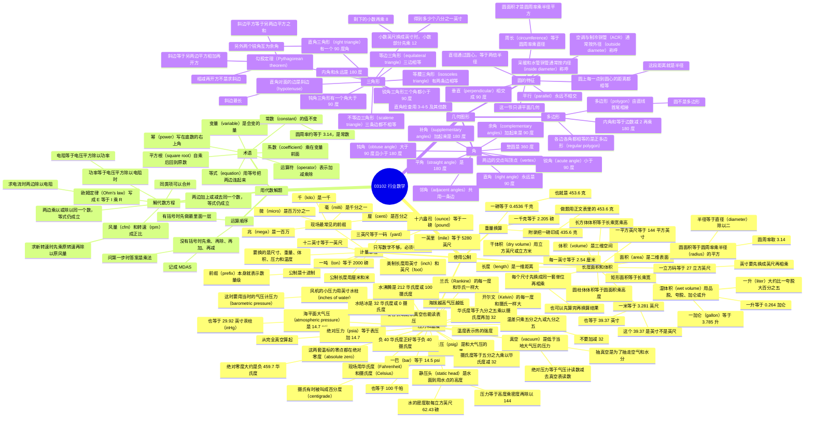

# 03102 行业数学（Trade Mathematics）

第六版 *HVACR, Level 1* 模块 03102。本模块没有实操任务，以计算为主。HVACR 里切管、配管、风管选型和安装、计算电流，都要用到这些换算和公式。

学完要能做到：

1. 在美制和公制之间换算长度、面积、体积、重量、压力和温度。
2. 解基本代数方程，并按运算顺序计算。
3. 识别圆、角、多边形和三角形，并用勾股定理求边长。

公制前缀、圆面积、温度换算这些是通用算法。下面的系数、例题数字和复习题选项按本模块整理，方便对着课本复习。

---

## 1.0.0 使用公制

全世界九成以上的地方用公制。不少美国在用的 HVACR 设备是别的国家造的，说明书里的尺寸、重量、温度、压力可能是公制。就算正文已经换成美制，安装螺栓往往仍是公制。厂家手册有时美制后面括号里给公制，有时只给公制。两种都要会换。

### 1.1.0 计量单位

测量就是拿一个量和一个标准单位比。只写数字不够，必须带单位，比如英尺、升、磅。同一个量可以用不同单位表示：长度可以是英寸、英尺、码、英里，也可以是毫米、厘米、米、千米。

HVACR 要换算的量主要是这五类：

| 量 | 美制 | 公制 |
| --- | --- | --- |
| 尺寸 | 英寸、英尺 | 厘米、米 |
| 重量 | 盎司、磅 | 克、千克 |
| 干体积 | 立方英寸、立方英尺 | 立方厘米、立方米 |
| 液体体积 | 夸脱、加仑 | 升 |
| 压力 | 磅每平方英寸（psi） | 帕斯卡（Pa）、巴（bar） |
| 温度 | 华氏度（°F） | 摄氏度（°C），口头有时叫 centigrade |

公制是十进制，前缀表示 10 的多少次方，加减不用分数。美制要记换算关系，例如 1 英里 = 5,280 英尺，1 英寸 = 1/12 英尺；公制里 1 厘米 = 1/100 米，1 千米 = 1,000 米。

**表 2　美制常用单位**

| 单位 | 等于 |
| --- | --- |
| 12 英寸（in） | 1 英尺（ft） |
| 1 码（yd） | 3 ft |
| 1 英里（mi） | 5,280 ft |
| 16 盎司（oz） | 1 磅（lb） |
| 1 吨（ton） | 2,000 lb |
| 1 分钟 | 60 秒 |
| 1 小时 | 3,600 秒 |
| 1 美制加仑（gal） | 0.1337 立方英尺 |

**表 3　公制前缀**

| 前缀 | 分数或整数 | 小数 | 指数 | 读法 |
| --- | --- | --- | --- | --- |
| 微 micro-（µ） | 1/1,000,000 | 0.000001 | 10⁻⁶ | 百万分之一 |
| 毫 milli-（m） | 1/1,000 | 0.001 | 10⁻³ | 千分之一 |
| 厘 centi-（c） | 1/100 | 0.01 | 10⁻² | 百分之一 |
| 分 deci-（d） | 1/10 | 0.1 | 10⁻¹ | 十分之一 |
| 十 deka-（da） | 10 | 10 | 10¹ | 十 |
| 百 hecto-（h） | 100 | 100 | 10² | 百 |
| 千 kilo-（k） | 1,000 | 1,000 | 10³ | 千 |
| 兆 mega-（M） | 1,000,000 | 1,000,000 | 10⁶ | 百万 |
| 吉 giga-（G） | 1,000,000,000 | 1,000,000,000 | 10⁹ | 十亿 |

现场最常见的是 mega-、kilo-、centi-、milli-、micro-。兆瓦、千米、厘米、毫伏、微安都是这些前缀。前缀本身就表示数量级，英尺和磅做不到这一点。

生活里已经常见的对照：冰在 0°C（32°F）结冰；黄金用克不用盎司；米尺对应码尺；两升汽水大约是半加仑。

### 1.2.0 长度、面积和体积

- **长度**：一维距离。
- **面积**：二维表面所占的大小，例如矩形、圆、正方形。
- **体积**：三维物体所占的空间。

面积和体积换算时，每一个有单位的尺寸都要先换成同一套单位，再相乘。也可以先用原来的单位算完，再把结果换成另一套单位。

#### 1.2.1 长度

长度通常指物体或表面较长的一边。液位也可以看成从液面到底部的长度。

**表 4　长度换算系数**

读法：左边这一行的 1 个单位，乘以格子里的数，得到上边那一列的单位。

| 1 个单位 | 厘米 | 英寸 | 英尺 | 米 | 千米 |
| --- | ---: | ---: | ---: | ---: | ---: |
| 1 毫米 | 0.1 | 0.03937 | 0.003281 | 0.001 | 0.000001 |
| 1 厘米 | 1 | 0.3937 | 0.03281 | 0.01 | 0.00001 |
| 1 英寸 | 2.54 | 1 | 0.08333 | 0.0254 | 0.0000254 |
| 1 英尺 | 30.48 | 12 | 1 | 0.3048 | 0.0003048 |
| 1 米 | 100 | 39.37 | 3.281 | 1 | 0.001 |
| 1 千米 | 100,000 | 39,370 | 3,281 | 1,000 | 1 |

米的定义后来改成光在 1/299,792,458 秒内走的距离，约等于 39.37 英寸。常用记法：**1 m = 3.281 ft = 39.37 in**。

**例：** 欧洲设备要求温控器装在地面以上 122 cm，卷尺是英寸。

- 1 cm = 0.3937 in
- 122 × 0.3937 = 48.0314 in，取整 **48 in**
- 换成英尺：122 × 0.03281 = 4.00282 ft，取整 **4 ft**

**思考：** 风机盘管高 1.22 m、宽 0.46 m，进门洞要留多少英尺？

- 高：1.22 × 3.281 = 4.00 ft
- 宽：0.46 × 3.281 = 1.51 ft
- 洞口大约 **4 ft 高 × 1.51 ft 宽**

#### 1.2.2 面积

矩形面积 = 长 × 宽。美制单位是平方英尺（ft²）或平方英寸（in²）。要知道风管截面积，才能判断它能送多少风。常见风管有方形、矩形、圆形；扁圆风管可以穿过窄处，但很少用。

正方形和矩形换算时，长和宽都要换，再相乘。

**正方形 4 ft × 4 ft**

- 美制：4 × 4 = 16 ft²
- 每边换成米：4 ÷ 3.281 = 1.219 m
- 公制：1.219 × 1.219 = **1.486 m²**
- 所以 16 ft² = 1.486 m²

**矩形 6 ft × 4 ft**

- 美制：6 × 4 = 24 ft²
- 6 ÷ 3.281 = 1.829 m，4 ÷ 3.281 = 1.219 m
- 公制：1.829 × 1.219 = **2.23 m²**

圆面积只需要换算半径：

\[
A = \pi r^2
\]

- \(\pi\) 取 3.1416，计算里通常用 **3.14**
- \(r\) 是半径，从圆心到边上的距离
- 半径 = 直径 ÷ 2

**例：** 半径 2 cm 的圆，换成平方英寸。

- 1 in = 2.54 cm，所以半径 = 2 ÷ 2.54 = 0.7874 in
- 公制：3.14 × 2 × 2 = 12.56 cm²
- 美制：3.14 × 0.7874 × 0.7874 = 3.14 × 0.62 = **1.95 in²**

#### 1.2.3 体积

长方体（房间、箱子）体积 = 长 × 宽 × 高。单位是立方英尺（ft³）或立方英寸（in³）。三个尺寸必须同一套单位。

什么时候要算体积：

- 算房间冷负荷、热负荷，以及换气次数。
- 半封闭压缩机要放 2.5 夸脱油，先确认容器够不够大；油放进没有刻度的容器时，反过来算放出了多少。
- 水暖系统按比例加乙二醇（防冻液）之前，先算管子和设备能装多少水。

**例：房间 6 ft × 5 ft × 4 ft**

- 美制：6 × 5 × 4 = 120 ft³
- 6 ÷ 3.281 = 1.829 m，5 ÷ 3.281 = 1.524 m，4 ÷ 3.281 = 1.219 m
- 公制：1.829 × 1.524 × 1.219 = **3.4 m³**

圆柱体（制冷剂钢瓶、圆罐）不能用长方体公式。把它看成圆面积乘以高度：

\[
V = \pi r^2 \times h
\]

**例：半径 20 cm，高 30 cm**

- 3.14 × 20 × 20 = 1,256 cm²
- 1,256 × 30 = **37,680 cm³**

换成立方英寸再算一遍：

- 20 cm = 7.874 in，30 cm = 11.811 in
- 3.14 × 7.874² = 3.14 × 62 = 194.68 in²
- 194.68 × 11.811 = **2,299.36 in³**
- 所以 37,680 cm³ = 2,299.36 in³

**思考：** 室外机混凝土底座 13 ft × 6 ft × 6 in，要订多少混凝土？

- 6 in = 0.5 ft
- 体积 = 13 × 6 × 0.5 = **39 ft³**
- 1 立方码 = 27 ft³，所以 39 ÷ 27 = **1.44 yd³**

#### 1.2.4 湿体积

用立方英尺或立方米表示容器容量，叫干体积。用品脱、夸脱、加仑或升表示液体能装多少，叫湿体积。液体会贴着容器的形状，所以用湿体积单位更方便。1 升大约比 1 夸脱大 5%。

公制前缀同样能加在升上：

- 1 千升 = 1,000 L
- 1 分升 = 0.1 L
- 1 厘升 = 0.01 L
- 1 毫升 = 0.001 L

**表 5　体积关系**

| 1 个单位 | 立方米 | 加仑 | 升 | 品脱 |
| --- | ---: | ---: | ---: | ---: |
| 1 立方米（m³） | 1 | 264.172 | 1,000 | 2,113.38 |
| 1 美制加仑（gal） | 0.0037 | 1 | 3.785 | 8 |
| 1 升（L） | 0.001 | 0.264 | 1 | 2.113 |
| 1 美制品脱（pt） | 0.0005 | 0.125 | 0.473 | 1 |

常用口诀：**1 gal = 3.785 L**，**1 L = 0.264 gal**。

### 1.3.0 重量换算

重量是物体因质量和地球引力作用在表面上的力。美制常用磅和盎司。HVACR 里要换算制冷剂充注重量，也要换算设备吊装重量。

**表 6　重量换算**

| 1 个单位 | 千克 | 磅 | 盎司 | 克 |
| --- | ---: | ---: | ---: | ---: |
| 1 千克（kg） | 1 | 2.205 | 35.27 | 1,000 |
| 1 磅（lb） | 0.4536 | 1 | 16 | 453.6 |
| 1 盎司（oz） | 0.0284 | 0.063 | 1 | 28.35 |
| 1 克（g） | 0.001 | 0.002 | 0.036 | 1 |

**例：** 屋顶机组标重 1,200 kg，吊具额定值是磅。

- 1 kg = 2.205 lb
- 1,200 × 2.205 = **2,646 lb**
- 吊带和起重设备的额定能力必须安全覆盖这个重量。

### 1.4.0 压力和温度

封闭系统里压力和温度互相影响，一边变，另一边按比例变。制冷循环就建立在这个关系上。判断系统是否正常，要在关键点测温度和压力。

轮胎上写 32 psi，意思是胎内空气比胎外大气压每平方英寸多出 32 磅的力。气体受压会压缩，压力降低会膨胀。液体一般看成不可压缩。制冷剂在系统不同位置分别以气态和液态存在。

钢瓶压力取决于制冷剂种类和周围温度。例如阳光下卡车后部的 R-410A，瓶温 105°F 时表压约 **339.9 psig**；32°F 时只有约 **101.6 psig**。

美制最常用的压力单位是磅每平方英寸（psi）。公制对应牛顿每平方米（N/m²），也叫帕斯卡（Pa）：1 帕 = 1 牛顿作用在 1 平方米上。把普通汽车轮胎充到约 28 psi，大约要 200,000 Pa，也就是 200 kPa。轮胎标签上通常同时标 kPa 和 psi。

HVACR 压力更高，公制更常用巴（bar）：

- **1 bar = 14.5 psi = 100 kPa**
- 1 毫巴 = 0.001 bar
- 天气里说的气压变化也用巴或毫巴

大气有质量。海平面标准大气压是 **14.7 psi**，也等于 **29.92 inHg**（英寸汞柱）。海拔越高，上方空气越少，气压越低。丹佛大约海拔 5,000 ft，气压约 **12.1 psi**。

- **大气压**：地表标准压力，14.7 psi 或 29.92 inHg。
- **气压计压力**：某地某时的实际大气压。天气会让它略有变化。

#### 1.4.1 绝对压力

标准大气压取海平面、空气 70°F 时为 14.696 psi，实用中取 **14.7 psi**，对应 **29.92 inHg**。

多数压力表测的是系统压力和大气压的差，叫表压（psig）。系统里的总压力叫绝对压力（psia）：

\[
\text{psia} = \text{psig} + 14.7
\]

绝对压力以完全真空（没有任何可测压力）为 0。

**例：** 蒸汽锅炉压力表读数 295 psig。

- psia = 295 + 14.7 = **309.7 psia**

锅炉压力有时用“大气压”作单位，1 个大气压 = 14.7 psi。

制冷剂压力表组是最常用的维修工具。左边是复合表，既能读低于大气压的 inHg，也能读高于大气压的 psig。右边高压表量程到 800 psig。把表上的 psig 换成 psia，仍然是读数加 14.7。

赛车轮胎里用氮气而不用压缩空气：压缩空气含水，轮胎变热后水分受热会使胎压明显上升；氮气更干，对温度没那么敏感。

#### 1.4.2 静压头

市政供水常用静压头表示压力，也就是用水点到高位水池水面的高度（英尺）。

\[
P = \frac{h \times d}{144}
\]

- \(P\)：压力，psig
- \(h\)：高度（压头），ft
- \(d\)：密度，水取 **62.43 lb/ft³**
- 144：把平方英尺换成平方英寸

**例：** 水面比用水点高 150 ft。

\[
P = \frac{150 \times 62.43}{144} = 65 \text{ psig}
\]

风机、风扇的压力很小，常用英寸水柱（inH₂O）。液压机械的压力可以忽略大气压的微小变化；风机和风扇的低压不能忽略，要测当时的实际大气压。

**表 7　压力换算**

| 把这个数 | 乘以 | 得到 |
| --- | ---: | --- |
| 大气压 | 14.7 | psi |
| psi | 0.0680 | 大气压 |
| psi | 0.069 | bar |
| bar | 14.5 | psi |
| psi | 27.68 | 英寸水柱（inH₂O） |
| psi | 2.31 | 英尺水柱 |
| psi | 2.04 | 英寸汞柱（inHg） |
| 英寸水柱 | 0.0361 | psi |
| 英尺水柱 | 0.433 | psi |
| 英寸汞柱 | 0.491 | psi |

**例 1：** 蒸汽发生器运行在 320 个大气压。

- psig = 320 × 14.7 = **4,704 psig**

**例 2：** 风机出口测得 56.55 inH₂O，当时气压 28.49 inHg。求出口绝对压力。

1. 表压：56.55 × 0.0361 = 2.041 psi
2. 实际大气压：28.49 × 0.491 = 13.989 psi
3. 绝对压力：2.041 + 13.989 = **16.03 psia**

#### 1.4.3 真空

在 HVACR 里，真空是低于当地大气压的任何压力，通常用英寸汞柱（inHg）表示。算真空下的绝对压力时，必须用当时的气压计读数：

\[
\text{真空绝对压力} = \text{气压计压力} - \text{真空表读数}
\]

**例：** 真空表 17.2 inHg，气压计 29.85 inHg。

- 绝对压力 = 29.85 − 17.2 = **12.65 inHg**

充制冷剂之前，必须用真空泵抽走系统里的空气和水分（不凝性气体）。泵在系统里造成更低的压力，空气和湿气就会被抽出去。压力降到当时环境温度对应的程度时，系统里的水分会沸腾成水蒸气，和水蒸气一起被排到大气中。真空程度用真空表测量。

#### 1.4.4 温度

温度表示热的强度，常用 °F 或 °C。温标用可以重复做出的状态来定点，这个物质是水：一个大气压下的冰点和沸点。

常用四套温标。HVACR 现场主要用华氏和摄氏。兰氏和开尔文主要用于科学计算，零点都在绝对零度。绝对零度是没有热量、分子不再活动的最低温度。

| | 华氏 °F | 摄氏 °C | 兰氏 °R | 开尔文 K |
| --- | ---: | ---: | ---: | ---: |
| 绝对零度 | −459.7 | −273 | 0 | 0 |
| 水结冰 | 32 | 0 | 491.7 | 273 |
| 水沸腾 | 212 | 100 | 671.7 | 373 |
| 冰点到沸点的间隔 | 180 | 100 | 180 | 100 |

- 兰氏的每一度和华氏一样大，所以兰氏也叫绝对华氏，属于英制。
- 开尔文的每一度和摄氏一样大，所以开尔文也叫绝对摄氏，属于公制。
- 摄氏冰点到沸点正好 100 度，所以有人把 °C 说成 centigrade。

数字温度计可以在 °C 和 °F 之间切换。探针式电子温度计很常见；红外温度计可以隔着一段距离瞄准测温。现场要按场合换不同类型的温度计。

**思考：** 冷藏系统把冷藏区维持在 −40°F 到 60°F，舒适空调维持 60°F 到 80°F。换成摄氏是多少？

- −40°F = **−40°C**
- 60°F = (60 − 32) × 5/9 = **15.6°C**
- 80°F = (80 − 32) × 5/9 = **26.7°C**
- 冷藏大约 **−40°C 到 15.6°C**，舒适空调大约 **15.6°C 到 26.7°C**

#### 1.4.5 温度换算

水从结冰到沸腾，华氏走过 180 度，摄氏走过 100 度，所以两者的度数之比是 180:100 = 9:5。

- 1°F 的间隔 = 5/9 个 1°C 的间隔
- 1°C 的间隔 = 9/5 个 1°F 的间隔

因为 32°F 对应 0°C，换算时要把这个起点差加减掉：

\[
°C = \frac{5}{9}(°F - 32)
\]

\[
°F = \left(\frac{9}{5} \times °C\right) + 32
\]

9/5 = 1.8，5/9 ≈ 0.556。温差（不是温度读数）换算时不要加减 32，只乘 5/9 或 9/5。

**例：77°F 换成 °C**

- 77 − 32 = 45
- 45 × 5/9 = **25°C**

**例：90°C 换成 °F**

- 90 × 9/5 = 162
- 162 + 32 = **194°F**

### 1.0.0 小节复习

1. 公制里液体体积用什么表示？
   - a. 立方英尺
   - b. in³
   - c. 升
   - d. 帕斯卡
2. 直径 3 m 的圆，面积是多少平方英尺？
   - a. 7.06 ft²
   - b. 9.42 ft²
   - c. 28.26 ft²
   - d. 76.1 ft²
3. 240 kg 的冷凝机组等于多少磅？
   - a. 240 lb
   - b. 109 lb
   - c. 768 lb
   - d. 529 lb
4. 10°C 时制冷剂压力是 9.88 bar。对应的美制温度和压力是多少？
   - a. 50°F，143.3 psi
   - b. 40°F，143.3 psi
   - c. 23°F，24.4 psi
   - d. 50°F，24.4 psi

**答案**

1. **c**。液体体积用升。
2. **d**。半径 = 1.5 m = 1.5 × 3.281 = 4.922 ft。面积 = 3.14 × 4.922² = 3.14 × 24.226 = 76.1 ft²。
3. **d**。240 × 2.205 = 529.2 lb。
4. **a**。°F = 1.8 × 10 + 32 = 50°F。9.88 × 14.5 = 143.3 psi。

---

## 2.0.0 用代数解题

代数用符号代替数字，再用加减乘除把符号连成等式。符号可以是常数，也可以是变量。培训和现场都要会：风量、电流、电压，以及很多故障排查，都是在解方程。

### 2.1.0 术语

#### 2.1.1 运算符

运算符用符号表示要做的运算：

- \(+\) 加
- \(-\) 减
- \(\times\) 或 \(\cdot\) 乘
- \(\div\) 或 \(/\) 除

#### 2.1.2 等式

等式是用等号连起来的数字、符号和运算符。例如：

- \(2 + 3 = 5\)
- \(P = EI\)
- 体积 \(= l \times w \times h\)

#### 2.1.3 变量

变量是等式里可以改变的量。矩形面积：

\[
\text{面积} = l \times w
\]

面积是 12、长是 6 时，\(12 = 6 \times w\)，宽是 2。长改成 3 时，\(12 = 3 \times w\)，宽变成 4。\(w\) 随 \(l\) 变，所以 \(w\) 是变量。

#### 2.1.4 常数

常数的值不变。\(2 + 5 = 7\) 里的 2、5、7 永远是这些数。也被公认、不随场合改变的数也是常数。圆里最常见的是 \(\pi\)，约 **3.14**，等于圆周长除以直径。

#### 2.1.5 系数

系数是乘在变量前面的数。

- \(2L\) 表示 2 × L，2 是 \(L\) 的系数
- \(IR\) 表示 I × R，I 是 \(R\) 的系数
- 面积 \(= l \times w\) 也可以写成 \(lw\)。关系清楚时，乘号可以不写

#### 2.1.6 幂和根

幂（指数）写在底数的右上角。\(y^x\) 表示把 \(y\) 自乘 \(x\) 次。\(y\) 的 \(x\) 次方根再乘 \(x\) 次，会回到 \(y\)。

平方就是一个数乘自己：

\[
6^2 = 6 \times 6 = 36
\]

平方根是那个自乘后得到原数的因子。符号是 \(\sqrt{\ }\)。求负荷、算风管风量都要用平方根。\(\sqrt{16} = 4\)，因为 \(4^2 = 16\)。

完全平方数的平方根是整数。4、25、36、121、324 的平方根分别是 2、5、6、11、18。

手算又慢又容易错，用科学计算器：

- 平方：输入数字，按 \(x^2\)。例如 4.235 的平方是 17.935225。
- 平方根：输入数字，按 \(\sqrt{}\) 或 \(\sqrt{x}\)。17.935225 的平方根回到 4.235。有的计算器要先按根号再输入数字。
- 任意次幂：先输入底数，按 \(y^x\)，再输入指数，按等号。\(2.86^3 = 23.393656\)。
- 任意次方根：例如 \(\sqrt[3]{1500}\)。输入 1500，按 INV（或 2nd）再按方根键，输入 3，按等号，得到约 11.447。用 \(11.447^3\) 可以验算回 1,500。有的计算器要先按方根键。

### 2.2.0 运算顺序

复杂算式必须按固定顺序做。本模块教的顺序是 **先乘、再除、再加、再减**，记成 MDAS。

\[
3 + 3 \times 2 - 6 \div 3
\]

1. 乘：\(3 + 6 - 6 \div 3\)
2. 除：\(3 + 6 - 2\)
3. 加：\(9 - 2\)
4. 减：结果是 **7**

不按这个顺序，会得到别的数。小节复习把“解方程时第一步”的答案定为乘法，指的就是这条 MDAS。

有括号或方括号时，先做最里面的括号，再逐层向外，括号表示的乘法优先于外面的 MDAS。

### 2.3.0 解代数方程

方程里有好几个变量时，先尽量化简，再把要求的那个量单独留在等号一边。

\[
P = R - [5(3A + 4B) + 40L]
\]

1. 先做最里面的括号，5 乘进去：\(P = R - [15A + 20B + 40L]\)
2. 括号前的减号相当于系数 −1，每一项都变号：\(P = R - 15A - 20B - 40L\)

这可以对应一件真实的活：刚给五套相同公寓装完风管，要算利润。

- \(P\)：利润
- \(R\)：收到的工程款
- 5 套公寓，每套 3 段单价为 \(A\) 的风管、4 段单价为 \(B\) 的风管
- 40 小时人工，每小时成本 \(L\)（含管理费）

代入：\(R = 7500\)，\(A = 100\)，\(B = 150\)，\(L = 55\)

\[
P = 7500 - (15 \times 100) - (20 \times 150) - (40 \times 55)
\]

\[
P = 7500 - 1500 - 3000 - 2200 = 800
\]

利润是 **800 美元**。

#### 2.3.1 代数规则

记住三条，现场遇到的多数方程都能化简。

**规则 1：等号两边加上或减去同一个数，等式仍然成立。**

- \(5 = 5\)，两边加 3，得到 \(8 = 8\)
- 两边减 4，得到 \(1 = 1\)

移项用的就是这一条。空调和蒸汽锅炉里常用：

\[
\text{绝对压力} = \text{表压} + 14.7
\]

求表压时，两边都减 14.7：

\[
\text{表压} = \text{绝对压力} - 14.7
\]

再求绝对压力时，两边都加 14.7，又回到原来的式子。

**规则 2：等号两边乘以或除以同一个数，等式仍然成立。**

欧姆定律：

\[
E = IR
\]

- \(E\)：电压
- \(I\)：电流
- \(R\)：电阻

已知电压和电流、要求电阻时，两边除以 \(I\)：

\[
R = \frac{E}{I}
\]

再两边乘以 \(I\)，回到 \(E = IR\)。

**规则 3：同类项可以像常数一样合并。**

\[
2A + 3A = 15
\]

\[
5A = 15
\]

两边除以 5：\(A = 3\)。

这三条可以反复用。静压头公式 \(p = hd / 144\) 求密度 \(d\)：

1. 两边乘 144，消掉分母：\(144p = hd\)
2. 两边除以 \(h\)：\(d = 144p / h\)

**风机定律里的一道：** 风量（cfm）和转速（rpm）成正比。

\[
\text{新 cfm} = \frac{\text{新 rpm} \times \text{原 cfm}}{\text{原 rpm}}
\]

已知新风量、原风量和原转速，求新转速时，两边先乘原转速，再除以原风量：

\[
\text{新 rpm} = \frac{\text{新 cfm} \times \text{原 rpm}}{\text{原 cfm}}
\]

### 2.0.0 小节复习

1. 方程里会变化的那个值叫什么？
   - a. 系数
   - b. 变量
   - c. 指数
   - d. 常数
2. 按本模块的运算顺序，解算式时第一步是什么？
   - a. 乘
   - b. 除
   - c. 加
   - d. 减
3. 已知 \(E = IR\)，把它改写成求 \(I\)。
   - a. \(I = E \times R\)
   - b. \(I = E - R\)
   - c. \(I = E \div R\)
   - d. \(I = E + R\)

**答案**

1. **b**。会变的是变量。
2. **a**。MDAS 从乘法开始。有括号时先做括号。
3. **c**。两边除以 \(R\)，\(R\) 消掉，得到 \(I = E \div R\)。

---

## 3.0.0 几何图形

几何研究图形，分平面几何和立体几何。平面几何研究正方形、矩形、三角形、圆、多边形这些二维图形。立体几何研究立方体、球等占有空间的三维物体。这一节只讲平面几何。钣金放样会大量用到它：变径管件的角度、圆弧弯头、绕开障碍物的管道偏置角。

图形由直线构成。

- **垂直**：两条直线相交成 90°。点到直线的距离，是从该点向直线作垂线的长度。
- **平行**：两条直线处处距离相等，永远不相交。

### 3.1.0 圆的特征

圆是一条与自身相连的曲线，还有这些性质：

- 圆周上每一点到圆心的距离都相等。
- 这段距离叫半径 \(r\)。
- 通过圆心、连接圆周上相对两点的最短距离叫直径 \(d\)。\(d = 2r\)。
- 绕圆外面一圈的长度叫周长：

\[
\text{周长} = \pi d
\]

\(\pi \approx 3.14\)，\(d = 2r\)。

管子尺寸有的标内径（ID），有的标外径（OD）。内径是管内壁之间的距离，采暖和水管用的铜管通常按内径称呼。外径是管外壁之间的距离，空调和制冷（ACR）铜管通常按外径称呼。软铜盘管常见规格从 1/8 in OD 到 7/8 in OD。

### 3.2.0 角

两条直线交于一点，这个点叫顶点，两条直线是角的边（射线）。角是两边张开的程度，用度来量。

标角有两种写法：

- 给角一个字母，例如 \(\angle D\)
- 用两条射线上的端点把顶点夹在中间，例如 \(\angle ABC\)

整圆分成 360 份，每一份是 1 度，所以 **1° = 1/360 圆**。度也用来量角的大小。度数尽量标在角的里面；角太小就标在外面，用箭头指进去。

| 角 | 定义 |
| --- | --- |
| 直角 | 两边互相垂直，永远是 90° |
| 平角 | 两边落在一条直线上，180° |
| 锐角 | 小于 90° |
| 钝角 | 大于 90°、小于 180° |
| 邻角 | 三条或更多射线交于同一顶点，挨在一起的角。公共的那条射线同时属于两个角 |
| 余角 | 两个邻角加起来是 90° |
| 补角 | 两个邻角加起来是 180° |

### 3.3.0 多边形

三条或更多直线按规则图形首尾相接，就成了多边形。各边等长、各内角相等的，叫正多边形。

常见图形：

- 四边形：矩形、正方形、梯形、菱形、平行四边形
- 三角形：等边、不等边、直角
- 正多边形：五边形、六边形、八边形

每一条边界叫边，两边交点叫顶点。

- **周长** = 各边长度之和
- **内角和** = \((n - 2) \times 180°\)，\(n\) 是边数

正方形：\((4 - 2) \times 180° = 360°\)。三角形：\((3 - 2) \times 180° = 180°\)。

### 3.4.0 三角形

三角形是三边多边形。内角和永远是 **180°**。已知两个角，第三个角用 180° 去减。

按边分：

- **等边三角形**：三边相等，三个角也相等。它是三边的正多边形。
- **等腰三角形**：有两条边相等，这两条边所对的角也相等。
- **不等边三角形（scalene）**：三条边都不相等。

按角分：

- **直角三角形**：有一个内角是 90°。
- **钝角三角形**：有一个内角大于 90°。
- **锐角三角形**：三个内角都小于 90°。

#### 3.4.1 直角三角形

直角三角形有一个 90° 角，另外两个角都是锐角，而且互为余角，加起来是 90°。形成直角的两条边互相垂直。

习惯标法：角用大写字母，边用小写字母。直角标成 \(C\)，直角对面那条边是斜边 \(c\)，它永远比另外两条边长。\(a\) 可以记成高（altitude），\(b\) 记成底（base）。边和它所对的角用同一字母：边 \(a\) 对着角 \(A\)。

#### 3.4.2 勾股定理

直角三角形已知任意两边，可以求出第三边。勾股定理：斜边的平方等于另外两边的平方和。

\[
c^2 = a^2 + b^2
\]

\[
a = \sqrt{c^2 - b^2} \qquad b = \sqrt{c^2 - a^2} \qquad c = \sqrt{a^2 + b^2}
\]

注意最后一式是平方**相加**再开方。\(\sqrt{a^2 - b^2}\) 不是求斜边的公式。

**例：** 高 \(a = 8\) ft，底 \(b = 12\) ft。

\[
c = \sqrt{8^2 + 12^2} = \sqrt{64 + 144} = \sqrt{208} = 14.422
\]

斜边长 **14.422 ft**。先把两边分别平方再相加，然后开平方。计算器上输入数字后按根号；如果根号是 \(x^2\) 的第二功能，就先按 INV 或 2nd，再按 \(x^2\)。

**3-4-5 法则**用来用卷尺放样或检查直角，用了几百年。3 ft、4 ft、5 ft 是一组直角三角形的边。现场按距离放大成倍数：9-12-15、12-16-20、15-20-25。

用 15-20-25 检查一个角：沿一边量 15 ft 做记号，沿另一边量 20 ft 做记号。两个记号之间必须正好是 25 ft，这个角才是直角。

**思考：** 计算器显示斜边是 6.354 ft。换成英尺和英寸是多少？算法见下一节，结果是 **6 ft 4¼ in**。

#### 3.4.3 小数英尺和英尺-英寸互化

三角函数算出来的长度常常是小数英尺。施工图多用英尺加英寸。没有换算表时，用下面的步骤。

**小数英尺换成英尺和英寸。** 以 45.3646 ft 为例。

1. 去掉整英尺：45.3646 − 45 = 0.3646 ft
2. 乘 12 变成英寸：0.3646 × 12 = 4.3752 in
3. 去掉整英寸：4.3752 − 4 = 0.3752 in
4. 乘 8 变成以 1/8 英寸为单位：0.3752 × 8 = 3.0016，四舍五入为 3，即 3/8 in

所以 **45.3646 ft = 45 ft 4⅜ in**。

**英尺和英寸换回小数英尺。** 把 45 ft 4⅜ in 换回去。

1. 分数变小数：3 ÷ 8 = 0.375 in
2. 加上整英寸：4 + 0.375 = 4.375 in
3. 除以 12：4.375 ÷ 12 = 0.3646 ft
4. 加回整英尺：45 + 0.3646 = **45.3646 ft**

6.354 ft 的换算：0.354 × 12 = 4.248 in；小数部分 0.248 × 16 ≈ 4，即 4/16 = 1/4 in。所以是 **6 ft 4¼ in**。

### 3.0.0 小节复习

1. 圆的周长公式是哪一个？
   - a. \(\pi r^2\)
   - b. \(2\pi\)
   - c. \(\pi d\)
   - d. \(I \times R\)
2. 大于 90°、小于 180° 的角是什么角？
   - a. 直角
   - b. 锐角
   - c. 补角
   - d. 钝角
3. 下面哪一个不是多边形？
   - a. 三角形
   - b. 圆
   - c. 矩形
   - d. 梯形
4. 直角三角形斜边 15 in、高 12 in，底边多长？
   - a. 9 in
   - b. 19.2 in
   - c. 81 in
   - d. 9 ft

**答案**

1. **c**。周长 = \(\pi d\)。\(\pi r^2\) 是面积。
2. **d**。钝角。
3. **b**。圆不是由直线围成的，不是多边形。
4. **a**。\(b = \sqrt{15^2 - 12^2} = \sqrt{225 - 144} = \sqrt{81} = 9\) in。这是 3-4-5 的放大，9-12-15。

---

## 模块复习题

奇数题的答案在课本附录 A。偶数题下面按本模块的表和公式演算。

1. 1 米等于多少？
   - a. 0.3937 ft
   - b. 39.37 ft
   - c. 3.281 ft
   - d. 3,281 ft
2. 房间长 3.568 m、宽 2.438 m，面积是多少平方英尺？
   - a. 20 ft²
   - b. 71.36 ft²
   - c. 93.64 ft²
   - d. 384 ft²
3. 风管内尺寸 16 in × 12 in，面积是多少平方英尺？
   - a. 1.33 ft²
   - b. 1.92 ft²
   - c. 13.3 ft²
   - d. 28 ft²
4. \(\pi\) 保留两位小数是多少？
   - a. 1.00
   - b. 3.14
   - c. 3.33
   - d. 3.45
5. 55 加仑的桶能装多少升？
   - a. 55 L
   - b. 110 L
   - c. 175 L
   - d. 208 L
6. 锅炉包装箱标重 175 lb，合多少千克？
   - a. 68.5 kg
   - b. 79.38 kg
   - c. 96.33 kg
   - d. 125 kg
7. 表压 164 psig，绝对压力是多少？
   - a. 14.7 psia
   - b. 149.3 psia
   - c. 164 psia
   - d. 178.7 psia
8. 0°C 等于多少？
   - a. −17.8°F
   - b. 32°F
   - c. 100°F
   - d. 144°F
9. 68°F 等于多少？
   - a. 20°C
   - b. 36°C
   - c. 41°C
   - d. 100°C
10. \(\sqrt{12500}\) 等于多少？
    - a. 1.11803
    - b. 11.1803
    - c. 111.803
    - d. 1118.03
11. \(6^2\) 等于多少？
    - a. 4
    - b. 8
    - c. 12
    - d. 36
12. 已知 \(P = E^2 / R\)，求 \(R\) 的式子是哪一个？
    - a. \(R = E^2 / P\)
    - b. \(R = E^2 \times P\)
    - c. \(R = P / E^2\)
    - d. \(R = \sqrt{PE}\)
13. 从圆心到圆周上任意一点的距离叫什么？
    - a. 周长
    - b. 半径
    - c. 直径
    - d. 弦
14. 三条边都不相等的三角形叫什么？
    - a. 等边三角形
    - b. 等腰三角形
    - c. 直角三角形
    - d. 不等边三角形
15. 下面哪一个不是勾股定理的形式？
    - a. \(c^2 = a^2 + b^2\)
    - b. \(a = \sqrt{c^2 - b^2}\)
    - c. \(b = \sqrt{c^2 - a^2}\)
    - d. \(c = \sqrt{a^2 - b^2}\)

**答案与演算**

| 题 | 答案 | 演算 |
| --- | --- | --- |
| 1 | c | 表 4：1 m = 3.281 ft。39.37 是英寸，不是英尺。 |
| 2 | c | 3.568 × 3.281 ≈ 11.707 ft，2.438 × 3.281 ≈ 8.000 ft，相乘 ≈ 93.64 ft²。 |
| 3 | a | 16 × 12 = 192 in²。1 ft² = 144 in²，192 ÷ 144 = 1.33 ft²。 |
| 4 | b | \(\pi\) 取 3.14。 |
| 5 | d | 表 5：1 gal = 3.785 L。55 × 3.785 = 208 L。 |
| 6 | b | 表 6：1 lb = 0.4536 kg。175 × 0.4536 = 79.38 kg。 |
| 7 | d | 164 + 14.7 = 178.7 psia。 |
| 8 | b | 水的冰点，0°C = 32°F。 |
| 9 | a | (68 − 32) × 5/9 = 20°C。 |
| 10 | c | 111.803² = 12,500。 |
| 11 | d | 6 × 6 = 36。 |
| 12 | a | 两边乘 \(R\) 再除以 \(P\)，得到 \(R = E^2 / P\)。 |
| 13 | b | 这段距离是半径。 |
| 14 | d | 三边不等是 scalene，不等边三角形。 |
| 15 | d | 斜边是 \(\sqrt{a^2 + b^2}\)。选项 d 把加号写成了减号。 |

---

## 附录 03102A　换算系数

本模块正文里的表 4、表 5、表 6 已经够做题。附录是同一套换算的另一份清单。

### 美制换成公制

**重量**

| 美制 | 公制 |
| --- | --- |
| 1 盎司 | 28.35 克 |
| 1 磅 | 附录印的是 435.6 克，同时又写 0.454 千克。表 6 是 **453.6 克** 或 **0.4536 千克**。复习和做题用表 6。 |
| 1 短吨 | 907.2 千克 |

**长度**

| 美制 | 公制 |
| --- | --- |
| 1 英寸 | 2.54 厘米 |
| 1 英尺 | 30.48 厘米 |
| 1 码 | 91.44 厘米，或 0.9144 米 |
| 1 英里 | 1.609 千米 |

**面积**

| 美制 | 公制 |
| --- | --- |
| 1 平方英寸 | 6.452 平方厘米 |
| 1 平方英尺 | 929 平方厘米，或 0.0929 平方米 |
| 1 平方码 | 0.836 平方米 |

**体积**

| 美制 | 公制 |
| --- | --- |
| 1 立方英寸 | 16.39 立方厘米 |
| 1 立方英尺 | 0.02832 立方米 |
| 1 立方码 | 0.765 立方米 |

**液体**

| 美制 | 公制 |
| --- | --- |
| 1 液量盎司 | 0.095 升（附录原文） |
| 1 品脱 | 473.2 立方厘米 |
| 1 夸脱 | 0.926 升 |
| 1 加仑 | 3,785 立方厘米，或 3.785 升 |

**温度：** \(°C = \dfrac{5}{9}(°F - 32)\)

### 公制换成美制

**重量**

| 公制 | 美制 |
| --- | --- |
| 1 克 | 0.0353 盎司 |
| 1 千克 | 2.205 磅 |
| 1 公吨 | 2,205 磅 |

**长度**

| 公制 | 美制 |
| --- | --- |
| 1 毫米 | 0.039 英寸 |
| 1 厘米 | 0.394 英寸 |
| 1 米 | 3.281 英尺，或 1.094 码 |
| 1 千米 | 0.621 英里 |

**面积**

| 公制 | 美制 |
| --- | --- |
| 1 平方毫米 | 0.0016 平方英寸 |
| 1 平方厘米 | 0.155 平方英寸 |
| 1 平方米 | 10.76 平方英尺，或 1.196 平方码 |

**体积**

| 公制 | 美制 |
| --- | --- |
| 1 立方厘米 | 0.061 立方英寸 |
| 1 立方米 | 35.31 立方英尺，或 1.308 立方码 |
| 1 升 | 1.057 夸脱，2.113 品脱，或 61.02 立方英寸 |

**温度：** \(°F = \left(\dfrac{9}{5} \times °C\right) + 32\)

---

## 复习时先记这几条

- 1 in = 2.54 cm，1 m = 3.281 ft = 39.37 in，1 kg = 2.205 lb，1 lb = 0.4536 kg
- 1 gal = 3.785 L，1 bar = 14.5 psi，1 个大气压 = 14.7 psi = 29.92 inHg
- psia = psig + 14.7
- \(°C = \frac{5}{9}(°F - 32)\)，\(°F = \frac{9}{5}°C + 32\)。温差只乘 5/9 或 9/5，不加 32
- 矩形面积 = 长 × 宽，圆面积 = \(\pi r^2\)，周长 = \(\pi d\)，圆柱体积 = \(\pi r^2 h\)
- 运算顺序：有括号先做括号，否则先乘、再除、再加、再减
- 移项时，加减就两边一起加减，乘除就两边一起乘除
- 三角形内角和 180°。直角三角形 \(c = \sqrt{a^2 + b^2}\)。3-4-5 及其倍数用来检查直角
- 小数英尺换成英寸：小数部分 × 12；余下的小数再 × 8，得到多少个 1/8 英寸

---

## 脑图

按章节展开。每一节只留这一节的核心。关键字第一次出现时写成中文（English）。

