# 03107 制冷入门（Introduction to Cooling）

> **Cooling Audio:** [Chinese](https://notebooklm.link.google/icBjXmMZQhGN) · [English](https://notebooklm.link.google/TJg2rihjNWoi)

第六版 *HVACR, Level 1* 模块 03107。要修制冷系统和热泵（heat pump），必须先看懂制冷循环（refrigeration cycle），以及主要部件各自做什么。制冷剂和用途差别很多，这里的基本原理适用于所有直接膨胀（direct-expansion, DX）制冷剂回路。

自然界里没有完全没有热的东西。说一件东西“冷”，只是说它的热能比别的东西少。封闭系统里热能不能创造，也不能消灭，但可以从一处转到另一处。空调和冰箱做的就是这件事：把热从不想要它的地方搬走。多数时候热被排到室外。家用冰箱和小型商用手取式冷柜（reach-in）把热排到房间里，这些热还得靠建筑的制冷系统再送到室外。

制冷剂（refrigerant）在回路里循环，在一处吸热，再把热带走。水用来传热时，也可以算一种制冷剂。

学完要能做到：

1. 解释制冷循环的基本概念。
2. 识别常见制冷剂及其识别特征。
3. 识别制冷系统的主要部件及其功能。
4. 识别制冷系统中常用的控制装置及其工作方式。

在指导下要能完成的实操（Performance Tasks）：

1. 测量并记录正在运行的制冷系统里，送风（supply air）和回风（return air）的干球温度（dry bulb）和湿球温度（wet bulb）。
2. 接上制冷剂压力表组（gauge manifold），并正确计算过冷度（subcooling）和过热度（superheat）。
3. 按钢瓶颜色识别制冷剂。
4. 认出压缩机、冷凝器、蒸发器、节流装置和附件。

重点单词第一次出现时写成「中文（English）」。后面复习和做题时，英文术语要能认出来。

NCCER Registry 里本模块编号是 03107。

---

## 1.0.0 制冷循环基础（Refrigeration Cycle Fundamentals）

### 1.1.0 热与物质状态（Heat and the States of Substances）

热是能量的一种，和光、电一样。热能做功，也能被测量和控制。热做功的能力取决于两件事：温度（temperature，强度）和热含量（heat content，数量）。

#### 1.1.1 温度（Temperature）

温度用来比较热的强度，用温度计（thermometer）以“度”来量。美国常用华氏温标（Fahrenheit）。世界其他地方、美国也经常遇到的是摄氏温标（Celsius），也叫 centigrade。绝对零度大约是 −459°F 或 −273°C。

温差和温度读数换算不一样。课本举例：制冷第一级和第二级之间通常差 3°F。这是温差（differential temperature），不是“气温是 3°F”。

- 华氏温差换成摄氏温差：乘以 5/9，也就是 **0.55**
- 摄氏温差换成华氏温差：乘以 9/5，也就是 **1.8**

不要先减 32。减 32 是把一个温度读数从 °F 换成 °C，不是换温差。3°F 的级差大约是 3 × 0.55 = 1.65°C。

#### 1.1.2 热含量（Heat Content）

美国 HVACR 里，热量用英热单位（British thermal unit, Btu）表示。

**Btu**：把 1 磅（lb）水的温度升高 1°F 所需要的热量。

所以 1 lb 水从 40°F 升到 50°F，要加 10 Btu。10 lb 水升高 10°F，要 100 Btu。反过来冷却也一样：1 lb 水降温 10°F，就是从水里移走了 10 Btu。公制里热量用焦耳（joule）。

#### 1.1.3 显热和潜热（Sensible and Latent Heat）

物质按热含量和温度可以是三种状态：固体（solid）、液体（liquid）、蒸气（vapor）。水的三种状态是冰、水和蒸汽。封闭制冷剂回路里，制冷剂主要是液体或气体，后面最关心这两种。

拿 1 lb、已经冷到 0°F（−18°C）的冰来看。继续加热，温度计会升到 32°F（0°C）。到了 32°F，冰开始化成水。加热还在继续，温度计却停在 32°F，直到这一磅冰全部化完。

**显热（sensible heat）**：加进或移走热量时，物质不改变状态。温度计能读出来，手也能感觉到。从 0°F 升到 32°F 就是显热。

**潜热（latent heat）**：物质正在改变状态时吸收或放出的热。变状态期间，温度计读数不变。全部热量都用在变状态上。

**焓（enthalpy）**：显热加潜热，也就是物质的总热含量。

冰全部化完以后再加热，温度会一直升到 212°F（100°C，海平面）。水开始沸腾，变成蒸汽。在全部变成蒸汽之前，温度停在 212°F。这段又是潜热。全部变成蒸汽之后，温度才会再升，那又是显热。

变状态需要的热，比只改变温度多得多。

| 过程（1 lb 水，海平面） | 热量 |
| --- | --- |
| 冰从 0°F 升到 32°F（显热） | 16 Btu |
| 32°F 的冰变成 32°F 的水（熔化潜热） | **144 Btu** |
| 水从 32°F 升到 212°F（显热） | 180 Btu |
| 212°F 的水变成 212°F 的蒸汽（汽化潜热） | **970 Btu** |

144 Btu 是把同样 1 lb 水升高 1°F 所需热量的 144 倍。970 Btu 更大。HVACR 就是利用“变状态要吸走或放出大量热”这一点。

图 5 把这几个名字分开。水是例子，制冷剂用同一套词。

**熔化潜热（latent heat of fusion）**：变成固体或离开固体时吸收或放出的热。冰变水，或水变冰。

**汽化潜热（latent heat of vaporization）**：液体变成蒸气时吸收的热。这个过程开始的温度是沸点（boiling point）。制冷里，沸点也叫饱和温度（saturation temperature）。

**饱和温度（saturation temperature）**：在给定压力下，液体变成蒸气的温度，也就是沸点。饱和状态下，同一空间里常常液体和蒸气都有，钢瓶里的制冷剂就是这样。

**冷凝潜热（latent heat of condensation）**：蒸气变回液体时放出的热。蒸汽冷凝成水。

**过热（superheat）**：液体已经全部变成蒸气之后，蒸气再升高的那部分显热温度。水在 212°F 沸腾，最后一滴水变成蒸汽之后，温度才会超过 212°F。升到 217°F，就有 5°F（2.8°C）过热。只有相变完成，蒸气温度才能继续升高。

**过冷（subcooling）**：蒸气已经全部冷凝成液体之后，液体再降低的那部分显热温度。蒸汽冷到 212°F 开始冷凝；冷凝完成后温度才会下降。降到 207°F，就是过冷了 5°F（2.8°C）。冰也可以过冷：冷到冰点以下 5°F，也就是 27°F（−2.8°C），这块冰过冷了 5°F。

过热存在的地方没有液体制冷剂。过冷存在的地方没有制冷剂蒸气。这两个数几乎每次维修、保养都要看。

#### 1.1.4 比热容（Specific Heat Capacity）

**比热（specific heat）**：把 1 lb 某种物质的温度升高 1°F 所需要的热量，单位 Btu/lb/°F。水是基准，比热是 1.00。

**表 1　常见物质的比热**

| 物质 | Btu/lb/°F |
| --- | --- |
| 水（water） | 1.00 |
| 冰（ice） | 0.50 |
| 干空气（air, dry） | 0.24 |
| 蒸汽（steam） | 0.48 |
| 铝（aluminum） | 0.22 |
| 黄铜（brass） | 0.09 |
| 铅（lead） | 0.03 |
| 铁（iron） | 0.10 |
| 汞（mercury） | 0.03 |
| 铜（copper） | 0.09 |
| 酒精（alcohol） | 0.60 |
| 煤油（kerosene） | 0.50 |
| 橄榄油（olive oil） | 0.47 |
| 松木（pine） | 0.67 |

同一种物质，状态不同，比热也不同。冰的比热是 0.50，所以让 1 lb 冰升高 1°F 所需的热，只有水的一半。给 1 lb 冰加 1 Btu，温度升高 2°F。冰从 0°F 到 32°F 只需要 16 Btu，就是因为比热是 0.50：32 × 0.50 = 16。

#### 1.1.5 传热（Heat Transfer）

传热是热从一处移到另一处。热总是从较暖的地方流向较冷的地方，像水往低处流。三种方式是导热（conduction）、对流（convection）和辐射（radiation），细节在模块 03108 Introduction to Heating。

容易传热的材料叫导体（conductor）。阻碍传热的叫绝缘体（insulator），例如软木、玻璃纤维、聚氨酯泡沫。多数金属导热好。铜和铝既是热的良导体，也常常是电的良导体，所以制冷回路里常用它们。

传热快慢常用 Btu/h（Btuh）表示。制冷里更大的单位是冷吨（ton of refrigeration）。

**1 冷吨 = 12,000 Btuh。**

它来自：24 小时内融化 1 吨冰所需要的热。

- 融化 1 lb 冰需要 144 Btu
- 1 吨冰 = 2,000 lb
- 2,000 × 144 = 288,000 Btu
- 288,000 ÷ 24 小时 = **12,000 Btuh = 1 ton**

冷吨用来描述空间的冷负荷或热负荷，也用来表示设备的名义容量（nominal capacity）。

### 1.2.0 压力与温度的关系（Pressure/Temperature Relationships）

#### 1.2.1 压力（Pressure）

压力是单位面积上的力。物质状态决定压力朝哪个方向作用：

- 固体（冰）：只向下压
- 液体：压容器的侧面和底面
- 气体：均匀压向容器的所有表面

美国用磅每平方英寸（pounds per square inch, psi）。公制正式单位是帕斯卡（pascal），太小，HVACR 常用千帕（kilopascal, kPa）。1 kPa = 1,000 Pa。**1 psi 大约等于 6.9 kPa。**

低于大气压的压力（真空，vacuum）常用英寸汞柱（inches of mercury, inHg）。换算可以用应用和网站，本模块附录 03107A 也有一张换算表。附录里和 kPa 交叉的几格印得不对，以本节“1 psi ≈ 6.9 kPa”为准，见文末附录说明。

#### 1.2.2 绝对压力和表压（Absolute and Gauge Pressure）

大气有重量，对地表施加大气压（atmospheric pressure）。气压计（barometer）量的就是它，所以也叫气压（barometric pressure）。水银管气压计上端封死，下端开口浸在水银盘里。气压把盘里的水银压进管子，气压越高，水银柱越高。

海平面、70°F（21°C）时，1 平方英寸空气柱的标准值是：

- **29.92 inHg**（76 cm）
- **14.7 psi**（6.67 kg）

这两套数经常一起用。气压升高通常表示天气较好；气压下降通常表示阴天或下雨。强飓风里气压极低。

海拔升高，气压下降，液体沸点也下降。丹佛大约海拔 1 英里（约 1,600 m），气压大约是海平面的 83%，水大约在 203°F（95°C）沸腾。

两套以 psi 为单位的刻度：

**绝对压力（absolute pressure）**：从完全没有压力算起，单位 psia（pounds per square inch absolute）。0 psia 是完美真空。标准大气压写成 **14.7 psia**。

**表压（gauge pressure）**：把大气压当作零点。表读数是 0 时，14.7 psi 的大气压已经被扣掉了。正表压单位是 psig。低于 0 psig 的负压用真空英寸汞柱（inHg vacuum）。低于大气压的封闭空间就说它处于真空。深度真空一般指已经到、或接近 0 psia。

换算：

**psia = psig + 14.7**

例如 10 psig + 14.7 = **24.7 psia**。0 psig 对应 14.7 psia。

完美真空实际上做不到。太空里每立方米也还有一些氢原子，而且完美真空只可能在绝对零度（0 K）存在。现场要做的是：加制冷剂之前，用真空泵抽走回路里的空气和水分。

#### 1.2.3 压力和温度的关系

液体或气体变状态的温度取决于压力。压力下降，沸点下降；压力上升，沸点上升。

水在标准大气压（14.7 psia、0 psig，或 101 kPa）下，沸点是 212°F（100°C）。海拔 5,000 ft 处压力大约只有 11.6 psia，水大约在 203°F（95°C）沸腾。高压锅把压力加到大约 29.7 psia（15 psig 再加上 14.7 psia），水大约在 250°F（121°C）沸腾。

图 10 里水的沸点和压力大致是：

| 压力 | 沸点 |
| --- | --- |
| 15.129 psig | 250°F |
| 0.0 psig | 212°F |
| 14.7 inHg 真空 | 180°F |
| 28.89 inHg 真空 | 80°F |
| 29.74 inHg 真空 | 30°F |

制冷循环就是在利用这一点：改变压力，就能改变制冷剂变状态的温度。每一种制冷剂都有自己的压力/温度关系。压力/温度图（pressure/temperature chart, P/T chart）给出某个温度下的饱和压力。表上压力是 psig；斜体数字是低于大气压的英寸汞柱（真空），不是 psig。

课本表 2 的标题写成 “HFC-134a and HCFC-22”，表头第二列和后面的循环例题却是 **HFC-410A**。40°F 对应 118 psig，这是 410A，不是 R-22。下面按表头抄。带 \* 的是真空，单位 inHg。

**表 2　HFC-134a 与 HFC-410A 的饱和压力（P/T）**

| °F | °C | HFC-134a | HFC-410A (psig) |
| --- | --- | --- | --- |
| −40 | −40.0 | 14.8\* | 11.6 |
| −35 | −37.2 | 12.5\* | 14.9 |
| −30 | −34.4 | 9.8\* | 18.5 |
| −25 | −31.7 | 6.9\* | 22.5 |
| −20 | −28.9 | 3.7\* | 26.9 |
| −15 | −26.1 | 0.1\* | 31.7 |
| −10 | −23.3 | 1.9 | 36.8 |
| −5 | −20.6 | 4.1 | 42.5 |
| 0 | −17.8 | 6.5 | 48.6 |
| 5 | −15.0 | 9.1 | 55.2 |
| 10 | −12.2 | 11.9 | 62.3 |
| 15 | −9.4 | 15.0 | 70.0 |
| 20 | −6.7 | 18.4 | 78.3 |
| 25 | −3.9 | 22.1 | 87.3 |
| 30 | −1.1 | 26.1 | 96.8 |
| 35 | 1.7 | 30.4 | 107.1 |
| 40 | 4.4 | 35.0 | 118.0 |
| 45 | 7.2 | 40.1 | 129.7 |
| 50 | 10.0 | 45.4 | 142.2 |
| 55 | 12.8 | 51.2 | 155.5 |
| 60 | 15.6 | 57.4 | 169.6 |
| 65 | 18.3 | 64.0 | 184.6 |
| 70 | 21.1 | 71.1 | 200.6 |
| 75 | 23.9 | 78.7 | 217.4 |
| 80 | 26.7 | 86.7 | 235.3 |
| 85 | 29.4 | 95.2 | 254.1 |
| 90 | 32.2 | 104.3 | 274.1 |
| 95 | 35.0 | 114.0 | 295.1 |
| 100 | 37.8 | 124.2 | 317.2 |
| 105 | 40.6 | 135.0 | 340.5 |
| 110 | 43.3 | 146.4 | 365.0 |
| 115 | 46.1 | 158.4 | 390.7 |
| 120 | 48.9 | 171.2 | 417.7 |
| 125 | 51.7 | 184.6 | 445.9 |
| 130 | 54.4 | 198.7 | 475.6 |
| 135 | 57.2 | 213.6 | 506.5 |
| 140 | 60.0 | 229.2 | 539.0 |
| 145 | 62.8 | 245.7 | 572.8 |
| 150 | 65.6 | 262.9 | 608.1 |

每种制冷剂在每个温度上只有一个饱和压力。这个压力和温度的组合就是饱和点：封闭空间里液体和蒸气以某种比例共存。再加热，一部分液体汽化，直到新的压力/温度平衡。再吸热（把热移走），一部分蒸气冷凝成液体。

同一点接上压力表和温度计，再去对 P/T 图。课本用 HFC-410A、118 psig、饱和温度 40°F（4.4°C）做例子：

- 温度也是 40°F：和表一致。这里液体和蒸气都在，状态稳定，没有明显的变状态温差。
- 温度是 50°F（10°C）：全是蒸气，没有液体，过热了 10°F（5.6°C）。有过热，就没有液体制冷剂。
- 温度是 30°F（−1.1°C）：全是液体，没有蒸气，过冷了 10°F（5.5°C）。有过冷，就没有制冷剂蒸气。

混合制冷剂的饱和温度是一个范围，算法不完全一样，见 2.1.2。

### 1.3.0 制冷循环（The Refrigeration Cycle）

舒适、食品保存、工业工艺用的系统外形差很多，共同的是机械制冷系统。四个基本部件：

**压缩机（compressor）**：建立压差，制冷剂才会流动，循环才转得起来。

**冷凝器（condenser）**：换热器。把制冷剂里的热传给室外空气。

**节流装置，或膨胀装置（metering device / expansion device）**：造成压力下降，降低进入蒸发器之前的沸点。

**蒸发器（evaporator）**：换热器。把房间里的热传给里面流动的制冷剂。

三条主要制冷剂管：

**热气管，也叫排气管（hot gas line / discharge line）**：把热的制冷剂蒸气从压缩机送到冷凝器。全系统压力和温度最高的地方。这里应该只有蒸气。

**液体管（liquid line）**：把液体制冷剂从冷凝器送到节流装置。

**吸气管（suction line）**：把制冷剂蒸气从蒸发器送回压缩机。全系统压力最低的地方。按设计，这里应该只有制冷剂蒸气。

制冷剂的定义：在低温低压下蒸发来吸热，再在较高温度和压力下冷凝来放热的物质。系统运行时，回路里的过程是连续的。变的是制冷剂种类、部件大小和样式、部件和管路的位置。需要时再加附件。

#### 1.3.1 基本部件怎样工作

循环靠两条已经讲过的原理：

- 液体变成蒸气时吸收大量热；蒸气变回液体时放出大量热。
- 改变压力，就能改变液体的沸点。

从压缩机看起。它吸入低温低压蒸气并压缩，造成压差。制冷剂和空气一样，从压力高的地方流向压力低的地方，所以制冷剂被吸向压缩机入口。

压缩后，制冷剂以高温高压蒸气离开压缩机。它比室外空气热得多，180°F（82°C）左右很常见，经排气管进冷凝器。压缩过程本身还会给蒸气加热，这叫压缩热（heat of compression）。如果电机泡在蒸气流里，电机的热也加进去。这些热是蒸发器里吸收的热之外多出来的。

冷凝器是一组盘管。比管内制冷剂蒸气更凉的空气吹过盘管，蒸气把热传给空气，冷到当前压力下的冷凝温度，然后开始变成液体。变状态是潜热过程，温度在变完之前不变。全部变成液体之后，再继续冷却就是过冷，温度会低于当前压力的饱和温度。高温高压的过冷液体经液体管去节流装置。

节流装置调节流向蒸发器的制冷剂，同时造成很大的压力损失。可以想成手指堵住花园水管：一个小孔，也叫孔口（orifice），把液体制冷剂的压力降下来。压力一降，制冷剂变成又凉又冷的饱和状态，准备在蒸发器里吸热汽化。离开节流装置时，大部分是液体，也有一些蒸气。

蒸发器接到低温低压的液体制冷剂。它也是一组盘管，让较暖的空气吹过冷的液体。热穿过管壁传给制冷剂，制冷剂汽化。在蒸发器的大部分路程里，制冷剂一直在沸腾，温度保持稳定。离开蒸发器时应该全部是蒸气，并且有一点能测到的过热，用来证明已经没有液体。然后它作为低温低压蒸气进入吸气管，回到压缩机。

液体不能被压缩。大量液体流进压缩机，很容易损坏或毁掉压缩机。

#### 1.3.2 典型空调系统的制冷循环

系统按压力分成两侧。高压侧（high-pressure side）包括压力达到或高于冷凝压力的所有部件。系统里较高的压力，从压缩机排气开始，叫压头压力（head pressure）、排气压力（discharge pressure）或高压侧压力（high-side pressure），这三个词可以互换。

较低的压力叫吸气压力（suction pressure）或低压侧压力（low-side pressure），从节流装置出口开始。高低压的分界线切过压缩机和节流装置，因为主要的压力变化发生在这两处。

舒适制冷（comfort cooling）的温度范围大约是 60°F（约 15°C）到 80°F（约 27°C）。下面这套系统用 HFC-410A。410A 在 118 psig（814 kPa）时饱和温度是 40°F（4.4°C）。舒适制冷蒸发器的目标温度通常就是 40°F。

假设室内 75°F（24°C），室外 95°F（35°C）。实际每小时都在变。管路摩擦会造成一些压力损失，下面为了看清楚，不算这些损失。图 12 上的点：

| 点 | 在哪里 | 状态 | 温度 | 压力 | 怎么读 |
| --- | --- | --- | --- | --- | --- |
| 1 | 压缩机排气 | 高温高压过热蒸气 | 180°F（82°C） | 475 psig | 475 psig 的饱和温度是 130°F。过热约 180 − 130 = **50°F**。这些过热必须先被去掉，蒸气才能冷凝 |
| 2 | 冷凝器前段，开始冷凝 | 饱和 | 130°F（54°C） | 475 psig | 比室外空气热得多，热很快传给空气。降到 130°F 后开始冷凝，变完之前一直停在 130°F |
| 3 | 冷凝器后段 | 过冷液体 | 115°F（46°C） | 475 psig | 全部变成液体后开始过冷。过冷 = 130 − 115 = **15°F** |
| 4 | 液体管，节流装置入口 | 过冷液体 | 110°F（43°C） | 475 psig | 液体管再降了约 5°F。这段额外过冷取决于管子经过的环境，环境很热时温度也可能上升 |
| 5 | 刚过节流装置 | 约 80% 液体、20% 闪发气体 | 40°F（4°C） | 118 psig | 见下面 |
| 6 | 蒸发器大约 90% 处 | 蒸气，已无液体 | 45°F（7°C） | 118 psig | 过热 = 45 − 40 = **5°F**。如果还有液体，温度会停在 40°F |
| 7 | 蒸发器出口，进入吸气管 | 过热蒸气 | 50°F（10°C） | 118 psig | 过热 **10°F**。房间送风大约 55°F（13°C），空气降了 20°F（11°C），这是舒适制冷常见目标 |
| 8 | 压缩机入口 | 过热蒸气 | 比点 7 再高 5°F | 118 psig | 吸气管沿途还能再吸收环境的热。吸了多少，取决于管子怎么走 |

点 5 最难。液体以 110°F、475 psig 进入很小的孔口，出口压力立刻掉到 118 psig。新的低压下，制冷剂必须马上冷到 P/T 图上的 40°F，也就是瞬间降大约 70°F（39°C）。它靠自己冷却自己：一部分液体立刻闪发成蒸气（flash）。变状态需要大量热，这些热全部来自剩下的液体，直到新的饱和状态（40°F、118 psig）建立起来。

这部分蒸气叫闪发气体（flash gas）。它对蒸发器里的制冷几乎没用，因为蒸气吸不了多少热，但这是循环必须付出的损失。大致比例是 80% 液体、20% 蒸气。混合物以 40°F、118 psig 进入蒸发器，从吹过的空气吸热，一直沸腾到液体消失。沸腾期间温度保持 40°F。蒸气体积变大，液体体积变小。

吸气管要保温，有几个原因。从环境吸来的热，系统还得在别处排掉，等于抢走制冷量。运行中的吸气管通常远低于露点，不保温就会“出汗”（sweating，结露）。管子很短时吸热机会少，但仍然会出汗。整体式机组（packaged unit）里，吸气管可能只有 2 ft（0.6 m）。

**想一想：怎样减少闪发损失？** 闪发气体在蒸发器里帮不上忙。减少它的办法是：让进入节流装置的液体更冷，也就是过冷更多。液体越冷，为了降到新饱和温度而必须闪发掉的液体就越少，蒸发器里能用来吸热的液体就越多。后面的液体—吸气换热器就是在做这件事。冷凝器盘管脏了，液体根本没有过冷，甚至没有完全冷凝，损失会更大。

这是一套典型设计工况。实际运行时，总有一个或几个条件在变。

现场算这两个数：

- **过热度 = 测到的蒸气温度 − 该压力下的饱和温度**
- **过冷度 = 该压力下的饱和温度 − 测到的液体温度**

上面点 1：180 − 130 = 50°F 过热。点 3：130 − 115 = 15°F 过冷。点 7：50 − 40 = 10°F 过热。

### 1.4.0 压力和温度的测量

判断要靠读数，工具必须准。

#### 1.4.1 温度计（Thermometers）

电子温度计现在是主流，很多万用表也带测温。探头一般是热电偶（thermocouple）或热敏电阻（thermistor），有的两种都有。

**热电偶**：两种不同金属丝在端部接在一起，接点温度不同，就产生可换算的电压。结实，通常比热敏电阻便宜。

**热敏电阻**：半导体，电阻随温度变化，用来做温度传感器。

同一只电子温度计可以换不同探头。细长探头用来测空气或插入液体。带弹簧夹的探头夹在管子上，测制冷剂管温度。管温必须准，探头和管子要贴实。

不少电子温度计能同时接两支或更多探头，直接显示温差。它们是精密仪器，按厂家说明使用和保养，有时需要校准。任何温度计都是量程中部更准，靠近最低和最高端时较差。

**棒式温度计（stick thermometer）**，也叫口袋温度计。结实、小、便宜。表盘刻度小，不容易读准。也有数字棒式温度计。

**红外温度计（infrared thermometer）**，也叫非接触温度计（non-contact thermometer）。靠检测表面发出的红外能量，用激光帮助瞄准，适合够不到的地方，例如头顶的管子。高反光表面会影响读数。有的仪器有针对反光表面的可调设置。在表面上贴哑光漆或胶带也能解决。

要懂距离与光斑比（distance-to-spot ratio, D:S）。它是“到表面的距离”和“测温圆斑直径”的比。D:S 为 12:1 时，距离 12 in（约 30 cm），圆斑直径约 1 in（约 25 mm）；距离 12 ft（约 3.7 m），圆斑直径变成 1 ft（约 0.3 m）。距离越远，被平均的圆斑越大。被测表面必须至少和圆斑一样大，否则背景也会被平均进去。仪器的 D:S 从 1:1 到 60:1 都有。比值越高，远距离越好用，也越贵。

例：D:S 为 10:1，对准 12 ft 外的表面，圆斑直径是 12 ÷ 10 = **1.2 ft**。

检查温度计：简单表盘温度计常常有一只六角螺母，用来转表盘校准。

- 高温：把水烧开。探头至少浸入 2 in（约 5 cm），不要碰到或太靠近锅底。沸腾时应该读 **212°F（100°C）**。不对就拿出来，用六角螺母调到正确读数，再测一次。开水和炉子会烫伤，戴好个人防护装备（PPE）。附近不能有易燃物。
- 低温：碎冰加刚好没过冰面的凉水，冰不要漂得离底太远。探头同样至少浸入 2 in，尖端离开底部。稳定后应该是冰点。调完再测。

能测到水的冰点和沸点的温度计都可以这样检查。不是每一只都能在现场校准，有的要送回厂家。看说明书。

#### 1.4.2 压力表组和测压仪表

压力表组用来充注或抽出制冷剂，也用来测运行压力。

标准双阀表组：歧管上两只压力表、阀门和软管。左边是复合表（compound gauge），量低压侧，也就是吸气压力，既能量高于大气压，也能量低于大气压。现在多数复合表在大气压以上是 0 到 250 psig，常带一段到 500 psig 的缓冲量程（retard range）。缓冲段只是多一层安全余量，**这段没有精度**。真空侧从 0 inHg 到 30 inHg。

标准复合表不能准确量真空深度。准确读真空要用微米表（micron gauge）。表组只能告诉你“有真空”。微米表在模块 03205 Leak Detection, Evacuation, Recovery, and Charging。

右边高压表量高压侧，也就是排气压力。现在多数高压表量程是 0 到 800 psig。低压表、高压表和软管都要覆盖 HFC-410A 这类较新制冷剂。软管也必须按 **800 psig** 额定。旧表组、旧表、旧软管按老制冷剂的较低压力做的，不能用于 HFC-410A。额定压力不够的工具可能突然爆开。

颜色：

| 颜色 | 接哪里 |
| --- | --- |
| 蓝色 | 低压复合表，蓝色软管接系统低压侧 |
| 红色 | 高压表，红色软管接系统高压侧 |
| 黄色 | 中间公用口（utility port），接到制冷剂钢瓶等维修设备。不用时最好盖上或堵上 |

软管除了颜色，本身一样。也有四只手阀、四个口的表组，不用把一根黄色软管在不同来源之间来回换。

电子表组可以读压力，并显示当前制冷剂对应的饱和温度。

读运行压力时，手阀保持关闭。软管必须有快速自封接头，断开时把制冷剂留在软管里，满足清洁空气法（Clean Air Act），尽量不排放。

接上之后，软管承受几百磅制冷剂压力。断开时软管如果甩开，会伤人；液体制冷剂喷出会造成灼伤。戴好 PPE，连接和断开时把软管控制住。

表组是精密工具。不加压、对大气敞开时，指针应该在 **0 psig**，并且从正面看，针尖对正 0 的刻度中心。

模拟表校准：

1. 确认软管里没有压力，对大气敞开，没有残留制冷剂。
2. 取下保护套，拧下表面玻璃。
3. 表面上通常有一只小校准螺丝，用小平口螺丝刀转到针尖对正 0 psig。
4. 从背面轻敲一下，确认指针没有被张力拉离这个位置。
5. 装回玻璃，不要拧太紧。

数字表常常也能现场校准。有的开机后快速按两次 On 就行。以厂家说明为准。

另一种测压仪表是压力计（manometer），电子的和充液的都常见。它量很低的压力，通常是英寸水柱（inches of water column）一类单位，用来测供暖系统的燃气压力，也用来测风管压力。

### 1.0.0 小节复习

1. 把华氏温差（°F）换成摄氏温差（°C），应该 _____。
   - a. 除以 1.8，再减 32°C
   - b. 乘以 1.8
   - c. 乘以 0.55
   - d. 除以 0.55
2. 受压制冷剂的饱和温度是 45°F，实测温度是 55°F，这说明 _____。
   - a. 制冷剂很可能进了水
   - b. 制冷剂很可能和另一种制冷剂混在一起
   - c. 没有蒸气，只剩液体
   - d. 没有液体，只剩蒸气
3. 压缩之后，制冷剂离开压缩机时是 _____。
   - a. 低温高压蒸气
   - b. 高温高压蒸气
   - c. 低温高压液体
   - d. 高温低压液体
4. D:S 为 10:1 的红外温度计对准 12 ft 外的表面，测到的圆斑是 _____。
   - a. 直径 1.6 ft
   - b. 直径 1.2 ft
   - c. 直径 1 ft
   - d. 直径 0.83 ft

**答案**

1. **c**。温差换算是 °F × 0.55 = °C。选项 a 是把温度读数从 °F 换成 °C 的做法，温差不能减 32。乘以 1.8 是把 °C 温差换成 °F。
2. **d**。55 − 45 = 10°F 过热。有过热就没有液体，全部是蒸气。温度低于饱和温度才说明只剩液体。
3. **b**。压缩机把低温低压蒸气压成高温高压蒸气。
4. **b**。圆斑直径 = 距离 ÷ D:S = 12 ÷ 10 = 1.2 ft。

---

## 2.0.0 制冷剂（Refrigerants）

制冷剂用来传热。更细的特性和用途在模块 03301 Refrigerants and Oils。这一节只讲氟碳制冷剂和氨。

故意把制冷剂排到大气中是违法的，依据是美国环保局（EPA）清洁空气法 Section 608 和 609。明知故犯地排放，处罚可以很重。即使是事故，大量泄漏也必须报告。这些物质和全球变暖、破坏臭氧层都有关。较新的制冷剂对环境好一些，但同样要小心管理，现在在用的大多数制冷剂都不能排到大气中。

### 2.1.0 氟碳制冷剂（Fluorocarbon Refrigerants）

现在常用的人造制冷剂，多数是氟碳化合物，或几种氟碳制冷剂的混合物。例如 HCFC-123（R-123）、HCFC-22（R-22）、HFC-410A（R-410A）、HFC-134a（R-134a）。它们来自两种基础分子：甲烷（methane）和乙烷（ethane）。

**化合物（compound）**：两种或更多元素按确定的重量比例结合，只存在一种分子。

甲烷和乙烷只含氢和碳，叫碳氢化合物（hydrocarbon）。分子里大部分或全部氢原子被氯、氟或溴替换后，新分子叫卤碳化合物（halocarbon），也就是卤代烃。氯、氟、溴、砹、碘是卤素（halogen）。碳氢化合物里所有氢都被氯或氟替换，就叫完全卤化。

至少有一个或多个氢被氟替换的卤碳化合物，叫氟碳化合物（fluorocarbon）。氟碳制冷剂按化学结构分成三类：氯氟烃（chlorofluorocarbon, CFC）、氢氯氟烃（hydrochlorofluorocarbon, HCFC）、氢氟烃（hydrofluorocarbon, HFC）。氟碳化合物必须含氟。卤碳化合物可以含氟和其他卤素，也可以完全不含氟。所以：**氟碳化合物一定有氟，不是所有卤碳化合物都有氟。**

#### 2.1.1 CFC、HCFC 和 HFC

过去每种制冷剂有商品名或 R 编号，例如 R-22、R-12、R-502，由美国供暖、制冷与空调工程师学会（ASHRAE）指定，用来代替化学名。R-22 的化学名是氯二氟甲烷（chlorodifluoromethane）。

现在 ASHRAE 在数字前面加 CFC、HCFC、HFC，一眼能看出化学家族。原来的数字保留。现场新旧名字都用。

**表 3　制冷剂新旧名称**

| 旧名 | 新名 |
| --- | --- |
| R-22 | HCFC-22 |
| R-123 | HCFC-123 |
| R-134a | HFC-134a |
| R-407C | HFC-407C |
| R-410A | HFC-410A |

**CFC**：含氯、氟和碳（甲烷这一支）。曾经很常用。CFC-12 用于汽车和冰箱，CFC-11 是离心式冷水机组用的低压制冷剂。因为含氯，已经停产，现在很少遇到。

**HCFC**：还含氢，结构里的氯比 CFC 少得多。HCFC-22 仍在不少舒适制冷系统里。新生产的 HCFC-22 限制了很多年。自 2020 年起，美国不再生产新的 HCFC-22。回收和再生的 HCFC-22 仍可使用。

**HFC**：不含氯。今天大量在用的是 HFC，例如 HFC-410A 和 HFC-134a。不含氯，不破坏臭氧层。自 2021 车型年起，美国汽车空调（MVAC）不能再以 HFC-134a 为基础，因为它的全球变暖潜能值（global warming potential, GWP）太高。

编号和原子有关。HCFC-22 的结构里有氢（H）、氯（Cl）、氟（F）、碳（C），所以是 HCFC。数字和分子里各种原子的个数有关。混合制冷剂的编号方法不同。

有证据表明，地球周围的臭氧层（ozone layer）被一些化学物质破坏，最突出的是氯。臭氧层滤掉太阳里有害的辐射。CFC 和 HCFC 里的氯参与了这个问题。1990 年清洁空气法通过以后，含氯制冷剂受到越来越严的管制。EPA 负责制定和执行这些法律。

CFC 含氯最多，对臭氧层影响最大，多年前已经禁止生产。HCFC 也在淘汰，步骤没有那么猛，因为含氯较少。现在常用的多数是完全不含氯的 HFC，一般认为对臭氧层无害。但 HFC 会加剧温室效应（greenhouse effect），排到大气中会加快全球变暖，所以排放同样违法。因为这个原因，HFC 也在被确认安全可用的新制冷剂替换。

#### 2.1.2 混合制冷剂（Refrigerant Blends）

很多新制冷剂是两种或更多制冷剂混出来的。可以是同类 HCFC 或 HFC 相混，也可以两类相混。HCFC 正在被淘汰，含有 HCFC 的混合物在美国会被禁止，如果还没被禁止的话。混合物里只要有 HCFC，名字就必须以 HCFC 开头。

纯化合物只有一种分子，行为很可预测。HCFC-22 就是纯化合物。很多混合物不是新的纯化合物：各组分的分子还在，各自保留原来的性质。这种混合物就叫混合制冷剂（mixture）。

混合物的行为大体可预测，但和纯制冷剂有差别。系统泄漏时，可能某一种组分漏得比另一种多。漏点位置和系统是否在运行，都会影响这一点。过热和过冷的算法也必须不同。

假设混合物里有沸点不同的 R-1 和 R-2，各自有自己的 P/T 图。在回路里，R-1 可能已经在沸腾汽化，R-2 还没吸到足够的热。所以混合物的饱和温度是一个温度范围，不是一个点。化学家尽量选性质差得不大的组分，但小差别很常见。不要以为所有制冷剂都严格按本节前面讲的纯制冷剂方式变化。

### 2.2.0 氨（Ammonia）

无水氨（anhydrous ammonia, R-717）传热很好，主要用于大型中温和低温场合：制冰厂、食品储存、大型食品加工厂。anhydrous 的意思是不含水分。氨极易溶于水。必须从系统里排出时，常常排进水里，以减轻局部气味。

它和前面那些制冷剂不是同一家族，ASHRAE 编号里没有 CFC、HCFC、HFC。美国从 19 世纪末就开始用氨制冷，1870 年代就有氨制冷机械专利，最早用于制冰厂。我们吃的东西和很多饮料，到达手里之前，至少经过一处使用氨的设施。

氨蒸气不算被归类为毒物，但对呼吸系统刺激很强，只有很少的量可以安全吸入。

| 浓度 | 意义 |
| --- | --- |
| 3–5 ppm | 就能闻到。气味本身会报警 |
| 15 ppm | 气味变得非常刺激 |
| **50 ppm** | OSHA 允许的 5 分钟最大接触浓度 |
| 5,000 ppm | 对生命有危险 |
| 150,000–270,000 ppm | 可燃 |

ASHRAE 标准 34 把氨（NH₃）列为 B2L 组，因为有毒性和可燃性方面的顾虑。刺鼻气味通常会让人在危险吸入浓度形成之前离开，也促使漏点被尽快修好。某些浓度下氨对空气中的人有毒。安全资料见 ASHRAE、美国国家职业安全卫生研究所（NIOSH）和国际氨制冷学会（IIAR）。

干氨的人必须受过专门训练，并有合适的设备。对环境来说，氨被认为相当安全。和卤代制冷剂比，氨有四个优点：

- 传热效率大约高 3% 到 10%。循环量可以更少，运行费用可以明显更低。
- 流量更小，管径可以更小。
- 比人造制冷剂便宜得多。
- 不破坏臭氧，也不加剧温室效应。

缺点：

- 浓度很高时有毒。但远低于危险浓度就能闻到，蒸气比空气轻，上升得快，人通常有时间反应。
- 氨和铜不相容。系统里凡是氨碰到的部件都不能含铜。配管一般全是钢。蒸发器、冷凝器一类换热部件通常用钢或铝管。表组、压力表和软管接头也必须是钢的。

氨在食品加工行业还会用很久。小型系统大多不划算，大型系统是很好的选择。

### 2.3.0 制冷剂容器与搬运

制冷剂装在一次性、可退回或可再灌装的金属容器里，形状和大小不同。低压制冷剂如 HCFC-123 用普通钢桶或钢瓶，沸点接近或略高于室温，对容器的压力比 HCFC-22、HFC-134a、HFC-410A 这类中压、高压制冷剂小得多。容器如果处理不当，可能爆开或泄漏，造成损坏、伤害，严重时致死。

任何带压容器都可能爆开或漏。低沸点制冷剂的容器爆开时，液体制冷剂会向各个方向喷出，迅速吸热并从液体闪发成蒸气。液体沾到身上很可能冻伤。搬运时至少戴手套和安全眼镜。

多数常用制冷剂无毒，但密闭空间里足够多的蒸气会排走氧气，使人难以呼吸或无法呼吸。要知道工作房间里有多少制冷剂，并想好突然大量泄漏时怎么办。使用任何化学品前看安全数据表（Safety Data Sheet, SDS）。

#### 2.3.1 一次性钢瓶（Disposable Cylinders）

一次性钢瓶不是用来重复灌装的。钢制，应存放在干燥处以免生锈，运输要小心。时间久了，粗暴搬运或过热可能使它爆炸，生锈或腐蚀后更危险。方便时留在原包装箱里。

很多年里常见的是 30 lb 或 50 lb 包装。不少新制冷剂用 24 lb、25 lb 或 27 lb 钢瓶。

空了以后当废钢回收。先把瓶内压力降到 **0 psig**，再刺破爆破片（rupture disk），让钢瓶不能再用。爆破片是一种泄压装置：材料厚度定死，压力超限时破裂，用一个可控的薄弱点保护容器其余部分。

**一次性钢瓶绝不能再灌。** 这既危险又违法。违规者最高可罚 25,000 美元，并可能面临最高 5 年监禁。

#### 2.3.2 可退回钢瓶（Returnable Cylinders）

可退回钢瓶送回厂家检修和再灌，也可用来回收大量制冷剂。**绝不能灌到容积的 80% 以上。** 灌太满时，内容物受热膨胀，可能爆炸。液体没有膨胀空间时，温度稍微一变，压力就升得很快。这里说的“满”，是物理容积的 80%。剩下 20% 必须留给膨胀。

瓶上打着几种重量。图 23 的例子：毛重（gross）179.5 lb，皮重（tare）54.5 lb，净重（net）125.0 lb，另有带盖重量。

- **皮重（tare weight）**：空瓶重量
- **毛重（gross weight）**：空瓶加上“满”的时候制冷剂的重量
- **净重（net weight）**：里面制冷剂的重量。向供应商订 50 lb 制冷剂，订的是净重

厂家把容器设计成：净重达到满值时，仍有 20% 容积给液体膨胀。

上次试验日期打在可退回钢瓶的肩部或颈圈上。可退回、可重复使用的钢瓶通常每 **5 年** 必须再试验一次。

#### 2.3.3 回收钢瓶（Recovery Cylinders）

回收常用 50 lb 容量的钢瓶。很结实，可以多次使用。皮重大约 28 lb，比一次性钢瓶重得多。所有用来回收和存放用过的制冷剂的钢瓶，瓶身漆成灰色，肩部漆成黄色。

可退回钢瓶不能拿来代替回收钢瓶。没有回收钢瓶的正确标记，就不能用于回收。同样不能超过容积的 80%。

美国运输部（DOT）规定储存和回收用钢瓶的构造和标签。回收 HFC-410A 的钢瓶必须专门制造并标明用于这种制冷剂，因为压力更高。

#### 2.3.4 识别制冷剂

容器有颜色和标签。标签上也有安全和健康信息。

**表 4　常见制冷剂钢瓶颜色**

| 制冷剂 | 颜色 |
| --- | --- |
| HCFC-22 | 浅绿（light green） |
| HCFC-124 | 深绿（dark green） |
| HCFC-409A | 中褐（medium brown） |
| HFC-410A | 玫瑰红（rose） |
| HFC-422B | 深蓝（dark blue） |
| HCFC-123 | 浅蓝灰（light blue-gray） |
| HCFC-408A | 中紫（medium purple） |
| HFC-404A | 橙色（orange） |
| HFC-407C | 棕色（brown） |
| HFC-134a | 浅蓝（light blue） |

系统里的制冷剂种类不明时，通常这样查：

- 查厂家维修资料
- 看设备铭牌。如果做过制冷剂转换，机组上应该有清楚的标签
- 看节流装置上的数据

#### 2.3.5 制冷剂安全注意事项

必须戴丁基内衬手套和安全眼镜，避免制冷剂沾到皮肤或眼睛。排到大气压时，制冷剂会造成冻伤或灼伤皮肤。

制冷剂会造成窒息。常见制冷剂无毒，但高浓度会排走氧气。始终保持足够通风。制冷剂蒸气看不见，几乎没有气味，而且比空气重。低洼处更容易积聚，要特别小心。

设备间和其他存有大量制冷剂的地方，必须有检测低氧并报警的系统。大量制冷剂附近要备有自给式呼吸器。必须进入被污染区域时使用呼吸器。有的设备间有机械通风，能很快把污染空气排出。

另外遵守这些规则：

- 始终再核对一次，确认用的是正确的制冷剂。容器有颜色和标签，标签上有产品、安全和警告信息。
- 看技术公告和 SDS。上面有可燃性、毒性、反应性，以及可能造成的健康问题。
- 不要摔、不要砸凹、不要虐待容器。不要乱动安全装置，除非目的是报废一只已经空了的一次性钢瓶。
- 有些制冷剂碰到明火会生成有毒气体。不要让制冷剂蒸气和钎焊火焰一类明火处在同一空间。
- 需要工具才能开关的阀门，用正确的阀门扳手，不要用活扳手。
- 不用时装回阀帽和护罩，保护瓶阀。
- 运输时把容器固定住，用带子或链条直立固定。
- 不要存放在温度会让压力超过钢瓶泄压阀设定值的地方。

### 2.0.0 小节复习

1. 卤碳制冷剂和氟碳制冷剂的差别是 _____。
   - a. 氟碳化合物一定含氟，但不是所有卤碳化合物都含氟
   - b. 氟碳制冷剂含氟，而卤碳制冷剂仍然有碳
   - c. 卤碳制冷剂从不含氯，氟碳制冷剂含氯
   - d. 卤碳制冷剂毒性很高
2. OSHA 规定氨蒸气 5 分钟最大接触浓度是多少 ppm？
   - a. 25 ppm
   - b. 50 ppm
   - c. 75 ppm
   - d. 100 ppm
3. HFC-410A 的一次性容器漆成 _____。
   - a. 深褐
   - b. 浅绿
   - c. 深绿
   - d. 玫瑰红

**答案**

1. **a**。氟碳化合物必须含氟。卤碳化合物可以含氟，也可以完全不含氟。
2. **b**。5 分钟最大接触浓度是 50 ppm。3–5 ppm 就能闻到，5,000 ppm 对生命有危险。
3. **d**。表 4：HFC-410A 是玫瑰红（rose）。浅绿是 HCFC-22。

---

## 3.0.0 制冷系统部件（Cooling System Components）

机械制冷系统运行所必需的主要部件：压缩机、冷凝器、蒸发器、节流装置和配管。

### 3.1.0 压缩机（Compressors）

压缩机是回路的心脏。它建立压差，制冷剂才从高压流向低压，就像热从高温流向低温。液体和气体都可以靠改变周围压力来推动。液体不能被压缩，大量液体进压缩机很容易损坏或毁掉它。

#### 3.1.1 压缩机的结构形式

压缩机通常由电动机驱动。很大的压缩机可以由内燃机或汽轮机驱动，但很少见。按和电机怎样连在一起，分成三类：

**开启式（open）**：压缩机和电机在形体上分开。传动轴伸出壳体，轴上有机械密封防止制冷剂泄漏。需要时可以在现场拆开维修。电机可以直接连在轴上，这是直接驱动（direct-drive），压缩机转速和电机完全一样。也可以皮带驱动，电机放在旁边而不是后面。皮带传动让电机和压缩机转速不同，转速由皮带轮尺寸组合决定。

**全封闭（hermetic）**：压缩机和电机一起封在焊接钢壳里，共用一根轴。体积紧凑、噪声较小，密封起来所以不用保养。坏了必须整台更换，不论毛病出在哪里。废压缩机报废，或退回厂家做评估或保修冲账。容量有限，10 冷吨及以下很常见，更大的有，但少。

**半封闭（semi-hermetic）**：压缩机和电机共用一个壳体，但不是一根轴，两根轴在内部机械连接。介于开启式和全封闭之间。拆下缸盖可以在现场检修阀门。电机坏了，整台压缩机更换。曲轴、活塞、连杆一类故障也是更换，现场没有车间设备很难修这些件。它们坏了很少直接报废，而是送到专门车间拆开再制造（remanufactured）或翻修（rebuilt）后重新出售。再制造一般被认为更值，因为所有零件都回到出厂规格。

#### 3.1.2 往复式压缩机（Reciprocating Compressors）

仍然很常见，不过很多场合已经被涡旋式取代。一个或多个活塞在气缸里来回运动，像汽车发动机的活塞那样压缩制冷剂蒸气。吸气阀和排气阀与活塞动作同步，控制蒸气的吸入和排出。开启式、半封闭、全封闭都有。半封闭往复式用于商用空调。开启式往复式主要用于工业制冷。全封闭往复式的电机常常在上面，活塞横置。

往复式不会做成离心式。离心式是另一种压缩机。

#### 3.1.3 旋转式压缩机（Rotary Compressors）

通常是全封闭。常用于家电、房间空调，以及 5 冷吨以下的中央空调。基本形式有两种：固定滑片（stationary vane）和旋转滑片（rotary vane）。HVACR 用的是旋转滑片式。

转子装在传动轴中心，但传动轴在气缸里是偏心的。转子上有两片或更多滑片，滑进滑出，贴着气缸形状走。转子转动时，滑片把制冷剂蒸气困住，压向气缸壁，再从排气口挤出。滑片也把高压区和低压区分开。

#### 3.1.4 涡旋式压缩机（Scroll Compressors）

全封闭。在所有类型里运动零件最少。出现以后用量增长很快，现在市场上多数住宅和轻型商用制冷系统用它。主要原因是耐用和效率。

没有吸气阀和排气阀。排气口附近有一只止回阀（check valve），帮助防止反转。压缩靠两个螺旋形零件，叫涡旋盘（scroll）。一个固定，一个被驱动，在固定盘里做轨道运动（orbiting）。两片之间有轻微接触。

制冷剂气体从涡旋外缘的吸气口进入。轨道运动把气体引进两片螺旋之间的气穴。继续转动时，进气口被短暂封住，气体被挤进更小的气穴。压缩后的蒸气从固定盘中心的排气口排出。

启动和停机时，涡旋压缩机常常发出不寻常的声音。第一次听见可能以为坏了。训练时有机会要仔细听，现场才认得出。

#### 3.1.5 螺杆式压缩机（Screw Compressors）

用于 20 到 750 冷吨的大型商业和工业场合。开启式和全封闭都有，最常见于冷水机组（chiller）。

一对匹配的螺杆形转子，一阳一阴，装在气缸里。电机驱动阳转子，阳转子再带动阴转子。阳转子凸角更少，所以通常转得比阴转子快。典型是阳转子 4 个凸角，阴转子 6 个。

转子转动时把中间的气体压缩。螺杆凸角形成好几个压缩腔的边界，这些腔同时沿压缩机往前走。气体经过一系列越来越小的气穴，直到从排气口离开。这一点和涡旋式相似。

#### 3.1.6 离心式压缩机（Centrifugal Compressors）

开启式和半封闭都有。通常用于负荷超过 100 冷吨的商业/工业冷冻水系统。标准机型到 10,000 冷吨，定制机型超过 20,000 冷吨。

压缩机坐在冷凝器和蒸发器组件上面。机组把水冷却后送去舒适制冷。这种冷水机组本身也是水冷的：水穿过冷凝器，再送到室外冷却塔把热排掉。

叶轮（impeller）上有很多叶片，在螺旋形壳体里旋转，转速很高，一般大约 10,000 rpm。制冷剂蒸气从叶轮中心进入壳体。叶轮把进来的蒸气沿着叶片之间向外甩，这是离心力，给蒸气加压，再把它从排气口送出。

离心式产生的压差通常远不如其他类型。几个叶轮可以串联，以得到更大压差。第一级的排气送进下一级入口。一个叶轮是单级，两个叶轮是双级，更多级就叫多级。

多数离心式使用低压制冷剂。较新的设计也能用压力较高的制冷剂。用低压制冷剂时，系统低压侧通常在真空下运行，排气侧只有不大的正压。

| 类型 | 常见场合 | 要记住的一点 |
| --- | --- | --- |
| 往复式 reciprocating | 开启式多用于工业；半封闭多用于商用空调 | 活塞在气缸里来回，有吸气阀和排气阀 |
| 旋转式 rotary | 家电、房间空调、5 冷吨以下中央空调 | HVACR 用旋转滑片，轴偏心 |
| 涡旋式 scroll | 多数住宅和轻型商用 | 运动零件最少；启动和停机的声音可能很怪 |
| 螺杆式 screw | 20–750 冷吨，冷水机组 | 阳转子 4 凸角，阴转子 6 凸角 |
| 离心式 centrifugal | 100 冷吨以上冷冻水，可达上万冷吨 | 叶轮约 10,000 rpm；低压制冷剂时低压侧常在真空 |

### 3.2.0 冷凝器（Condensers）

冷凝器排掉制冷剂在循环里吸收的热。它接受压缩机来的高压高温蒸气，把它冷凝成高温高压液体。热一般传给空气或水。

制冷剂刚进冷凝器时，先排掉大量过热。到达饱和温度后开始冷凝。冷凝器必须排掉蒸发器吸收的热，再加上压缩热。所以它的排热能力必须大于蒸发器的吸热能力。

三类：风冷、水冷、蒸发式。

#### 3.2.1 风冷冷凝器（Air-Cooled Condensers）

把热排给室外空气。形状和大小很多。流过冷凝器的制冷剂，饱和温度通常比周围空气高大约 **25°F 到 35°F**（14°C 到 19°C）。室外空气 95°F（35°C）时，冷凝器里饱和温度 120°F 到 130°F（49°C 到 54°C）很典型。刚进来的热蒸气可能接近 200°F（93°C）。

多数风冷冷凝器用螺旋桨式（轴流）风机让空气穿过盘管。需要大量空气吹过表面，位置和空气温度对效率很重要。冷凝空气越热，压缩机就越得把制冷剂温度抬得更高。

住宅和商用空调大约用到 80 冷吨。更大的系统常常改用水冷。必要时也有几百冷吨的大型风冷冷凝器。

常见两种构造：翅片管（fin-and-tube）和板式（plate）。翅片管里，制冷剂蒸气穿过一排排管子，管子包在金属翅片里。翅片加大与空气接触的面积，从而加强传热。吹过翅片和管子的较凉空气从制冷剂吸热。

翅片越多，传热越好，盘管可以更小。但翅片越多，空气阻力越大，也越容易积灰。尺寸和翅片间距必须折中。

微通道盘管（microchannel coil）用内部有许多小通道的扁管，代替传统圆铜管或圆铝管。目的是增加制冷剂和传热表面的接触面积，同时减少制冷剂充注量。效率提高，盘管整体尺寸保持或缩小。先用在冷凝器上，现在蒸发器也在用。

板式冷凝器由两张压成或冲成形状的金属板焊在一起。面积大，便于把热传给周围空气。一般只用于小型家用制冷设备。

#### 3.2.2 水冷冷凝器（Water-Cooled Condensers）

比风冷更复杂、更贵、保养更多，但更有效，冷凝温度大约低 **15°F**（8°C）。压缩机可以在更低的排气压力下运行，耗功更少。

四种基本构造：

**套管式（tube-in-tube）**：水在一根或多根弯曲管子里流，压缩机来的高温高压制冷剂在另一根管子里反向流。也叫同轴换热器（coaxial heat exchanger）。

**壳管式（shell-and-tube）**：卧式或立式。立式是金属壳里装直的竖管。压缩机来的制冷剂进入壳体顶部。水也从顶部进入，沿竖管向下，吸收壳里制冷剂的热。制冷剂蒸气在水管外侧冷凝，液体流到壳体底部。制冷剂和水都从底部离开。卧式让水管可以来回折返。

**壳盘管式（shell-and-coil）**：和壳管式相似，只是管子在壳里绕成盘管。蒸气在较凉的水管上冷凝，液体积在壳体底部后离开。

**板框式（plate-and-frame）**：也叫板式换热器。一串金属板用金属框架夹住。水走一组小通道，制冷剂走另一组通道。板之间用垫片、焊接或钎焊，防止两种流体混合。很小的一台就能传很多热，差别在于传热面积。

水冷冷凝器必须始终防冻。冻住以后，冰融化时很可能把管子胀破，水会大量进入制冷回路，制冷剂则被挤出去。课本举过一家小型猪肉加工厂：系统停了，人把货挪走，几周后才报修。技术员一接表，生锈的水立刻灌满表组。整个系统和压缩机都被水淹了，设备只好更换。连接管可以用氮气吹扫再抽真空几天保住，但从制冷回路里去除任何水分都很贵、很费时，损坏太大时往往不值得修。

#### 3.2.3 冷却塔（Cooling Towers）

水冷冷凝器常常接到冷却塔。冷却塔本身不是冷凝器，因为那里没有东西在冷凝。循环水里的热被排进大气。冷凝器的水被泵到顶部，靠重力从顶部开口流下，或被喷进塔内。温水和空气直接接触，一部分水蒸发，剩下的水温度下降。冷水积在底部，再循环回冷凝器。

商业/工业 HVACR 里强制通风冷却塔（forced-draft）很常见。空气从下往上、水和空气方向相反的，叫逆流塔（counterflow tower）。风机组件在塔底部。有的塔把风机分级运行，或变速运行。

诱导通风塔（induced-draft）是把空气抽过塔，而不是推进去。塔顶的螺旋桨风机把空气向上抽，穿过下落的水滴。

冷却过程会蒸发掉一部分水，必须补水才能维持循环。简单的浮球阀在需要时加水。也用电子水位传感器和阀门控制器。

冷却塔常常成组安装，每一组叫一个单元（cell），以凑够容量。各个单元可以互相隔离，这样一台保养时系统还能运行。

**军团病（Legionnaires’ disease）**：由军团菌（Legionella）引起的严重肺炎样肺部感染。军团菌常在淡水里，很少致病。水长期保持较暖时，例如热水浴缸和冷却塔，军团菌可能失控繁殖。带菌的小水滴进入空气后很容易被吸入。冷却塔会产生这种水滴。军团病目前不认为会传染。如果你出现肺炎样症状，并且认为接触过军团菌，马上就医，并告诉医生你是否去过热水浴缸或冷却塔附近。

这种细菌在 1976 年命名：费城一次美国军团大会上很多人患病。仅美国每年仍诊断出约 5,000 例，大约十分之一致命，每年大约 50 人死亡。接触后 2 到 10 天发病。症状包括发热、寒战、共济失调、疲倦、恶心、腹泻、呕吐、头痛、咳嗽、气短、肌肉酸痛。正规的冷却塔水处理用来避免军团菌和其他生物滋生。

#### 3.2.4 蒸发式冷凝器（Evaporative Condensers）

把水冷冷凝器和冷却塔的功能放在同一个外壳里。热从制冷剂传到水，再从水传到空气。冷凝器的水直接从冷凝器管子上蒸发。每蒸发 1 lb 水，大约从制冷剂带走 **1,000 Btu**。

空气从机组底部进入，向上流过充满制冷剂的盘管，同时水喷在盘管上。空气和水都从制冷剂吸热。喷水上方的除雾器（mist eliminator）阻止水雾逃出塔外。被空气和水同时冷却后，盘管里的制冷剂冷凝。

### 3.3.0 蒸发器（Evaporators）

蒸发器从空气或某种物质里取热。节流装置来的低温低压制冷剂一进蒸发器就开始吸热，往前走时沸腾，变成蒸气。这个潜热过程吸收大量热。

变状态时吸收的热，比显热温升吸收的热大得多。如果供到蒸发器的液体制冷剂不够，它会很快变成蒸气，蒸发器大部分被蒸气占满，容量严重下降。蒸气吸不了多少热。

要让蒸发器效率最高，管子内表面都应接触到正在闪发的液体。理想情况是：最后一滴液体刚好在离开盘管时沸腾成蒸气。但液体制冷剂不能回到压缩机。难处就是在“尽量提高制冷量”和“不能回液”之间取得平衡。

大多数蒸发器属于两大类之一：直接膨胀式和满液式。

#### 3.3.1 直接膨胀蒸发器（Direct-Expansion, DX）

用得最广。一根或多根连续的管子或盘管，制冷剂在里面流。制冷剂夹着少量闪发气体进入，被周围介质逐渐加热，直到汽化。

进入 DX 盘管的流量由节流装置控制。它供给的量刚好让制冷剂在到达出口之前全部汽化。

节流装置下游通常有一只分配器（distributor）。分配器把制冷剂送到盘管的每一路，并让每一路分到的量相等。

**回液（refrigerant floodback）**：运行中有相当数量的液体制冷剂经吸气管回到压缩机。原因可以是节流装置供液过多，或蒸发器风机电机故障。

#### 3.3.2 满液式蒸发器（Flooded Evaporators）

一只叫稳压罐（surge chamber）的容器接在蒸发器管子的进口和出口之间。节流装置把液体制冷剂送进稳压罐，并维持罐里预定的液位。液体流入蒸发器盘管，液位和稳压罐拉平。制冷剂蒸气从稳压罐顶部离开，去压缩机。罐里的液位决定蒸发器有多少被液体浸没。

稳压罐用来同时存放液体和蒸气。液体一般从底部送进蒸发器，压缩机从顶部抽蒸气，靠控制压力来维持制冷剂温度。

满液式通常只用于大型食品加工和类似场合。舒适制冷的蒸发器一般不用，不过有些大型冷水机组会用。它的节流装置要维持预定液位，不是维持某个过热度。

#### 3.3.3 蒸发器构造

**光管蒸发器（bare-tube）**：单路和多路。多路省空间，也能减少节流装置数量。每一路就是一根弯成适合这项工作的铜管、铝管或钢管。只有管子表面在传热，用途有限。

**翅片管蒸发器（finned-tube）**：铝或铜的薄翅片装在管子上，和翅片管冷凝器一样，加大与空气接触的面积。这是 HVACR 里最常见的盘管。蒸发器盘管通常被冷凝水打湿，灰尘很快积在翅片上，所以空气必须好好过滤。翅片间距按用途选定，在效率和保养之间取平衡。间距用每英寸翅片数（fins per inch, FPI）表示。

**板式蒸发器（plate）**：和板式冷凝器类似，一段管子贴着金属板并牢牢结合。板提供更大的传热面积。老式家用冷冻柜里曾用作搁板。食品加工里仍大量使用。鱼一类食品可以单层放在每块板上，或夹在两块板之间，靠和蒸发器表面的最大接触快速冻结，也叫急冻（flash frozen）。

#### 3.3.4 冷冻水系统的蒸发器

制冷剂管拉得很长又贵又麻烦，大型设施常常用冷冻水来供冷。水被看成二次制冷剂（secondary refrigerant）。水温需要低于冰点时，用盐水（brine）代替水。

把水或盐水冷却的制冷装置叫冷水机组（chiller）。严格说，盐水是被盐饱和的水。这一行里，掺了酒精或乙二醇（glycol）的水也叫盐水。盐或乙二醇降低水的冰点。乙二醇是汽车防冻液的主要成分。

壳管式或壳盘管式蒸发器用来把水里的热传走。冷水机组蒸发器可以是 DX，也可以是满液式。

- DX 冷水机组：较冷的液体制冷剂走管子，较暖的水或盐水在壳里、管子周围循环。
- 满液式冷水机组：水在管子里循环，管子位于蒸发器壳体底部，浸在壳内制冷剂液面以下。老机型用浮球阀做节流装置。壳体上部留给制冷剂蒸气，再被抽回压缩机。

### 3.4.0 制冷剂节流装置（Refrigerant Metering Devices）

节流装置在冷凝器出口和蒸发器进口之间。冷凝器来的高压高温液体制冷剂进入，离开时是低压低温的液体，加上少量蒸气。它做两件必不可少的事：

- 提供压降，降低制冷剂的沸点。
- 理想情况下，按制冷剂正在汽化的速率，把液体制冷剂计量送进蒸发器。

分成固定式和可调式。细节在模块 03303 Metering Devices。

固定式主要用于家用冰箱、冷冻柜，以及一些住宅/轻型商用空调。可调式最常用于负荷会变的系统，以及需要更高效率的系统。固定式在住宅制冷里用了很多年，但更高效率的要求使较新设备更倾向可调式。

节流装置好不好用，很大程度上取决于它收到的液体制冷剂的状态，也就是过冷多少。整个回路的表现也很大程度上取决于这一点。

经过节流装置时，必须有一些液体闪发成蒸气，用来把剩下的液体冷却。闪发的量要足以把它从入口温度冷到新压力下的饱和温度。入口 105°F（40°C）很常见；舒适制冷的饱和温度以 40°F（4°C）为正常，也就是必须瞬间降 65°F（36°C）。为了产生这个冷却效果而生成的蒸气，到了蒸发器里不能再用来传热。所以进入节流装置的液体温度越低（过冷越多），蒸发器盘管的制冷量越大。

如果离开冷凝器的液体完全没有过冷，也就是制冷剂没有完全冷凝，损失就很大。冷凝器盘管堵住很容易造成这种情况。结果是更热的液体被送给节流装置，靠闪发气体去冷却，能用来工作的液体制冷剂更少。

#### 3.4.1 固定节流装置（Fixed Metering Devices）

开口，也就是孔口尺寸是固定的。

**毛细管（capillary tube）** 是最老的节流装置之一。一根长度固定、直径很小的铜管。更长、更细，压降更大。厂家按每台设备确定管径和长度，以得到准确的流量和压降。长毛细管常常盘起来，省地方，也避免碰坏。

另一种叫固定节流器（fixed restrictor）。结构紧凑结实，装在蒸发器入口。壳体里有一只可以来回滑动的活塞（piston），活塞上的孔口尺寸和设备容量匹配。安装时按厂家指导装上正确的活塞，使它和系统容量一致。

流量由孔口大小和所加压力决定。室外温度升高，压力也升高，就会把更多制冷剂推过固定节流装置。

优点是简单、非常便宜。明显的缺点是不能适应变化的负荷和运行条件。例如舒适制冷刚启动、室内 90°F（32°C）时，空气和制冷剂温差大，蒸发器传热极好。固定装置放进来的液体很快全部汽化，盘管很大一部分处于缺液（starved）。制冷变慢，过热高于正常。能感知需要更多制冷剂并作出反应的节流装置好得多。

固定节流器在很多住宅空调和热泵里取代了毛细管。活塞不容易堵，现场也好修，还简化了热泵需要的制冷剂回路。活塞在壳体里可以自由移动。一个方向来压力时，活塞被推到阀座上，制冷剂只能从孔口过。热泵换向后，活塞被推到另一边，制冷剂既能从孔口过，也能从它周围整个绕过去，压降只剩下一点点。

#### 3.4.2 可调节流装置（Adjustable Metering Devices）

构造和控制方式差别很大。它们调节制冷剂流量，让蒸发器容量跟上冷负荷。常用六种：

- 手动膨胀阀（hand-operated expansion valve）
- 低压侧浮球阀（low-side float valve）
- 高压侧浮球阀（high-side float valve）
- 自动膨胀阀（automatic expansion valve, AXV）
- 热力膨胀阀（thermostatic expansion valve, TXV 或 TEV）
- 电动和电子膨胀阀（electric / electronic expansion valve, EXV 或 EEV）

前三种一般和商业/工业制冷有关。手动阀靠人控制，用途很少。TXV 是最常见的膨胀阀。EXV 或 EEV 因为效率和适应性，用得越来越多。

**TXV** 靠感知蒸发器出口吸气管里的过热，控制流过蒸发器的制冷剂量。它设计成维持一个恒定的过热值。

顶部有膜片（diaphragm），下面是阀和阀座。装膜片的上部叫动力头（power element）。膜片下面的压力是蒸发器制冷剂压力加上调节弹簧压力。弹簧调到的压力，代表希望的蒸发器过热。膜片上面的压力来自远程感温包（sensing bulb）里的制冷剂。感温包固定在吸气管上。感温包和动力头里的制冷剂不是回路里的制冷剂，而是厂家永久密封在里面的很少一点。

负荷变化使吸气管温度变化时，感温包把相应的压力变化传到阀机构。这个压力变化抵消蒸发器压力和弹簧压力的合力，把阀开大或关小，从而控制流量。

感温包要用保温包起来，确保它只感知离开蒸发器的制冷剂温度，不受外界温度影响。外平衡式（externally equalized）TXV 底部有一根接到吸气管的平衡管，这样即使蒸发器有压降，过热也能维持准确。感温包必须牢牢固定在干净、平直、水平的吸气管上，靠近蒸发器出口，并用防水保温彻底包住。TXV 出口那段短管如果不保温，运行时会出汗，因为出口侧大约是 40°F（4°C），这段也应该保温。安装不当会让系统无法正常运行。

**EXV** 的开度由信号控制，例如 4–20 mA 电流或 0–10 VDC 电压。信号强弱根据热敏电阻监测的、离开蒸发器的制冷剂温度。很多按预定的步数开和关，把阀准确地停在负荷需要的位置。

EXV 的优点是更准。舒适制冷里 TXV 常常把过热维持在 10°F 到 12°F（大约 6°C）。EXV 可以可靠地把过热维持在 5°F（3°C）以下，同时仍然防止回液。更多蒸发器表面泡在沸腾的制冷剂里，系统效率更高。

### 3.5.0 制冷剂配管（Refrigerant Piping）

多数制冷剂管用空调与制冷铜管（ACR copper tubing）。有的场合也用铝、钢和不锈钢。布置由系统设计者决定。

好的配管有三个特点：

- 避免过大的压力降
- 可靠地把油送回压缩机曲轴箱
- 保护压缩机，避免回液（floodback）和液击（slugging）

配管的目的是给制冷剂提供从一件部件到另一件部件的路径，同时不能有过大的压力降。摩擦、节流一类情况都会造成压力降。

多数制冷剂回路里都有一些压缩机润滑油在循环。配管必须让油能回到压缩机。一大团油从吸气管突然进入压缩机，会严重损坏压缩机。油必须回来，但速度要可控。

**液击（slugging）**：传统上指相当体积的油一下子回到压缩机，主要发生在启动时。例如吸气管里的存油弯在停机时灌满油，启动时整团离开。有人误用这个词来形容制冷剂回液。回液是 floodback，液击按课本是油。

图 57 里的主要管路：吸气管运送蒸发器到压缩机的冷的低压蒸气；热气管运送压缩机到冷凝器的热的高压蒸气；液体管把液体从冷凝器或储液器送到节流装置。储液器（receiver）是有些系统用来存放制冷剂的容器。不是每个回路都需要图上的全部附件。

所有制冷剂管都适用的基本原则：

- 尽量简单。水平管略微朝流动方向倾斜，帮助油朝正确方向走。
- 压力降在实用范围内尽量低。管内流速影响压力降，对带油也很关键。流速太低，油可能回不到压缩机。

#### 3.5.1 吸气管（Suction Line）

从布置和安装来看，吸气管最关键，也最难。满负荷时压力降必须在实用限度内。管径大，压力降小。但最小负荷时仍必须带动油、把油送回压缩机。管径大了流速就低，对回油不利。吸气管尺寸必须在可接受的压力降和流速之间平衡。有时系统不同位置要改变管径，才能保证回油。

设计还必须防止液体制冷剂和油团直接流到压缩机。极少量液体回到压缩机可以忍受，成团回油和制冷剂回液必须避免。

吸气管比液体管粗，因为它输送的是蒸气。同样数量的制冷剂要同时流过液体管和吸气管，但蒸气是膨胀状态。吸气管太细，压力降会损失容量。吸气管太粗，可能无法正常回油，安装费用也更高。

除了有意设置的存油点，避免做出让油积住、出不来的地方。吸气管一般应朝压缩机向下倾斜。

在吸气立管（suction riser）里，油被制冷剂气体往上带。必须维持最低流速，油才上得去。立管底部的存油弯（trap）在蒸气拐弯时制造湍流，帮助把积下的油混合、夹带起来，再送到立管顶部。

系统容量会变时，例如压缩机有容量控制，立管可以比吸气管其余部分更细，以提高流速，帮助油上去。

有时找不到一种立管尺寸，既能在最小容量时带动油，又能在最大容量时把压力降控制在可接受范围。这时用双吸气立管（double suction riser）。流量减小时，制冷剂只沿一根立管上升。另一根因为流速不够，存油弯里的油把它堵住。这个存油弯要尽量浅，这样只要很少的油就能堵住那一条路。满负荷、压缩机所有气缸都工作时，蒸气和油沿两根立管一起上。

压缩机和蒸发器同一高度，或压缩机比蒸发器低时，吸气管里要有一段至少高过蒸发器盘管顶部的立管。这是为了防止停机时液体从蒸发器流到压缩机入口。如果系统按抽空控制（pump-down control）设计，这段回弯可以不做。

抽空控制在节流装置上游的液体管里装一只电磁阀。温控器满足后，压缩机不马上停，只是液体电磁阀关闭。压缩机继续运行，把蒸发器里剩余的制冷剂汽化并抽走，直到压力开关把它关掉。这样停机期间不会有过多制冷剂在蒸发器盘管里冷凝。主要用于制冷场合。典型是温控器控制电磁阀，低压侧压力开关和/或定时器控制压缩机。

#### 3.5.2 热气管（Hot Gas Line）

考虑和吸气管类似。这根管也同时带蒸气和油。三件主要的事：

- 满负荷压力降保持在合理限度内
- 最小负荷时油仍能循环
- 停机时，冷凝下来的制冷剂和油不能流回压缩机

最简单的接法应从压缩机向冷凝器向下倾斜。冷凝器高于压缩机时，管路里要有立管。和吸气立管一样，部分负荷时可以用较细的管子保证油向上走。负荷变化范围很大时，可能需要双立管。

热气管接到压缩机缸盖，必须防止停机时油或冷凝的制冷剂流回压缩机。在压缩机和立管之间做到地面的一个回弯（深存油弯，deep trap），可以留出足够的空间把液体截住。

#### 3.5.3 液体管（Liquid Line）

布置重要，但尺寸没有另外两条那么关键。油和很多制冷剂在液体状态下自由混合，所以液体管不必靠高流速来保证回油。液体管里的存油弯不会造成回油问题。三条主要管里，液体管的布置和安装被认为最不关键。

希望到达节流装置的是有足够压力的过冷液体。压力降过大，会使液体管里的一部分制冷剂闪发回蒸气。液体管太细，就会变成一根不受欢迎的节流装置，很像毛细管。液体管压力降可以来自管壁摩擦、很长的垂直上升，以及尺寸不够的附件。

液体管里任何垂直立管都会因为把液体抬高而产生可预测的压力降，这叫静压损失（static loss），来自液柱重量。常见制冷剂大约每上升 1 ft，顶部压力降低 **0.4 到 0.5 psig**（2.7 到 3.4 kPa）。20 ft（6 m）立管顶部因此下降 8 到 10 psig（55 到 69 kPa）。没有哪种选管方法能消除它。只有液体里有足够的过冷，才能防止液体立管里生成闪发气体。

附件应按给定流量下的压力降来选。管径是其次。

#### 3.5.4 保温（Insulation）

液体管通常不保温，除非环境比制冷剂热得多。热气管温度一般远高于周围环境，不受环境影响。它散给环境的热其实是赚的。

吸气管始终要保温，防止管子外面结露，也减少从环境吸热。从环境得到的任何热，冷凝器仍然得排掉。吸气管保温外面可以再加隔汽层（vapor retarder）并做防风雨。有的工程规范要求这样做，尤其是工业制冷。住宅和轻型商用很少加隔汽层和防风雨。

### 3.6.0 制冷剂回路附件（Refrigerant Circuit Accessories）

基本回路上可以再加部件，用来提高安全、改善运行、提高效率或方便维修。有的是出厂安装，有的在现场安装。

#### 3.6.1 检修阀（Service Valves）

给安装人员和维修技术员提供测压和做维修操作的接口，也可以用来隔离一根制冷剂管。

多数空调有出厂安装的检修阀，液体管一只，吸气管一只。图中这种阀有几个位置，用专用方头扳手转动阀杆。不要用普通扳手或活扳手，阀杆很容易被不合适的扳手损坏。住宅和商用空调冷凝机组常见这四个位置，市场上有一些变体：

| 位置 | 做什么 |
| --- | --- |
| 后座（back seated） | 阀杆完全退出。制冷剂可以自由流过阀门，检修口不起作用。可以取下盖子、接上表组而不损失制冷剂。正常运行应在这个位置 |
| 前座（front seated） | 新的、里面已有制冷剂的冷凝机组到货时，阀门在这个位置。主管被关断，检修口通向管路。管路接到新机组后，可以接真空泵抽空系统，机组里的制冷剂仍被隔开 |
| 中间（neutral） | 对整个系统充注、抽空或回收时用，包括冷凝机组。机组、制冷剂管和检修口彼此都通 |
| 离开后座一点点（cracked off the back seat） | 读压力时用。管路和机组彼此开通，制冷剂可以自由流过。检修口也刚好打开到能读到有效压力。为了读压力开得太大，会干扰阀门里的流动 |

气门芯阀（Schrader valve）类似汽车轮胎气门，但并不相同，也不能互换。弹簧操作，用来快速连接。表组软管接头里有阀针顶杆，压下去就把阀打开。这种阀以 Schrader 公司创始人 August Schrader 命名。公司 1844 年成立，阀门设计 1893 年获得专利。几乎全世界的轮胎都用这种形式。

用气门芯阀做充注、抽空、回收时，最好把阀芯拆掉，让接头流量更好。系统仍有压力时，不能用普通阀芯工具拆。那种工具只能在系统处于大气压时用。专用的四合一阀芯工具可以在表管仍然接上的情况下，把阀芯拆下并留在工具内部，不损失制冷剂。里面还有一只球阀，多一层控制。

检修阀比气门芯阀可靠，但只在主要管路连接处才有必要用检修阀。气门芯阀容易漏出少量制冷剂，不用时必须始终把盖子拧紧。

#### 3.6.2 干燥过滤器（Filter Driers）

把过滤和干燥放在一个装置里。过滤器保护节流装置和压缩机，挡住污物、水垢或铁锈。干燥器除去系统里的水分并把它截住。干燥部分用干燥剂（desiccant），例如硅胶或氯化钙（CaCl），直接从制冷剂里吸收水分，也能从周围空气里吸水。

最好装在液体管上、节流装置正前方。系统为了维修被打开较长时间时，通常要更换。

严重的压缩机故障之后，可以先装一只专用的、一次性使用的液体管干燥过滤器，让制冷剂循环一段时间后再换成干净的。这种过滤器用来尽量除去酸性物质。内部电气故障时，压缩机电机制绕组的密封材料熔化会产生酸。

也可以再装一只吸气管干燥过滤器，增加保护和吸酸。系统干净之后，吸气管干燥过滤器应该从回路里完全拆掉。它端部常有表口，用来测过滤器入口压力。再在下游测一次压力，就能得到通过过滤器的压降。如果被杂物堵住，压降会升高。

热泵里制冷剂双向流动。标准干燥过滤器只按一个方向设计。需要时有双向干燥过滤器。

#### 3.6.3 视液镜和含湿指示器（Sight Glass and Moisture Indicator）

视液镜是一扇窗，用来看制冷剂的状态。能看出制冷剂是不是已经完全冷凝成液体，还是夹着蒸气。蒸气看起来是气泡。一个常见位置是冷凝器出口，看离开冷凝器的状态和流量。更好的位置是靠近节流装置入口，因为这里的制冷剂状态最重要。

有些混合制冷剂因为各组分特性不同，视液镜不一定可靠。过冷其实已经足够时，某个组分仍可能造成气泡。

含湿指示器是视液镜窗口里一小点对水敏感的材料，暴露在流过的制冷剂中，按含水量变色。回路里即使极少量的水也会稀释油、增加内部腐蚀的机会，并且可能在节流装置出口结冰，造成堵塞。

#### 3.6.4 压缩机消声器（Compressor Mufflers）

有些带往复式压缩机的系统使用。往复式产生的声音脉动会沿配管传出去。消声器装在排气管上，尽量靠近压缩机，用来减弱这些脉动。小型消声器从外面看很像普通干燥过滤器。

#### 3.6.5 止回阀（Check Valves）

只允许制冷剂朝一个方向流。常见于热泵，不过较新的热泵节流设计正在把它们省掉。多数里面是一颗可以移到壳体任一端的球。一端的壳体弧度和球吻合，这个方向的流动被挡住。另一端有护挡，球堵不住开口，制冷剂可以绕过球自由流过。

多数止回阀里的球是钢的，有磁性。系统不运行时，可以用磁铁从外面测试它是否能动。磁铁沿壳体来回移动，能听到球在两端碰撞，就知道它是自由的。

#### 3.6.6 储液器（Receivers）

用来存放液体制冷剂的罐。有些系统需要它来适应制冷负荷的突然变化，也可以在维修时存放系统充注量。

装在液体管上，位于冷凝器和节流装置之间。多数制冷系统既不必要、也不实用。最常用于负荷会变的系统，例如商用冷冻柜，以及冷天也必须供冷的系统。

#### 3.6.7 气液分离器（Accumulators）

基本上是一只存液弯，用来防止制冷剂回液到压缩机。大量液体制冷剂进入压缩机，可能损坏或造成故障。微量液体回来没有问题，一下子回来相当体积就会损坏压缩机。装在吸气管上，通常靠近压缩机入口。只出现在吸气管上的附件就是它。储液器在液体管，消声器在排气管，油分离器在热气管。

大型气液分离器可能有加热器，帮助把积下的制冷剂液体汽化。制冷剂蒸气从顶部被抽走，回到压缩机。内部 U 形管底部有一个小孔，允许极少量液体制冷剂和油回到压缩机。更大的系统里，被截住的油用管子计量送回压缩机。这个小孔保证油能回去，同时控制积下的液体制冷剂。

安装方向必须正确。课本的例子：一家广播电台演播室的制冷系统不到两年，已经坏了七台压缩机。吸气气液分离器被拆下后装反了。油从吸气管回来，全部被截在分离器里。拆开后发现里面满是油。多数部件在本体上打有或标有正确流向。

#### 3.6.8 换热器（Heat Exchangers）

用来提高效率或改善运行。两种可能：液体—吸气，以及液体—液体。

**液体—吸气换热器（liquid-to-suction heat exchanger）**：把离开冷凝器的温热液体制冷剂的一部分热，传给离开蒸发器的凉吸气蒸气。液体被进一步过冷，效率提高。同时把蒸发器可能带回压缩机的少量液体制冷剂蒸发掉。换热量取决于两种介质的温差、内部传热面积，以及介质流过的速度。

**液体—液体换热器**：可以用供水给热气体去过热。外形和液体—吸气换热器相似。制冷系统多得到一份制冷剂冷却，水被加热后可以当作热水器的冷水进水。洗衣很多的酒店可以从制冷系统回收热。模块 03404 Energy Conservation Equipment 讲热回收和类似应用。

#### 3.6.9 油分离器（Oil Separators）

油在回路里有几项作用：润滑压缩机；密封活塞环一类零件周围的细小间隙；减弱压缩机噪声；为压缩机和电机提供冷却。最重要的是润滑。少量油从压缩机出来，和制冷剂混在一起走遍回路。

油分离器减少循环中的油量。普通系统不一定需要。例如住宅系统的压缩机有足够的油，一部分在系统里走时，自己仍够用。住宅和商用舒适制冷系统上见不到油分离器。大型制冷系统里，压缩机的油可能不够补偿正在循环的那一部分。

油会涂在它经过的每个部件内壁上。循环的油太多，会降低盘管的传热效率。把油从制冷剂里分开，可以改善传热。

大型系统配管很长，很多地方可能积油。减少循环油量并控制它的移动，可以降低油被截在回路里的可能。

超市制冷系统常常很多台压缩机分级运行，接在同一条制冷剂回路上。这些压缩机的油混在一起、共用。油分离器加上油管理控制，给每台压缩机正确的油量。否则可能一台被油淹没，另一台缺油。

单台压缩机的油分离器通常装在热气管上，尽量靠近压缩机排气。分离器有一个集油槽（sump）。槽里的浮球阀在系统高压侧和低压侧之间保持密封。油位高到抬起浮球时，阀门自动通过一个孔口把油送回压缩机。

开机前要先给油分离器充油，从一开始就有足够的油。否则它可能把压缩机里的全部油充进去，压缩机被抽空。回油管上可以装一只小干燥过滤器和一只视液镜。视液镜用来确认油在流动。

### 3.0.0 小节复习

1. 往复式压缩机可以做成下面各种形式，除了 _____。
   - a. 全封闭
   - b. 半封闭
   - c. 开启式
   - d. 离心式
2. 空气从底部被强制向上、水从上向下滴的冷却塔叫 _____。
   - a. 逆流塔（counterflow tower）
   - b. 鼓风塔（blast tower）
   - c. 顺流塔（downflow tower）
   - d. 自然塔（natural tower）
3. 满液式蒸发器的节流装置设计成 _____。
   - a. 维持某个过热设定
   - b. 维持预定的液位
   - c. 维持某个过冷值
   - d. 保证稳压罐里没有蒸气
4. 流过固定孔口节流装置的制冷剂量取决于 _____。
   - a. 盘管出口的过热
   - b. 液体管里的过冷量
   - c. 开口大小和所加的压力
   - d. 开口大小和液体温度
5. 哪一条主要制冷剂管的布置和安装被认为最不关键？
   - a. 液体管
   - b. 吸气管
   - c. 热气管
   - d. 冷凝水管
6. 哪一个回路附件用来在维修时存放系统制冷剂，并适应制冷负荷的突然变化？
   - a. 气液分离器（accumulator）
   - b. 储液器（receiver）
   - c. 消声器（muffler）
   - d. 换热器（heat exchanger）

**答案**

1. **d**。往复式有全封闭、半封闭和开启式。离心式是另一种压缩机，不是往复式的一种外壳形式。
2. **a**。风机在底部把空气从下往上送、水从上往下，方向相反，是逆流塔。诱导通风是塔顶把空气抽上去。
3. **b**。满液式的节流装置维持稳压罐里的预定液位。维持过热是 TXV 的事。
4. **c**。固定孔口的流量由开口大小和所加压力决定。室外温度升高使压力升高，推过更多制冷剂。过热是 TXV 在管的。
5. **a**。液体管里油和液体混合，不必靠高流速回油。吸气管最关键。冷凝水管不是制冷剂管。
6. **b**。储液器在液体管上存放液体，适应负荷变化，维修时也可存放充注量。气液分离器是防止回液，装在吸气管上。

---

## 4.0.0 制冷系统控制（Cooling System Control）

控制装置用来启动、停止、调节和/或保护制冷系统。

**主控制（primary controls）** 直接或间接地启动或停止制冷循环，靠感知温度、湿度、压力或类似变量。包括但不限于：温控器、压力开关、定时钟。

**辅助控制（secondary controls）** 在系统运行时调节和保护它，也常叫运行控制（operating controls），因为它们让循环保持合适并正常运行。包括：继电器和接触器、电气和热过载、压力开关、温度开关、油压安全开关、流量开关。种类比这里列的多。继电器、接触器和各种过载在模块 03106 Basic Electricity 里介绍过。更细的内容在模块 03314 Control Circuit and Motor Troubleshooting。

压力开关既可以是主控制，也可以是辅助控制。

### 4.1.0 主控制（Primary Controls）

#### 4.1.1 温控器（Thermostats）

温控器感知并响应被调节空间的温度变化。它在预设温度下，靠控制电路里的一组触点把系统打开或关掉。

制冷温控器：温度上升时接通（make），温度下降时断开（break）。

供暖温控器：温度下降时接通，温度上升时断开。

多数舒适温控器两种功能都有。

简单温控器靠双金属片（bimetal strip）弯曲来响应温度。不同金属膨胀或收缩的速率不同。电触点直接装在双金属片上，配对的那一侧触点有磁性。两触点靠近时，磁力克服弹簧张力，触点一下子吸合。所以叫快动温控器（snap-action thermostat）。

感温包温控器（remote-bulb thermostat）响应感温包经波纹管（bellows）传来的压力。一根细铜毛细管把感温包和膜片连起来。感温包里充着制冷剂或类似物质。温度升或降，感温包压力跟着升或降。压力升高使波纹管膨胀，机械地让电触点靠近或分开。压力下降时动作相反。

电子温控器用电子元件测温并完成开关，通常用热敏电阻测温。一般比其他类型更准、更可靠。里面的微处理器可以编程，自动启停，并按天改变设定点。有的还带湿度控制，不必再单独装湿度控制器（humidistat）。

无线型号可以接入本地网络，用各种应用来操作，人几乎可以在任何地方改设定。

很多老温控器含汞（mercury）。因为健康危害，含汞的温控器和其他控制装置大多已被市场禁止。使用和处置规定各州不同，要查当地规定，确认含汞装置能不能按危险废物正确处置。

汞是液态的有害金属。接触会造成严重的脑和肾损伤。可以摄入，也可以经皮肤吸收。金属汞暴露在空气中会慢慢蒸发，吸入汞蒸气也会造成严重的慢性健康问题。处理含汞装置要极度小心，不要赤手接触汞。清理方法和注意事项联系本州负责危险废物的机构。HVACR 技术员最好备有汞泄漏处理包。

拆下含汞温控器之后，要查明含汞装置应送到哪里正确处置。不能扔进垃圾桶，不能把汞倒在地上或倒进下水道，也不要自己把汞收集起来存放。

#### 4.1.2 压力开关（Pressure Switches）

按压力变化来控制，高压侧和低压侧都用。可调压力开关可以在低压侧压力到达预设值时直接控制压缩机。小型制冷设备常常用这种简单安排代替温控器。

抽空控制的系统也用低压开关控制压缩机。压力开关还作为安全装置：系统压力超过安全水平时断开控制电路。所以它既能做主控制，也能做辅助控制。

波纹管压力开关通过毛细管接到制冷剂回路。压力变化时，波纹管里的压力也变。压力升高，波纹管膨胀；压力下降，波纹管收缩。这个动作打开或闭合控制电路。

#### 4.1.3 定时钟（Time Clocks）

用来启动和停止制冷系统，或系统里选定的部件。现在很多温控器本身就能对 HVACR 系统做时间控制，所以这类定时钟现在几乎只用作商用制冷的除霜控制。

例如步入式冷冻柜的除霜周期：定时器关掉制冷设备，包括蒸发器盘管上的风机。装在蒸发器盘管里的电加热分级接通，冰从盘管上化掉。如果除霜终止温控器没有提前结束除霜，定时钟最终会结束这个周期。然后制冷设备重新启动。蒸发器风机可能再停一小段时间，避免把盘管表面的水吹到下面的货物上。几分钟后水滴重新冻住，风机就可以安全重启。

### 4.2.0 辅助控制（Secondary Controls）

#### 4.2.1 温度开关（Temperature Switches）

“温控器”这个词一般让人想到墙上那只控制系统的装置。承担很多用途的温度开关也可以叫温控器。样式很多，可以控制各种功能。

热泵冬天必须自己除霜，系统需要知道冰已经化完，才能结束周期。除霜终止温控器被预设在某个温度。超过这个温度，触点闭合，除霜周期终止。它设计成夹在或捆在圆的制冷剂管或盘管 U 形弯上。

温度开关也用作安全开关，在温度高得或低得不能接受时把系统关掉。

#### 4.2.2 油压安全开关（Oil-Pressure Safety Switches）

靠压力动作的安全控制，用来防止失去油压。这里用的是差压开关（differential pressure switch）。差压开关监视两个压力源，响应两者之差。用于较大的半封闭和开启式压缩机，不是大多数全封闭压缩机上的东西。它是辅助控制，不是主控制。

开关同时监视曲轴箱里的压力（油泵从这里抽油）和油泵出口压力。两者之差是净油压（net oil pressure）。净油压低于设定值时，触点打开，压缩机停机。它监视的是净油压，不是总油压（gross oil pressure）。

压缩机刚启动时没有净油压，所以油安全开关里带定时装置，给一两分钟让压力建立起来，然后才停压缩机。也有电子型。

#### 4.2.3 流量开关（Flow Switches）

主要用于按水的流动来允许或禁止系统运行。流量不够时不让系统启动。水流量开关是冷水机组启动前、确认蒸发器有足够水流的组成部分。也可以用在空气分配系统里，控制电子空气净化器一类装置。

一种感知空气运动的叫帆开关（sail switch）。基本上是一根细金属杆，上面装塑料或薄金属帆。杆的另一端接到机械开关。更精细的办法是利用风管里的压差。一只压力开关感知风管压力和大气压力之差。压差是确认有气流的间接但可靠的方法。模块 03108 里有类似的开关，用来确认燃气炉有抽力。

监视液体流动的流量开关带一片桨叶。附件桨叶分成几节，管径决定装几节。有的桨叶是一整条，再切到合适长度。液流推动桨叶，桨叶带动外壳里的一组电触点。差压开关也可以用来检测系统里的液体流动。工程师和系统设计者决定哪种方法适合这项用途。

风管或管子里空气或液体的流动，可以用流量开关监视，也可以用差压开关监视。

### 4.0.0 小节复习

1. 拆下一只含汞的温控器之后，你应该做什么？
   - a. 把温控器扔进垃圾桶
   - b. 查明含汞装置应送到哪里正确处置
   - c. 把温控器里的汞收集到一个容器里
   - d. 把汞倒在地上或倒进下水道，其余部分扔进垃圾桶
2. 关于油压安全开关，哪一句是对的？
   - a. 油压安全开关是系统的主控制
   - b. 大多数油压安全开关用在全封闭压缩机上
   - c. 油压安全开关监视总油压
   - d. 油压安全开关是差压开关

**答案**

1. **b**。汞是危险废物。要查当地规定，送到可以正确处置含汞装置的地方。不能当普通垃圾，不能倒掉，也不要自己收集存放。
2. **d**。它比较曲轴箱压力和油泵出口压力，响应的是净油压这个差值。它是辅助安全控制，多用于较大的半封闭和开启式压缩机，不是全封闭压缩机上的常见件。

---

## 模块复习题

奇数题的官方答案在附录 A。偶数题按本节内容判断，理由写在答案表里。

1. 把 30 lb 水的温度升高 10°F，需要 _____。
   - a. 3 Btu
   - b. 30 Btu
   - c. 150 Btu
   - d. 300 Btu
2. 显热是这样一种热：_____。
   - a. 造成状态变化，温度不变
   - b. 液体变成蒸气时获得
   - c. 蒸气变成液体时获得
   - d. 可以用温度计测量
3. 过热可以在 _____ 之后获得。
   - a. 固体全部变成液体
   - b. 正在把蒸气变成液体时
   - c. 液体已经全部汽化之后
   - d. 正在把液体变成蒸气时
4. 液体制冷剂的温度低于它的冷凝温度时，这液体叫做 _____。
   - a. 过热
   - b. 饱和
   - c. 过冷
   - d. 正在沸腾
5. 一种气体被过热 15°F（8°C），温度达到 87°F（31°C）。可以确定它的 _____。
   - a. 沸点是 72°F（22°C）
   - b. 冰点是 102°F（39°C）
   - c. 饱和点是 102°F（39°C）
   - d. 熔化潜热是 72°F（22°C）
6. 1 冷吨所依据的，是在 _____ 内融化 1 吨冰所需的热量。
   - a. 1 分钟
   - b. 1 小时
   - c. 4 小时
   - d. 24 小时
7. 表压零点（0 psig）在绝对压力刻度上对应 _____。
   - a. 10.4 psia
   - b. 14.7 psia
   - c. 27.4 psia
   - d. 44.7 psia
8. 气体或液体总是 _____。
   - a. 从较低压力流向较高压力
   - b. 从较高温度流向较低温度
   - c. 从较高压力流向较低压力
   - d. 沿直线流动
9. 在制冷系统里，低温低压蒸气被 _____ 变成高温高压蒸气。
   - a. 压缩机
   - b. 蒸发器
   - c. 膨胀（节流）装置
   - d. 冷凝器
10. 制冷系统的低压侧包括 _____。
    - a. 压缩机入口
    - b. 消声器
    - c. 储液器
    - d. 冷凝器
11. HFC 不含 _____。
    - a. 氢
    - b. 氟
    - c. 碳
    - d. 氯
12. 关于氨，哪一句是对的？
    - a. 氨蒸气比空气重
    - b. 等你闻到氨时，浓度已经高到会造成伤害
    - c. 氨传热比卤碳制冷剂更有效
    - d. 氨只用于大型冷冻水系统
13. 制冷剂回收钢瓶要求的颜色是 _____。
    - a. 橙色瓶身、灰色肩部
    - b. 绿色瓶身、黄色肩部
    - c. 灰色瓶身、黄色肩部
    - d. 黄色瓶身、灰色肩部
14. 活塞在气缸里来回运动的压缩机是 _____。
    - a. 往复式压缩机
    - b. 旋转式压缩机
    - c. 离心式压缩机
    - d. 涡旋式压缩机
15. 冷凝器的主要用途是 _____。
    - a. 存放液体制冷剂
    - b. 把热从制冷剂排走
    - c. 从制冷剂里除去水
    - d. 把热传给制冷剂
16. 蒸发器的主要用途是 _____。
    - a. 存放液体制冷剂
    - b. 把热从制冷剂排走
    - c. 从制冷剂里除去水
    - d. 把热传给制冷剂
17. TXV 调节流向蒸发器的制冷剂，以维持一致的 _____。
    - a. 过冷
    - b. 过热
    - c. 排气压力
    - d. 风量
18. 双吸气立管的工作取决于 _____。
    - a. 有足够体积的油，把底部存油弯堵住
    - b. 低流速，好让油流动
    - c. 压缩机始终在接近 100% 容量下运行
    - d. 液体制冷剂和油混合
19. 只出现在吸气管上的附件是 _____。
    - a. 储液器
    - b. 气液分离器
    - c. 消声器
    - d. 油分离器
20. 风管或管子里空气或液体的流动，可以用流量开关监视，也可以用 _____。
    - a. 温度计
    - b. 差压开关
    - c. 继电器
    - d. 视液镜

**答案**

| 题 | 答案 | 为什么 |
| --- | --- | --- |
| 1 | d | 1 lb 水升高 1°F 需要 1 Btu。30 × 10 = 300 Btu。 |
| 2 | d | 显热可以用温度计测量，变状态时温度不变的是潜热。b 是汽化潜热，c 是冷凝潜热。 |
| 3 | c | 过热是液体全部变成蒸气之后，蒸气再升高的温度。变状态过程中温度不变。 |
| 4 | c | 低于冷凝（饱和）温度的液体是过冷。过热说的是蒸气。饱和是正好处在变状态温度。 |
| 5 | a | 过热 15°F 后是 87°F，饱和温度（沸点）= 87 − 15 = 72°F。不是 87 + 15。 |
| 6 | d | 2,000 lb × 144 Btu = 288,000 Btu，再除以 24 小时，得到 12,000 Btuh。 |
| 7 | b | 表压把大气压当作 0。0 psig = 14.7 psia。 |
| 8 | c | 制冷剂和空气从高压流向低压。从高温流向低温的是热，不是流体本身。 |
| 9 | a | 压缩机把低温低压蒸气变成高温高压蒸气。节流装置是降压。 |
| 10 | a | 低压侧从节流装置出口开始，包括蒸发器、吸气管和压缩机入口。消声器在排气管，储液器和冷凝器在高压侧。 |
| 11 | d | HFC 是氢氟烃，不含氯。不含氯，所以不破坏臭氧层。 |
| 12 | c | 氨传热大约比卤碳制冷剂高 3% 到 10%。蒸气比空气轻。3–5 ppm 就能闻到，远低于造成伤害的浓度。用途包括制冰、储存和食品加工，不只是冷冻水。 |
| 13 | c | 回收钢瓶：灰色瓶身，黄色肩部。 |
| 14 | a | 活塞在气缸里来回，是往复式。涡旋式用涡旋盘，离心式用叶轮，旋转式用滑片。 |
| 15 | b | 冷凝器把制冷剂吸收的热排走，蒸气冷凝成液体。把热传给制冷剂的是蒸发器。 |
| 16 | d | 蒸发器让热传给制冷剂，制冷剂沸腾。把热从制冷剂排走的是冷凝器。 |
| 17 | b | TXV 感知吸气管过热，维持恒定过热。舒适制冷常见设定大约 10°F 到 12°F。 |
| 18 | a | 部分负荷时，浅存油弯里的油堵住另一根立管，制冷剂只走一根，流速才够把油带上去。 |
| 19 | b | 气液分离器在吸气管上，靠近压缩机入口，防止回液。储液器在液体管，消声器和油分离器在热气/排气管。 |
| 20 | b | 压差可以间接确认空气或液体在流动。帆开关是流量开关的一种，桨叶开关用于液体。 |

---

## 附录 03107A　压力换算

用法：左边一列是你现在的单位，顶上一行是要换成的单位，交叉格子是系数。原数乘以系数，得到新单位。

课本例子：15 psi 换成大气压，15 × 0.068 = 1.02 个大气压。这一格是对的。

本模块正文用的换算，做题时以这些为准：

| 关系 | 数值 |
| --- | --- |
| 标准大气压 | 14.7 psi = 14.7 psia = 0 psig = 29.92 inHg |
| psia | psig + 14.7 |
| 1 psi | 约 6.9 kPa |
| 1 psi | 0.068 大气压 |
| 真空 | 常用 inHg；准确的深度真空用微米，不用复合表 |

印刷的附录表里，和 kPa 交叉的几格与正文矛盾。例如“大气压”那一行、kPa 那一列印的是 0.010，而 1 个大气压应约为 101.3 kPa；“千帕”那一行开头印的是 101.325。现场和做题用正文的 **1 psi ≈ 6.9 kPa**，不要背附录里那两格。

其余几列和正文、例子一致，可以用来换算。下表按印刷页抄出，kPa 列和 kPa 行保留原书数字，使用前先看上面的说明。

| 从＼到 | 大气压 | psi | kPa | kg/cm² | inHg（32°F） | ft 水柱（60°F） | in 水柱（60°F） | bar |
| --- | --- | --- | --- | --- | --- | --- | --- | --- |
| 大气压 | 1.000 | 14.700 | 0.010 | 1.033 | 29.921 | 33.910 | 406.900 | 1.013 |
| psi | 0.068 | 1.000 | 0.145 | 0.070 | 2.036 | 2.307 | 27.680 | 0.069 |
| kPa | 101.325 | 6.895 | 1.000 | 0.010 | 0.295 | 0.335 | 4.019 | 0.010 |
| kg/cm² | 0.968 | 14.220 | 98.067 | 1.000 | 28.960 | 32.840 | 394.100 | 0.981 |
| inHg | 0.033 | 0.491 | 3.386 | 0.035 | 1.000 | 1.132 | 13.590 | 0.034 |
| ft 水柱 | 0.029 | 0.433 | 2.989 | 0.030 | 0.882 | 1.000 | 12.000 | 0.030 |
| in 水柱 | 0.002 | 0.036 | 0.249 | 0.003 | 0.074 | 0.083 | 1.000 | 0.002 |
| bar | 0.987 | 14.500 | 100 | 1.020 | 29.530 | 33.490 | 401.800 | 1.000 |

---

## 重点单词

先认这些。括号里是本模块用的意思。

### 热、压力、状态

| English | 中文 |
| --- | --- |
| sensible heat | 显热，温度计能读到，不改变状态 |
| latent heat | 潜热，变状态时吸收或放出，温度不变 |
| enthalpy | 焓，显热加潜热 |
| specific heat | 比热，Btu/lb/°F。水是 1.00，冰是 0.50 |
| Btu | 英热单位。1 lb 水升高 1°F |
| ton of refrigeration | 冷吨，12,000 Btuh |
| saturation temperature | 饱和温度，该压力下的沸点 |
| superheat | 过热。蒸气温度 − 饱和温度。有过热就没有液体 |
| subcooling | 过冷。饱和温度 − 液体温度。有过冷就没有蒸气 |
| latent heat of fusion / vaporization / condensation | 熔化潜热 / 汽化潜热 / 冷凝潜热 |
| flash gas | 闪发气体。节流后为了自己冷却而变成的蒸气，在蒸发器里几乎不制冷 |
| psig / psia | 表压 / 绝对压力。psia = psig + 14.7 |
| atmospheric pressure | 大气压。海平面 70°F 为 14.7 psi，29.92 inHg |
| inHg | 英寸汞柱。斜体的 P/T 数字是真空，不是 psig |
| conductor / insulator | 导体 / 绝缘体 |

### 循环和部件

| English | 中文 |
| --- | --- |
| compressor | 压缩机。低温低压蒸气进去，高温高压蒸气出来 |
| condenser | 冷凝器。把热从制冷剂排走 |
| evaporator | 蒸发器。把热传给制冷剂 |
| metering device / expansion device | 节流装置 / 膨胀装置 |
| hot gas line / discharge line | 热气管 / 排气管。只有蒸气，压力温度最高 |
| liquid line | 液体管 |
| suction line | 吸气管。压力最低，应该只有蒸气 |
| high-side / head / discharge pressure | 高压侧压力 / 压头 / 排气压力 |
| low-side / suction pressure | 低压侧压力 / 吸气压力 |
| heat of compression | 压缩热。电机在蒸气流里时，电机热也算进去 |
| comfort cooling | 舒适制冷，大约 60°F 到 80°F |
| DX, direct-expansion | 直接膨胀。流量刚好在出口前全部汽化 |
| flooded evaporator | 满液式。稳压罐维持液位 |
| floodback | 回液。液体制冷剂回到压缩机 |
| slugging | 液击。课本指成团的油突然回压缩机，多在启动时 |
| refrigerant | 制冷剂 |

### 压缩机

| English | 中文 |
| --- | --- |
| open / hermetic / semi-hermetic | 开启式 / 全封闭 / 半封闭 |
| reciprocating | 往复式。活塞 |
| rotary | 旋转式。HVACR 用旋转滑片 |
| scroll | 涡旋式。住宅和轻型商用最常见 |
| screw | 螺杆式。20–750 冷吨 |
| centrifugal | 离心式。大型冷冻水，叶轮 |
| direct-drive | 直接驱动。转速和电机相同 |

### 冷凝器、蒸发器、节流

| English | 中文 |
| --- | --- |
| air-cooled / water-cooled / evaporative condenser | 风冷 / 水冷 / 蒸发式冷凝器 |
| fin-and-tube | 翅片管 |
| microchannel | 微通道 |
| shell-and-tube / shell-and-coil / tube-in-tube / plate-and-frame | 壳管式 / 壳盘管式 / 套管式 / 板框式 |
| cooling tower | 冷却塔。不是冷凝器 |
| counterflow / induced-draft | 逆流 / 诱导通风 |
| Legionella | 军团菌 |
| chiller | 冷水机组 |
| brine | 盐水。这一行里也指加了盐、酒精或乙二醇的水 |
| capillary tube | 毛细管 |
| fixed restrictor / piston | 固定节流器 / 活塞 |
| TXV, TEV | 热力膨胀阀。维持恒定过热 |
| EXV, EEV | 电子膨胀阀。过热可以低于 5°F |
| sensing bulb | 感温包。水平、干净、靠近蒸发器出口，并且保温 |
| distributor | 分配器。把制冷剂均匀分到每一路 |

### 配管和附件

| English | 中文 |
| --- | --- |
| ACR tubing | 空调与制冷铜管 |
| riser / trap | 立管 / 存油弯 |
| double suction riser | 双吸气立管 |
| pump-down | 抽空控制。液体电磁阀先关，压缩机再抽到低压开关断开 |
| static loss | 静压损失。液体立管大约每英尺 0.4–0.5 psig |
| service valve | 检修阀。后座是正常运行 |
| Schrader valve | 气门芯阀。不用时必须盖紧 |
| filter drier | 干燥过滤器。最好在液体管、节流装置前 |
| desiccant | 干燥剂 |
| sight glass | 视液镜。气泡说明有蒸气 |
| moisture indicator | 含湿指示器 |
| muffler | 消声器。在排气管，靠近往复式压缩机 |
| check valve | 止回阀 |
| receiver | 储液器。液体管上存液体 |
| accumulator | 气液分离器。吸气管上防回液 |
| oil separator | 油分离器。热气管上，大型系统 |
| sump | 集油槽 |

### 制冷剂和安全

| English | 中文 |
| --- | --- |
| CFC / HCFC / HFC | 氯氟烃 / 氢氯氟烃 / 氢氟烃。HFC 不含氯 |
| hydrocarbon / halocarbon / halogen | 碳氢化合物 / 卤碳化合物 / 卤素 |
| blend / mixture | 混合物。饱和温度是一个范围 |
| anhydrous ammonia, R-717 | 无水氨。不用铜 |
| ozone layer | 臭氧层 |
| greenhouse effect / GWP | 温室效应 / 全球变暖潜能值 |
| disposable / returnable / recovery cylinder | 一次性 / 可退回 / 回收钢瓶 |
| tare / net / gross weight | 皮重 / 净重 / 毛重 |
| rupture disk | 爆破片 |
| rose | 玫瑰红。HFC-410A 钢瓶颜色 |
| frostbite | 冻伤 |
| SDS | 安全数据表 |

### 仪表和控制

| English | 中文 |
| --- | --- |
| dry bulb / wet bulb | 干球 / 湿球 |
| thermocouple / thermistor | 热电偶 / 热敏电阻 |
| D:S ratio | 距离与光斑比 |
| gauge manifold | 压力表组。蓝低压，红高压，黄公用 |
| compound gauge | 复合表。缓冲量程没有精度 |
| micron gauge | 微米表。准确量真空 |
| manometer | 压力计。英寸水柱一类低压 |
| primary / secondary control | 主控制 / 辅助控制 |
| thermostat | 温控器。制冷：升温接通，降温断开 |
| bimetal / snap-action | 双金属片 / 快动 |
| pressure switch | 压力开关。可以兼做主控制和安全控制 |
| differential pressure | 差压。油压安全开关看的是净油压 |
| sail switch | 帆开关。感知空气流动 |
| mercury | 汞。按危险废物处置 |

---

## 复习时先记这几条

- 冷只是热比较少。制冷是把热搬走，不是把冷制造出来。
- 显热改变温度，潜热改变状态。水：熔化潜热 144 Btu/lb，汽化潜热 970 Btu/lb。1 冷吨 = 12,000 Btuh，来自 24 小时融化 1 吨冰。
- 过热 = 实测蒸气温度 − 饱和温度，证明没有液体。过冷 = 饱和温度 − 实测液体温度，证明没有蒸气。
- 温差换算乘 0.55 或 1.8，不减 32。0 psig = 14.7 psia。1 psi ≈ 6.9 kPa。
- 压缩机升高压力和温度，冷凝器向外放热，节流装置降压并产生闪发气体，蒸发器从室内空气吸热。高低压分界切过压缩机和节流装置。
- 舒适制冷例子（HFC-410A）：蒸发 40°F / 118 psig，冷凝 130°F / 475 psig。排气 180°F 是约 50°F 过热。送风大约比回风低 20°F。
- 液体过冷越多，闪发越少，蒸发器制冷量越大。
- HFC 不含氯。2020 年后美国不生产新的 HCFC-22，回收和再生的仍可用。排放制冷剂违法。
- 氨是 R-717，效率更高，但不能碰铜。5 分钟接触上限 50 ppm，3–5 ppm 就能闻到。钢瓶颜色里，410A 是玫瑰红，回收瓶是灰身黄肩。一次性瓶不能再灌。“满”是容积的 80%。
- 往复式是活塞；涡旋式现在统治住宅和轻型商用；螺杆式是大冷吨；离心式是超大冷冻水。全封闭坏了就换。半封闭可以拆盖修阀门。
- 风冷冷凝饱和温度通常比室外空气高 25°F 到 35°F。水冷大约再低 15°F。冷却塔不是冷凝器。蒸发 1 lb 水大约带走 1,000 Btu。
- DX 靠节流装置把制冷剂在出口前用完。满液式靠液位。TXV 维持过热，常见 10°F 到 12°F。感温包要水平、贴实、保温。
- 吸气管最关键，要保温，还要保证回油。液体管最不讲究尺寸，立管静压损失大约每英尺 0.5 psig。液击在课本里指油，回液指制冷剂。
- 检修阀正常运行在后座。读压力时只从后座拧开一点点。表组阀门在读运行压力时是关的。410A 的表和软管要按 800 psig。复合表的缓冲段不能当准确读数。
- 制冷温控器升温接通、降温断开。油压安全开关看净油压，启动后给一两分钟。含汞温控器按危险废物处置。

---

## 脑图

按章节展开。每一节只留这一节的核心。关键字第一次出现时写成中文（English）。

```mermaid
mindmap
  root((03107 制冷入门))
    制冷循环基础
      热与物质状态
        冷只是热比较少
          制冷是把热搬走
        温度是热的强度
          温差换算乘 0.55 或 1.8
          温差不要减 32
        英热单位是 1 磅水升高 1 华氏度
        显热（sensible heat）改变温度
          温度计能读到
        潜热（latent heat）改变状态
          变状态时温度不变
        焓（enthalpy）是显热加潜热
        水的熔化潜热是每磅 144 Btu
        水的汽化潜热是每磅 970 Btu
        饱和温度（saturation temperature）就是该压力下的沸点
        过热（superheat）是蒸气温度减去饱和温度
          有过热就没有液体
        过冷（subcooling）是饱和温度减去液体温度
          有过冷就没有蒸气
        比热（specific heat）以水为 1
          冰是 0.50
        热总是从较暖处流向较冷处
        导体（conductor）容易传热
        绝缘体（insulator）阻碍传热
        冷吨（ton of refrigeration）等于每小时 12000 Btu
          来自 24 小时融化 1 吨冰
      压力与温度
        固体只向下压
        液体压侧面和底面
        气体压向所有表面
        每 1 psi 大约等于 6.9 kPa
        真空常用英寸汞柱（inHg）
        海平面标准大气压是 14.7 psi
          也是 29.92 inHg
        绝对压力（psia）从完美真空算起
        表压（psig）把大气压当作零
          表压零点对应 14.7 psia
        海拔升高时沸点下降
        压力下降沸点下降
        压力温度图上的斜体数字是真空
          不是表压
        混合制冷剂的饱和温度是一个范围
      制冷循环
        压缩机（compressor）把低温低压蒸气变成高温高压蒸气
          压缩热（heat of compression）是压缩时多出来的热
        冷凝器（condenser）把热从制冷剂排走
        节流装置（metering device）降压并产生闪发气体
        蒸发器（evaporator）把室内的热传给制冷剂
        热气管（discharge line）压力和温度最高
          应该只有蒸气
        液体管（liquid line）把液体送到节流装置
        吸气管（suction line）压力最低
          应该只有蒸气
        流体从高压流向低压
        液体不能被压缩
        高低压分界切过压缩机和节流装置
        舒适制冷（comfort cooling）大约 60 到 80 华氏度
        以 410A 为例
          蒸发大约 40 华氏度对应 118 psig
          冷凝大约 130 华氏度对应 475 psig
          排气 180 华氏度大约是 50 华氏度过热
          送风大约比回风低 20 华氏度
        闪发气体（flash gas）在蒸发器里几乎不制冷
        液体过冷越多闪发越少
          蒸发器制冷量越大
        过热度等于实测蒸气温度减饱和温度
        过冷度等于饱和温度减实测液体温度
      测量仪表
        热电偶（thermocouple）靠两种金属接点产生电压
        热敏电阻（thermistor）的电阻随温度变化
        管温探头必须贴实
        量程中部更准
        红外温度计要看距离与光斑比（D:S）
          圆斑直径等于距离除以这个比
          高反光表面要贴哑光胶带
        开水应读 212 华氏度
        冰水应读冰点
        压力表组（gauge manifold）
          蓝色接低压
          红色接高压
          黄色是公用口
        复合表（compound gauge）的缓冲段没有精度
        准确的真空用微米表（micron gauge）
        用于 410A 的表和软管要按 800 psig 额定
        读运行压力时表组阀门是关的
        不加压时指针对准 0
        压力计（manometer）量很低的压力
          例如英寸水柱
    制冷剂
      氟碳制冷剂
        氟碳化合物一定含氟
          不是所有卤碳化合物都含氟
        CFC 含氯最多已经停产
        HCFC 含氯较少
          美国自 2020 年起不再生产新的 HCFC-22
          回收和再生的仍可使用
        HFC 不含氯
          不破坏臭氧层
          仍会加剧温室效应
        故意排放（venting）违法
        纯制冷剂只有一个饱和点
        混合物（blend）的饱和温度是一个范围
          泄漏时各组分可能漏得不一样
      氨
        无水氨是 R-717
        主要用于大型中温和低温
        传热大约比卤碳制冷剂高 3% 到 10%
        不能碰铜
          配管用钢
        蒸气比空气轻
        大约 3 到 5 ppm 就能闻到
        接触上限是 5 分钟 50 ppm
        ASHRAE 34 把它列为 B2L
      容器与搬运
        液体制冷剂喷出会造成冻伤（frostbite）
        蒸气比空气重会排走氧气
        使用前看安全数据表（SDS）
        一次性钢瓶（disposable cylinder）不能再灌
          空了先降到表压零再刺破爆破片
        可退回钢瓶不能灌过容积的 80%
          大约每 5 年再试验一次
        皮重（tare）是空瓶
        净重（net）是里面的制冷剂
        回收钢瓶是灰身黄肩
        HFC-410A 钢瓶是玫瑰红（rose）
        HCFC-22 是浅绿
        HFC-134a 是浅蓝
        种类不明时看铭牌资料和节流装置
        搬运戴手套和安全眼镜
        运输时直立固定
        不要让蒸气和明火处在同一空间
    系统部件
      压缩机
        开启式（open）电机和压缩机分开
          可以直接驱动或皮带驱动
        全封闭（hermetic）焊死
          坏了整台更换
        半封闭（semi-hermetic）可以拆盖修阀门
        往复式（reciprocating）是活塞在气缸里来回
          不会做成离心式
        旋转式（rotary）用旋转滑片
          多用于 5 冷吨以下
        涡旋式（scroll）现在统治住宅和轻型商用
          运动零件最少
          启动和停机的声音可能很怪
        螺杆式（screw）大约 20 到 750 冷吨
          常见于冷水机组
        离心式（centrifugal）用于超大冷冻水
          靠叶轮（impeller）
          低压制冷剂时低压侧常在真空
      冷凝器
        先去掉过热再冷凝成液体
        排热必须大于蒸发器的吸热
        风冷饱和温度通常比室外空气高 25 到 35 华氏度
        水冷大约再低 15 华氏度
        水冷构造有套管壳管壳盘管和板框
        水冷必须防冻
        冷却塔（cooling tower）不是冷凝器
          蒸发 1 磅水大约带走 1000 Btu
        空气从下向上水从上向下是逆流（counterflow）
        塔顶把空气抽上去是诱导通风（induced-draft）
        较暖的水里可能滋生军团菌（Legionella）
        蒸发式冷凝器是空气和水一起冷却盘管
      蒸发器
        直接膨胀（DX）靠节流装置把制冷剂在出口前用完
        满液式（flooded）靠稳压罐维持液位
          不是维持过热
        翅片管最常见
          间距用每英寸翅片数表示
        板式可以用来急冻
        冷冻水是二次制冷剂
        低于冰点时用盐水（brine）
          这一行里也指加了乙二醇的水
        回液（floodback）是液体制冷剂回到压缩机
      节流装置
        固定孔口的流量看开口大小和所加压力
        毛细管（capillary tube）靠管径和长度
        固定节流器里的活塞可以让热泵反向时绕过孔口
        固定式不能跟上变化的负荷
        热力膨胀阀（TXV）维持恒定过热
          舒适制冷常见 10 到 12 华氏度
        感温包（sensing bulb）要水平贴实并保温
        外平衡式用来补偿蒸发器压降
        电子膨胀阀（EXV）可以把过热维持在 5 华氏度以下
        进入的液体过冷越多制冷量越大
      配管
        多数用空调与制冷铜管（ACR tubing）
        吸气管最关键
          要保温
          还要保证回油
        热气管也要在最小负荷时把油带上去
        液体管最不讲究尺寸
          通常不保温
          立管静压损失大约每英尺 0.5 psig
        液击（slugging）在课本里指成团的油
        双吸气立管在部分负荷时用油堵住另一根
        抽空控制（pump-down）先关液体电磁阀
          压缩机再抽到低压开关断开
      附件
        检修阀正常运行在后座（back seated）
          读压力时只从后座拧开一点点
        气门芯阀（Schrader valve）不用时必须盖紧
        干燥过滤器（filter drier）最好装在节流装置前的液体管
          里面是干燥剂（desiccant）
        视液镜（sight glass）里的气泡说明有蒸气
        消声器（muffler）在排气管靠近往复式压缩机
        止回阀（check valve）只允许一个方向流
        储液器（receiver）在液体管上存液体
        气液分离器（accumulator）只出现在吸气管上
          用来防止回液
        液体吸气换热器让液体进一步过冷
        油分离器（oil separator）在热气管上
          住宅舒适制冷通常不用
    系统控制
      主控制
        主控制（primary control）用来启动或停止循环
        制冷温控器升温接通降温断开
        供暖温控器降温接通升温断开
        快动温控器靠双金属片（bimetal）和磁力一下子吸合
        含汞（mercury）温控器按危险废物处置
          不能扔进垃圾桶
        压力开关既可以做主控制也可以做安全控制
        定时钟现在多用于商用制冷除霜
      辅助控制
        辅助控制在运行中调节和保护系统
        油压安全开关是差压开关
          看的是净油压不是总油压
          用于较大的半封闭和开启式
          启动后给一两分钟建立油压
        流量可以用流量开关或差压开关监视
        感知空气流动的一种叫帆开关（sail switch）
```

