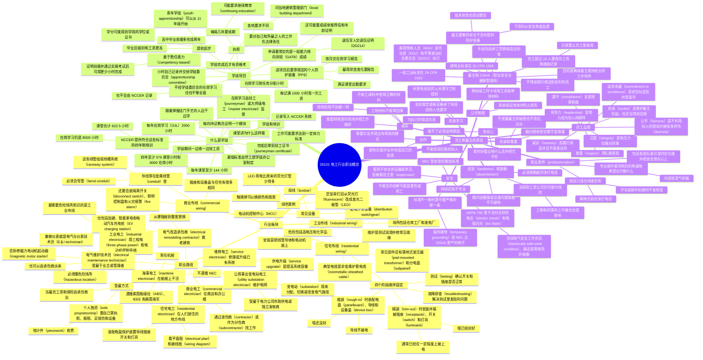

# 26101 电工行业职业概览（Occupational Overview: The Electrical Industry）

第十二版 *Electrical, Level 1* 模块 26101-26。这一模块讲电工行业有哪些板块、可以走哪些职业路径、怎样成为学徒，以及员工和雇主各自要负什么责任。没有实操任务（Performance Tasks），以知识为主。模块编号是 **26101-26**。通过 NCCER 认可的培训机构学习，可以取得这一模块的行业证书（industry-recognized credentials）。

学完要能做到：

1. 辨认电工行业的各个板块和工种选择。
   - a. 描述住宅布线系统里常见的组成部分。
   - b. 描述商业布线系统里常见的组成部分。
   - c. 描述工业布线系统里常见的组成部分。
   - d. 列出电工行业的职业路径和就业机会。
2. 概括电工的学徒制和培训过程。
   - a. 说明怎样成为电工学徒。
   - b. 描述学徒有哪些培训方式。
3. 概括员工和雇主的责任。
   - a. 指出员工的责任。
   - b. 指出雇主的责任。

停电之后，手机、灯、游戏机都用不了。很多人负责让你在需要的时候用上电：有人在发电厂发电，有人维护输电线路，有人维修系统和设备，有人在住宅、学校、办公室里安装导线和用电设备。

电气系统必须按《国家电气规范》（National Electrical Code, NEC）安装，电才能安全使用。NEC 规定的是电气系统安全安装的**最低标准**。NFPA 70、National Electrical Code、NEC 都是美国国家消防协会（National Fire Protection Association, NFPA）的注册商标，协会在马萨诸塞州昆西。

重点单词第一次出现时写成「中文（English）」。后面做题时，英文术语要能认出来。

---

## 1.0.0 电工行业的各个板块（Sectors of the Electrical Industry）

### 1.1.0 住宅布线系统（Wiring Systems in Residential Buildings）

新建住宅要装电气进线（electrical service），把房子接到电力公司的电源上。

**电气进线（electrical service）**：把供电的电力公司接到房屋布线系统上的导体和设备。

给住宅布线有四个基本阶段，顺序固定：

| 阶段 | 做什么 | 墙和电的状态 |
| --- | --- | --- |
| 粗装（rough-in） | 安装配电盘（panelboard）、导线和设备盒（device boxes） | 墙还没封。导线这时**不接电** |
| 精装（trim-out） | 安装并端接插座（receptacles）、开关（switches）、用电设备和灯具（fixtures），再接到配电盘 | 墙已经保温并封好。这时通常已经在一定程度上接上电 |
| 测试（testing） | 确认一切正常，例如开关能不能开灯、插座有没有电 | 安装之后 |
| 故障排查（troubleshooting） | 解决测试中发现的问题。例如开关开不了灯，就去查配电盘上的断路器（circuit breaker） | 需要知识和经验 |

**粗装（rough-in）**：布线的开始阶段，电工安装配电盘、导线和盒子。

**精装（trim-out）**：电工安装并端接用电设备和灯具的阶段。

住宅电气系统里常见的部件（图 1）：

| 图中部件 | 英文 |
| --- | --- |
| 落地式变压器 | pad-mounted transformer |
| 住宅电气进线 | residential electrical service |
| 钉装设备盒 | nail-on device box |
| 非金属护套电缆 | nonmetallic-sheathed cable |
| 室内配电盘（分电盘） | interior panel (subpanel) |
| 灯具 | luminaire (lighting fixture) |

住宅布线**典型使用非金属护套电缆**。配电盘通常在 **rough-in** 阶段安装，不是 trim-out，也不是单独的「进线安装」或「规划」阶段。

### 1.2.0 商业建筑的布线系统（Wiring Systems in Commercial Buildings）

办公室和商店的布线，很多地方和住宅一样，插座、设备盒都会用到。明显的差别是：商业系统里，导线穿在金属线管（metal conduit）里，这些线管组成线槽系统（raceway system）。

**线槽系统（raceway system）**：把电气系统里的导体包起来的封闭通道。

所以做商业布线必须会弯管（bend conduit），还要会装更复杂的设备，包括隔离开关（disconnect switches）、照明控制盘（lighting control panels）和火灾报警系统（fire alarm systems）。

商业电气系统常见部件（图 2）：

| 图中部件 | 英文 |
| --- | --- |
| 落地式商业变压器 | pad-mounted commercial transformer |
| 商业电气进线 | commercial electrical service |
| 线管系统 | conduit system |
| 火灾报警系统 | fire alarm system |
| 办公室照明 | office lighting |
| 室外照明 | outdoor lighting |

判断题要记住：在商业建筑里安装导线，必须学会弯管。这句是 **对的**。

### 1.3.0 工业设施的布线系统（Wiring Systems in Industrial Facilities）

工业设施用来制造、装配或储存产品。仓库（warehouses）、工厂（factories）、发电厂（power plants）都是例子。

工业电工负责这些设施里系统的安装和维护：

- **安装（installation）**：把系统需要的线管、导体、电动机和其他设备装到位。
- **维护（maintenance）**：对系统做保养，例如测试、给电动机加润滑油，并修好常见故障，让系统继续运行。

工业电工用的设备，住宅和办公室里没有（图 3）：

| 图中设备 | 英文 |
| --- | --- |
| 配电开关设备 | distribution switchgear |
| 母线 | busbars |
| 电动机控制中心 | motor control center (MCC) |

工业现场有专门的安全危险，包括高电压（high voltages）和化学危险（chemical hazards）。在工厂干活的电工叫 **工业电工（industrial electricians）**，不是电力承包商、商业电工或公用事业承包商。

### 1.4.0 电工行业的职业路径（Career Paths in the Electrical Industry）

合格电工一直有需求，选择也多。可以安装、维护传统设备，也可以去做太阳能、风能这类新技术。成为熟练电工要下功夫，但这一行在个人成就和收入上都有回报。

#### 1.4.1 住宅电工（Residential Electrician）

住宅电工在人们居住的地方布线和安装电气系统。工作包括：

- 看电气平面图（electrical plans）和接线图（wiring diagrams），确定系统怎么装
- 安装配电盘和断路器这类保护装置（protective devices）
- 安装导线，以及插座、开关这类设备
- 安装照明、烟感（smoke detectors），以及风扇、报警器等灯具

很多住宅电工给承包商（contractor）干活。承包商按合同向别人提供服务和材料。例如住宅承包商承包建房，再雇木工、电工。

你可以受雇于住宅承包商或电气承包商。作为雇员（employee），工资和保险由承包商提供。

也可以自己当承包商，这叫个人独资（sole proprietorship）。这意味着自己开公司：要有承包商执照（contractor’s license），要报营业税，自己买保险，自己准备工具设备。客户按计件（piecework）付钱，也就是每项工作或每份合同有一个固定价格。

#### 1.4.2 商业电工（Commercial Electrician）

如果喜欢工期长的大工程，可以做商业电工。他们在商店、办公楼这类建筑里安装电源、照明和其他电气设备。

商业电工通过承包商找工作。总承包商（general contractor）可能把他们作为分包商（subcontractors）雇来。你可以给电气承包商干活，也可以自己成为电气承包商。有的建筑同时需要商业和住宅布线，电气承包商会两种电工都雇。

商业电工最典型的工作地点是 **办公楼（office building）**。船厂是海事电工，联排住宅工地是住宅电工，石化厂是工业电工。

#### 1.4.3 维修电工（Service Electrician）

如果喜欢每天做不同的事，又擅长修东西，可以做维修电工。他们修理或升级已有的电气系统，工作包括：

- 在住宅或商业建筑里排查并修理电气故障
- 做供电升级（service upgrades），提高电气系统的容量（capacity）

可以给电气承包商干，也可以自己开业。

#### 1.4.4 电气改造承包商（Electrical Remodeling Contractor）

如果喜欢老建筑，可以做电气改造承包商。业主改造时会找你做电气部分。工作可以包括：

- 简单改造：挪插座，或加开关
- 复杂改造：整套电气系统换掉
- 给加建部分（home addition）加新照明、吊扇和开关的线路
- 安装智能家电、热水浴缸线路，或电动汽车充电桩（electric vehicle charging stations）

可以自己干，也可以给别的承包商干。

#### 1.4.5 工业电工（Industrial Electrician）

如果想学怎样安全地安装和维护专用设备，可以做工业电工。他们在有特殊危险和专用设备的设施里工作，职责包括：

- 使用三相电（three-phase power）、电动机和电动机控制系统（motor control systems）
- 给电动机和过程控制仪表（process control instruments）安装线管和导线
- 维护、排查并修理电动机和其他电气设备

工业电工需要额外培训，才能安装和维护复杂设备，也必须知道危险场所（hazardous locations）的安全要求。**最需要危险场所专门知识的是工业布线**，不是住宅、商业或一般维修。

#### 1.4.6 电气维护技术员（Electrical Maintenance Technician）

如果喜欢专用设备，可以做电气维护技术员。他们受雇于建筑物的业主或管理者，是技术员团队的一员。职责包括：

- 监视并维护电气系统和设备
- 拆开并修理磁力电动机起动器（magnetic motor starters）

**电动机起动器修理**这类工作，最可能由电气维护技术员来做，不是住宅电工、商业电工或改造承包商。

有的公司雇常驻现场的电气维护技术员，保证系统一直在运行。有的工业设施不直接雇人，而是雇一家承包商，再由承包商派电气维护技术员带队来干活。设施付钱给承包商，承包商再付钱给你。

如果同时还做仪表系统（instrumentation systems），就是电气与仪表技术员（electrical and instrumentation technician, **E&I** technician）。E&I 需要专门培训。

#### 1.4.7 公用事业变电站电工（Utility Substation Electrician）

如果想参与维护电网（power grid），可以做公用事业变电站电工。他们受雇于电力公司（utility company）、市政供电方（municipal power provider）或独立发电商（independent power provider），负责建设、维护和运行变电站（substations）。职责包括：

- 安装并维护送电设备，例如断路器、变压器（transformers）和调压器（voltage regulators）
- 安装接地系统（grounding systems）、导体和线槽

**变电站（substation）**：一组设备的组合，例如开关、开断装置、断路器、母线和变压器。电能从这里经过，用来分配、切换，或改变电气路径。

#### 1.4.8 海事电工（Maritime Electrician）

Maritime 的意思是「和海有关」。海事电工在船舶上安装、维护和修理发动机及电气系统，可能受雇于船东、造船厂或船舶修理公司。工作包括：

- 安装蓄电池和发电机（batteries and generators）
- 维护并修理电动机、泵和导航系统（navigation systems）

他们经常在机舱（engine room）里干活。

和建筑电工不同，海事电工**不遵循 NEC**。他们遵循其他机构制定的标准，例如：

- 美国船级社（American Bureau of Shipping, ABS）
- 电气与电子工程师协会（Institute of Electrical and Electronics Engineers, IEEE）
- 美国海军（US Navy）

「海事电工和建筑电工一样必须遵守 NEC」这句是 **错的**。

### 绿色案例：芝加哥灯冠改造（Going Green）

2017 年，电气承包商更换了芝加哥最高建筑约翰·汉考克中心（John Hancock Center）第 99 层的灯冠（Crown of Lights）。原来的灯冠是 552 根 8 英尺荧光灯管（fluorescent tubes）。业主要改颜色时，电工得把每根灯管拆下来，套上有色塑料套，两名电工要干一个星期。

改造后换成发光二极管（light-emitting diode, **LED**）灯具，用触摸屏就能切换颜色和图案。LED 比荧光灯管高效得多。课本给出的数字是：原来的荧光灯管每年用 57,048 瓦（watt, W），新系统只用 9,400 W。

### 1.0.0 小节复习

1. 安装并端接用电设备和灯具的布线阶段叫 _____。
   - a. rough-in　b. trim-out　c. final finish　d. cleanup
2. 在商业建筑里安装导线，需要学会弯管。
   - a. True　b. False
3. 在工厂工作的电工称为 _____。
   - a. industrial electricians　b. power contractors　c. commercial electricians　d. utility contractors
4. 海事电工和建筑电工一样，必须遵守 NEC。
   - a. True　b. False

答案：1 b，2 a，3 a，4 b。

---

## 2.0.0 怎样培训成为电工（Training to Be an Electrician）

美国劳工统计局（Bureau of Labor Statistics, BLS）的数据是：电工有需求，工作有意思，收入也不错。但必须有正确的技能：会用工具、会看图、能完成具体任务，而且全程要安全。

这些技能从培训或学徒项目（apprenticeship program）开始学。

### 2.1.0 什么是学徒（What Is an Apprentice?）

几百年前，年轻人跟铁匠当学徒，学会打铁。今天学一门手艺（trade），仍然可以当学徒。

电工学徒跟着已经掌握这门手艺的人学技能。不是只在书上看，而是动手练。课堂里会学每项技能和概念背后的目的。知道为什么要这样做，才更可能做对。学徒期间一边练动手技能，一边领工资。

美国劳工部（US Department of Labor, **DOL**）学徒办公室规定美国培训项目的**最低标准**。项目同时用课堂教学和在岗学习（on-the-job learning, **OJL**）。OJL 也叫在岗培训（on-the-job training, **OJT**）。

**在岗学习（OJL）**：学徒在技工级（journey-level）工人监督下边干边学。

DOL 学徒至少要求：

- 每年课堂 **144 小时**
- 每年 OJL **2,000 小时**

四年制电工学徒至少要 **576 小时**课堂（144 × 4）和 **8,000 小时** OJL（2,000 × 4）。OJL 由技工（journeyman）或大师级电工（master electrician）监督。完成注册学徒项目后，会拿到技工证书（journeyman certificate）。

全国建筑教育与研究中心（National Center for Construction Education and Research, **NCCER**）提供符合 DOL 标准的四年制电气培训。图 10 的时间线是：

| 年份 | 课堂 | OJL |
| --- | --- | --- |
| 第 1 年，NCCER Level 1 | 145 小时 | 2,000 小时 |
| 第 2 年，NCCER Level 2 | 167.5 小时 | 2,000 小时 |
| 第 3 年，NCCER Level 3 | 165 小时 | 2,000 小时 |
| 第 4 年，NCCER Level 4 | 145 小时 | 2,000 小时 |
| 合计 | **622.5 课堂小时** | **8,000 OJL / OJT 小时** |

学完之后取得证书或州执照，学徒期结束。NCCER 电气培训通常要 **四年**。

课堂里学，工地上练。要升级，必须向教员证明自己能安全完成每一项指定任务，也就是证明胜任能力（competency）。NCCER 会记录你的进度。每向持证教员证明自己掌握了某个模块的知识和技能，教员就把记录写入 NCCER 系统。以后换地方干活，NCCER 可以证明你受过相应培训、具备相应技能。

做电工可能很累：要爬梯子、搬重设备。安全可能取决于你够不够强壮、身体够不够好。公司甚至可能要求你达到一定的体力活动标准。

### 2.2.0 学徒项目（Apprenticeship Programs）

传统电工学徒一共要 **8,000 OJL 小时**，分四年，每年 2,000 小时。OJL 按任务分配小时数，让你花规定的时间学每一项动手工作。

NCCER 的项目是基于胜任能力的（competency-based）。意思是：只要证明自己具备必要技能，并通过一系列实操考试（performance exams），就可以用更少的小时数完成。基于胜任能力的培训，就是在进入下一阶段之前，必须先证明自己能做那些动手任务。这句是 **对的**。

小时数要记准确，因为这是你达到项目要求的证据。**OJL 小时由你自己记录**：记下工作时间，交给学徒委员会（apprenticeship committee）。大多数学徒项目每记录满 **1,000 小时**就涨一次工资。

能在电工学徒项目里成功，通常需要：

- 高中或技术学校学历
- 上过车间课（shop）、机械制图（mechanical drawing）和普通数学
- 手能做精细的活，也能做粗重的活
- 身体状况好
- 反应快
- 会解决问题
- 有团队意识
- 把安全放在心上

申请学徒时，通常要向学徒委员会交下面这些材料里的一部分：

- 能力倾向测验成绩，一般是当地就业保障委员会（Employment Security Commission）给的一般能力倾向成套测验（General Aptitude Test Battery, **GATB**）Form Test
- 成绩单（educational transcripts）
- 雇主或朋友的推荐信
- 年龄证明：出生证明、驾照或护照
- 和建筑业有关的技术培训记录，例如学徒前培训（pre-apprenticeship training）
- 如果是退伍军人，交 DD214 表（Certificate of Release or Discharge from Active Duty，退伍或解除现役证明）

入学徒最可能要交的是 **GATB Form Test 成绩**。不是承包商执照，不是学术能力测验（Scholastic Aptitude Test, SAT），也不是 OSHA 40 小时课程证书。

进了项目之后还要满足要求，否则可能被要求离开。常见要求：

- 在工地穿戴全部规定的个人防护装备（personal protective equipment, PPE）
- 按需要、并按承包商的要求，购买并保养本行工具
- 每月向委员会交 OJL 报告
- 雇佣状态变化时向委员会报告
- 参加与课堂相关的教学，并满足出勤等课堂要求

不是所有 OJL 都是正式学徒项目。你也可能在小承包商甚至大公司里做 OJL，不经过学徒委员会。这时要知道：培训往往不如正式学徒全面；主管带学员的经验可能不够；培训也不会由 NCCER 记录和跟踪。非正式培训学到什么，常常取决于雇主规模。小承包商可能只培训一个方面；大公司可能能培训好几个方面。

#### 2.2.1 提前起步（Getting a Head Start）

如果不想等到毕业才当学徒，可以参加青年学徒项目（youth apprenticeship program）。这类项目提供这些机会：

- 可以从 **11 年级**开始学徒培训
- 可以跟着当地的手艺雇主学手艺，同时挣钱
- 高中毕业时，四年制 NCCER 标准手艺培训最多可以完成 **两年**
- 毕业后进入行业时，级别和工资都高于刚开始学徒的人

青年学徒项目和 NCCER 学习中心、承包商、学院用的普通学徒项目类似。你会拿到正式成绩单，项目在哪里开设，就可以在哪里进入下一年。学分也可能用到提供建筑行业学位或证书的两年制或四年制学院。

#### 2.2.2 执照（Licensing）

完成电工学徒，才有资格去考执照（license）。执照向雇主和客户表明你是合格电工。

有执照更可能被录用，收入也往往更高。同时，你要为自己的工作、以及你所雇用的任何人的工作承担法律责任。

各州的执照要求不同，同一个州里的市镇也可能不同。怎样拿执照，问当地建筑管理部门（local building department）。执照每隔几年要续期，可能还要求继续教育（continuing education）。

### 2.0.0 小节复习

1. NCCER 电气培训通常要几年完成？
   - a. One　b. Two　c. Three　d. Four
2. 进入学徒项目，最可能要提交哪一项？
   - a. GATB Form Test results　b. Contractor’s license　c. Scholastic Aptitude Test　d. OSHA 40-hour course certificate

答案：1 d，2 a。

---

## 3.0.0 员工和雇主的责任（Employee and Employer Responsibilities）

当电工有危险。你和雇主都按专业方式做事、遵守全部安全规则，你自己、同事和客户才能在工作按时、按预算完成的同时保持安全。

### 3.1.0 员工的责任（Employee Responsibilities）

员工的责任从准时到岗，一直到知道怎样安全使用设备。成功需要这些个人品质：

| 品质 | 英文 | 意思 |
| --- | --- | --- |
| 诚实 | honesty | 始终诚实。达到最高的职业标准。履行全部合同和承诺。不故意误导或欺骗别人 |
| 正直 | integrity | 表现出个人正直。即使有压力让你图省事、做错事，也要做对的事 |
| 忠诚 | loyalty | 对公司、雇主、赞助方、同事、行业协会和其他组织保持忠诚。你也应当得到对方的忠诚 |
| 公平 | fairness | 始终公平。不利用别人的错误或困难。思想开放，坚持公正。平等待人。容忍并接受多样性（diversity） |
| 尊重 | respect | 用礼貌和公平表现尊重 |
| 遵守 | compliance | 在工作、学校和家里遵守全部规章制度 |
| 追求卓越 | commitment to excellence | 把目标定高，始终争取做得好。努力、有准备，愿意学新技能和新知识 |
| 领导力 | leadership | 努力成为别人的榜样 |

#### 3.1.1 职业素养（Professionalism）

职业素养指你在工作中的行为方式，对工地上每个人都有好处。图 12 里的品质是：有团队意识（team-oriented）、准备好干活（prepared to work）、准时（on time）、会沟通（communicative）、把安全放在心上（safety-minded）、有效率（productive）、诚实（honest）、合作（cooperative）、文明礼貌（civil）。

沟通是职业素养的重要部分。说话、倾听、写字都要礼貌、清楚。

和客户、同事、雇主沟通，常常用电子邮件。一封专业邮件要做到：

1. 主题行说明这封信的目的。
2. 使用收件人的称谓和姓名。
3. 内容短，说到点子上。
4. 说明你希望对方下一步做什么。
5. 语气积极。
6. 用专业的结束语收尾。

短信适合快速告知或提问，例如告诉客户你正在路上。短信不适合交换重要信息，例如解释你为什么迟到。那种情况应该打电话道歉并说明。短信要显出职业素养，记住：

- 写短
- 发出前检查错字
- 不用缩写
- 开车或操作机械时不发短信

#### 3.1.2 诚实（Honesty）

诚实不只是说实话。工作时要讲职业道德（ethics）。职业道德告诉你什么是对的、什么是错的。例如，从工地偷东西是错的。作为专业人员，诚实表现在：

- 尊重财物
- 准时到场
- 把工作做好
- 从不偷工减料（never cutting corners）
- 使用正确的材料
- 为自己的错误负责

工地上用不到的边角料，也不能拿回家。那是不诚实。「用不到的废料可以拿回家」这句是 **错的**。

不诚实一定会追上来。不管是偷工地设备，还是对工作撒谎，雇主不用多久就会发现。

诚实带来你和雇主双方的成功。这不只是好坏之间的选择，也是成功和失败之间的选择。诚实是保住工作、拿到高收入、得到雇主和客户好评的稳妥办法。

#### 3.1.3 忠诚和尊重（Loyalty and Respect）

忠诚意味着你维护雇主的利益：在别人面前说他们的好话，不泄露他们的秘密，也不背后议论。作为回报，雇主也应当对你忠诚：给你稳定的工作，并把你提升到更好的岗位。

尊重是你怎样对待别人，也怎样对待自己。它包括礼貌、公平，以及理解别人的感受和看法。尊重体现在你说什么、也体现在你怎么说。翻白眼、挖苦，都不是尊重。

尊重让同事之间有公平感。尊重别人，就是用你希望被对待的方式对待他们。

#### 3.1.4 愿意学习（Willingness to Learn）

每家公司、每个工地都有自己的做法。第一天到场，你不可能什么都懂，但雇主期望你愿意学。这意味着听工地上更有经验的人，并遵守工地规则。你必须能适应，并尽快学会新方法和新程序。

安全规定变了，或者买了新设备，即使是有经验的员工，也需要学新方法和新操作。成功的人会抓住每一个机会，把自己的手艺学得更深。

#### 3.1.5 责任心（Responsibility）

责任（responsibility）是别人期望你完成的一项任务或工作。雇主期望你准时到、看出有什么活要干，然后把它干完。

要准备好在工作中承担责任。这意味着确认自己明白任务是什么、怎样安全地做、什么时候应该完成。如果做不了，必须说明原因，而且不能把责任推给别人。

#### 3.1.6 合作（Cooperation）

合作是把事情做成的关键。作为手艺工人（craftworker），你通常在一个团队里，成员包括雇主、主管和同事。大家一起把工作做得有效率、安全、准时，所有人都会成功。

合作可以这样表现：

- 尊重队友
- 提出有帮助的建议
- 避免负面评论
- 完成自己的职责

#### 3.1.7 公司制度（Company Policies）

公司制度用来保证效率、防止损失。始终遵守全部公司制度，例如填工时卡（time cards）、领用工具、申领材料。不遵守的话，雇主可能损失时间、工具或钱，你甚至可能丢掉工作。

#### 3.1.8 迟到和缺勤（Tardiness and Absenteeism）

**迟到（tardiness）**是上班晚到。**缺勤（absenteeism）**是经常不来。

有时迟到或缺勤有正当理由，例如健康紧急情况，或交通出了问题。偶尔缺勤不可避免，但持续迟到和频繁缺勤说明工作习惯差。这不专业，也不尊重别人，说明你没有把这份工作看得足以让你到场。

迟到或缺勤的那段时间没有工资。另外，你的缺席可能让雇主花钱。例如雇主仍要为你付健康保险。现场没有你，工作可能更久，更费钱，也打乱进度。同事可能要更辛苦，才能补上你留下的空档。

所以要每天准时到岗。如果必须缺勤，**尽快打电话**，让雇主能找人替你。

下面几句是错的，不要选：

- 「就算有传染性也绝对不能缺勤。」偶尔因健康原因缺勤是不可避免的。
- 「只要事后把时间补上，晚到一点没关系。」持续迟到不专业。
- 「没领到工资，缺勤就不会让公司有任何损失。」保险、工期和同事的工作量仍然受影响。

#### 3.1.9 安全（Safety）

每个员工都应得一个安全的工作场所。雇主必须让工地对所有人安全。作为回报，你必须遵守全部安全规章制度，也必须确认同事同样在遵守。

维护安全的工作环境，意味着两件事：

- 遵守公司关于安全工作程序和做法的规定。
- 把不安全的设备和工作状况**直接报告给主管（supervisor）**。

职业安全与健康管理局（Occupational Safety and Health Administration, **OSHA**）要求你报告危险状况。这条规则适用于建筑业的每一部分。你始终有义务报告不安全状况。在工作中看到不安全的事，就报告。不要不理它，它不会自己变好。

不要担心：因为不安全状况必须停工，雇主会生你的气。雇主更可能因为你不报告问题而生你的气。花时间把现场重新弄安全，好过因为有人受伤而把整个工程停掉。

**始终报告不安全状况。不报告，结果可能是重伤甚至死亡。** 看到安全违规，正确做法是报告给主管。不要只在它直接影响你时才管，不要只在心里记住以后绕开，也不要因为还没人受伤就当作没问题。

在工地上，你要为自己和别人的安全负责。安全是每个人的责任。

OSHA 的工作场所标准不是你要知道的唯一安全标准。你还必须熟悉当地规范（local codes）和 NEC。有些 NEC 要求比 OSHA **更严**（more stringent）。临时接地（temporary grounding）就是一个例子。标准不一致时，**始终遵守最严格的那一条**。培训往下走，你会非常熟悉 NEC。

还必须遵守 NFPA 的 **NFPA 70E**，全称是《工作场所电气安全标准》（Standard for Electrical Safety in the Workplace）。这份标准覆盖：

- 避免电气危险的安全工作做法
- 建立电气安全工作状态（electrically safe working condition）的步骤
- 靠近裸露带电部件的安全接近距离（safe approach distances）
- 为防止电击（electric shock）和电弧闪光（arc flash）必须使用的 PPE

覆盖「避免电气危险的安全工作做法」的标准是 **NFPA 70E**，不是 NEC，也不是 29 CFR 1910 或 29 CFR 1926。

**OSHA**：美国为确保工作场所安全与健康而设立的政府机构。

### 3.2.0 雇主的责任（Employer Responsibilities）

雇主有法律责任，达到 OSHA 规定的工作场所安全与健康标准。这些标准列在《1970 年职业安全与健康法》（Occupational Safety and Health Act of 1970）里。OSHA 执行这些标准，确保雇主为所有员工提供并维持安全的工作场所。OSHA 还提供研究和教育项目，支持安全的工作做法。

法律允许各州有自己的安全法规和执行机构。每个州的项目必须经美国劳工部长（US Secretary of Labor）批准。没有自己法规和机构的州，必须执行 OSHA 标准。

按 OSHA 标准，你有权接受在岗安全培训。雇主必须：

- 教你怎样安全地做你的工作
- 提供规定的 PPE
- 就具体危险向你提出警告
- 在你干活时从安全角度进行监督

图 14 把 OSHA 的作用概括成：

- OSHA 声明的目的，是为美国工人提供最安全、最有益健康的工作条件。
- OSHA 要求雇主提供安全、没有危险的工作场所。
- OSHA 要求员工遵守与工作行为有关的 OSHA 规章制度。
- 为确认双方都在守规则，OSHA 可以：在工地安全之前停止作业继续进行；对违规处以罚款；对工地进行突击检查（spot inspections）。

OSHA 的首要使命是 **确保雇主维持安全的工作场所**。检查工地、罚款、发放安全装备，都不是它的首要使命。

一般工业的 OSHA 标准在 **OSHA Standard 29 CFR 1910**，名称是 Occupational Safety and Health Standards。适用于建筑的其他安全标准发布在 NEC、NFPA 70E，以及 **OSHA Standard 29 CFR 1926**（Safety and Health Regulations for Construction）里。

一般工业标准在 **29 CFR 1910**。29 CFR 1926 是建筑业。没有 29 CFR 1965 或 29 CFR 1970 这个选项。

建筑业雇主最重要的一般 OSHA 要求：

- 必须在员工容易看到的地方张贴告示，告知他们的权利和责任。
- 必须在所有规定地点张贴警告标志、海报和标签。
- 必须确保工地没有严重危险，并确保工作场所符合 OSHA 规章制度。
- 必须对设备做经常、定期的工地检查。
- 必须指导所有员工识别并避免不安全状况。
- 必须确保员工知道与这项工作有关的法规，以便他们控制或消除危险。
- 不得允许使用任何不符合 OSHA Standard 29 CFR 1926 的工具、设备、机器或材料。
- 必须确保只有合格人员操作工具、设备和机器。
- 在 OSHA 要求时必须提供体检。
- 员工超过 10 人的雇主，必须保存与工作有关的伤害和疾病记录，而且这些记录必须能让员工查阅。
- 不得歧视行使 OSHA 法规所给权利的员工。

雇主还必须遵守《1990 年美国残疾人法》（Americans with Disabilities Act of 1990, **ADA**）。ADA 保护残疾工人不受歧视。执行 ADA 的美国机构包括司法部（Department of Justice, DOJ）和平等就业机会委员会（Equal Employment Opportunity Commission, EEOC）。

「OSHA 要求雇主提供安全、没有危险的工地」这句是 **对的**。

### 3.0.0 小节复习

1. 覆盖避免电气危险的安全工作做法的标准是 _____。
   - a. NEC　b. OSHA Standard 29 CFR 1910　c. OSHA Standard 29 CFR 1926　d. NFPA 70E
2. 一般工业标准写在 _____。
   - a. OSHA Standard 29 CFR 1926　b. OSHA Standard 29 CFR 1910　c. OSHA Standard 29 CFR 1965　d. OSHA Standard 29 CFR 1970

答案：1 d，2 b。

---

## 模块复习题

奇数题的答案与课本后面的答案一致。偶数题课本没有给答案，下面是按对应章节做出来的。先自己做，再对答案。

1. 住宅建筑里的配电盘通常在 _____ 阶段安装。
   - a. rough-in　b. trim-out　c. service installation　d. planning
2. 住宅布线系统通常使用 _____。
   - a. medium-voltage cable　b. tray cable　c. flat conductor cable　d. nonmetallic-sheathed cable
3. 你会在 _____ 找到正在工作的商业电工。
   - a. shipyard　b. tract home construction　c. office building　d. petrochemical plant
4. 下面哪一项最可能需要危险场所的专门知识？
   - a. Residential wiring　b. Industrial wiring　c. Commercial wiring　d. Service work
5. 电动机起动器修理这类工作，最可能由 _____ 来做。
   - a. residential electrician　b. commercial electrician　c. electrical maintenance technician　d. electrical remodeling contractor
6. 学徒培训项目的最低标准由 _____ 制定。
   - a. OSHA　b. DOL　c. NCCER　d. the employer
7. 典型电工学徒项目的 OJL 总小时数是 _____。
   - a. 4,000　b. 8,000　c. 9,000　d. 10,000
8. 关于迟到和缺勤，哪一句是对的？
   - a. 就算有传染性，也绝对不能缺勤
   - b. 只要事后把时间补上，上班晚一点没关系
   - c. 如果必须缺勤，早点打电话，让雇主能找人替你
   - d. 如果没有领到工资，你的缺勤不会让公司有任何损失
9. 如果在工地看到安全违规，你应该 _____。
   - a. 除非它直接影响你，否则不用管
   - b. 在心里记住，以后绕开那个区域
   - c. 报告给你的主管
   - d. 如果还没有人受伤，就当作没问题
10. OSHA 的首要使命是 _____。
    - a. 检查工地的安全违规
    - b. 对违反安全规定的公司罚款
    - c. 把安全装备发给工人
    - d. 确保雇主维持安全的工作场所

### 复习题答案

| 题 | 答案 | 依据 |
| --- | --- | --- |
| 1 | a | 1.1.0。配电盘在 rough-in 安装，这时墙还没封，导线不接电 |
| 2 | d | 1.1.0，图 1。住宅系统图里标的是 nonmetallic-sheathed cable |
| 3 | c | 1.2.0，1.4.2。商业电工在商店和办公楼。船厂是海事，联排住宅是住宅，石化厂是工业 |
| 4 | b | 1.3.0，1.4.5。工业现场有高电压、化学危险，工业电工必须懂危险场所 |
| 5 | c | 1.4.6。电气维护技术员会拆修 magnetic motor starters |
| 6 | b | 2.1.0。最低标准由 DOL Office of Apprenticeship 制定。NCCER 的项目是符合这些标准，不是制定最低标准的机构 |
| 7 | b | 2.1.0，2.2.0。每年 2,000 小时，四年共 8,000。576 和 622.5 是课堂小时，不要和 OJL 混 |
| 8 | c | 3.1.8。必须缺勤时尽快打电话。没发工资不等于公司没有损失 |
| 9 | c | 3.1.9。OSHA 要求报告危险状况。不要等它自己变好 |
| 10 | d | 3.2.0。检查、罚款、停工是手段。目的是安全、有益健康的工作条件 |

### 补充练习

1. 住宅电气布线的基本步骤是什么？
2. 判断：住宅布线和商业布线的一个主要差别是，商业布线通常装在金属线管里。
3. 如果你有兴趣帮助维护电网，你可能想成为 _____。
4. 你的学徒项目每年要求 _____ 小时 OJL。
5. 判断：基于胜任能力的培训，意思是进入课程下一阶段之前，必须证明自己具备完成动手任务所需的技能。
6. _____ 让你在高中毕业前最多完成两年学徒培训。
7. 判断：工地上用不到的边角料，拿回家是可以的。
8. 很多员工把病假当成可以随时休的浮动假期。这对雇主和同事为什么不公平？
9. 判断：OSHA 要求雇主提供安全、没有危险的工地。
10. 除了 OSHA 标准，再举出两项和电气工作有关的标准。

补充练习奇数题答案与课本一致：

| 题 | 答案 | 依据 |
| --- | --- | --- |
| 1 | rough-in、trim-out、testing、troubleshooting | 1.1.0。顺序就是这四步 |
| 3 | utility substation electrician | 1.4.7 |
| 5 | True | 2.1.0。NCCER 项目可以因证明技能、通过实操考试而用更少小时完成 |
| 7 | False | 3.1.2。拿工地材料是不诚实，会用到用不到都一样 |
| 9 | True | 3.2.0 |

偶数题按课文：

2. **True**。1.2.0。商业导线穿在金属线管里，组成 raceway system。
4. **2,000**。2.1.0。每年课堂至少 144 小时，每年 OJL 2,000 小时。
6. **youth apprenticeship program**（青年学徒项目）。2.2.1。11 年级可以开始，高中毕业前最多完成四年制 NCCER 培训中的两年。
8. 3.1.8。雇主仍要付健康保险；现场少一个人，工期变长，更费钱，也打乱进度；同事要更辛苦才能补上。没领工资，不代表公司没有损失。
10. **NEC** 和 **NFPA 70E**。3.1.9，3.2.0。当地规范也要熟悉。标准不一致时遵守最严的一条。临时接地是 NEC 比 OSHA 更严的例子。

---

## 工匠案例（Cornerstone of Craftsmanship）

课本这一节采访的是 Paul Asselin，Elm Electrical, Inc. 的培训师兼高级项目经理。考试一般不直接考他的生平，但他的建议和本模块第 3 节是同一件事：

- 哥哥建议他上职业学校学一门手艺；叔叔是电工，也是当地技校的电气教员。
- 他持续接受培训：规范与理论、多门安全课、NFPA 70E、培训师培训、SKM 软件、管理培训。
- NCCER 证书给他打开了原来不知道的门，也让他能培训别人。证书证明你投入过功夫、完成了本行培训。
- 他做过电气维修、工业电气施工、机械的布线和修理、电气系统设计、工程估价、电弧闪光研究、安全程序和表格，以及给学生讲安全和电气规范与理论。
- 他认为成功主要来自努力和投入。给新人的建议是：准时、穿着得体、准备好干活、不确定就问、保持专注、少看手机、安全工作、做你自己。
- 手艺人边学边挣，通常没有或只有很少债务，还能拿到一张可以用一辈子的执照。

---

## 重点单词

| English | 中文 |
| --- | --- |
| electrical service | 电气进线：把电力公司接到房屋布线系统的导体和设备 |
| rough-in | 粗装：装配电盘、导线和盒子，墙未封，不接电 |
| trim-out | 精装：墙封好后安装并端接设备和灯具 |
| testing / troubleshooting | 测试 / 故障排查 |
| panelboard | 配电盘 |
| device box | 设备盒 |
| receptacle / switch / fixture | 插座 / 开关 / 灯具 |
| circuit breaker | 断路器 |
| nonmetallic-sheathed cable | 非金属护套电缆，住宅典型用这种 |
| luminaire | 灯具 |
| subpanel | 分电盘 |
| conduit / bend conduit | 线管 / 弯管。商业布线必须会 |
| raceway system | 线槽系统：把导体包起来的封闭通道 |
| disconnect switch | 隔离开关 |
| fire alarm system | 火灾报警系统 |
| distribution switchgear | 配电开关设备 |
| busbar | 母线 |
| motor control center (MCC) | 电动机控制中心 |
| three-phase power | 三相电 |
| hazardous location | 危险场所。工业电工必须懂 |
| contractor / subcontractor / general contractor | 承包商 / 分包商 / 总承包商 |
| sole proprietorship | 个人独资，自己当承包商 |
| piecework | 计件：每项工作或合同一个固定价格 |
| service upgrade | 供电升级，提高系统容量 |
| magnetic motor starter | 磁力电动机起动器。维护技术员会拆修 |
| E&I technician | 电气与仪表技术员 |
| substation | 变电站：开关、断路器、母线、变压器等，用来分配、切换或改变电气路径 |
| utility / municipal / independent power provider | 电力公司 / 市政供电 / 独立发电商 |
| maritime | 与海有关。海事电工不遵循 NEC |
| ABS / IEEE | 美国船级社 / 电气与电子工程师协会 |
| LED | 发光二极管，light-emitting diode |
| DOL | 美国劳工部。制定学徒项目最低标准 |
| OJL / OJT | 在岗学习 / 在岗培训。每年 2,000 小时 |
| journeyman / master electrician | 技工 / 大师级电工 |
| journeyman certificate | 技工证书 |
| NCCER | 全国建筑教育与研究中心。四年制项目符合 DOL 标准 |
| competency-based | 基于胜任能力。证明技能并通过实操考试，可以用更少小时完成 |
| apprenticeship committee | 学徒委员会 |
| GATB | 一般能力倾向成套测验。申请学徒常要交 Form Test 成绩 |
| DD214 | 退伍或解除现役证明 |
| youth apprenticeship | 青年学徒。11 年级可开始，毕业前最多完成两年 |
| license | 执照。各州甚至各市镇要求不同，问当地建筑管理部门 |
| PPE | 个人防护装备 |
| ethics | 职业道德：区分对和错 |
| tardiness / absenteeism | 迟到 / 经常缺勤 |
| OSHA | 职业安全与健康管理局。确保工作场所安全与健康 |
| NFPA 70E | 工作场所电气安全标准。防电击和电弧闪光的工作做法 |
| NEC | 安装的最低标准。有时比 OSHA 更严，例如临时接地 |
| 29 CFR 1910 | OSHA 一般工业标准 |
| 29 CFR 1926 | OSHA 建筑业安全与健康法规 |
| electrically safe working condition | 电气安全工作状态 |
| arc flash | 电弧闪光 |
| Occupational Safety and Health Act of 1970 | 1970 年职业安全与健康法 |
| ADA | 1990 年美国残疾人法。DOJ 和 EEOC 执行 |
| most stringent requirement | 几套标准不一致时，遵守最严格的那一条 |

---

## 复习时先记这几条

- 住宅布线四步，顺序不能换：rough-in、trim-out、testing、troubleshooting。配电盘在 rough-in。住宅典型电缆是 nonmetallic-sheathed cable。
- 商业和住宅用很多相同的插座和设备盒。差别是商业导线在金属线管里，所以必须会弯管，还要会装隔离开关、照明控制盘和火灾报警。
- 工业设施是仓库、工厂、发电厂。安装是把线管、导体、电动机装上；维护是测试、润滑、修常见故障。危险包括高电压和化学品。设备有开关设备、母线、MCC。
- 八条职业路径对得上地点：住宅是住房；商业是商店和办公楼；维修是修和升级已有系统；改造是老房子；工业是三相电、电动机和危险场所；维护技术员给业主干活，会修磁力起动器，兼做仪表就是 E&I；变电站电工维护电网；海事电工在船上，跟 ABS、IEEE、美国海军，**不跟 NEC**。
- 自己当承包商是 sole proprietorship：要执照、营业税、自己的保险和设备，按 piecework 收费。给承包商当雇员，工资和保险由对方出。
- DOL 最低标准：每年课堂 144 小时，每年 OJL 2,000 小时。四年至少 576 课堂小时和 8,000 OJL 小时。NCCER 时间线的课堂合计是 622.5 小时，仍然是四年、8,000 OJL。考试问「总共多少 OJL」选 8,000，问「几年」选四年。
- 最低标准是 DOL 定的，不是 OSHA，也不是 NCCER。NCCER 是符合 DOL 标准，而且是 competency-based。
- 申请材料里要认 GATB Form Test。每 1,000 记录小时涨一次工资。小时自己记，按月交给学徒委员会。青年学徒从 11 年级开始，毕业前最多完成两年。
- 执照证明你合格，也让你对自己和你所雇之人的工作负法律责任。规则各地不同，问当地 building department。
- 看到不安全的事，报告主管。标准打架时跟最严的。NEC 管安装最低要求，NFPA 70E 管干活时怎样防电击和电弧闪光。29 CFR 1910 是一般工业，29 CFR 1926 是建筑。
- OSHA 的目的是安全的工作场所。它可以停工、罚款、突击检查。超过 10 名员工的雇主要保存工伤疾病记录，并让员工能查阅。ADA 由 DOJ 和 EEOC 执行。
- 缺勤即使没工资，公司仍要付保险，工期和同事都会受影响。必须缺勤就尽快打电话。工地材料不能拿回家。

---

## 脑图

按章节展开。每一节只留这一节的核心。关键字第一次出现时写成中文（English）。

