# 26102 电工安全（Safety for Electricians）

第十二版 *Electrical, Level 1* 模块 26102-26。学徒只能在更有经验、合格的电工监督下干活。安全要养成习惯，自己的安全自己负责。看到不安全的情况，马上停工并报告同事和主管。

学完要能做到：

1. 识别电气危险及其后果。
2. 描述个人防护装备（personal protective equipment, PPE）怎样降低受伤风险。
3. 识别和电气安全有关的标准。
4. 认出各类电气危险对应的安全要求。

在指导下还要能完成两项实操（Performance Tasks）：

1. 正确选用并使用 PPE。
2. 按老师给的一项具体任务（例如换教室灯具）说出安全要求：要做的工作和危险、梯子目视检查并正确架设、确认当地急救电话已经张贴或大家都知道、计划事故时的逃生路线。

重点单词第一次出现时写成「中文（English）」。后面做题时，英文术语要能认出来。

---

## 1.0.0 电气危险（Electrical Hazards）

### 1.1.0 四大致命危险（Focus Four）

职业安全与健康管理局（Occupational Safety and Health Administration, OSHA）把工地最危险的四类叫做 **Focus Four**，也叫 **Fatal Four**：

| 危险 | 意思 |
| --- | --- |
| 坠落（fall hazards） | 从高处掉下来 |
| 电气危险（electrical hazards） | 碰到带电导体，造成电击（electric shock）和烧伤 |
| 夹住或夹在中间（caught-in or -between） | 被掉下来的材料或设备压住 |
| 被击中（struck-by） | 被飞来的物体，或卡车、叉车等移动设备撞到 |

建筑工地大约 90% 的死亡来自这四类。其他常见伤害还有割伤、烧伤、腰扭伤、化学物或异物进眼睛。大多数伤害只要小心就可以避免。

### 1.1.1 电击（Electric Shock）

电让导体里的电子移动，这种移动叫电流（electric current）。银、铜、钢、铝都是良导体。人体也是良导体，皮肤湿的时候更明显。

线管（conduit）很少带电，但导体绝缘破了、导体碰到管壁时，整根线管都可能带电。电子走过人体，可能造成重伤，也可能让心脏停跳。不管是什么表面，先认清什么材料会带电，**碰之前先测试**。

**表 1　电流对人体的典型影响**（来源：OSHA）

| 电流 | 典型效果 |
| --- | --- |
| 1 mA（0.001 A） | 能感觉到，像轻微发麻 |
| 5 mA（0.005 A） | 轻微电击，人可能跳开或摔倒，摔倒本身就会受伤 |
| 6–30 mA（0.006–0.030 A） | 很痛，肌肉失控 |
| 50–150 mA（0.050–0.150 A） | 剧痛、肌肉严重收缩，可能停止呼吸，也可能死亡 |
| 1,000–4,300 mA（1–4.3 A） | 心跳节律危险、严重抽筋、神经损伤，很可能死亡 |

**毫安（milliampere, mA）**：1 mA = 千分之一安培（ampere, A）。能勉强感觉到的电流，和能致命的电流，中间只差大约 100 mA。

电流进出身体还会留下伤口和烧伤。皮下烧伤当时不一定看出来，受损皮肤后来可能从里面坏死。任何较重的电击都要去看医生。

OSHA 的数据：电气相关伤害每年大约造成 350 人死亡，差不多每天一人。建筑工人被电击的可能性，是其他所有工种加在一起的 **4 倍**（美国国家职业安全卫生研究所，National Institute for Occupational Safety and Health, NIOSH）。

通过人体的电流（安培）决定电击有多严重。电压越高，致命电击的机会越大。但《国家电气规范》（National Electrical Code, NEC）里的高压（high voltage）是 **超过 1,000 V**（1 千伏，kilovolt, kV）。高压致死的可能性大约是低压的 10 倍，可是电工大部分时间都在低压旁边干活，所以**大多数电死是低压造成的**。

国际电气安全基金会（Electrical Safety Foundation International, ESFI）用的是 2019–2020 年数据：

| | 2019 | 2020 |
| --- | --- | --- |
| 非致命电气伤害 | 1,900 | 2,220 |
| 电气死亡 | 166 | 126 |
| 电气伤害平均病假 | 9 天 | 3 天 |

其他结论：

- 接触导体造成全部电气事故的 30%。其中 66% 是低压导体（1,000 V 及以下）。
- 大约 8% 的电气伤害是致命的。非致命伤害的中位数是离开工作 5 天。
- 便携手持电动工具是第二大伤害因素（15%）。将近 70% 发生在工具外壳或机架带电的时候。

很多事故本来可以避免：

- 遵守雇主的电气安全规程
- 使用维护良好的接地工具，或双重绝缘 / 不接地工具（double-insulated/ungrounded tools）。这类工具铭牌上有双重绝缘标志
- 使用接地故障断路器（ground fault circuit interrupter, GFCI）保护

**双重绝缘 / 不接地工具**：外壳用非导电材料做成，和电能隔开。

**GFCI**：当接地故障电流超过 A 类装置的设定值（4–6 mA）时，在规定时间内切断电路，保护人和设备。

### 1.1.2 人体和电阻（The Body and Resistance）

电在闭合电路里走。人体成为电路的一部分，就会被电击。常见三种情况：

- 同时碰到两个电位（电压）不同的导体
- 碰到接地物体，同时又碰到电路里一根不接地导体
- 碰到接地物体，同时又碰到已经因为接触带电导体而带电的导电表面

严重程度看三件事：通过身体的电流有多大、电流走哪条路径、身体在电路里待多久。频率、电击发生时心跳处在哪个阶段、当时身体是否健康，也会影响结果。

手到手的人体电阻大约是 **1,000 欧姆（ohm, Ω）**。只要 50 mA 就可能致死。所以从 **50 V 及以上**就要开始防接触。

欧姆定律（Ohm's law）在模块 26113 会细学。这里先记住三个量：电压 E（电位差）、电流 I（电子的移动）、电阻 R（材料对电流的阻碍）。

- E = I × R
- I = E / R
- R = E / I

图里的算法：50 V / 1,000 Ω = 0.050 A = 50 mA。电流必须从一个地方进身体、从另一个地方出去。

要理解电击怎样伤人，先看皮肤、心脏和肌肉。

#### 皮肤（Skin）

皮肤有三层。对外电来说，最重要的是外层。外层大部分是蛋白质角蛋白（keratin），人体大部分电阻在这里。干燥时外层可以有几千欧姆；出汗或潮湿时电阻小很多；有割伤、擦伤时电阻也下降。

人与人不同：外层皮肤厚的老人，电阻比小孩高很多。身体不同部位也不一样，手上的电阻可能比小腿后面高。

#### 心脏（Heart）

心跳由神经发出的电脉冲控制。外来电击可能让心脏不再正常收缩，而是乱颤。这叫 **纤维性颤动（fibrillation）**：交流电（alternating current, AC）电击引起的心肌不协调颤动。颤动的心脏泵不出血，不恢复正常节律就会死。

**除颤器（defibrillator）**给心脏一次电击，把节律拉回来。心肺复苏（cardiopulmonary resuscitation, CPR）不能把纤维性颤动“修好”，要由合格的人使用除颤器。

#### 肌肉（Muscles）

神经也导电，所以被电击时人会失去对肌肉的控制，抓着导体松不开手。人还可能从梯子上掉下来，造成瘀伤、骨折甚至死亡。

### 1.1.3 烧伤（Burns）

烧伤是电击最常见的伤害，分三类：

| 类型 | 怎么发生 |
| --- | --- |
| 电烧伤（electrical burns） | 电流流过身体，电流产生的热把人从里到外烧伤。皮肤上可能只是一小块，里面可能已经很严重。任何电烧伤都要马上就医 |
| 电弧烧伤（arc burns） | 人接触到电弧（electric arc）。电流从电路的一处“跳”过空气到另一处。金属之间的电弧温度可达 **35,000°F**，大约是太阳表面的 4 倍。人在几英尺外也能严重烧伤。很多安全规则只防电击，照做了仍可能被电弧烧伤 |
| 热接触烧伤（thermal contact burns） | 电弧爆炸抛出的炽热物体碰到皮肤。熔融金属粘在皮肤和衣服上 |

电弧的原因：接触不良、绝缘差，或者很大的电流流过已经汽化的端子材料（金属或碳）。

电弧有多热，取决于弧点能从电源得到多少电流，以及过流保护装置要多久才断开（clear / open）。所以**低压系统的电弧，危险可以等于甚至大于高压电弧**。

东西为什么会被抛出去：电弧周围空气被加热，压力升高；金属汽化后体积暴胀。铜汽化后体积可以超过原来的 **67,000 倍**。汽化的金属颗粒还能被吸进肺里。

压力可以把人掀翻、让心脏停跳、让金属穿进身体、破坏听力、撕裂肢体。电弧闪光（arc flash）的主要危害：

- 熔融金属粘在皮肤和衣服上，造成热接触烧伤
- 强光可达 35,000°F，造成电弧闪光烧伤
- 碎片刺入、割伤，并造成热接触烧伤
- 热空气迅速膨胀，把东西向外推
- 声波和压力波造成听力损失，可能鼓膜破裂
- 汽化的铜被吸入，烧伤口、喉和肺

**电弧闪光（arc flash）**：电弧发出的光和热，能量大到足以造成严重损坏、火灾和伤害。

住宅以外的场所，NEC 第 110.16 条要求这些设备清楚标出潜在电弧闪光危险，警告合格人员（qualified persons）：开关板（switchboards）、开关设备（switchgear）、配电盘（panelboards）、工业控制盘、电表插座箱、电动机控制中心。需要在带电状态下维修或保养的、由电源进线或馈线供电的设备，必须有永久性电弧闪光标签，现场贴或出厂贴都可以。

三个容易混的身份：

| 说法 | 意思 |
| --- | --- |
| 合格人员（qualified persons） | 有必要的培训或证书，并且已经证明自己有知识和能力，能处理这项工作里的问题 |
| 胜任人员（competent persons） | 能识别已经存在或可以预见的、会伤害其他员工的危险，并且有权用纠正措施把危险除掉 |
| 不合格人员（unqualified person） | 在暴露的带电部件上或附近工作时，几乎没有避免电气危险的培训 |

### 1.1.4 电气安全预防（Electrical Safety Precautions）

遵守雇主的安全规则、工地规则，以及其他适用规定。OSHA 的《联邦法规汇编》（Code of Federal Regulations, CFR）：**CFR 1910** 是一般工业，**CFR 1926** 是建筑业。看到 CFR，就是在看 OSHA 法规。

**表 2　固定带电部件的有限接近边界（limited approach boundary），交流**

依据 NFPA 70E《工作场所电气安全标准》表 130.4(E)(a)。这张表**不包括架空线路**，架空线路要离得更远。导体被证明已经断电、正确上锁，并且由胜任人员确认安全之前，不要比表上的距离更近。公司要求更远时，按更远的做。

| 系统标称电压（相间） | 距固定电路部件的有限接近边界 |
| --- | --- |
| 50 V 至 5 kV | 3 ft 6 in |
| 5.1 kV 至 15 kV | 5 ft 0 in |
| 15.1 kV 至 36 kV | 6 ft 0 in |
| 36.1 kV 至 121 kV | 8 ft 0 in |
| 121.1 kV 至 145 kV | 10 ft 0 in |
| 145.1 kV 至 169 kV | 11 ft 8 in |
| 169.1 kV 至 242 kV | 13 ft 0 in |
| 242.1 kV 至 362 kV | 15 ft 4 in |
| 362.1 kV 至 550 kV | 19 ft 0 in |
| 550.1 kV 至 800 kV | 23 ft 9 in |

还可以做的事：

- 所有电气作业都穿合适的 PPE
- 干活前摘掉首饰等导电物品
- 在带电设备上干活要两人一起
- 弄清危险和自己的工作；不懂就问清楚
- 开工前找到可能的危险和切断开关，并计划逃生路线
- 遵守上锁挂牌（lockout/tagout, LOTO）
- 知道出事找谁
- 工作比原计划更复杂时告诉主管
- 提前计划，一直留意危险，避开或除掉其他危险

更完整的安全作业做法见最新版 NFPA 70E。

### 1.2.0 确认电路已经安全（Verifying Circuits Are Safe）

**在确认之前，一律当成带电。** 用带电—断电—带电测试（live-dead-live test）确认电路已经断电（de-energized / dead）。做这个程序的人必须是合格人员，并且穿着正确的 PPE。

1. 确认电路已经按 OSHA 29 CFR 1910.333 或 29 CFR 1926.417 正确上锁并挂牌。
2. 先在已知电压的带电物体上试仪表（例如 120 V 插座），确认仪表是好的。也可以用验证单元（proving unit）：把表笔接到验证单元的正负极，看仪表是否显示正确电压。仪表的电压和电流额定必须够。
3. 穿上合适的 PPE，再测你认为已经断电的电路。电压应为零。有的话要测：线对线、线对中性线、线对地。
4. 再回到已知带电电源上测一次，确认仪表仍然正常。

任何情况下，碰导体之前都要先测，哪怕它已经上锁、以前也证明过断电。

### 1.3.0 电气事故和风险控制（Electrical Incidents and Risk Controls）

#### 1.3.1 事故原因

三类主要原因：不安全的状况、不安全的设备、不安全的行为。

安全规则用来认出不安全的设备、减少危险的工作条件。能减少事故的做法还包括：雇主和员工都接受适当培训、GFCI、防触摸（封装）端子、绝缘工具。

事故还是很多，是因为人没有遵守安全作业做法，或者没有认出危险。OSHA 列出的常见原因：

- 没有把电路或设备做成安全状态（断电并 LOTO）
- 梯子和动力施工设备碰到带电线路
- 手持电动工具、延长线、插座和已安装的电气设备没有 GFCI
- 使用破损或磨损的电源线，包括地脚丢失的插头
- 设备使用不当：用多插座盒自制延长线、用非金属护套电缆（Type NM）做延长线、使用电线破损或被改过的电动工具、使用过大的熔断器或断路器

#### 1.3.2 风险控制层级（Hierarchy of Risk Controls）

这是把系统做安全的优先顺序。从最有效的开始；做不到就降到下一级。目标是能用的方法尽量多用。

消除、替代和工程控制效果最好，通常加在危险产生的地方，不太受人为失误影响。意识、管理控制和 PPE 效果较差，因为它们并没有减轻或除掉危险本身。

从最有效到最不有效：

| 层级 | 做什么 |
| --- | --- |
| 消除（elimination） | 把危险除掉 |
| 替代（substitution） | 换成没那么危险的东西 |
| 工程控制（engineering controls） | 用围栏、安全网、防护罩等，把危险和人、环境隔开。机器防护罩属于这一层 |
| 意识（awareness） | 保持警觉，用警告声提醒其他人。工地上的警告声属于这一层 |
| 管理控制（administrative controls） | 用规章迫使人们更安全地干活。工作许可证（work permit）属于这一层 |
| PPE | 一直穿安全装备。这是最后一道防线，也是效果最差的一层 |

NIOSH 有一个全国项目叫 **设计阶段预防（Prevention through Design, PtD）**：开工之前就把危险除掉或降低。例如电动工具很吵，工人仍要护耳，但 PtD 鼓励改用更安静的工具。NIOSH 也和设计者、制造商、工人一起做更安全的设备、改进安全规则。

### 1.0.0 小节复习

1. 关于电击，哪句是对的？
   - a. 大多数电气事故是碰到高压导体（超过 1,000 V）
   - b. 建筑工人被电死的可能性和别的行业一样
   - c. CPR 可以修好电击后的心脏纤维性颤动
   - d. 大多数手持电动工具事故发生在外壳或机架带电时
2. live-dead-live 测试用来确认 _____。
   - a. 电路已经断电
   - b. 电路工作正常
   - c. 电动机是否能转
   - d. 已知电源的电压
3. 人被电伤害，最常见的原因是 _____。
   - a. 没穿对 PPE
   - b. 没遵守安全作业做法
   - c. 每天收工不回顾事故
   - d. 工作没有协调
4. 工地上的警告声是 _____ 的例子。
   - a. 管理控制
   - b. 工程控制
   - c. 工人意识
   - d. 危险消除

答案：1 d，2 a，3 b，4 c。

---

## 2.0.0 用 PPE 降低受伤风险

PPE 是防伤害、防接触电气危险的**最后一道防线**。电工常用的有：橡胶绝缘手套和袖套、耐电弧服装、安全眼镜和面罩、安全鞋和套鞋、安全帽。

选 PPE 之前先做 **任务危险分析（Task Hazard Analysis, THA）**，和健康安全人员一起把这项工作的任务和危险过一遍。然后问：停机检修这类管理措施能不能防住？能不能不用 PPE、用物理隔离来防？THA 的结果可能是改设备、改流程、改系统，也可能是针对某项危险使用特定 PPE。

PPE 可以防物理、化学、辐射、电气、机械和其他工作场所危险。橡胶手套防止皮肤碰到带电电路；外面再套一层皮护套，防止橡胶手套被刺破。

实操：在指导下正确选用并使用 PPE。

### 2.1.0 OSHA 对防护装备的要求

#### 2.1.1 PPE 和电气危险

OSHA 29 CFR 1910.132(f) 规定 PPE 使用和保养的培训。雇主必须给每个被要求使用 PPE 的员工培训，让他们知道：

| 要学会的内容 | 条款 |
| --- | --- |
| 本条要求的规则 | 1910.132(f)(1) |
| 什么时候需要 PPE | (f)(1)(i) |
| 需要什么 PPE | (f)(1)(ii) |
| 怎样正确穿上、脱下、调整和佩戴 | (f)(1)(iii) |
| PPE 的局限 | (f)(1)(iv) |
| 正确保养、维护、使用寿命和废弃 | (f)(1)(v) |

29 CFR 1910.137(a) 是电气防护装备的设计要求。29 CFR 1910.335 是有潜在电气危险时的 PPE 防护。要点：

- **带电时绝不要装、拆熔断器。** 可能产生电弧，造成死亡或重伤。
- 暴露的带电部件附近，用非导电的绳子和手拉绳。
- 在暴露带电部件附近，或可能发生危险电热、电弧的地方，用防护屏、屏障或绝缘材料，防电击、烧伤和其他电气伤害。
- 维修使带电部件暴露时，要把它们围起来，防止不合格人员接触。

常见安全装备：额定电压工具、经过试验的橡胶防护装备（手套、袖套、毯）、耐电弧服装、打底用的天然纤维衣服、电气操作杆（hot sticks）、熔断器拉拔器（fuse pullers）、防电气危险的鞋、安全眼镜、面罩和开关操作头罩、安全帽、听力保护。

OSHA 对 PPE 的几条具体要求（图 10）：

1. 可能有电气危险的区域，要按 1910.335(a)(1)(i) 提供合适防护装备，并按 1910.137 和 1910.335(a)(1)(ii) 维护和检查。
2. 声级超过 1910.95(b) 表 G-16 时，要提供并使用听力保护，把声音降到表中的水平。
3. 使用中绝缘可能损坏时，按 1910.335(a)(1)(iii) 保护绝缘材料。
4. 有电弧、闪光，或电气爆炸飞出物时，按 1910.335(a)(1)(v) 保护眼睛和面部。
5. 头部可能因接触暴露带电部件而电击或烧伤时，按 1910.335(a)(1)(iv) 戴非导电头部防护。
6. 在暴露的带电导体或电路部件附近工作、工具可能碰到导体时，使用绝缘到 1,000 V 的额定电压工具，1910.335(a)(2)(i)。
7. 暴露带电部件附近使用非导电绳子和手拉绳，1910.335(a)(2)(i)(B)。
8. 用防护屏、屏障或绝缘材料防电击和烧伤，1910.335(a)(2)(ii)。

**案例：碰之前先测。** 肯塔基州路易斯维尔一名电工清扫高压开关柜。他取下挂锁、打开门，用电压表测了柜子后部三个负荷相没有电压，但没有测柜子里所有可能带电的部件，有些部件仍然带电。他只穿普通工作靴和安全眼镜，没有橡胶手套，也没有耐电弧服装。用油漆刷清扫时发生电弧爆炸，大约六分之一秒。他被炸倒，手臂和手三度烧伤，需要植皮。调查认为是碎屑（例如蜘蛛网）落到打开的开关上引起的。结论：始终穿合适的 PPE；核对最新图纸和单线图（one-line diagram，也叫 single-line diagram, SLD），看有没有其他电源；在设备上或附近干活之前，所有部件都要测到没有电压。

### 2.2.0 选用电气安全装备

所有工地都要传统 PPE：听力保护、防护鞋、眼睛防护。电工还要专用 PPE，包括安全帽，用来防接触带电电路或设备。经验做法是安全帽大约 **每 5 年换一次**；被化学品、阳光或高温严重损坏的，马上换。

可能接触高压危险的员工，OSHA 要求用 **E 级（Class E）** 电气额定安全帽。E 级额定最高，试验是承受 **20,000 VAC 三分钟**。另一种电气额定安全帽是 **G 级（Class G）**，试验是承受 **2,200 VAC 一分钟**。两种都有攀爬式，可以加眼部防护、额定面罩（含耐电弧面罩）、下巴带、灯和耳部防护。

另外三类重要的电气 PPE：绝缘橡胶手套、橡胶袖套、橡胶毯。它们的电压额定必须达到或超过电路或设备的电压。使用、存放、检查、试验都必须正确，使用中失效可能重伤或死亡。

**臭氧（ozone, O₃）**是电场产生的一种氧。电压高时，它存在于导体周围的空气里。通常在 **10 kV 及以上**才明显，这种电压多在电力公司的输电和配电系统上。

**表 4　橡胶防护装备的两种类型**

| 类型 | 材料 | 说明 |
| --- | --- | --- |
| Type 1 | 正确硫化的天然橡胶或合成橡胶 | 电晕切割（corona cutting）会损坏它：臭氧在天然橡胶受机械应力时的切割作用。紫外线（ultraviolet, UV）也会损坏。尽管如此，现在使用的橡胶防护装备应当是天然橡胶（Type 1） |
| Type 2 | 耐臭氧的弹性体或弹性体组合 | 很硬，不如 Type 1 好穿 |

#### 2.2.1 防护装备的等级（Classes）

美国国家标准学会（American National Standards Institute, ANSI）和美国材料与试验协会（ASTM International）给橡胶防护装备分级。标签颜色对应最高可用交流 / 直流电压。使用电压和试验电压之间要有足够的安全系数。标记不能影响防护性能。现场人员穿戴之前，装备上必须标有电压额定，以及最近一次检验试验日期或下次复试到期日。

**表 5　橡胶防护装备分级**

| 等级（标签颜色） | 最高电压 AC / DC |
| --- | --- |
| Class 00（米色 beige） | 500 VAC / 750 VDC |
| Class 0（红色 red） | 1,000 VAC / 1,500 VDC |
| Class 1（白色 white） | 7,500 VAC / 11,250 VDC |
| Class 2（黄色 yellow） | 17,000 VAC / 25,500 VDC |
| Class 3（绿色 green） | 26,500 VAC / 39,750 VDC |
| Class 4（橙色 orange） | 36,000 VAC / 54,000 VDC |

没有雇主的直接指示，并且没有穿上合适的安全装备，不要在任何带电物体上或附近工作。

#### 2.2.2 橡胶手套（Rubber Gloves）

额定电压橡胶手套是长筒式（gauntlet），有各种尺码。使用要点：

- 橡胶手套外面**始终套皮护套**。皮护套挡住尖锐物，还提供橡胶本身给不了的烧伤防护。
- 正面朝外穿（序列号和尺码在外面）。
- 筒口保持向上。卷下来等于放弃一块保护区域。衬衫或防护服的袖子塞进手套袖口里面，避免电弧喷到衣服下面的皮肤。
- 使用前做检查和现场测试，也要看手套里面有没有碎屑。
- 少量使用厂家认可的手套粉，或戴棉衬里，吸收多年使用中会损坏手套的汗。
- 每次用完用温热的干净清水洗，内外晾干再收好。**不要用任何清洁剂。**
- 存在阴凉、干燥、避光、没有臭氧、化学品、油、溶剂或其他会损坏手套的地方。不要靠近热管道，不要放在直射阳光下。手套和袖套按自然形状放在袋子或盒子里，再放进皮护套。不要变形、不要翻面、不要折叠。里朝外存放会缩短寿命，也会给预成型橡胶加应力。
- 不要接触化学品，尤其是油、汽油、液压油防锈剂、护手霜、膏剂。沾上了马上擦掉。出现物理损坏或化学变质就不要用：肿胀、变软、变硬、发黏、臭氧劣化、日晒裂纹。
- 戴橡胶手套时不要戴手表、戒指等导电物。会从里面损坏手套，也让橡胶手套失去意义。
- 必须由有资质的试验室**每 6 个月**做一次电气试验。用之前看试验日期，过期不用。
- 只按预定用途使用。不要拿来处理化学品。皮护套也一样。

使用前做目视检查和充气试验，一天里需要就再做。目视时把一小块拉开看缺陷：嵌入的异物、深划痕、针孔或刺穿、钩伤或割口。

充气试验（图 12）：

1. 核对检验日期和电压额定。
2. 目视检查。
3. 捏住并卷起腕部，把空气关在里面。
4. 挤压充气的手套，让裂纹、割口、缺陷露出来。
5. 举到耳边，听有没有漏气。

接触过油、油脂等石油产品、橡胶可能已经开始变质的，送去试验。只要怀疑不安全，就交出去评估和试验。**不要用压缩气体做充气试验，也不要充得超过厂家建议**，会把手套弄坏。

坏手套不要随手一放，别人可能当成好的直接用。确认损坏后，把手指剪掉再废弃。也可以用手套充气器（glove inflator）：尼龙带把手套固定在壳体上，把波纹管抵在硬表面上打气，再查漏。充气器的现场测试更精确。

#### 2.2.3 绝缘毯（Insulating Blankets）

绝缘毯是遮盖装置，维修人员用来避免意外碰到带电设备。它只用来盖设备，**不要铺在地上**。地上用专门的橡胶地板垫，叫开关板垫（switchboard matting）。盖到锐边或尖物上时要小心。绝缘毯**不提供电弧闪光防护**，使用时仍要穿合适的 PPE。

绝缘毯每年试验一次，每次使用前检查。检查时平铺，从一个角滚到对角；每个角都滚过之后翻面再做一遍。橡胶有不均匀的地方会被挤出来。清洗方法和橡胶手套一样。干净、检查、试验之后，卷起来放进专用容器，存放条件和手套相同：阴凉、干燥、避光，远离臭氧、化学品、油、溶剂、热管道和阳光。

#### 2.2.4 其他防护服装

还有耐电弧服、面罩、橡胶袖套。制造厂还应备有高压袖套、高压靴、非导电头盔、非导电眼镜和面部防护、开关板毯、开关板垫。

用什么、防护到什么程度，看具体情况，但防电击、电弧闪光和烧伤时，宁可保护过头。始终戴合适的手套、额定头饰、皮靴或皮鞋、安全眼镜、安全帽和听力保护。带电设备上干活时，可能还要耐电弧服，以及额定的面部和头部防护。

耐电弧服装里面的衣服要仔细选。带电作业时**不要穿合成纤维**：腈纶（acrylic）、聚酯（polyester）、尼龙（nylon）。它们遇高温会熔化，事故时加重烧伤。里层用棉等天然纤维，或不熔化的织物。

#### 2.2.5 操作杆（Hot Sticks）

手持绝缘工具，用来分合开关、取装熔断器、装拆临时接地。用对了，它在你和带电部件或线路之间留出距离。

两部分：头部（head / hood）和绝缘杆。头部通常是金属或硬化塑料；绝缘段是木头、塑料、层压木或其他有效绝缘材料。也有伸缩式。

选对类型和尺寸，用前检查明显损坏、深划痕、灰尘或表面污染物。损坏的不要用。存放时竖直挂在墙上，远离直射阳光和石油产品。

OSHA 29 CFR 1910.269(j)(2)(i)：每件带电作业工具（live-line tool，例如 hot stick）每次使用前要擦干净并检查缺陷。(j)(2)(iii)：每两年退出使用并试验一次。

#### 2.2.6 熔断器拉拔器（Fuse Pullers）

低压管式熔断器用塑料或玻璃纤维拉拔器来取和装。手持拉拔器时始终穿合适的 PPE。熔断器只有在安全断电之后才能装拆，否则可能重伤或死亡。最好的一种带张开限位（spread guard），安装时如果遇到阻力，拉拔器不会被撑开。

#### 2.2.7 放电探头（Discharge Probes）

带电容器的电路即使已经断电，开工前也要先把电容器放掉电。用安全放电探头。这个程序要专门培训，只能由合格人员做。

#### 2.2.8 眼、面和听力保护

NFPA 70E 和 OSHA 要求：在带电电路上或附近工作时始终戴安全眼镜，安全眼镜外面再戴电弧闪光面罩。有电弧、闪光危险，或电气爆炸造成飞落物时都要戴。

典型电弧爆炸可以远超 **140 分贝（decibel, dB）**，相当于全油门喷气发动机在 100 英尺外。没有听力保护，伤害会又痛又不可逆。在带电电路上或附近工作时始终戴听力保护。

听力保护用降噪值（Noise Reduction Rating, NRR）衡量，常见大约 22 dB 到 33 dB。NRR 越高，保护越好。

相位测试仪（phasing tester）或其他电压探测设备可能让人面临相当大的电弧闪光危险。使用的人必须是合格人员，并且花时间穿上合适的 PPE。保护自己只有一次机会。

### 2.0.0 小节复习

1. 要求给员工做防护装备使用和保养培训的是 _____。
   - a. ANSI　b. OSHA　c. DOL　d. NEMA
2. 白色标签的橡胶防护装备额定为 _____。
   - a. 500 VAC　b. 1,000 VAC　c. 7,500 VAC　d. 17,000 VAC

答案：1 b，2 c（Class 1，白色）。

---

## 3.0.0 电气安全标准（Electrical Safety Standards）

电工要熟悉国家标准，也要熟悉当地要求。电气工作的主要国家标准：

| 标准 | 管什么 |
| --- | --- |
| NEC，NFPA 70 | 电气系统安装的最低要求 |
| NFPA 70E | 工作场所电气安全，防电击和电弧闪光造成的工伤 |
| NFPA 70B | 电气设备维护（预防性维护） |
| OSHA 29 CFR 1910 | 一般工业 |
| OSHA 29 CFR 1926 | 建筑业 |

本模块重点是 NFPA 70E 和 OSHA。

### 3.1.0 在工作场所落实 OSHA 要求

OSHA 的目的是“保证劳动男女有安全和有益健康的工作条件”。它执行标准，并通过研究、信息、教育和培训，协助各州做到这一点。

工作场所没有危险，是每个人的责任。雇主要培训员工，并配备所需 PPE。员工要遵守既定程序、不超出作业计划、检查并正确使用 PPE、不抄近路。

建立 OSHA 的法律写明了双方的安全职责。下面不是全部，也不能取代雇主或当地政府要求的程序。

#### 3.1.1 雇主责任

1910 和 1926 里面再分小部分。例如 1910.331 到 1910.335 是与电气安全有关的作业做法；1910.332 要求所有可能遭受电击的员工接受培训。

某项具体安全问题在单项 OSHA 标准里没有写到时，用 1970 年职业安全与健康法（OSH Act）第 5(a)(1) 条，有时叫 **一般责任条款（General Duty Clause）**：雇主必须提供没有公认危险的工作场所，这些危险有可能造成死亡或严重身体伤害；雇主还必须遵守 OSHA 确定的全部适用标准。

检查员会看安全培训记录、标准作业程序（standard operating procedures, SOPs）或其他保证员工得到正确培训的公司政策。如果发生过须报告的事件，尤其是电气事件，他们会要某些文件，并检查与事件有关的培训记录、SOP、工作许可证和其他文件。

雇主要保证工人：得到正确培训、有安全的工作环境、有所需 PPE、被告知工作场所里的危险、有清楚的书面指示、拿到安全干活所需的全部工具、遵守全部员工安全政策和程序。

#### 3.1.2 员工责任

对员工影响最大的两部标准是 1926（建筑业）和 1910（一般工业）。在哪里干活、干什么，决定用哪一部，或两部都用。公司还可以有自己的政策和程序。

所有员工的关键责任：阅读、理解和遵守公司全部安全政策；检查、使用并正确存放全部所需 PPE；留意工作环境，认出全部危险。

以前是问题出现了再处理，现在不行。NFPA 70E 要求每项任务开始前做**作业安全计划和工作交底（job briefing）**。要有明确目标，只做计划内的工作。很多电气事故发生在做着一件事、顺手去修另一件事的时候。例如在电动机起动器上测电流，发现一个接头松了，那不是去拧紧的时候。拧紧会接触暴露的带电部件，大大增加引发电弧闪光的可能。任何工作都必须在电气安全工作状态（electrically safe work condition）下完成。

#### 3.1.3 电气安全方面的 OSHA 要求

在电气环境里干活，最重要的“安全装备”是常识。危险态度是电气工作区最危险的状况之一。

29 CFR 1910.333(a) 和 1926.416：在带电设备或电路上或附近工作时，必须用与安全有关的作业做法，防止直接或间接电气接触造成的电击或其他伤害。只有雇主认定资格的人，才能在带电电气设备上或附近工作。始终遵守雇主的安全规则，并阅读、遵守所用工具和设备的厂家说明。

OSHA 规定员工必须遵守雇主提供的安全规则。有的州如果受伤员工没有遵守已知的既定安全规则，会减少给付。公司也可能因为违反既定安全规则而解雇你。

有效安全计划里的基本做法：

- 全部电气工作符合最新的 NEC、NFPA 70E 和 OSHA。
- 有受伤风险时 OSHA 要求张贴标志，包括需要安全帽、防止意外直接接触电气系统部件的场所。留意这些区域，安全帽帽檐朝前戴。有头顶危险、有电击或烧伤风险时都要戴。
- 所有工地穿安全鞋，并保持良好状态。
- 衣服合身、安全。不要有外露的金属拉链、纽扣或其他金属扣件。不要穿宽松或撕破的衣服。
- 始终戴带全侧罩的安全眼镜。工作还可能要求面罩或护目镜。
- 用双重绝缘工具，或正确接地的工具。固定式、便携式、插头连接设备上所有不载流的金属部件都要接地。
- **接地工具（grounded tool）**：电源线是三脚插头，或用其他办法给接地故障电流提供低阻抗返回电源的路径，使过流装置在接地故障时动作，保护使用者不被电击。
- 用安全的三线延长线，并保护它不被损坏。架空悬挂时不要用订书钉固定，也不要用任何会损坏护套或绝缘的方法。不要让延长线穿过会夹住它的门或窗，不要让车辆从线上压过。
- 临时照明的灯必须有防护，防止意外接触。临时灯具按目录或标签说明支撑。
- 连接插头用的插座必须是认可类型并正确安装。
- NEC 590.7：所有 125 V、单相、15 A、20 A 和 30 A 插座出口都要有 GFCI 保护。临时电源如此，临时使用的永久电源也如此。
- 电动机、电器、电源馈线、分支电路必须标明电压和用途，字迹清楚，标在起点。
- 软线用连续长度。除非 NEC 400.13 允许，不能有接头，并且型号要在 NEC 表 400.4 里。
- NEC 590.7(B)(1) 要求 GFCI。如果延长线前面没有 GFCI，就必须按 590.7(B)(2) 对所有工具和成套软线执行**保证设备接地导体计划（assured equipment grounding conductor program）**。

**GFCI 怎样保护人：** 它监视不接地导体（hot，火线）和接地导体（neutral，中性线）之间的电流不平衡。电路正常时，流回电源的电流应等于离开电源的电流。差值超过预定水平，说明电流去了不该去的地方，GFCI 打开触点，切断电路。要最有效，应装在被保护电路的前面（延长线之前），这样下游任何地方的故障都会被切断。

直径任一方向超过 **2 英寸**的孔洞，必须用盖板或护栏保护。盖板要能承受预期荷载的两倍，固定到位，并清楚标明。没盖的开口会让人绊倒，够大时人会掉进去，下面有人时工具也会砸下去。哪怕这个洞不是你弄的，OSHA 也可以因为你在它旁边干活而处罚公司。只有两个选择：自己或由负责的承包商把开口正确盖上；或者告诉主管之后停工离开，直到盖好。

NEC 110.26：电气设备周围要留出规定的工作空间。安装或拆除设备时保持工作区干净。废线甚至绝缘都可能造成故障，或让保护装置跳不开。门和盖要装好，零件和工具都要清点。绝不要把外壳顶面当存放处或工作台。

所有电气设备上的工作，都应在电路断电并已清除或接地之后进行。只要可能，就不要在带电设备上工作。1910.333(a)(1)：员工将在带电部件上或附近工作时，应先把这些部件断电。例外是：雇主能证明断电会带来额外或更大的危险，或者因为设备设计或运行限制而无法断电。对地电压低于 50 V 的带电部件，如果不会因此增加电弧造成的电烧伤或爆炸，可以不断电。

在按 1910.333(b)(1) 证明并非如此、或已经上锁挂牌之前，所有导体、母线和连接都应视为带电。配电系统里断路器和隔离开关的日常操作，方法不对也会有危险。

操作开关设备（图 16）：

1. 按 NFPA 70E 穿天然纤维或耐电弧织物做的合适衣服。
2. 保护眼、面和头。
3. 操作低压或中压系统的断路器或隔离开关时站在侧面，让面对设备的身体尽量少，脸转向旁边。
4. 隔离开关和断路器始终在无负荷状态下操作。
5. 绝不要故意强行打开或旁路系统或断路器上的联锁（interlock）。

低压断路器没有明显原因跳开时，为了避免重新合到故障上损坏设备和系统：

1. 确认所供电的设备或电路没有物理损坏，没有明显过热或起火。
2. 做全部适当试验，找出故障。
3. 重新合上馈线断路器时站在侧面。只要可能，不要伸手越过设备正面。
4. 如果再次跳开，不要再合。工厂环境里通知电气工程部门，然后隔离并修好跳闸原因。

更换熔断器大体相同，**变压器熔断器除外**。变压器熔断器熔断，通常说明内部故障。重新送电前要检查并试验变压器和馈线电缆。变压器故障可以极其危险。适用时，重新给变压器送电之前联系厂内电气工程部门。

更换 1,000 V 以下电路的熔断器：

1. 穿上合适的 PPE，包括所需的耐电弧服，以及额定的手、面、头部防护。
2. 关掉隔离开关的电源。
3. 确认熔断器已经断电。
4. 取下熔断的那只。
5. 装上新的，推到位并确认坐实。
6. 重新送电。

拆装熔断器之前先切断电路电源。大型变压器上游的空气断路隔离开关（或快速隔离开关）要先打开，再拆变压器熔断器。否则拆装时可能严重拉弧，伤人并损坏设备。

更换 1,000 V 以上系统的熔断器：

1. 穿上合适的 PPE，可能包括耐电弧服，以及额定的手、面、头和听力防护。
2. 打开隔离开关并上锁。
3. 打开熔断器隔室的锁。
4. 确认熔断器已经断电。
5. 用取熔断器的 hot stick 接上并取下。
6. 用 hot stick 装上新的。
7. 重新送电。

#### 3.1.4 OSHA 上锁挂牌（Lockout/Tagout, LOTO）

OSHA 的 LOTO 规则，是对“机器和设备进行检修和维护时，机器或设备意外通电、起动，或释放储存的能量，可能使员工受伤”的程序。它给出控制危险能量的最低性能要求。

在电路上干活之前，先把设备与潜在危险能量隔离开。危险能量可以是电、机械、液压、气动、化学或热。员工做任何检修或维护之前，还要上锁并挂牌，只要意外通电、起动或释放储存能量可能伤人。

OSHA 程序只是最低要求。始终按你公司和工厂或工地的 LOTO 程序做。你的命可能就靠它。NEC 要求远置的电动机隔离开关永久带有上锁功能。虽然 99% 的工作可能是电气的，机械和其他能量设备也可能需要上锁。

全体员工都要接受 LOTO 培训。它保护人员在电气能量系统的施工、安装、检修和维护中，不接触危险能量。

下面按 OSHA 29 CFR 1910.147 说明。适用定义：

| 说法 | 意思 |
| --- | --- |
| 受影响员工（affected employee） | LOTO 期间在设备或机器上或附近工作的任何人 |
| 指定的授权员工（appointed authorized employee） | 由工地主管指定，协调并维持一组 LOTO 状态的安全 |
| 授权员工（authorized employee） | 由工地主管授权，在电气设备上工作时使用 LOTO 程序的人 |
| 授权主管（authorized supervisor） | 被指派的工地主管，监督程序的协调，并维持工地全部 LOTO 作业的安全 |
| 能量隔离装置（energy isolation device） | 经认可的电气隔离开关，把危险电源隔离并固定在打开或安全位置 |
| LOTO 硬件 | 挂锁、危险标签和其他装置的组合，用来固定在电气隔离装置上并锁住它 |

授权主管、授权员工、指定的授权员工都必须接受 LOTO 培训。培训之后要能认出危险能量源，知道能量的类型和大小，理解能量隔离和控制程序。程序改变，或有证据表明没有正确遵守时，要再培训。

使用规则：

- LOTO 装置只用来控制危险能量源。
- 每把挂锁编号，并且只分配给一名员工。
- 除现场主管外，不给任何人配复制钥匙或万能钥匙。
- 现场主管保存一份现行清单：锁号和授权员工姓名。
- 只用标准的白、红、黑危险标签，上面写 “DANGER—DO NOT OPERATE”。必须用永久性记号笔写上授权员工姓名、日期和相应的电网公司。
- 危险标签和挂锁一起用。

准备：核对程序步骤，确认上次使用之后没有改过。找出即将进行的这次 LOTO 涉及的全部授权员工和受影响员工。

执行顺序：

1. 使用 LOTO 之前，通知全部授权人员和受影响人员。
2. 用正常的 Off 或 Stop 程序关掉设备或系统。
3. 锁住能量源。试隔离开关，确认不能扳到 On。打开控制切断开关。如果没有切断开关，在 Switch Open 位置挡住电磁铁。在电动机、继电器等电动设备上干活之前做这一步。拆掉控制线。
4. 把所需开关锁在 Open 位置并挂牌。**每名授权员工各自挂自己的锁和牌。** 所以同一处可能同时有好几把锁和牌。
5. 穿着合适的 PPE，用额定类别正确的电压测试仪，先在已知带电电源上测试。再测负荷：相对相、相对中性线、相对地。然后再测一次测试仪，确认它仍然正常。
6. 把设备或系统接到地上，放掉储存的能量。
7. 如果离开现场，回来后重新测试，确认仍然断电。

工作结束、恢复能量：

1. 清点全部人员和工具，包括短路探头。从设备或系统上拿走全部工具。
2. 把设备或系统完全装回并固定好。
3. 装回并重新启用全部安全控制。
4. 从隔离开关上取下锁和牌。授权员工必须取下自己的锁和牌。
5. 通知全部受影响人员：LOTO 已经结束，设备或系统即将重新通电。
6. 操作或合上隔离开关，恢复能量。

如果人离开了、授权员工不在、或者钥匙丢了，而 LOTO 装置还锁着，授权主管可以取下。必须告知该授权员工已经取下，并把所采取的行动记进工作日志。

LOTO **不适用**于这些例外：

- 工艺和/或公用设备，以及软线插头供电、软线和插头是唯一危险能量源的系统：已经从电源上断开，并且仍由授权员工控制。
- 因为必须连续供电，或停机行不通，能量源不能断电时的电气设备和系统，以及故障排查程序。

这些例外情况下，必须穿额外的 PPE，并遵守相应的安全作业做法。

**案例：不要绕过 LOTO。** 劳工统计局（Bureau of Labor Statistics, BLS）的案例：两名电工去工地，把旧的工业灯换成 LED。灯大约在混凝土地面上方 10 英尺，他们用梯子。规范和电气承包商都要求 LOTO，他们却只去关相应的断路器。找不到正确的断路器之后，仍然继续换灯。一人在梯子上给 LED 接线时碰到带电部件，被电击后从梯子摔到混凝土上。急救人员到达时已经死亡，死因后来确定为电击引起的心脏骤停。结论：干活前始终按正确的 LOTO 做。绕过 LOTO 可能死人。

### 3.2.0 NFPA 70E

1970 年 OSH Act 把 OSHA 设为联邦机构，制定工作场所安全法规，所有工地都必须遵守。某些要求上，OSHA 也依靠全国协商一致标准。

电气安全方面，OSHA 承认美国消防协会（National Fire Protection Association, NFPA）的若干标准。NFPA 70（NEC）是电气系统安装的最低要求，模块 26105 会深入讲。NFPA 70B 讲电气设备的预防性维护。NFPA 70E 给出安全作业要求，针对会造成电击和电弧闪光工伤的危险。

NFPA 70E 分三章：

- 第 1 章：与安全有关的作业做法
- 第 2 章：与安全有关的维护要求
- 第 3 章：特殊设备的安全要求

每章再分条款。还有许多附录，提供计算方法、表格和其他参考。本模块重点是第 1 章。

**表 6　NFPA 70E 第 1 章里和安全作业有关的内容**

| 条款 | 内容 |
| --- | --- |
| Article 90 | 本标准的范围和结构 |
| Article 100 | 术语定义。很多定义专门针对本标准讨论的危险 |
| Article 105 | 与安全有关的作业做法和程序怎样应用 |
| Section 105.3 | 雇主和员工的责任 |
| Article 110 | 电气装置和与安全有关的作业做法的一般要求 |
| Section 110.2 | 电气安全工作状态。落实安全作业做法时，消除危险是第一优先。具体说，工人只应在断电的导体和电路部件上工作 |
| Section 110.4 | 可能接触电气危险的员工的安全培训 |
| 110.4(A)(1) 和 (A)(2) | 合格人员和不合格人员的培训要求和特征 |
| Section 110.4(A)(3) | 再培训。用来跟上 NFPA 70E 的变化，以及雇主电气安全政策和程序的变化。再培训间隔不得超过 **3 年** |
| Article 120 和 130 | 涉及电气危险的工作。建立电气安全工作状态、做电气风险评估、使用测试设备的要求 |

#### 3.2.1 认出危险边界（Hazard Boundaries）

只要可能，就在没有施加电力的情况下，在电气设备上或附近工作。这就是电气安全工作状态。电压超过 **线对线 50 V** 时，NFPA 70E 要求特殊安全程序。

距离是防电击最好的办法。NFPA 70E 给出靠近暴露带电部件的接近距离限值，叫接近边界（approach boundaries）。必须做电击风险评估，确定接近边界、所需 PPE，以及其他工具或设备。

在核实之前，把电气设备一律当成带电。它可能同时有电击、电弧闪光和爆炸危险。电弧闪光边界（arc flash boundary, AFB）单独确定，距离可能和电击防护边界不同。

| 边界 | 意思 | 谁能进去 |
| --- | --- | --- |
| 有限接近边界（limited approach boundary） | 距暴露的带电导体或电路部件的距离限值，里面存在电击危险 | 只有合格人员可以越过。危险区内的不合格人员要通知，并警告他们不要越过。用屏障或其他有效办法把不合格人员挡在外面，除非 NFPA 70E 表 130.4(E)(a) 允许。130.4(F)(3) 规定不合格人员必须进入有限接近边界时的规则 |
| 受限接近边界（restricted approach boundary） | 更靠近暴露带电部件，越过之后电击的可能性增大 | 只有使用全部所需 PPE 的合格人员可以进入并在里面工作，130.4(G)。里面要使用橡胶绝缘装备，以及按所工作电压额定的绝缘工具 |
| 电弧闪光边界（AFB） | 距暴露带电导体或电路部件的接近距离限值。电弧闪光发生时，人在这个限值内可能受到二度烧伤 | 必须穿耐电弧防护服装。依据电弧闪光风险评估，以及 NFPA 70E 第 130 条里确定的其他 PPE |

暴露的带电部件可以是一根线，也可以是设备内部的机械零件。所有边界距离都从那一点量起。暴露的可移动导体，和暴露的固定电路部件或导体，要分开处理，距离可能更大。

**电弧闪光风险评估（arc flash risk assessment）**：由合格工人做的研究，查工人可能接触到的电弧闪光能量，用来预防伤害、确定安全作业做法和合适的 PPE 等级。

**入射能量（incident energy）**：距电弧源一定距离处，印在某个表面上的热能。通常用卡路里每平方厘米（calories per centimeter squared, cal/cm²）表示。

**耐电弧额定（arc rating）**：材料（或几层材料）在击穿之前，或在开始造成二度皮肤烧伤时，所能抵抗的最大入射能量。单位是焦耳每平方厘米（J/cm²）或 cal/cm²。

AFB 按人要离多远才不会受到严重烧伤来定。在 AFB 里面可能受到二度（起水疱）或更重的烧伤。入射能量大小会变，所以 AFB 可能在电击防护边界里面，也可能在外面。很多电气安全计划取两者中较大的距离，由风险评估得出。

有时电气故障引起电弧闪光。爆炸同时产生火球和冲击波。冲击波从导体或电路所在的电弧闪光位置向外扩展，AFB 内的人会受到灼热，还会有极亮的光，可能暂时疼痛和失明。热量常常足以熔化外壳里的金属件。大多数电气设备装在外壳里，电弧闪光的效果通常会集中反射回面对设备的工人。爆炸的冲击波可以把设备炸开、把人推开。碎片、有毒气体和铜蒸气向各个方向爆开。声波可以损伤听力。

电击防护的两条边界数值，见 NFPA 70E 表 130.4(E)(a)。两条边界都见 130.4(E)(a) 和 130.4(E)(b)。表里的距离已经加上安全裕量，用来考虑工人无意中的动作。

手持工具碰到暴露带电部件和测试设备时，可能发生电击甚至电弧闪光：工具或表笔变成了电路路径的一部分。大多数电弧事故是这样开始的。绝缘工具用来防止一条意外路径变成电弧故障。在受限接近边界内，只使用绝缘工具或绝缘用具，并留意自己的动作。

始终在断电设备上工作。只有合格人员才可以考虑在带电设备上工作。

雇主的责任之一，是对工作场所全部电气危险完成电气风险评估，包括电击风险评估和电弧闪光风险评估。每项危险分析并记录之后，为在危险上或附近执行的任务确定 PPE，并按 130.5(H) 在设备外部张贴警告。标签要从任何边界的外面都能读到，并且必须列出系统标称电压、AFB，以及下面至少一项：

- 可用的入射能量和对应的工作距离，**或者**设备的电弧闪光 PPE 类别（NFPA 70E 表 130.7(C)(15)(a) 或 (b)）。两项不要同时都标
- 服装的最低耐电弧额定
- 现场特定的 PPE 等级

典型警告标签会列出电弧闪光和电击的距离与接触水平，并建议手套等级。设备名称和编号用来识别给这台设备供电的母线。

电弧闪光继电器（arc flash relay）用光传感器，或光加电流传感器，检测电弧闪光产生的光和电流，使上游装置跳闸。这样缩短过流装置的断开时间，降低入射能量，限制可能的损坏。见 NFPA 70E 资料性附录 O.2.3(6)。

电弧放出的能量：Energy = I²t。I 是短路电流，t 是电弧发展所用的时间。能量、功率和电弧闪光的规模，同时跟短路电流和时间成正比。电弧电流更大，或持续时间更长，损坏通常更大。

任何接触电气危险的工人，都必须有资格管理该危险并使用合适的 PPE。所有工人都必须被告知潜在电气危险，并学会怎样避开。

#### 3.2.2 人的表现和工作场所电气安全

做电气风险评估时始终考虑人的表现。NFPA 70E 资料性附录 Q 讲这件事。原则：

- 所有人都会犯错。
- 有效的表现，取决于预见、管理和防止容易出错的情境和条件（例如疲劳时工作）。
- 组织的流程和价值观影响个人表现。
- 领导、同事和下属的正向强化，会让工人表现更好。
- 找出错误为什么发生，有助于防止再发生。用过去事故里学到的东西避免将来的错误。

工人处在三种表现模式之一（附录 Q.4）：

| 模式 | 什么时候 | 常见错误 |
| --- | --- | --- |
| 基于规则（rule-based） | 以前做过，或知道程序。依据已知规则。因为规则和结果可预期、经过检验，这是最理想的模式 | 偏离批准的程序；把正确的程序用到错误的情况上 |
| 基于知识（knowledge-based） | 在做以前没做过的任务，往往没有具体程序，要靠知识和经验做决定 | 对情况判断不准；只盯问题的一个局部，不看整体 |
| 基于技能（skill-based） | 做常见、熟悉的任务，例如操作低压断路器 | 不注意风险 |

**错误前兆（error precursors）**：因为任务要求、条件、工人态度和/或环境，让工人处于风险中的情境。附录 Q.5 表 Q.5 分成四类：

- 任务要求：工作量大、单调（无聊且重复）、时间压力、多项任务、关键且不可逆的任务
- 工作环境：分心、打断、变通办法、意外情况、新的惯例
- 个人能力：新任务或新技术、不安全的态度、沟通差
- 人性：压力、习惯、假设、自满、过度自信、抄近路

每一类都可以用一种或多种人的表现工具抵消（附录 Q.6）：

- **作业计划和作业前交底**：这些会明确每个工人怎样执行任务。
- **工地复查**：找出危险，以及可能的障碍或延误。开工前或工作中任何时候都可以做。
- **作业后复查**：反馈用到以后的工作上，改进表现。
- **按程序做并遵守**：完成每一步之前，先读懂这一步。做完就勾掉，保证按顺序做；中断后也能从正确的地方重新开始。程序不能按写的那样用，或者结果无法预料时，停下来，问题解决后再继续。
- **口头自我检查**：关键或不可逆的程序上很有用。缩写是 **STAR：Stop, Think, Act, Review**（停下、思考、行动、复查）。做不可逆的任务之前、之中、之后，停下、思考，并把要做的动作说出来。
- **三向沟通**：发送者说一句，接收者复述以确认听懂，发送者再确认。可能的话，字母用音标字母说。例如 A 说 Alpha。这样减少听起来像的字母搞混，例如 S（Sierra）和 F（Foxtrot）。
- **不确定就停**：程序不能按写的执行、发生意外、或者觉得有什么不对时，马上停工，得到进一步指示再继续。训练所有工人认出危险的说法，例如 “I think” 或 “I’m pretty sure”。这些话会损害安全。
- **标记和阻挡（flagging and blocking）**：标记用来做记号、贴标签或以其他方式认出部件，保证在正确的时间、所需的条件下操作正确的部件。看起来一样的设备、同时做多个部件、短时间里频繁操作、或打断对工艺至关重要的设备时，使用标记。阻挡是从物理上阻止进入某个区域或设备控制，例如围栏、栅栏，或开关和控制按钮上的铰链盖。两者可以同时用。

减少或消除电气事故，需要组织里所有人一起建立一种文化：重视防错，使用人的表现工具，最终认出并防止容易出错的情境和条件。沟通是关键。

### 3.0.0 小节复习

1. OSHA 的 LOTO 规则适用于 _____。
   - a. 只有做电气工作的员工
   - b. 任何可能造成伤害的储存能量释放
   - c. 工艺和公用设备
   - d. 只有包含在较大政府合同里的工地
2. NFPA 70E 覆盖的是 _____。
   - a. 电气设备安装的最低要求
   - b. 电气设备的制造规格
   - c. 针对电气危险的实用安全作业要求
   - d. 电气设备的操作说明

答案：1 b，2 c。安装最低要求是 NEC；制造规格和操作说明都不是 70E 的主题。

---

## 4.0.0 危险和安全要求（Hazards and Safety Requirements）

工地上还有坠落、设备、化学品和工具方面的危险。最好的预防是有安全意识。出事了要知道急救在哪里，并始终按公司程序报告。急救电话必须让工地上每个人都能拿到。具体要求见 OSHA 29 CFR 1910.151，以及 1926.23 和 1926.50。

接触带电部件造成的伤害，大约一半涉及梯子和脚手架。人被电击时还会不由自主地动，从而从梯子或高处掉下来。

实操：按老师给的任务说出安全要求（例如换教室的灯）。讨论要做的工作和危险；需要梯子时做目视检查并正确架设；确认当地急救电话已经张贴或大家都知道；计划事故时的逃生路线。

### 4.1.0 梯子、脚手架和升降设备

#### 4.1.1 梯子（Ladders）

很多工地事故是梯子用错。美国梯子协会（American Ladder Institute, ALI）的资料：美国每年有数千名工人在梯子上工作时住院。大多数伤害不死人，但 BLS 近年数据大约每年有 160 人在使用梯子时死亡。

梯子危险到很多承包商有 “Ladders Last”（梯子放最后）政策：能用人员升降机、搭脚手架，或把工作移到地面，就优先那样做，不让员工暴露在梯子的危险里。

梯子见 OSHA 29 CFR 1910.23 和 1926 Subpart X。每次使用都遵守：

- **选对梯子**：直梯、伸缩梯、人字梯、平台梯等类型要对；材料（玻璃钢对铝）、高度、荷载等级（最大安全荷载）也要对。做电气工作时，**始终用非导电材料的梯子**，降低电击风险。
- **用前检查**：横档、踏板、螺栓、螺钉有没有松或缺失；横档、踏板或侧轨有没有裂、弯、断或严重磨损。
- 清掉梯脚周围的碎屑，下来时才不会踩到或绊倒。
- 状况差的梯子不要用。报告并挂牌送修或废弃，从工地拿走。
- 不要改装梯子，不要锯短或削弱部件。
- 架在远离人的安全位置。不要架在人来人往的地方、门口或走道。必须架在这些地方时，用屏障保护，并设标志提醒。
- 不要加高够得着的范围。不要放进机械升降机，也不要站在箱子、桶或任何不是平坦坚实表面的东西上。
- 上梯前检查鞋上有没有油脂、油或泥，这些会让你打滑。
- **始终面向梯子，保持三点接触（three-point contact）**：上爬时要么双脚加一只手，要么双手加一只脚都在梯子上。
- 不要探出身子。皮带扣保持在两根侧轨中间。东西够不着，就下来把梯子挪过去。
- 不要在梯子上拉东西。一只手拉、一只手抓，重心会偏，可能摔倒。只有双脚都在坚实平台上时才拉。

直梯和伸缩梯：

- 角度要对。梯脚到墙根的水平距离，大约是梯子工作高度的 **四分之一**（4 比 1）。
- **消防员规则（Fireman’s Rule）**用来核对直梯角度：双脚抵住侧轨，身体站直，双臂向前与身体成直角伸出。如果两只手都能抓住侧轨，角度就对。梯子不直会造成坠落或其他伤害。
- 固定直梯防止滑动。顶部和底部用梯脚或钩子。也可以在地面上用一块板抵住梯脚。短时间的工作可以让人扶着。
- 侧轨必须超出顶部支承点至少 **36 英寸**，这样迈过梯子时又稳，又有手可抓。
- 升起伸缩梯始终用两个人。先竖起来，再伸长。不要扛着已经伸开的梯子走。
- 不要把两架梯子接在一起加长，底座不稳。
- 梯子不要刷漆，漆会盖住缺陷。

人字梯：

- 完全打开，锁住撑杆（spreaders），避免突然合上。
- 高度要够，不必探身。超过 10 英尺时，最好有人扶着。
- 不要把人字梯当直梯用。
- 不要站在或跨坐在最上面两级。
- 不要把梯子当架子。不要把工具或材料留在人字梯上，可能砸到别人，或让往上爬的人绊倒摔下。

为了完成任务而移动或拆掉防护物时，始终穿正确的防护，离开之前把挪开或拆掉的东西装回去。

#### 4.1.2 脚手架（Scaffolds）

在脚手架上必须始终安全，并留意危险。见 OSHA 29 CFR 1926 Subpart L。只用为特定用途制造并做了标记的脚手架和铺板材料。按 OSHA 的坠落防护要求做；适当时穿经认可的安全带，安全绳锚到结构上。平台上不要放多余材料或废料，它们会变成致命的绊倒物或坠落物。搭设时仔细检查每一部分，你的命可能靠它。临时拼凑的脚手架在工地上造成过很多伤害和死亡。

下面综合了 1910 和 1926 里较严的要求：

- 搭在坚实、刚性的基础上。这种做法叫 **垫木（mud sill）**，要能承受最大预期荷载。如果不是混凝土或其他坚硬表面，可以用 2×10 或 2×12 的脚手架级木材，垫在底盘下面，防止脚陷入泥里。
- 搭得要直，不能有弯曲或变形的件。正确搭好的脚手架两边对称、零件相同（除非有悬挑附件 outrigger）。
- 离地超过 10 英尺的平台，开口的侧面和端部要装护栏和踢脚板。很多公司把这个高度降到 6 英尺甚至 4 英尺。
- 工人必须在脚手架下面工作或通过时，要装筛网。踢脚板和中栏杆之间的开口最大 **1/2 英寸**。
- 平台要装对。除非用挡块、钩子或类似物约束，每一端必须伸过支承中心线。长度 10 英尺及以下的平台，每一端伸出至少 6 英寸，但不超过 12 英寸。长于 10 英尺的平台，每一端伸出 18 英寸。复习题问的最小和最大伸出，答案是 **6 英寸和 12 英寸**（对应 10 英尺及以下的平台）。
- 需要时使用附带的梯子通道。没有符合标准的内置梯子时，必须有附带的梯子或楼梯通道。
- 搭设或拆除脚手架的员工都要培训。使用脚手架的员工都要接受安全使用培训。
- 除非不可能，搭设或拆除时都要穿坠落防护。
- 工作平台必须完全铺满，员工才能使用。
- 用垃圾容器防止碎屑掉落。绝不要从上面扔或扫东西下来。
- 每个工作班开始前，以及任何可能影响脚手架完整性的事件之后，由胜任人员检查可见缺陷。

**案例：脚手架和电气危险。** 脚手架是极好的导电体。一支维修队要移动脚手架。工作单里给了拆开再搭的时间，他们却决定推着走。没有遵守 OSHA 建议的脚手架净距，也没有做工地勘查。移动中，五层脚手架碰到 12,000 V 架空线路。四名队员死亡，队长重伤。结论：安全和别人的安全上不要抄近路。开工前应由受过培训的安全人员勘查工地。脚手架和电力线路之间保持安全工作距离。

#### 4.1.3 升降设备（Lift Equipment）

可能在升降机、葫芦或起重机附近工作。下面是给不直接操作、但在头顶设备附近工作的人：

- 操作任何叉车都必须经过培训和/或持有相应执照。
- 保持警觉，始终注意操作员的警告信号。
- 无论荷载在动还是停着，都不要站在或走到荷载下面。
- 头顶荷载在移动或接近时，始终警告别人。
- 不要打扰信号员或头顶设备的操作员。
- 遵守警告标志。
- 不要使用你没有资格操作的设备。
- 人可能被困住或夹住的区域要有围栏。起重机周围必须设围栏，警告工人并让他们远离危险区。
- 固定好葫芦，防止被拉下来。
- 绝不要让葫芦、升降机或起重机超载。始终遵守起重量。不存在可以用来“作弊超载”的安全系数。
- 起重机、升降机和葫芦每天检查。
- 绝不要用起重机、葫芦或物料升降机吊人。
- 不要滥用设备。例如不要把升降机改成吊荷载。
- 使用和安装索具的人要培训。索具不正确时，荷载非常容易掉出来。索具设备在其限值内使用。
- 人员升降机在每一层平台都要有门，并且能从升降机一侧打开，这样门不会朝着坠落危险打开。

### 4.2.0 受限空间进入程序（Confined Space Entry Procedures）

电工有时要在受限空间里工作。建筑业的受限空间见 OSHA 29 CFR 1926 Subpart AA。人孔和地下vault 的细节见 1926.1200 到 1926.1213。

受限空间的例子包括但不限于：人孔（manhole）、锅炉、储罐、隧道、料斗（hopper）、料仓、下水道、大桶、管道、地下vault、风管、容器。

图上用来识别受限空间的特征：

- 可能困住人或被物料吞没（entrapment / engulfment）
- 进出受限制
- 可能有电气或爆炸危险
- 不是为人停留而设计的
- 可能积聚危险空气

身体任何一部分越过进入平面，就算进入了受限空间。没有接受过受限空间进入培训的人，谁都不应进入。其他要求：

- 进入之前，全部危险必须消除或受控。
- 必须监测空气质量。
- 进入和工作期间始终穿合适的 PPE。
- 进入用的梯子必须固定。
- 进入受限空间、以及在需要许可证的受限空间里工作时，必须使用救援回收系统。受过培训的监护人（attendant）必须始终在场。还要有能立即响应、并带有 PPE 的救援队。
- 受限空间外面必须设围栏，并张贴警告标志。
- 工地主管必须签发并签署进入许可证。工作期间许可证留在受限空间处。班次结束时放进工作日志，**保存一年**。

#### 4.2.2 受限空间危险复查

先做危险风险评估，再决定正确的进入程序。评估应包括：

- 这个空间过去和现在的用途
- 物理特征：大小、形状、空气流通等
- 离其他危险有多近
- 已经存在或潜在的危险：大气条件（氧气、易燃/爆炸、有毒）、已经有或可能有的液体、颗粒，或被吞没的可能
- 机械或电气危险的可能，包括为消除危险要做的工作

评估完成后，主管应与项目经理和/或安全经理商量，把空间分成：

- 非许可受限空间（non-permit confined space）
- 需要许可证的受限空间（permit-required confined space）

需要许可证的必须张贴。分类之后，遵守相应的进入和工作程序。承包商必须列出现场全部受限空间，并标明是需要许可证的还是非许可的。只有合格且受过培训的人可以进入，或担任监护人。

### 4.3.0 危险材料（Dangerous Materials）

危险材料的危害沟通要求见 OSHA 29 CFR 1910.1200。万一出事，急救培训是你和同事能得到的最好保障，包括 CPR 和人工呼吸的证书课。知道急救在哪里，知道事故报告程序。每个工地应有急救手册，能快速找到各种伤害的紧急处理。急救电话让每个人都能拿到。具体急救要求仍见 1910.151、1926.23 和 1926.50。

#### 4.3.1 溶剂（Solvents）

电工用的溶剂可能放出蒸气，毒性足以让人生病，甚至造成永久伤害。很多溶剂刺激皮肤和眼睛，吞下或经皮肤吸收时也会中毒。

喷雾或气雾剂里的溶剂含有小颗粒或溶剂蒸气，可以和空气混合。这些小颗粒和空气中的氧气混合，可能形成高度可燃的蒸气。密闭区域里，最小的火花都可能爆炸。

使用、存放和废弃溶剂与化学品，有专门程序，写在设施里的**安全数据表（Safety Data Sheet, SDS）**上。SDS 必须放在工地上够得着的地方。对人员或设备可能有害的全部材料都要有 SDS，里面有材料信息，例如制造商和化学组成。危险材料的信息尽量多留，可以防止危险情况；真的出事了，也可以用来处理。

只要可能，就用不易燃、无毒的溶剂。使用溶剂时给工作区通风，并穿合适的 PPE：化学围裙、适合该化学品的手套、化学面罩加化学护目镜。纸口罩滤得住较大的灰尘，但挡不住危险蒸气进入肺部。可能遇到危险蒸气时，用化学滤毒盒呼吸器。通风也有问题的区域，用自给式呼吸器。

能避开造成呼吸困难的危险就避开。错开班次、通风、灵活的工作时间，都可以避免被迫在空气质量差的地方干活。例如某个区域要用溶剂时，电气工作可以改到别的时间做，避免溶剂作业和电气作业重叠。做不到时，用呼吸器防护高浓度的灰尘、雾、烟、蒸气和气体。

始终阅读并遵守化学品容器上的说明。每个人对化学品的反应不同。对某种化学品敏感时，一出现过敏迹象就离开，必要时就医。

按工作的范围和性质，为所涉危险材料选用合适的呼吸防护装置。空气净化式呼吸器有三类：

| 类型 | 防什么 |
| --- | --- |
| 颗粒去除（机械过滤） | 吸入空气中的颗粒。可针对一种颗粒，例如致尘肺粉尘、 nuisance 粉尘、有毒粉尘、金属烟或雾，也可以针对它们的组合 |
| 气体和蒸气去除（化学过滤） | 吸入气体或蒸气。例如防毒面具、化学滤毒盒呼吸器（非紧急气体呼吸器）、自救呼吸器。可针对单一气体（如氯气）、一类气体（如酸性气体），或几类气体的组合（如酸性气体加有机蒸气） |
| 两者组合 | 既去颗粒，又去气体或蒸气 |

被要求使用呼吸防护装置时，医生必须评估你的身体是否适合使用呼吸器。然后要做适配，并彻底学会怎么用。工作中必须戴呼吸器的员工，密封区域不能有胡须。没有适配、也没有彻底弄懂用法之前，不要使用任何呼吸器。遵守雇主的呼吸保护计划和政策。

呼吸防护装备定期检查，维护并保持良好状态，定期清洗，存放在干净、防尘的容器里。

**案例：改过的呼吸装备。** 一名自雇者在储罐内部涂溶剂型涂料。他没有戴正确的呼吸器，而是用了非标准供气软管，还改了面罩，所有接头和呼气口都用胶带封死。他昏倒后几个小时才被发现。结论：绝不要改动或凑合安全装备。

**另一个案例：** 一名自雇建筑工人在金属车棚屋顶上使用金属切割工具，没有 GFCI。延长线的公母插头部分分开，带电插片碰到金属屋面。他在相邻屋顶的天沟上把自己接地，遭到致命电击。结论：始终使用 GFCI，并留意潜在危险。

#### 4.3.2 石棉（Asbestos）

石棉是矿物材料，耐热、耐腐蚀性化学品。纤维从粗到细都有。工业上看重它的抗拉强度、柔韧性、耐热耐化学，以及摩擦性能。

但石棉有很多健康危害。纤维通过吸入空气中的颗粒，或通过食入进入身体，然后嵌在呼吸或消化系统的组织里。接触石棉可以引起多种致残或致命的病：石棉肺（asbestosis，类似肺气肿）、肺癌、间皮瘤（mesothelioma，在覆盖肺和其他器官的膜细胞里迅速扩散的癌）、胃肠癌。因此石棉在 **1978 年被禁止**。

禁止之后，制造里仍有一段时间在用。所以必须假定 **1980 年以前建造的设施里有石棉**。可能含石棉的产品：热力管道保温、风管和保温用的玛蹄脂（mastic）、喷涂防火层、地砖、天花板、屋顶保温、建筑外覆面板、旧电线绝缘，甚至管道。含石棉的设施，业主必须有一份勘查，以及在石棉周围安全工作所需的工作规则。

没有接受正确培训、也不能安全完成工作时，电工不要钻孔穿过石棉、扰动石棉，或以其他方式接触石棉。石棉作业是需要专门培训和防护装备的一行。含石棉的区域必须放置危险标志。

#### 4.3.3 电池（Batteries）

湿电池周围工作有危险，要采取正确预防措施。有些电池会放出氢气作为副产品，氢气和空气混合后在某些情况下会爆炸。

锂离子电池还有别的危险。能量密度比老式电池高得多。再加上可燃的电解液，短路、过充或高温，就可能引起 **热失控（thermal runaway）**：电池内部的连锁反应，一旦开始很难停。几秒内可以升级到极高温度和很难扑灭的火。

因此电池室里和附近严格禁止吸烟。这类区域还要求绝缘工具。适当通风可以降低电池区域爆炸的可能。遵守公司在电池附近或使用电池的指南。

电池驱动的剪叉式升降机可能有未密封的电池，需要定期检查水位并补水。绝不要用火焰照明去看电池内部，可能爆炸。水位低时充电会损坏电池。

#### 4.3.4 酸（Acids）

电池酸能腐蚀人的皮肤和很多其他材料。电池工作的 PPE 通常包括化学围裙、袖套、手套、面罩和护目镜，防止酸接触皮肤和眼睛。遵守工地处理电池酸溢出的程序，并知道急救箱在哪里。

酸可能溅进眼睛或接触皮肤。电池室附近有冲洗站。没有正确培训和监督，不要连接或断开电池。在该区域工作的每个人都应知道最近的洗眼站在哪里、怎么用。用大量的水，或中和溶液，把皮肤和眼睛上的电池酸冲掉。接触到电池酸，冲洗患处，并马上报告主管。

#### 4.3.5 多氯联苯（PCBs）和气体放电灯

**多氯联苯（polychlorinated biphenyls, PCBs）**是有毒化学品，以各种商品名作为液体绝缘 / 冷却剂用在较老的变压器里。大型电容器里也常见，偶尔还出现在路灯和普通荧光灯具里的小型镇流变压器中。废弃由美国环境保护局（Environmental Protection Agency, EPA）监管，必须通过受监管的废弃公司处理。接触 PCBs 时要极其小心，并遵守设施程序。不要接触 PCBs，它们有多种严重健康风险，包括肺损伤和癌症。

荧光灯、金属卤化物灯、高压钠灯、汞蒸气灯等气体放电灯含汞，要回收。灯管和高强度气体放电灯（high-intensity discharge, HID）要包装好，小心搬运，避免打碎。

#### 4.3.6 铅安全（Lead Safety）

2010 年 EPA 制定了 **翻新、维修和油漆规则（Renovation, Repair, and Painting, RRP）**，保护在含铅涂料建筑里居住或停留的幼儿。它要求铅安全认证和作业做法。1978 年以前建造的所有住宅，或其他有儿童停留的设施，翻新时必须遵守。

规则适用于：一个房间内扰动的室内油漆表面超过 **6 平方英尺**，或室外油漆表面超过 **20 平方英尺**。

住房和城市发展部（Housing and Urban Development, HUD）项目更严：室内含铅涂料只有 **2 平方英尺**、室外超过 20 平方英尺，或者含铅涂料的室内或室外部件总表面积的 **10%**，就适用。窗台、踢脚板、装饰线条这种相对小的面积也包括在内。

RRP 的基本要求：

- 每个工地至少有一名 RRP 认证的翻新人员。认证是由 EPA 认可的培训机构做的铅安全作业培训。
- 除了个人认证，承包公司或机构也要认证。
- 承包商必须给客户一份小册子 *The Lead-Safe Certified Guide to Renovate Right*（可在 www.epa.gov 下载）。

#### 4.3.7 二氧化硅安全（Silica Safety）

在混凝土、砌体和岩石上切割或钻孔会产生硅尘。长期接触可引起肺癌、矽肺（silicosis）、慢性阻塞性肺病（chronic obstructive pulmonary disease, COPD）和肾病。见 OSHA 29 CFR 1926.1153 和 1910.1053。OSHA 称，可吸入硅尘每年影响大约 **200 万**名建筑工人。

OSHA 的硅尘规则把可吸入结晶二氧化硅的允许接触限值（permissible exposure limit, PEL），按 8 小时轮班平均，降到空气中 **50 微克每立方米（µg/m³）**。

雇主还必须用这些控制来限制工人接触：

- 工程控制。例如带护罩或集尘系统的工具，以及带整体供水的工具，帮助减少工人接触到 PEL。
- 工程控制不足以限制接触时，提供呼吸器。
- 限制工人进入高接触区域。
- 制定书面接触控制计划。
- 为高接触工人提供体检，监测并告知他们的肺部健康。
- 培训工人：硅尘风险，以及怎样限制接触。

OSHA 估计这条规则每年能挽救 600 多条生命，并防止 900 多例新的矽肺。按表 7A 和表 7B 的指南做，即符合该标准。表中 APF 是指定防护系数（Assigned Protection Factor）。

**表 7A　硅尘接触控制**

| 设备或任务 | 工程和工作做法 | ≤4 小时/班的呼吸防护 | >4 小时/班 |
| --- | --- | --- | --- |
| 固定式砌体锯 | 锯带整体供水，持续把水送到锯片；按厂家说明操作维护，尽量减少粉尘 | 不需要 | 不需要 |
| 手持电锯（任意锯片直径） | 同上，整体持续供水 | 室外不需要；室内或封闭区域 APF 10 | 室外 APF 10；室内或封闭区域 APF 10 |
| 切割纤维水泥板的手持电锯（锯片直径 8 英寸及以下） | 仅室外。使用带市售集尘系统的锯；集尘器风量达到或超过厂家建议，过滤器效率 99% 或更高 | 不需要 | 不需要 |
| 推行式锯（walk-behind saw） | 整体持续供水到锯片 | 室外不需要；室内或封闭区域 APF 10 | 室外不需要；室内或封闭区域 APF 10 |
| 机架安装的取芯锯或钻 | 整体供水到切割面 | 不需要 | 不需要 |
| 手持和支架式钻（含冲击钻和电锤） | 市售护罩或外壳加集尘；风量达到或超过厂家建议；过滤器 99% 或更高并有滤芯清洁机构；清孔时用高效空气微粒（HEPA）过滤的吸尘器 | 不需要 | 不需要 |

**表 7B　硅尘接触控制（续）**

| 设备或任务 | 工程和工作做法 | ≤4 小时/班 | >4 小时/班 |
| --- | --- | --- | --- |
| 风镐和手持动力凿削工具 | 持续水流或水雾喷到冲击点；或者市售护罩加集尘（风量、99% 过滤器、滤芯清洁，并按厂家说明操作） | 室外不需要；室内或封闭区域 APF 10 | 室外 APF 10；室内或封闭区域 APF 10 |
| 非清除砂浆用的手持磨机 | 仅室外：整体持续供水到磨削面。或者市售护罩加集尘：每英寸砂轮直径至少 25 立方英尺每分钟（cfm）风量，过滤器 99% 或更高，并有旋风预分离器或滤芯清洁 | 供水方案：不需要。集尘方案：室外不需要；室内或封闭区域也不需要 | 供水方案：不需要。集尘方案：室外不需要；室内或封闭区域 APF 10 |
| 平地、挖掘等重型设备和公用车辆（不包括拆除、打磨或破碎含硅材料） | 按需要洒水和/或抑尘剂。或者这项任务只有设备操作员一人时，在封闭驾驶室里操作 | 不需要 | 不需要 |

### 4.0.0 小节复习

1. 梯子上保持三点接触的意思是 _____。
   - a. 四根轨点（两根侧轨和两只脚）里至少三点落在坚实表面上
   - b. 只要一只手和双脚在梯子上，左右够多远都可以
   - c. 上爬时要么双脚加一只手在梯子上，要么双手加一只脚在梯子上
   - d. 所有接头必须固定在三个点上
2. 下面哪一个算受限空间？
   - a. 楼与楼之间的窄巷　b. 料斗（hopper）　c. 浅沟　d. 马圈
3. 荧光灯具里可能含有 _____。
   - a. 酸　b. 铅　c. 氯氟烃（CFCs）　d. PCBs

答案：1 c，2 b，3 d。

---

## 模块复习题

奇数题的答案与课本后面的答案一致。偶数题课本没有给答案，下面是按对应章节做出来的。先自己做，再对答案。

1. 下面哪一个不是建筑工地的 Focus Four？
   - a. 坠落　b. 电击　c. 被坠落或飞来的物体压住或击中　d. 化学烧伤
2. 低压导体 _____。
   - a. 电力不够，电不死人
   - b. 必须超过 480 V 才会电死人
   - c. 因为接触频繁，造成了大多数电死
   - d. 只要穿橡胶底的鞋就不容易受伤
3. 5 mA 的电击可能通过 _____ 造成伤害。
   - a. 呼吸停止　b. 窒息　c. 不由自主的动作　d. 电烧伤
4. 如果电击让心脏开始纤维性颤动，办法是 _____。
   - a. 让人独自待着，直到颤动停止
   - b. 由合格的人使用除颤器
   - c. 把人浸进冰水
   - d. 使用海姆立克手法
5. 机器防护罩属于 _____。
   - a. 危险消除　b. 工程控制　c. 危险替代　d. 管理控制
6. 工作许可证属于 _____。
   - a. 危险消除　b. 工程控制　c. 危险替代　d. 管理控制
7. 预防风险效果最差的方法是使用 _____。
   - a. 消除　b. 替代　c. 工程控制　d. PPE
8. 能承受 20,000 VAC 三分钟的安全帽是 _____。
   - a. A 级　b. C 级　c. E 级　d. G 级
9. Class 0 橡胶手套用于不超过 _____ 的电压。
   - a. 500 VAC　b. 1,000 VAC　c. 5,000 VAC　d. 7,500 VAC
10. hot stick 的一个重要用途是 _____。
    - a. 更换母线　b. 测试绝缘　c. 更换熔断器　d. 测试通断
11. 哪一句正确描述双重绝缘电动工具？
    - a. 电源线上的绝缘有两倍厚
    - b. 可以安全地用来代替接地工具
    - c. 整件工具都由塑料或其他非导电材料做成
    - d. 整件工具包着橡胶
12. LOTO 程序里，哪一句适用？
    - a. 只有主管可以安装 LOTO 装置
    - b. 几名员工参与时，只有第一个到达隔离开关的人安装 LOTO
    - c. 一名员工装的 LOTO，只要能证实他已经下班离开，另一名员工就可以拆
    - d. 参与这项工作的每名员工都安装 LOTO 装置
13. NEC 覆盖的是 _____。
    - a. 电气系统安装的最低要求
    - b. 电气设备的制造规格
    - c. 与电气设备有关的工作场所危险
    - d. 电气设备的操作说明
14. 直梯梯脚到墙的正确距离是多少？
    - a. 梯子工作高度的四分之一
    - b. 梯子高度的一半
    - c. 等于最下面三级的高度
    - d. 梯子高度平方根的四分之一
15. 脚手架铺板伸出端部支承之外，最小和最大距离是多少？
    - a. 4 英寸；8 英寸　b. 6 英寸；10 英寸　c. 6 英寸；12 英寸　d. 8 英寸；12 英寸
16. 进入受限空间用的许可证后来怎样处理？
    - a. 每班结束时复查，工作完成时丢掉
    - b. 每班结束时记入工作日志，保存一年
    - c. 每班结束时记入工作日志，交给 OSHA
    - d. 每班结束时复查，保留三个月
17. 保护自己免受溶剂危害，最好的办法是哪一个？
    - a. 始终戴乙烯基手套和纸过滤口罩
    - b. 问同事怎么做
    - c. 问供应商
    - d. 阅读并遵守产品化学品容器上的全部说明
18. 可以安全地假定，_____ 以前建造的任何设施里都可能有石棉。
    - a. 1980　b. 1985　c. 1990　d. 1995

### 复习题答案

| 题 | 答案 | 依据 |
| --- | --- | --- |
| 1 | d | 1.1.0。化学烧伤不在 Focus Four 里 |
| 2 | c | 1.1.1。高压更可能致死，但大多数电死发生在低压，因为接触多 |
| 3 | c | 1.1.1，表 1。5 mA 可能让人跳开或摔倒 |
| 4 | b | 1.1.2。除颤器恢复正常节律 |
| 5 | b | 1.3.2。防护罩是工程控制 |
| 6 | d | 1.3.2。许可证是规章，属于管理控制 |
| 7 | d | 1.3.2。PPE 是最后、也是效果最差的一层 |
| 8 | c | 2.2.0。Class E：20,000 VAC，三分钟。Class G 是 2,200 VAC，一分钟 |
| 9 | b | 2.2.1，表 5。Class 0 红色标签，1,000 VAC。500 VAC 是 Class 00 |
| 10 | c | 2.2.5。分合开关、取装熔断器、装拆临时接地 |
| 11 | b | 3.1.3。外壳与电能隔开，可以代替接地工具。整件都是塑料、或整件包橡胶，都说得太绝对 |
| 12 | d | 3.1.4。每名授权员工各自挂锁和牌。别人的锁不能随意拆 |
| 13 | a | 3.2.0。工作场所危险是 NFPA 70E |
| 14 | a | 4.1.1。水平距离约为工作高度的 1/4 |
| 15 | c | 4.1.2。10 英尺及以下的平台：至少 6 英寸，不超过 12 英寸 |
| 16 | b | 4.2.1。班次结束放入工作日志，保存一年 |
| 17 | d | 4.3.1。纸口罩挡不住蒸气 |
| 18 | a | 4.3.2。1978 年禁止，但仍要假定 1980 年前的设施里有 |

### 补充练习

1. OSHA 标准 29 CFR 1910 覆盖 _____。
2. OSHA 标准 29 CFR 1926 覆盖 _____。
3. 判断：高压手套做充气试验应该用压缩机，因为压力更大、也快得多。
4. 橡胶防护装备有六个等级。列出六个等级和它们的电压额定。
5. 在证明并非如此之前，所有导体、母线和连接都应视为 _____。
6. 梯脚到墙根或支承的距离，大约应是从底部到梯子顶部垂直距离的 _____。
7. 脚手架搭设过程中，每一部分都应仔细 _____。
8. 列出识别受限空间时用的一般特征。
9. 确定受限空间进入的正确程序之前，必须先做 _____。

补充练习奇数题答案与课本一致：

| 题 | 答案 | 依据 |
| --- | --- | --- |
| 1 | 一般工业标准（standards for general industry） | 1.1.4 |
| 3 | 错。不要用压缩气体给手套充气 | 2.2.2 |
| 5 | 带电（energized） | 3.1.3 |
| 7 | 检查（inspected） | 4.1.2 |
| 9 | 危险风险评估（hazard risk assessment） | 4.2.2 |

偶数题按课文：

2. 建筑业的安全与健康法规（construction industry）。
4. Class 00 米色 500 VAC / 750 VDC；Class 0 红色 1,000 / 1,500；Class 1 白色 7,500 / 11,250；Class 2 黄色 17,000 / 25,500；Class 3 绿色 26,500 / 39,750；Class 4 橙色 36,000 / 54,000。
6. 大约四分之一（one-fourth）。
8. 可能困住或吞没；进出受限制；可能有电气或爆炸危险；不是为人停留而设计；可能积聚危险空气。例子包括人孔、锅炉、储罐、隧道、料斗、料仓、下水道、管道、vault、风管。

---

## 重点单词

| English | 中文 |
| --- | --- |
| electric shock | 电击 |
| electric current | 电流 |
| conductor | 导体 |
| milliampere (mA) / ampere (A) | 毫安 / 安培 |
| voltage / high voltage | 电压 / 高压（NEC 里超过 1,000 V） |
| resistance / ohm (Ω) | 电阻 / 欧姆 |
| fibrillation / defibrillator | 纤维性颤动 / 除颤器 |
| electrical burn / arc burn / thermal contact burn | 电烧伤 / 电弧烧伤 / 热接触烧伤 |
| arc / arc flash | 电弧 / 电弧闪光 |
| qualified / competent / unqualified person | 合格人员 / 胜任人员 / 不合格人员 |
| PPE | 个人防护装备 |
| GFCI | 接地故障断路器，A 类约 4–6 mA 跳闸 |
| double-insulated tool | 双重绝缘工具 |
| grounded tool | 接地工具（三脚插头，给故障电流低阻抗返回路径） |
| live-dead-live test | 带电—断电—带电测试 |
| proving unit | 验证单元，用来确认仪表正常 |
| de-energized | 已断电 |
| LOTO, lockout/tagout | 上锁挂牌 |
| hierarchy of risk controls | 风险控制层级 |
| elimination / substitution | 消除 / 替代 |
| engineering controls | 工程控制 |
| administrative controls | 管理控制 |
| awareness | 意识（例如警告声） |
| Task Hazard Analysis (THA) | 任务危险分析 |
| Class E / Class G hard hat | E 级 / G 级安全帽 |
| rubber gloves / leather protector | 橡胶手套 / 皮护套 |
| insulating blanket / switchboard matting | 绝缘毯 / 开关板垫 |
| hot stick | 绝缘操作杆 |
| fuse puller | 熔断器拉拔器 |
| arc-rated | 耐电弧的 |
| NRR | 降噪值 |
| limited approach boundary | 有限接近边界 |
| restricted approach boundary | 受限接近边界 |
| arc flash boundary (AFB) | 电弧闪光边界 |
| incident energy | 入射能量，单位常为 cal/cm² |
| electrically safe work condition | 电气安全工作状态 |
| General Duty Clause | 一般责任条款 |
| affected / authorized employee | 受影响员工 / 授权员工 |
| energy isolation device | 能量隔离装置 |
| rule-based / knowledge-based / skill-based | 基于规则 / 基于知识 / 基于技能 |
| error precursor | 错误前兆 |
| STAR | Stop, Think, Act, Review |
| three-point contact | 三点接触 |
| Fireman’s Rule | 消防员规则，核对直梯 4:1 角度 |
| scaffold / mud sill | 脚手架 / 垫木 |
| confined space | 受限空间 |
| permit-required confined space | 需要许可证的受限空间 |
| attendant | 受限空间监护人 |
| SDS | 安全数据表 |
| asbestos / PCBs | 石棉 / 多氯联苯 |
| thermal runaway | 热失控（锂离子电池） |
| RRP | 翻新、维修和油漆（铅）规则 |
| silica / silicosis / PEL | 二氧化硅 / 矽肺 / 允许接触限值 |
| NFPA 70E | 工作场所电气安全标准 |
| NEC, NFPA 70 | 国家电气规范，安装最低要求 |
| CFR 1910 / CFR 1926 | OSHA 一般工业 / 建筑业 |

---

## 复习时先记这几条

- Focus Four：坠落、电气、夹住、被击中。大约 90% 的工地死亡在这里。化学烧伤不算。
- 1 mA 能感觉到，50 mA 可能致死。手到手大约 1,000 Ω，所以 50 V 就要开始防。能感觉到和能致命，中间大约只差 100 mA。
- 高压（超过 1,000 V）更可能致死，但大多数电死发生在低压，因为你大部分时间在低压旁边。
- 人体成为电路有三种接法。严重程度看电流大小、路径和持续时间。干燥皮肤电阻高，湿、出汗、破皮都会下降。
- 纤维性颤动要除颤器，不是放着等它自己停，也不是 CPR 就能修好。
- 三类烧伤：电流穿过身体、电弧（可达 35,000°F）、电弧抛出的热物体。铜汽化体积可超过原来的 67,000 倍。低压电弧不一定比高压安全。
- 合格人员会干活并证明过能力；胜任人员能认出危险并且有权纠正；不合格人员几乎没有防电气危险的培训。
- 风险控制从最有效到最差：消除、替代、工程控制、意识、管理控制、PPE。机器防护罩是工程控制，警告声是意识，工作许可证是管理控制。
- 确认断电用 live-dead-live：先上锁挂牌，已知电源上试表，穿 PPE 测到零（线对线、线对中性线、线对地），再回已知电源试一次表。碰之前都要测。
- 橡胶手套等级看标签颜色。白色是 Class 1，7,500 VAC。红色 Class 0 是 1,000 VAC。米色 Class 00 是 500 VAC。手套外面始终套皮套，每 6 个月试验，充气试验不用压缩气体。坏了就把手指剪掉再扔。
- E 级安全帽 20,000 VAC 三分钟；G 级 2,200 VAC 一分钟。大约五年一换，损坏马上换。
- 带电作业里面不穿腈纶、聚酯、尼龙。绝缘毯盖设备，不铺地，也不防电弧闪光。hot stick 每两年试验。熔断器带电时装拆可能死人。
- CFR 1910 一般工业，CFR 1926 建筑业。NEC 管安装最低要求，NFPA 70E 管干活时怎样防电击和电弧闪光。再培训不超过 3 年。超过线对线 50 V 要特殊程序。
- 有限接近边界里只有合格人员。受限接近边界里还要 PPE、橡胶绝缘装备和绝缘工具。AFB 按二度烧伤的距离定，可能和电击边界不在同一个距离。标签要有标称电压和 AFB。Energy = I²t。
- LOTO：通知、正常停机、锁住能量源、每人自己的锁和牌、测电压、接地放掉储存能量、离开再回来要重测。自己的锁自己拆。只关断路器不算 LOTO。
- 电气作业用非导电梯子。直梯 4:1，侧轨高出落点至少 36 英寸。三点接触是手脚的接触，不是梯脚落地点。不要站人字梯最上面两级，也不要把它当直梯。
- 脚手架铺板：10 英尺及以下，伸出 6 到 12 英寸。离地超过 10 英尺要护栏和踢脚板。脚手架导电，不要推着它去碰架空线。
- 料斗是受限空间，窄巷不是。身体任何一部分越过进入平面就算进入。许可证存工作日志一年。监护人始终在场。
- 溶剂看 SDS，纸口罩挡不住蒸气。石棉 1978 年禁止，假定 1980 年前的房子里有，没有培训不要去钻。荧光灯镇流器里可能有 PCBs，灯管含汞要回收。
- 电池酸用大量水冲。锂离子电池会热失控，电池室禁止明火。铅：1978 年前、室内超过 6 ft² 或室外超过 20 ft² 适用 RRP。硅尘 PEL 是 8 小时平均 50 µg/m³。

---

## 脑图

按章节展开。每一节只留这一节的核心。关键字第一次出现时写成中文（English）。

```mermaid
mindmap
  root((26102 电工安全))
    电气危险
      四大致命危险（Focus Four）
        坠落（fall）
        电气
        夹住或夹在中间（caught-in or caught-between）
        被击中（struck-by）
        大约 90% 的工地死亡在这四类
        化学烧伤不算在里面
      电击（electric shock）
        人体也是导体
          皮肤湿的时候更明显
        碰之前先测试
        电流决定严重程度
          约 1 mA 能感觉到
          约 5 mA 可能跳开或摔倒
          约 6 到 30 mA 很痛并且肌肉失控
          约 50 到 150 mA 可能停止呼吸或致死
          能感觉到和能致命大约只差 100 mA
        高压是超过 1000 伏
          高压更可能致死
          大多数电死发生在低压
        手持工具事故多发生在外壳或机架带电时
        接地故障断路器（GFCI）大约在 4 到 6 mA 跳闸
        双重绝缘（double-insulated）工具的外壳与电能隔开
          可以代替接地工具
        接地工具（grounded tool）用三脚插头给故障电流返回路径
      人体和电阻
        同时碰到两个电位不同的导体
        碰到接地物体和一根不接地导体
        碰到接地物体和已经带电的导电表面
        严重程度看电流大小路径和持续时间
        手到手大约 1000 欧姆
          从 50 伏起就要防接触
        干燥皮肤电阻高
          出汗潮湿或破皮会下降
        纤维性颤动（fibrillation）要由合格的人使用除颤器（defibrillator）
          心肺复苏不能把节律拉回来
        被电击时可能抓着导体松不开
      烧伤
        电烧伤（electrical burn）是电流把人从里到外烧伤
        电弧烧伤（arc burn）温度可达 35000 华氏度
        热接触烧伤（thermal contact burn）来自电弧抛出的炽热物体
        铜汽化后体积可超过原来的 67000 倍
        低压电弧的危险可以等于甚至大于高压电弧
        住宅以外的指定设备要有电弧闪光（arc flash）标签
        合格人员（qualified person）会干活并且证明过能力
        胜任人员（competent person）能认出危险并且有权纠正
        不合格人员（unqualified person）几乎没有避免电气危险的培训
      电气安全预防
        一般工业看 29 CFR 1910
        建筑业看 29 CFR 1926
        有限接近边界（limited approach boundary）随电压变远
          这张表不包括架空线路
          证明断电并上锁之前不要靠得更近
        带电设备上干活要两人一起
        开工前找到切断开关并计划逃生路线
        遵守上锁挂牌（lockout/tagout）
      确认电路已经安全
        确认之前一律当成带电
        先确认已经正确上锁并挂牌
        先在已知带电电源上试表
        穿上防护装备再测目标电路
          线对线
          线对中性线
          线对地
        再回到已知带电电源试一次表
        哪怕已经上锁碰之前还是要测
      事故原因
        三类是不安全的状况设备和行为
        最常见是没有遵守安全作业做法
        包括没有做成安全状态
        梯子或设备碰到带电线路
        没有接地故障断路器
        使用破损的电源线或过大的熔断器
      风险控制层级
        从最有效到最差
          消除（elimination）
          替代（substitution）
          工程控制（engineering control）例如机器防护罩
          意识（awareness）例如警告声
          管理控制（administrative control）例如工作许可证（work permit）
          个人防护装备（PPE）效果最差
        设计阶段预防（Prevention through Design）是开工前就把危险降低
    用防护装备降低风险
      选用前先做任务危险分析（THA）
      防护装备要求
        雇主必须培训何时需要以及需要什么
        还要会穿上脱下并知道局限和废弃
        带电时绝不要装拆熔断器（fuse）
        暴露带电部件附近用非导电绳子
        头部有电击风险时戴非导电头部防护
        工具可能碰到导体时用绝缘到 1000 伏的工具
        测电压要测到所有可能带电的部件
      选用电气安全装备
        安全帽大约每 5 年换一次
          严重损坏马上换
        E 级（Class E）承受 20000 伏交流三分钟
        G 级（Class G）承受 2200 伏交流一分钟
        橡胶装备的电压额定必须达到或超过设备电压
        臭氧（ozone）通常在 10 千伏及以上才明显
        现在应当用天然橡胶的第一类
          第二类耐臭氧但更硬
      橡胶防护等级（class）
        Class 00 米色 500 伏交流
        Class 0 红色 1000 伏交流
        Class 1 白色 7500 伏交流
        Class 2 黄色 17000 伏交流
        Class 3 绿色 26500 伏交流
        Class 4 橙色 36000 伏交流
        直流额定是交流的 1.5 倍
        使用前必须标有电压额定和试验日期
      橡胶手套（rubber glove）
        外面始终套皮护套（leather protector）
        筒口向上
          袖子塞进手套里面
        每 6 个月做一次电气试验
        使用前做目视检查和充气试验
          不要用压缩气体
        不要用清洁剂
        损坏后把手指剪掉再废弃
      绝缘毯（insulating blanket）
        用来盖设备
        不要铺在地上
          地上用开关板垫（switchboard matting）
        不提供电弧闪光防护
        每年试验一次
        使用前从一个角滚到对角再翻面
      其他防护服装
        带电作业里面不要穿腈纶（acrylic）、聚酯（polyester）或尼龙（nylon）
        里层用棉或不熔化的织物
        防电击和电弧闪光时宁可保护过头
      操作杆（hot stick）
        用来分合开关取装熔断器和装拆临时接地
        在人和带电部件之间留出距离
        每次使用前擦干净并检查
        每两年退出使用并试验一次
      熔断器拉拔器（fuse puller）
        用于低压管式熔断器
        只有安全断电之后才能装拆
      放电探头（discharge probe）
        带电容器的电路断电后还要先放电
        只能由受过专门培训的合格人员做
      眼面和听力
        带电电路附近始终戴安全眼镜
        外面再戴电弧闪光面罩
        电弧爆炸可以远超 140 分贝
        降噪值（NRR）越高，听力保护越好
    电气安全标准
      各标准管一件事
        国家电气规范（NEC）管安装的最低要求
        NFPA 70E 管工作场所里防电击和电弧闪光
        NFPA 70B 管预防性维护
        一般工业标准在 29 CFR 1910
        建筑业标准在 29 CFR 1926
      落实 OSHA
        目的是安全和有益健康的工作条件
        单项标准没写到时用一般责任条款（General Duty Clause）
          雇主必须提供没有公认严重危险的场所
        雇主要培训并提供防护装备
          告知危险并给出书面指示
        员工要遵守程序并且不抄近路
        每项任务开始前要做工作交底（job briefing）
          只做计划内的工作
      电气作业做法
        只有雇主认定资格的人才能在带电设备上工作
        证明并非如此之前导体母线和连接都视为带电
        对地电压低于 50 伏而且不会增加电弧烧伤时可以不断电
        操作开关时穿合适衣服并保护眼面和头
          站在侧面
          隔离开关和断路器在无负荷状态下操作
          不要旁路联锁（interlock）
        断路器再次跳开就不要再合
        更换熔断器前先切断电源
          高于 1000 伏时用操作杆取装
        临时的 125 伏 15 到 30 安插座要有接地故障保护
        直径超过 2 英寸的孔洞必须盖住或护栏
      上锁挂牌（lockout/tagout）
        适用于任何可能伤人的储存能量释放
          不只有电
        每把锁只分给一名员工
        标签写危险不要操作以及姓名和日期
        执行顺序
          先通知相关人员
          用正常程序停机
          锁住能量源并确认不能合上
          每名授权员工（authorized employee）各自挂锁和牌
          测电压确认断电
          接地并放掉储存能量
          离开后再回来要重测
        结束时自己的锁自己拆
          然后通知受影响的人
        只关断路器不算完成上锁挂牌
        软线插头由授权员工控制时可以例外
          不能断电的故障排查也要额外防护
      NFPA 70E
        第 1 章是安全作业做法
        第 2 章是安全维护
        第 3 章是特殊设备
        消除危险是第一优先
          工人只应在断电的导体上工作
        再培训间隔不得超过 3 年
      危险边界
        线对线超过 50 伏要特殊程序
        有限接近边界里只有合格人员
        受限接近边界（restricted approach boundary）还要防护装备和绝缘工具
        电弧闪光边界（arc flash boundary）按二度烧伤的距离定
          可能和电击边界不在同一距离
        标签要有标称电压和电弧闪光边界
          入射能量（incident energy）和防护类别不要同时都标
        能量等于电流的平方乘以时间
      人的表现
        基于规则（rule-based）是最理想的模式
        基于知识（knowledge-based）容易把情况看偏
        基于技能（skill-based）做熟任务时容易不注意风险
        错误前兆（error precursor）来自任务、环境、个人能力和人性
        关键步骤用停下、思考、行动、复查（STAR）
        不确定就停
    现场其他危险
      梯子
        能用升降机脚手架或把工作移到地面就少用梯子
        电气作业始终用非导电材料
        直梯水平距离约为工作高度的四分之一
        消防员规则（Fireman's Rule）用来核对这个角度
        侧轨高出顶部支承至少 36 英寸
        三点接触（three-point contact）是两脚一手或两手一脚
        不要站或跨坐人字梯最上面两级
        不要把人字梯当直梯
        不要给梯子刷漆
        升起伸缩梯用两个人
      脚手架
        搭在能承受荷载的垫木（mud sill）上
        搭设时每一部分都要检查
        每个工作班开始前由胜任人员再检查
        离地超过 10 英尺要护栏和踢脚板
        长度 10 英尺及以下的铺板伸出 6 到 12 英寸
        更长的铺板每一端伸出 18 英寸
        下面有人时要装筛网
        脚手架导电
          不要推着它去碰架空线
        绝不要从上面扔或扫东西下来
      升降设备
        操作叉车必须培训或持证
        不要走到荷载下面
        不要用起重机葫芦或物料升降机吊人
        不要超载
        每天检查
        起重机周围要有围栏
      受限空间（confined space）
        可能困住或被吞没
        进出受限制
        可能有电气或爆炸危险
        不是为人停留而设计
        可能积聚危险空气
        料斗（hopper）算受限空间
        身体任何一部分越过进入平面就算进入
        进入前危险必须消除或受控
        必须监测空气并固定梯子
        监护人（attendant）始终在场
        许可证留在空间处
          班次结束放入工作日志并保存一年
        先做危险风险评估再决定要不要许可证
      溶剂
        阅读并遵守容器上的全部说明
        安全数据表（SDS）必须放在够得着的地方
        纸口罩挡不住蒸气
        危险蒸气用化学滤毒盒或自给式呼吸器
        使用呼吸器前要体检适配
          密封处不能有胡须
        不要改动安全装备
      石棉（asbestos）
        石棉在 1978 年被禁止
        仍要假定 1980 年以前的设施里有
        没有专门培训不要钻孔或扰动
      电池
        有的电池会放出能爆炸的氢气
        锂离子电池短路、过充或高温会热失控（thermal runaway）
        电池室禁止吸烟和明火
        不要用火焰去看电池内部
      酸
        用大量的水或中和溶液冲洗
        冲洗后马上报告主管
        每个人都应知道洗眼站在哪里
      多氯联苯（PCBs）和气体放电灯
        老变压器电容器和荧光灯镇流器里可能有
        废弃由环境保护局监管
        气体放电灯含汞要回收
      铅
        铅规则适用于 1978 年以前的住宅翻新
        室内扰动超过 6 平方英尺就要遵守
        室外超过 20 平方英尺也要遵守
        每个工地至少一名认证翻新人员
      二氧化硅（silica）
        切割混凝土砌体和岩石会产生硅尘
        允许接触限值（PEL）是 8 小时平均每立方米 50 微克
        先用供水或集尘把接触降下来
        工程控制不够时才用呼吸器
```

