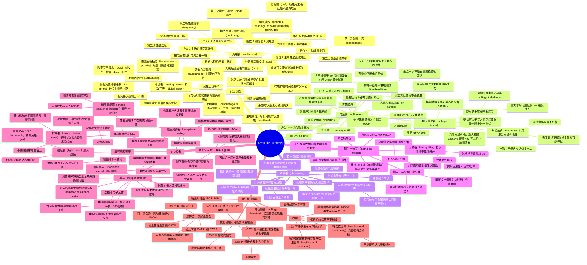

# 26112 电气测试仪表（Electrical Test Equipment）

第十二版 *Electrical, Level 1* 模块 26112-26。电看不见。电工要靠测试仪表确认有没有电，也要靠测得准的数做计算。这一模块讲常用仪表，以及每种仪表怎样安全地测量电气系统的特性。模块编号是 **26112-26**。

学完要能做到：识别常用电气测试设备，并说明怎样使用。

- a. 识别并描述典型的万用表（multimeter）。
- b. 识别并描述怎样使用电压表（voltmeter）。
- c. 识别并描述怎样使用欧姆表（ohmmeter）。
- d. 识别并说明怎样使用钳形电流表（clamp-on ammeter）。
- e. 识别并描述各种专用仪表。
- f. 描述仪表的电气类别等级（category ratings），以及它们怎样用在电工工作里。

在指导下还要能完成两项实操（Performance Tasks）：

1. 测量教室插座上火线对中性线（line to neutral）、火线对地（line to ground）的电压。
2. 用欧姆表测试一只灯开关的通断（continuity）。

电看不见，仪表就是眼睛。测得最多的是电压、电流和电阻，别的特性要用对应的仪表。在可能带电的电路旁边干活，可靠的仪表能救命。没有任何一次测量重要到值得拿安全去赌。

重点单词第一次出现时写成「中文（English）」。后面做题时，英文术语要能认出来。

---

## 1.0.0 识别仪表（Identifying Meters）

### 指针式仪表和数字仪表

指针式仪表（analog meters）用了很多年。一根指针在表盘上摆，对上代表各种单位的刻度。被测的量（电压、电流或电阻）越大，指针摆得越远。原因是电磁作用在连着指针的小线圈上。

图 1 那种传统指针表可以测交流（alternating current, **AC**）和直流（direct current, **DC**）的毫安（milliampere, mA），也可以测交直流电压。有的指针表电流最多测到 10 安培（ampere, A），再大就很少能测。

**交流（AC）**：方向和大小都随时间变化的电流。

**直流（DC）**：只朝一个恒定方向流动的电流。

**电流表（ammeter）**：用来读电流的仪表。

用普通指针式电流表测电流，唯一的办法是把它**串联（in series）**进带负载的电路，让电流从仪表里穿过。低压小电流时问题不大。电路如果是普通线路电压、电流又不小，这样做既不现实，也危险，因为手要靠近带电电路和正在运行的负载。

现在测电流可以不接触带电表面、不接线、也不打断负载电路，用的就是后面要讲的钳形电流表。但测 mA 或微安（microampere, µA）这种很小的电流，最准的办法仍然是把指针表或数字表串联在负载上。电工很少需要测到钳形表量程以下，但这个过程要懂。

图 1 指针表上能看见这些部分：刻度（scale）、分流和倍增电阻（shunt and multiplier resistors）、量程选择开关（range selector switch）、指针（pointer）、动圈（moving coil）、圆形永久磁铁（permanent magnet，在底板后面）、功能选择开关（function selector switch）、定位销（retaining pins）。

1882 年，法国教授 Jacques-Arsène d’Arsonval 发明了检流计（galvanometer），用来检测电流。永久磁铁不动，线圈动，从而量化电流。最早的检流计很准，但只能测非常小的电流。后来量程加大，也更结实。d’Arsonval 机构是电磁原理的早期应用，到今天仍是指针表的工作基础。后来的型号加了熔断器保护，但那种表的机构本身往往只到 30 mA。数字表用途更广，现在占市场主流。

今天大多数仪表用固态数字元件和数字显示（图 3）：

| 显示 | 特点 |
| --- | --- |
| 液晶显示（liquid crystal display, LCD） | 灰度屏。很常见，更便宜 |
| 发光二极管（light-emitting diode, LED） | 彩色屏。亮度、对比度、色彩更准，寿命也往往更长 |

数字表没有表头机构，也没有活动零件，不像指针表那么脆。数字一般比指针好读。但有时仍更想用指针表：

- 指针对瞬间波动反应快。
- 查变压器极性（transformer polarity）时，指针表通常更直观、更快。
- 数字显示可能来不及把很小的波动清楚地显示出来。

有的新数字表在数字下面加一条棒图（bar graph），用来模仿老式指针的摆动。

### 1.1.0 万用表（Multimeters）

有的仪表只测一种量，例如只测电压、电阻或电流。很少有电工会买好几块表来保养，因为一块表就能做必要的测量。后面要讲的电压测试器（voltage tester）是常见的例外：很多电工会另外带一块。

典型万用表把电压表、欧姆表和电流表合在一起。很多还能测：

- 交流频率（AC frequency）
- 电容（capacitance）
- 二极管（diode）和晶体管（transistor）特性
- 温度（temperature）
- 压力（pressure）

其中有些功能要专用附件。

**电压表（voltmeter）**：测量电压的仪表。

**欧姆表（ohmmeter）**：测量对电流的电阻，并判断电路是否完整、是否导通（continuity）的仪表。

**频率（frequency）**：交流电流、声波或振动物体在一段时间里完成的周数。单位是赫兹（hertz, Hz）。1 Hz = 每秒 1 周。

**电容（capacitance）**：器件（例如电容器）储存电能的能力。单位是法拉（farad, F）或微法（microfarad, µF）。

**二极管（diode）**：电子电路里常见的半导体，两个端子，通常只允许电流朝一个方向流。

**晶体管（transistor）**：三个端子的半导体。可以当开关控制电流，也可以当电流放大器。

**通断（continuity）**：电路完整、没有断开，能够传导电流。这样的电路叫闭合电路（closed circuit）。

用万用表时，旋转开关通常要选对三件事：

- 正确的功能：电压、电流、电阻或其他
- 正确的电源类型：AC 还是 DC
- 正确的量程

图 4 是一种常用万用表的旋转开关。橙色按钮相当于笔记本电脑上的 Fn 键。按下之后，每个挡位上用橙色符号标出的第二功能才启用。

| 挡位 | 主功能 | 第二功能 |
| --- | --- | --- |
| 1 | 交流电压，单位 V。V 上面的波浪线代表交流正弦波 | 测交流频率 |
| 2 | 直流电压，单位 V。V 上面一条实线加一条虚线代表直流 | 测直流频率。直流不像交流那样交变，所以频率是 0 Hz。但电子和控制电路里，直流常常按某个频率脉冲，用来当信号 |
| 3 | 直流电压，单位毫伏（millivolt, mV）。符号和直流电压一样。测交流毫伏用第 1 挡，表会自动换成毫伏量程 | 测温度。需要温度探头附件 |
| 4 | 电阻，单位欧姆（ohm, Ω） | 测电容。符号是电容器的图形 |
| 5 | 通断。这一挡也测欧姆电阻，但常用在只想知道电路是闭合还是断开。电路闭合时表会响，不用盯着屏幕 | 二极管测试 |
| 6 | 交流毫安 | 直流毫安，或这个交流毫安值的频率。没有钳形附件时，表必须串联在负载上。低压可以这样做，但电工不常做 |
| 7 | 交流安培 | 直流电流，或这个交流信号的频率。同样，没有钳形附件就必须串联。串联时表能安全测量的最大电流通常是 **10 A** |

有的测量必须手动量程。数字表常常能自动选量程，这叫自动量程（autoranging）。图 4 那种表测交流电压时可以自动选量程，但测直流电压和交流电流时，必须自己选对挡位。

选定功能之后，万用表的用法就和单独的电压表、欧姆表、电流表一样。因为电工喜欢它灵活，这一模块后面讲各种表时，配图大多仍是万用表。

**幽灵读数（phantom readings）**，也叫鬼读数（ghost readings）：表笔没接到电路上，数字表有时仍显示一个很低、不断跳动的电压。常见原因是表拾取了附近带电设备的电磁信号和噪声，有时只是电子电路本身的特性。有的数字表有低阻抗（low impedance, **LoZ**）功能，用来确认读数是真的还是鬼读数。表一接到真实电路上，幽灵读数通常立刻消失。

### 1.1.1 测试设备的安全

工地上每个人都要对自己和别人的安全负责。遵守工地和公司的安全制度。不小心的话，电击、烧伤、坠落、飞来的物体都会让人受伤或死亡。查事故原因时，几乎总能发现：只要遵守简单规则，事故本来可以避免。看到不安全的行为，必须说出来。

拉开主电源的隔离开关，不一定把所有能量源都断掉。电还可能从别的地方灌进设备。人经常被另一路电源的反送电（backfeed）打到。

**反送电（backfeed）**：配电系统里电能反向流动。主电源已经断开，第二或第三电源仍在运行并把电送进来，就会反送。外来电源可以是应急发电机，或太阳能光伏（solar photovoltaic, PV）系统。设备过载也会造成反送。

电能只是危险能量的一种。气动（pneumatic）和液压（hydraulic）能量也可能要切断。做上锁挂牌（lockout/tagout, LOTO）时，还要记住水压、气动压力、蒸汽、被压缩的弹簧。这些也要上锁并挂牌。

干活时还要记住：

- 常见的 120 V 电源不是无害电压。它造成的死亡比任何其他电压都多，只是因为人们不够重视它。
- 每次使用前彻底检查测试设备。看表笔是否折断、插头是否损坏、线是否磨破。湿的或损坏的设备不要用。不可靠的设备要挂牌，并尽快撤离工地。
- 除非主管或教员认定你是合格人员，否则不要在带电设备上干活。
- 安全不能走捷径。带电作业的制度和程序要严格遵守。
- 带电作业（hot work）时，旁边始终要有另一名工人。这个人要知道出了事联系谁，以及怎样断开你正在用的那路电源。

### 1.2.0 电压表（Voltmeters）

电压表测的是电压，也就是两点之间的电位（electrical potential）。表笔用导电探头**并联（in parallel）**接到电路或元件上。测电压不用拆任何导线。

使用前先估计电压大概是多少，把量程设对。接到比所选量程高得多的电压上，会损坏仪表。

理想情况是把量程设成预计值的大约 **两倍**，让读数落在量程中部附近。仪表通常在量程中部最准，最低端和最高端准确度会差一些。相对量程的准确度写在厂家规格里。

很多数字电压表是自动量程，会自己找正确的刻度。不是自动量程的表，挡位会很多（图 5）。

**测量超过 50 V 的电压，有可能致命。** 遵守 NFPA 70E、OSHA 以及公司和培训机构的安全程序。

不是自动量程的电压表，**始终从最高电压挡开始**，再把量程往下调，直到读数靠近量程中部。用没见过的表之前，先看说明书，确认选择开关怎么设。

「从最低挡开始」是错的。

#### 1.2.1 带电—断电—带电测试（Live-Dead-Live Testing）

用电压表去测一个应该已经断电的电路之前，必须先确认表是好的。表坏了，会导致重伤或电死。做法是先在你知道带电的电路上试表，证明它能正确、可靠地读出电压，再用它去测要干活的那条电路有没有电。确认那条电路已经断电、可以干活之后，再回到已知带电的电源上把表再试一次。这叫 **live-dead-live test**。看起来麻烦，但这是保命的步骤。

三步的顺序是：

1. **Live**：在已知带电的电源上试表，证明表是好的。
2. **Dead**：去测要检修的系统，确认它已经断电。
3. **Live**：再回到已知带电的电源上试一次表。

最后一步不是去测要检修的系统。要检修的系统是中间那一步。所以「live-dead-live 的最后一步是测试要检修的系统、确认它已断电」这句是 **错的**。

NFPA 70E《工作场所电气安全标准》给所有和电路打交道的手艺工人提供基本安全做法。**NFPA 70E Section 110.6(E)** 要求：在电压大于或等于 50 V 时，测试「没有电压」之前，必须先在已知电压源上测试电压表。NFPA 70E Article 120 讲怎样建立电气安全工作状态，里面有 LOTO 过程。OSHA 也有类似的安全电气作业规定。

在墙上插座测电压，是一个比较安全的试表位置。可以先插一个电器，确认插座有电。在美国，电压大约是 **110 VAC 到 120 VAC**。

戴好 PPE，包括安全眼镜，然后：

1. 黑表笔插入接地端，也就是公共端（common, **COM**）。COM 插孔是黑色的，标着 COM。
2. 红表笔插入电压/电阻插孔（volts/ohms, **VΩ**）。这个孔是红色的。两根表笔除了颜色没有区别。但以后测直流时，表笔插进对应颜色的孔，极性才不会错。
3. 旋转开关转到正确挡位。屏幕亮起，说明表已打开。自动量程的表，交流电压通常只有一个挡。必须手选时，从最高交流挡开始，再降到读数靠近量程中部。
4. 表笔插入插座孔：先黑后红。读数不受先后影响，但养成这个习惯有好处。图 5 测的是火线和中性线之间的电压。实操还要再测一次火线对地。
5. 读屏幕上的电压，确认和预计一致。测完把表笔从插座拔出。

**如果表设在电阻或其他不是电压的挡位，表笔又碰到带电部件，表和表笔可能严重损坏，人也可能受伤。** 表里有熔断器保护，但偶尔仍会发生灾难性损坏。

表笔接触带电电路时，金属尖端本身就带电。不要碰探头的金属部分。两根探头的金属部分也不能互相碰到，也不能碰到旁边的导电表面。

**验证单元（proving unit）**可以代替带电电路，用来证明电压表是好的（图 6）。它用四节 AA 电池产生 **240 VAC 或 240 VDC**。打开之后，把表笔插进两个凹进去的测试点即可。工地上不容易找到带电电路时特别有用，可以放在手边反复用。

#### 1.2.2 电压测试器（Voltage Testers）

有时必须知道准确电压。例如算电压不平衡（voltage imbalance），需要相与相之间的准确电压，这时必须用电压表。更常见的情况是只想知道有没有电压，以及电压大概在哪个范围：电路或元件带电吗？是 120 V、240 V，还是 480 V？这时可以用电压测试器（图 7）。

例如电动工具不转，用电压测试器排查：如果那边有电，问题就在工具或它的电源线上。三相电动机不起动时，也可以用它确认电动机那边有没有电。

**电压不平衡（voltage imbalance）**：对三相电源，任一相电压偏离三相平均电压的最大偏差，再除以平均电压。一般用百分数表示。**2% 通常就算过大。**

要在电路上干活时，电压测试器或电压表都可以用来确认电路已断电。但不管选哪一种，安全作业都要做 live-dead-live。

用电压测试器之前先看量程，确认被测电压落在这个范围里。大多数用一排灯显示检测到的最高电压。高级电压测试器还可以测接地故障断路器（ground fault circuit interrupter, GFCI）。

电压测试器主要有两类，其中一类更准确的名字是电压检测器（voltage detector）：

| 类型 | 怎样工作 | 告诉你什么 |
| --- | --- | --- |
| 接触式（contact tester） | 探头必须碰到带电表面 | 在合理范围内报告实际电压 |
| 非接触式（noncontact voltage tester），也叫接近检测器（proximity detector） | 靠近带电表面即可 | 只报告有没有电压，不报告多少 |

非接触式不如电压测试器或电压表可靠，信息也少。**动手干活之前，不要用非接触式电压检测器来确认电路已经断电。** 要用电压测试器或电压表。

非接触式适合快速扫一小块区域，看有没有电压，或看一根电缆里有没有导体带电。例如用在接线盒、配电盘上，或顺着墙追踪电缆路径。大多数带电导体，包括包着绝缘的，它都能测。但穿过金属屏蔽或线管就不可靠。下面这些情况也会让它不可靠：

- 离电源太远
- 没有握在裸手里。戴着手套也可能干扰
- 电压源的频率因为某种原因失真
- 环境温度超出厂家规定的工作范围

图 7 那种高级电压测试器，有的既能接触，也能非接触。

每次使用都要检查电压表或电压测试器：状态良好、工作可靠。表笔不能开裂或磨破。损坏的表笔和露出的导线是明显的电击危险。这些工具既用来排查故障，也是你防止重伤的个人防线。

有的测试器是为快速读数做的，在电压源上放太久可能损坏。用之前看说明书。

表笔附件：仪表通常配一组固定尖头表笔。鳄鱼夹（alligator clips）可以夹住，腾出双手。钩形探头（hook probes）和镊子探头（tweezer probes）适合测小元件和电路板。夹持钩（gripper hooks）是缩小版的鳄鱼夹。

### 1.3.0 欧姆表（Ohmmeters）

欧姆表测量电路或元件的电阻，单位是欧姆。也用来找出开路或短路、测熔断器（图 9）、测电动机绕组（图 10）。

查熔断器或开关的通断时，精确电阻值不重要。有通断时，闭合的开关或完好的熔断器一般显示 **0 Ω**。实际上总有一点很小的电阻，但小到落在欧姆表量程之外。

| 被测件 | 读数 |
| --- | --- |
| 完好的熔断器、闭合的开关 | 0 Ω，通断挡会响 |
| 开路或熔断的熔断器、断开的开关 | 表没有通断反应。数字表在表笔分开时常显示 OL |

很多数字欧姆表是自动量程。内部选好刻度，读数会标出范围：欧姆、千欧，有时是兆欧。所有指针式欧姆表，以及一部分数字欧姆表，要自己选量程。和测电压一样：**从最高量程开始，再往下调**，直到精度够用。

**千欧（kiloohms, kΩ）**：1,000 Ω。

**兆欧（megohms, MΩ）**：1,000,000 Ω。

三相电动机绕组：任意两根引线之间的电阻应当相等（图 10）。

大多数数字表在测到的电阻很低或为 0 Ω 时会发出声音，表示导通。通断测试不需要精确电阻，这个声音很有用。

欧姆表自己要有电压才能工作，因为判断通断需要一点电压。这个电压来自表内电池。所以把欧姆表表笔接到带电电路上，会立刻、永久地损坏仪表。万用表的欧姆挡有熔断器，用来防止过载损坏表。**用欧姆表之前，始终先用电压表确认电路已经断电。** 欧姆表不工作，按厂家说明检查熔断器。

使用前把两根表笔碰到一起。读数是 0 Ω，说明表是好的。指针表可能要调零，把指针调到零，用来补偿表笔自身的电阻：旋钮转到显示 0 Ω。每换一个量程，通常要重新调零。数字表很少有、也很少需要可调的调零功能。

**用欧姆表读数之前，先用电压表确认电路两侧都已断电。电路如果带电，表可能灾难性损坏，并把你打伤。**

灯开关的通断测试（实操第 2 项）。开关拿在手里，没有接线：

1. 表笔插入测电阻的正确插孔。开关转到电阻/通断挡。屏幕应亮起。数字表在表笔还没碰在一起时，常显示 **OL**。
2. 两根表笔相碰。应读 0 Ω。如果声音功能开着，会响。
3. 开关扳到 Off。表笔放在两侧端子上。表不应有反应，表示开路。
4. 开关扳到 On，再测一次。应读 0 Ω。声音功能开着就会响。

### 1.4.0 钳形电流表（Clamp-On Ammeters）

钳形电流表也叫 clamp meter 或 amp clamp。它不接触带电导体就能测电流，靠的是检测导线周围电磁场的强度。

图 11 那种钳形表本身也是万用表，虽然样子和前面的万用表不同。钳形电流表很多年只测电流，现在大多数型号是万用表，功能大体和标准万用表一样。很多标准万用表也能测电流，但要配一套兼容的钳口附件（图 12）。

它用的是基本的变压器原理。导体周围看不见的电磁场，强度随电流变化。电流越大，电磁场越强。表感应这个场的强度，再显示对应的电流。

**钳口不能同时套住多根导体，否则读数不可靠。** 即使两根是并联导体（parallel conductors），也要分别套住每一根才准。两根导体的电磁场会互相干扰，哪怕它们两端都连在一起。

例如把钳口套住一台正在工作的 120 VAC 电熨斗的整根电源线，读数往往会非常接近 **0 A**。钳口同时套住火线和中性线时，两根导体里的电流互相抵消（图 13）。要在软线或电缆上测准，必须把导体分开，一次只套一根。

**并联导体（parallel conductors）**：同一规格、同样结构的多根导体，在一段线路的两端都连在一起，用来形成更大的载流路径。这样可以增加载流量（ampacity），而不必用一根粗得多的导体。

反过来，可以把**一根**导体在钳口上绕多圈，把读数放大。测小电流时有用。例如绕 5 圈，表显示 2.5 A，实际电流是 0.5 A。用这个方法时，**读数除以绕的圈数**：

2.5 A ÷ 5 = 0.5 A

所以导体在钳口上绕 3 圈，表上显示的是实际电流的 **3 倍**，不是三分之一，也不是 0，更不是乱跳的无效读数。

始终先看你这台表的说明书。要知道量程，不要测超出量程的电流。钳形表的量程从大约 50 A 到几千安培不等。钳口形状和大小也按用途不同。

图 14 那种钳形万用表配了电流环附件，量程可以扩到 **2,500 A**。显示部分可以拆下来，拿到最多 **30 英尺**外监视电流。

培训环境里通常有敞开、可以接近的交流系统，钳形表能套得住导体。可以在能接近的插座或打开的配电盘上测。箱式风扇或吹风机是合适的负载，它们的电流通常比一只普通灯泡大得多。

基本测电流的步骤：

1. 系统断电后，先把要测的导体摆好或整理好，让钳口能轻松套上去。
2. 确认钳口干净，并且能完全合拢。打开表，选对功能。屏幕应显示当前是在测电流。
3. 需要选量程时，从最高量程开始，保护仪表。
4. 打开钳口，套住你要测的那**一根**导体。拿稳，或确认它有可靠支承再松手。轻的表常常可以直接挂在导体上，但不能让导体或接头受力。
5. 恢复供电。在带电的控制盘或配电盘里面干活时，最好不要两只手同时伸进去。
6. 电路上没有负载，就没有电流。表还套在导体上时，加上电气负载。
7. 读屏幕上的电流。
8. 小心地打开钳口，把表从导体上拿下来。

测电流时，电路或元件是带电的。你和你的工具都不能碰到任何带电表面。必须非常小心，穿对应的 PPE，并按教员的指导练习。

很多电流表有保持（hold）功能：表拿开之后，电流读数仍留在屏幕上。导体位置让你不好看屏幕时有用。测量时按 Hold，拿开后再读。

很多表还有最小/最大（minimum/maximum, min/max）功能，有时标成 Peak。表会记录它停在那里期间的最小值和最大值。分析交流电动机的起动电流时有用。普通电动机的起动电流比运行电流高得多，因为转子要从静止被转起来。

最先进的表可以无线和其他设备通信。数据可以存下来，用应用程序画电流随时间变化的图，也可以在规定距离内远程监视。

带电源线的电器不好套钳口，有三种办法：

- 打开插座盒，把火线分开再套。必须先断电，恢复供电时插座还挂在盒子外面。
- 把电源线里的导体物理分开，钳口只套一根。
- 最好也最安全：用分线器（line splitter）。分线器插进插座，电器再插进分线器。里面火线和中性线被分开，各在大开口的一侧。钳口伸进开口，就能测准。

很多带线电器电流很小，分线器常常把读数乘以 **10**。表显示 20.4 A 时，实际电流是 2.04 A（读数除以 10）。电流小时这样更准。

考试里有一个陷阱：把钳口套在一台 1,200 W 吹风机的**整根电源线**上，预计读数大约是多少？1,200 W 在 120 V 下单根导体大约是 10 A，但钳口套的是整根线，火线和中性线抵消，读数大约是 **0 A**。不要选 10 A。

### 1.5.0 专用仪表（Specialty Meters）

#### 1.5.1 兆欧表（Megohmmeters）

普通欧姆表测不了几百万欧姆的电路电阻。标准欧姆表只会把这样的电路显示成开路（没有通断）。但有时需要测高电阻。例如电动机绕组和地之间的高电阻，用来判断绕组绝缘是否健康、可不可靠。电动机里总有一条绕组到地的最小电阻路径，维护人员需要知道这个值。导体穿管拉过去之后，也可以测绝缘是否完好。

测高电阻要用兆欧表，也叫 megger，更正式的名字是**绝缘电阻测试仪（insulation resistance tester）**。电源可以是交流电源线、电池，或手摇来产生需要的电压。图 15 那种高级表用镍金属氢化物电池（nickel-metal hydride, NiMH），并带内置充电器。兆欧表可以测千欧、兆欧，甚至吉欧（gigaohms，有时说成 gigohms）。

**吉欧（gigaohms, GΩ）**：1,000,000,000 Ω。

标准欧姆表用一节小电池，通常 **1.5 V**，把电送进电路。兆欧表产生高得多的直流电压，例如 **500 VDC、5 kVDC，甚至 10 kVDC**。以前要在小仪器里产生这么高的电压，只能用带线的，或用手摇表内的小发电机（图 16）。现在的电池和电子技术，让无线兆欧表也能产生有效测试需要的电压。

图 15 那种 5 kV 无线表适合测导体绝缘，还能存储最近几次测试的数据。要求不那么高时，也有手持兆欧表。图 17 那种输出 **1 kVDC**，量程从 **10 kΩ 到 200 GΩ**。测得的值超出 200 GΩ 时，屏幕显示 **>200.0 GΩ**，说明这根导体的绝缘明显是好的。

用错会伤人或损坏设备。始终按厂家说明操作，并穿相关 PPE。安全要求包括：

- 兆欧表产生极高电压。只有合格人员可以使用。表开着的时候，绝不要碰测试线。
- 接到电路之前先断电并验证。给被测电路里的所有电容器留出放电时间。任何欧姆表接到带电电路上，都可能损坏或毁掉仪表。
- 被测件要先和其他电路元件全部断开。
- 不要超过厂家对被测电缆或设备推荐的试验电压。厂家可能按电缆或设备的新旧，规定不同的试验电压。
- 测完之后，把可能留在电路里的能量放掉：把导体或设备物理接地，接地时间要等于这次测试持续的时间。
- 考虑被测导体或母线的另一端，并做相应防护。电动机和类似设备必须和所有外部电路完全断开。

兆欧表的电压会损坏敏感电子设备。加表之前，电源线、控制线和传感器线都要断开。

厂家手册会说明怎样测各种设备和装置。有问题就用厂家提供的支持。没有人比制造者更了解自己的工具。

交流电动机绕组经常用兆欧表监测绝缘是否老化，对工艺或基础设施很关键的电动机更是这样。一般认为，绕组引线对地的电阻不应小于电动机电源电压每伏 **1,000 Ω**。例如 230 VAC 电动机：

230 V × 1,000 Ω/V = 230,000 Ω = **230 kΩ**

低于这个值，可能说明电气绝缘正在变差。隔一段时间再测，可以看出趋势，在故障发生前处理。

#### 1.5.2 电动机转向和相序指示器（Motor Rotation and Phase Sequence Indicators）

把三相电动机接到电路之前，最好让电动机绕组和电路的相匹配。这样电动机才会朝正确方向转。相接错了，起动时就会反转。大多数三相电动机两个方向都能转，但所带的负载未必允许反转。

**电动机转向表（motor rotation meter）**用来识别电动机绕组的引线。**相序指示器（phase sequence indicator）**用来识别电路的相。图 18 那种表两件事都能做。

**不要把电动机转向测试器接到带电设备上。** 可能发生灾难性损坏，并造成人身伤害。

用法：把三相电动机的引线接到测试器上，再把电机轴转半圈。测试器上的指示会确认转向是顺时针还是逆时针。它通过分析相序，并比较三相电压或电流信号的相位角，判断三相电动机的转向。

如果要求顺时针，测试器也显示顺时针，就把电动机引线做上标记，和转向表的引线对应。如果要求顺时针，测试器却显示逆时针，就把引线对调，再测一次，对了再做标记。测试器种类很多，按你这台的说明书做。也有非接触式转向测试器。

转向表的引线颜色，不一定对应常见的三相颜色代码。最好在表的引线上贴相色带，和电路的颜色代码一致，避免接错。

没有运动部件的静态电源，例如光伏装置里的逆变器（inverters），不涉及转动，只涉及相序。

相序指示器用在三相系统上，显示决定电动机转向的相序。通常用 LED 表示顺时针或逆时针。

相序测试时电路必须带电，所以只有合格人员可以使用。穿对应的 PPE。在你自己合格之前，这种测试要在监督下做。

也有所谓非接触相序指示器，这个名字容易误解：仍然需要测试线，只是夹在导体的绝缘部分上，不直接接触导体。

相序指示器的一个用途，是保证整个设施里相序一致。一般步骤：

1. 断电，并给电路上锁。
2. 把测试器的三根引线接到相导体上。确认引线和导体都不会靠近或碰到其他即将带电的表面。
3. 小心地给电路送电，观察仪表。记下引线接到系统上的颜色，以及表上显示的相序。
4. 再次断电并上锁，然后才拆引线，并按需要挂牌或贴带。

三相电动机相序不对时，电机会**朝错误的方向转**。不是迅速过热，不是只哼哼不转，也不是以设计转速的一半旋转。

#### 1.5.3 插座测试器（Receptacle Testers）

插座测试器（图 19）用来检查接地电路的状况。插进接地插座，不同的灯表示：

- 地线开路（open ground）
- 中性线开路（open neutral）
- 火线开路（open hot）
- 火线与中性线接反（hot/neutral reversed）
- 火线与地线接反（hot/ground reversed）
- 正确（correct）：插座接线和功能都正常

图 19 那种还可以测试 GFCI 插座。工程快结束、要检查很多面墙上的插座时，插座测试器是最合适的工具。

#### 1.5.4 辐照度和照度表（Irradiance and Light Meters）

辐照度表（irradiance meters，图 20）用在安装和测试太阳能光伏系统时。它测量某个地点在一段时间里的太阳辐射能，用来计算太阳能阵列的预期出力。

辐照度可以用这些单位：

- 瓦每平方米（watts per square meter, W/m²）
- 英热单位每小时每平方英尺（British thermal units per hour per square foot, Btuh/ft²）
- 千瓦时每平方米每天（kilowatt-hours per square meter per day, kWh/m²/day）

有的还能测窗户的太阳透射。其他功能包括：倾角仪（inclinometer）测屋面坡度，指南针测屋面朝向，温度计测环境气温和太阳能组件温度，以及无线数据记录。

照度表（light meters，图 21）测的是人造光的强度，光源可以是白炽灯、荧光灯和其他光源。结果用英尺烛光（footcandles）或勒克斯（lux）表示。

**英尺烛光（footcandles）**：到达一个表面的光的多少，不是从表面反射出去的光。

**勒克斯（lux）**：光强的米制单位。

#### 1.5.5 数据记录仪（Data Loggers）

数据记录仪在一段时间内测量某些特性，并留下永久记录。老设备用图表记录仪（chart recorder）把数据画在纸上。你仍可能在有的地方见到图表记录仪，但数据记录仪更小、更灵活、更简单，基本上已经让图表记录仪过时。

可以监视并记录的电力特性包括：

- 电压（voltage）
- 电流（current）
- 用电量（power consumption）
- 峰值需求（peak demand）
- 电能质量，包括谐波（power quality, harmonics）
- 功率因数（power factor）
- 频率（frequency）
- 交流波形（AC waveforms）

图 22 那种三相电能质量表兼数据记录仪，能做其中很多项。数据可以导出成多种格式，用兼容软件分析。设施工程师可以根据软件分析，实时做能源方面的决定。

不是所有数据记录仪都这么复杂。图 23 那种简单装置记录单个插座上的用电：插进插座，负载再插进这个装置，数据下载后用软件画图。

买的时候，存储容量很重要。记录仪常常按固定间隔记一次，例如每 5 秒或每 3 分钟。读数越多，需要的容量越大。不间断记录能给出非常细的运行情况，但如果要录好几天，存储量会非常大。

电压、电流、频率、用电量和其他常见特性，都有便宜的小型单功能记录仪。它们对系统分析很有帮助，也适合排查那些看起来时有时无的间歇故障。

按指定时间间隔做电气读数的仪器，就是 data logger。除了确认它能记录你需要的量（例如电压），还要考虑**存储容量**。

### 1.6.0 仪表的电气类别等级（Meter Electrical Category Ratings）

电压瞬变（voltage transient）是短暂的高能量电脉冲，可以非常危险。配电系统和负载越来越复杂，瞬变尖峰更可能出现。雷击室外输电线路，或正常开关操作之后的浪涌，也会产生。电动机、电容器、变速驱动器和电能变换设备也会制造尖峰。可以确定的是：电压瞬变对正在电气系统上干活的电工是危险。

**电压瞬变（voltage transient）**：加到电路上的短暂、不需要的电压。从几伏到几千伏，持续时间从微秒到几毫秒。

国际电工委员会（International Electrotechnical Commission, **IEC**）为测试设备制定了安全标准 **IEC 61010**，全称是测量、控制和实验室用电气设备的安全要求。

标准把伤害风险分成四级，风险逐级升高：**CAT I、CAT II、CAT III、CAT IV**。类别号越大，可能出现的电压瞬变幅度越高。

| 等级 | 典型位置 | 风险 |
| --- | --- | --- |
| CAT I | 有保护的电子设备，低压运行，不直接接到线路电压上。例如电脑：线路电压和内部电路之间有整流器 | 对仪表和人的风险最低 |
| CAT II | 插在普通墙上插座里的带线单相电动工具和小家电 | 高于 CAT I |
| CAT III | 范围很宽：住宅和商业建筑里的单相和三相配电系统。开关设备和多相电动机这类负载也在这里。商业建筑里的照明配电盘属于这一级 | 高于 CAT II |
| CAT IV | 电力公司设备、建筑物进户装置（service entrance）和进户导体。在进户隔离开关里面的导体上测电流，需要 CAT IV | 对仪表和人的风险最高 |

在墙上插座测电压，表必须明确标出符合 **CAT II 或更高**。大多数安全问题，CAT IV 的表都能覆盖，少数例外除外。

同一栋房子里，四个等级的区域通常都有。最好选你在这个工作环境里可能遇到的**最高**等级。

仪表由认可的检测机构独立测试并认证。合格的表会把类别等级清楚地标在外壳上（图 25），一般标在表笔插孔附近，准备测量时能看见。

始终选达到或超过该环境类别等级的表。检查表笔有没有损坏，并确认表笔的等级**等于或高于**仪表。钳形万用表的电流功能和依靠表笔的那些功能，等级可能不同。不要假定整块表、全部功能都是同一个等级。

表笔也有类别等级。表笔和其他附件至少要和表一样高。有的探头有可选塑料套：套上之后才是 CAT III 和 CAT IV；不套时只是 CAT II（图 26）。暴露在超过 CAT II 的场合时，必须把套装上。

#### 1.6.1 怎样选一块安全的表

上面那张表就是选表的依据。插座上测电压，至少 CAT II。商业建筑照明配电盘属于楼内配电，是 **CAT III**。进户隔离开关里测电流，要 **CAT IV**。CAT IV 代表最大风险，不是照明配电盘那一题的答案。

#### 1.6.2 仪表校准（Meter Calibration Requirements）

仪表可靠，但要偶尔校准才能保持最佳性能。通常最好送回厂家，也有独立检测机构。美国国家标准协会（American National Standards Institute, **ANSI**）要求现场和实验室仪器**至少每年校准一次**。

校准不是你自己能做的。即使你能调，也没有授权机构出具的文件来证明。

很多人从不校准，或校准得不够规律。如果表功能正常、读数一直符合预期，多数人认为风险很小。电压表稍微偏一点，日常使用往往不是问题。但所有电气测试仪器都应该定期校准，读数才可靠，设备才安全。

有些场合校准不是可选的。设施调试（commissioning）时，工程说明书常常要求某些测量必须用持有有效校准证书的表来做。校准证书通常有效期 **一年**。

检测机构做完会在仪器上贴带日期的校准标签。这个标签永远不要撕掉。还会提供纸质或电子文件。工程说明书甚至可能要求把证书副本放进合同档案。

校准证书（certificate of calibration）和符合性证书（certificate of conformity）不是一回事。符合性证书只向买方确认仪表符合所列规格或标准，**不能证明**这台设备做过校准。

校准信息和工作流程看厂家网站。有的产品出售时已经包含以后的校准服务，别的产品可以另买校准服务协议。

按设备和要认证的功能，校准费用一般从 **75 美元**到高级设备的 **1,000 美元**。不含证书的校准服务通常更便宜。

### 1.0.0 小节复习

1. 万用表旋转开关上，一个符号上面有波浪线，表示这个选项和 _____ 有关。
   - a. AC　b. DC　c. current　d. resistance
2. 用没有自动量程的电压表测量时，先把电压表设到最低量程。
   - a. True　b. False
3. 测试闭合的开关或完好的熔断器时，欧姆表应显示什么？
   - a. OL　b. 0 Ω　c. Infinity　d. 表没有反应
4. 把电流表钳口套在一台插在插座上的 1,200 W 吹风机电源线上，预计测到大约多少电流？
   - a. About 0 A　b. About 5 A　c. About 10 A　d. About 15 A
5. 三相电动机相序不对时会发生什么？
   - a. 电动机迅速过热　b. 电动机发哼声但不转　c. 电动机朝错误方向转　d. 电动机以设计转速的一半旋转
6. 哪一个类别等级对电工的安全风险最大？
   - a. CAT I　b. CAT II　c. CAT III　d. CAT IV

答案：1 a，2 b，3 b，4 a，5 c，6 d。

---

## 模块复习题

奇数题的答案与课本后面的答案一致。偶数题课本没有给答案，下面是按对应章节做出来的。先自己做，再对答案。

图 RQ01 就是图 4 那个旋转开关，挡位 1 到 7 的含义见上面的表。

1. 关于指针式仪表，哪一句正确？
   - a. 指针表靠 LCD 显示
   - b. 指针表是固态仪器
   - c. 指针表有自动量程设置
   - d. 指针表很少能测量大于 10 A 的电流
2. 看图 RQ01。挡位 3 的主要测量功能是什么？
   - a. Temperature　b. DC voltage in mV　c. AC voltage in mV　d. DC frequency
3. 看图 RQ01。挡位 4 的第二测量功能是什么？
   - a. Frequency　b. Temperature　c. Capacitance　d. Diode testing
4. live-dead-live 测试的最后一步，是测试要检修的系统，确认系统已经断电。
   - a. True　b. False
5. 在 _____ 时，始终应该用电压表，而不是电压测试器。
   - a. 测试绝缘完好性　b. 计算电压不平衡　c. 检查插座有没有电　d. 做 live-dead-live 测试
6. 关于欧姆表，哪一句正确？
   - a. 数字欧姆表每次使用前都必须调到读数 0 Ω
   - b. 使用前始终把表笔碰到电压源上来测试欧姆表
   - c. 欧姆表的电池提供测试电路或器件所需的电压
   - d. 欧姆表要工作，被测电路必须在正常电压下带电
7. 一根导体在钳形电流表的钳口上绕了三圈，屏幕上应该看到什么？
   - a. 大约 0 A　b. 随机的、不准确的读数　c. 实际电流的三倍　d. 实际电流的三分之一
8. 绝缘电阻测试仪是 _____ 的另一个名字。
   - a. ammeter　b. multimeter　c. megohmmeter　d. continuity tester
9. 电动机转向表的功能是什么？
   - a. 测量电动机转速
   - b. 使三相电动机反转
   - c. 识别单相电动机相对于转向的相
   - d. 识别三相电动机的绕组和转向
10. 要用在商业建筑的照明配电盘上，仪表必须具有什么电气等级？
    - a. CAT I　b. CAT II　c. CAT III　d. CAT IV

### 复习题答案

| 题 | 答案 | 依据 |
| --- | --- | --- |
| 1 | d | 1.0.0。指针表用指针和线圈，不是 LCD，也不是固态自动量程。电流很少能超过 10 A |
| 2 | b | 1.1.0。挡位 3 主功能是直流毫伏。温度是它的第二功能。交流毫伏用挡位 1 |
| 3 | c | 1.1.0。挡位 4 主功能是电阻，第二功能是电容。二极管测试是挡位 5 的第二功能 |
| 4 | b | 1.2.1。顺序是已知带电、被测断电、再回已知带电。最后一步是再证表是好的 |
| 5 | b | 1.2.2。电压不平衡要准确的相间电压。绝缘用兆欧表。查有没有电、做 live-dead-live，电压测试器也可以 |
| 6 | c | 1.3.0。电压来自表内电池。电路必须先断电。数字表很少要调零。表笔碰电压源会毁表 |
| 7 | c | 1.4.0。显示值 = 实际电流 × 圈数。要实际值就用显示值除以圈数 |
| 8 | c | 1.5.1。megohmmeter 也叫 megger，正式名称是 insulation resistance tester |
| 9 | d | 1.5.2。转向表识别绕组引线和转向。识别电路的相是相序指示器。不能接到带电设备上 |
| 10 | c | 1.6.0。商业和住宅楼内的配电，包括配电盘，是 CAT III。CAT IV 是进户和电力公司侧。表必须达到或超过现场等级，这道题对应的等级是 CAT III |

### 补充练习

1. 电路的电位可以用 _____ 来测量。
2. 使用不是自动量程的电压表时，应从最高挡开始，再往下调，直到测量值落在 _____。
3. 判断：电压表的表笔与电路并联连接。
4. 用指针式万用表测电流时，怎样接到电路上？
5. 短路可以用 _____ 来查找。
6. 为了确认导体拉线时绝缘没有损坏，你使用 _____。
7. 工程快结束了，你要检查 45 个墙上插座是否完好。最好用什么工具？
8. 照度表用 _____ 或 _____ 测量光强。
9. _____ 用来按指定的时间间隔做电气读数。
10. 选数据记录仪时，除了确认它能记录需要的特性（例如电压），还要考虑什么？

补充练习奇数题答案与课本一致：

| 题 | 答案 | 依据 |
| --- | --- | --- |
| 1 | voltmeter 或 voltage tester | 1.2.0，1.2.2。电位就是电压 |
| 3 | True | 1.2.0。测电压是并联，不用拆线。测电流的串联是电流表 |
| 5 | ohmmeter | 1.3.0。欧姆表用来识别开路或短路 |
| 7 | receptacle tester | 1.5.3。插上去看灯，比一块一块用万用表量快 |
| 9 | data logger | 1.5.5 |

偶数题按课文：

2. **量程中部附近（near the center of the range）**。1.2.0。中部最准。从最高挡往下走，不是从最低挡开始。
4. **串联在带负载的电路里，让电流从仪表中通过。** 1.0.0。这是指针式电流表测电流的唯一办法。线路电压、电流较大时既不现实也危险。
6. **megohmmeter**（也叫 megger 或 insulation resistance tester）。1.5.1。穿管之后检查绝缘完整性。
8. **footcandles 或 lux**。1.5.4。英尺烛光是到达表面的光，不是反射光。勒克斯是米制单位。
10. **数据存储容量（data storage capacity）**。1.5.5。间隔越短、记录越久，需要的容量越大。

---

## 工匠案例（Cornerstone of Craftsmanship）

课本这一节采访的是 Justin Johnson，堪萨斯城退伍军人医疗中心（Kansas City VA, KCVA）的设施合规官。考试一般不直接考他的生平。和他的工作有关、也和本模块有关的一点是：他现在跟踪医院关键系统的预防性维护、测试和新安装的文件，并跟上可能影响设施的规范变化。他给新人的建议是早点到，准备好学这门手艺。

---

## 重点单词

| English | 中文 |
| --- | --- |
| analog meter | 指针式仪表。指针、动圈、永久磁铁。电流很少超过 10 A |
| digital meter | 数字仪表。LCD 或 LED，没有活动零件 |
| AC / DC | 交流，方向和大小都变 / 直流，只朝一个方向 |
| ammeter | 电流表。普通表要串联，最大通常 10 A |
| voltmeter | 电压表。并联，不用拆线 |
| ohmmeter | 欧姆表。测电阻和通断。电压来自表内电池，电路必须断电 |
| multimeter | 万用表。电压、电阻、电流合在一块 |
| continuity / closed circuit | 通断 / 闭合电路。完整、能导电 |
| frequency / hertz (Hz) | 频率 / 赫兹。1 Hz = 每秒 1 周 |
| capacitance / farad (F) | 电容 / 法拉。也用微法 µF |
| diode / transistor | 二极管，两端子、单向 / 晶体管，三端子，开关或放大 |
| autoranging | 自动量程。没有这个功能时，从最高挡开始，读数调到量程中部 |
| phantom / ghost reading | 幽灵读数、鬼读数。LoZ 用来确认是不是真电压 |
| LoZ | 低阻抗功能 |
| backfeed | 反送电。发电机、光伏，或设备过载 |
| LOTO | 上锁挂牌。电以外还有水压、气动、蒸汽、弹簧 |
| live-dead-live | 已知带电试表、测目标应断电、再回已知带电试表 |
| proving unit | 验证单元。四节 AA 电池，产生 240 VAC 或 240 VDC |
| COM / VΩ | 黑色公共插孔 / 红色电压电阻插孔。先黑后红 |
| voltage tester | 电压测试器。看有没有电，以及大概是 120、240 还是 480 |
| voltage imbalance | 电压不平衡。最大偏差除以三相平均电压。2% 通常过大 |
| noncontact voltage tester | 非接触电压检测器。只报告有没有电压。不能用来确认可以动手干活 |
| proximity detector | 接近检测器，非接触式的另一叫法 |
| GFCI | 接地故障断路器。高级电压测试器和有的插座测试器可以测 |
| kΩ / MΩ / GΩ | 千欧 1,000 / 兆欧 1,000,000 / 吉欧 1,000,000,000 |
| OL | 数字表上的开路或超量程显示 |
| clamp-on ammeter | 钳形电流表。不接触导体，感应电磁场。一次只套一根 |
| parallel conductors | 并联导体。两端都连在一起，用来加大载流量 |
| line splitter | 分线器。把火线和中性线分开，读数常乘以 10 |
| Hold / min/max | 保持读数 / 记录最小和最大，用来看电动机起动电流 |
| megohmmeter / megger | 兆欧表。正式名称 insulation resistance tester |
| insulation resistance tester | 绝缘电阻测试仪 |
| NiMH | 镍金属氢化物电池 |
| motor rotation meter | 电动机转向表。识别绕组引线和转向。不能接到带电设备 |
| phase sequence indicator | 相序指示器。识别带电电路的相序。只有合格人员可用 |
| receptacle tester | 插座测试器。开路、接反、正确，有的还能测 GFCI |
| irradiance meter | 辐照度表。太阳能。单位 W/m²、Btuh/ft²、kWh/m²/day |
| light meter | 照度表。人造光。单位 footcandles 或 lux |
| footcandle / lux | 英尺烛光，到达表面的光 / 勒克斯，米制光强 |
| data logger | 数据记录仪。按时间留下记录。要看存储容量 |
| voltage transient | 电压瞬变。几伏到几千伏，微秒到几毫秒 |
| IEC 61010 | 测试设备安全标准。规定 CAT I 到 CAT IV |
| CAT I / II / III / IV | 电子设备 / 插座电器 / 楼内配电 / 进户和电力公司。号越大风险越高 |
| ANSI | 美国国家标准协会。现场和实验室仪器至少每年校准一次 |
| certificate of calibration | 校准证书。通常有效一年。调试时常常强制要求 |
| certificate of conformity | 符合性证书。只证明符合规格，不证明校准过 |

---

## 复习时先记这几条

- 指针表靠指针和电磁线圈，电流很少超过 10 A。数字表是 LCD 或 LED。查瞬间波动和变压器极性时，指针表往往更好。
- 旋转开关：波浪线是 AC，实线加虚线是 DC。挡位 3 主功能是直流毫伏，第二功能是温度。挡位 4 主功能是电阻，第二功能是电容。挡位 5 是通断，第二功能是二极管。串联测电流，上限通常 10 A。
- 测电压并联，从最高挡开始，读数放在量程中部。测电流串联，或用钳形表不接触导体。超过 50 V 按 NFPA 70E。120 V 造成的死亡比其他电压都多。
- live-dead-live：已知带电、目标断电、再回已知带电。最后一步是再证表是好的。验证单元用四节 AA 电池，给出 240 V。先黑表笔进 COM，再红表笔进 VΩ。
- 要准确电压（例如电压不平衡）用电压表。只看有没有电、大概是 120 还是 480，用电压测试器。非接触式只报告有没有，不能用来放行动手作业，穿线管也不可靠。2% 的电压不平衡通常过大。
- 欧姆表的电压来自电池，通常约 1.5 V。电路必须先用电压表确认断电。闭合开关和好熔断器是 0 Ω。使用前表笔相碰应是 0。数字表表笔分开时常显示 OL。指针表换量程要重新调零。
- 钳口一次只套一根导体。套整根电源线，火线和中性线抵消，读数约 0。绕 n 圈，显示值是实际值的 n 倍。分线器常常 ×10，显示值要除以 10。
- 高电阻用兆欧表，也叫绝缘电阻测试仪。试验电压可以到 500 V、5 kV、10 kV。电动机绕组对地一般不少于每伏 1,000 Ω，230 V 就是 230 kΩ。测完要接地放电，时间等于测试时间。会损坏电子元件，控制和传感器线先拆掉。
- 转向表认的是电动机绕组，而且电动机不能带电，把轴转半圈。相序指示器认的是电路的相，电路必须带电。相接错，三相电动机反转。光伏逆变器没有转动，只有相序。
- 插座测试器看接地插座接得对不对，也能看开路和接反。照度表的单位是 footcandles 或 lux。数据记录仪要同时看测什么、存储够不够。
- CAT I 电子设备，CAT II 插座电器，CAT III 楼内配电和商业照明配电盘，CAT IV 进户和电力公司，风险最大。表和表笔都要达到或超过现场等级。探头不套只算 CAT II，套上才是 CAT III 和 CAT IV。
- ANSI 要求至少每年校准一次。校准证书和符合性证书不是一回事。证书通常一年有效，标签不要撕。

---

## 脑图

按章节展开。每一节只留这一节的核心。关键字第一次出现时写成中文（English）。

