# 03101 HVACR 入门（Introduction to HVACR）

> **HVACR 行业语音讲解：** [中文版](https://notebooklm.link.google/iJDDxSaAJxE6) · [英文版](https://notebooklm.link.google/tMJNygasv02G)

第六版 *HVACR, Level 1* 模块 03101。本模块没有实操任务（Performance Tasks），以知识为主。这是进入这一行的起点。

**HVACR** = Heating, Ventilating, Air Conditioning, and Refrigeration，供暖、通风、空调和制冷。这一行用来控制住宅、学校、办公室和工厂里空气的温度（temperature）、湿度（humidity）和洁净程度。舒适空调和制冷用的是同一套原理，所以培训里有很多共同点。

全世界大量住宅和商业建筑有供暖，其中很大一部分还有舒适制冷，多数还带某种制冷设备。商店和餐馆里的制冷设备也很多。受过培训的技术工人（craftworker）可以在新建工程（new construction）里安装系统，也可以在已有设施里维修设备。

学完要能做到：

1. 陈述供暖、通风、空调和制冷的基本原理。
2. 描述指导安装和维修的原则：安全、节能与 LEED、执照，以及规范和许可证。
3. 识别职业路径，并描述培训和学徒制（apprenticeship）怎样开展。

重点单词第一次出现时写成「中文（English）」。后面复习和做题时，英文术语要能认出来。

---

## 1.0.0 基本原理（Basic HVACR Principles）

先把 HVACR 这四个字母各自代表什么学清楚。

### 1.1.0 供暖（Heating）

人早就知道烧木头取暖和做饭。现在不必围着壁炉（fireplace）取暖。中央热源，例如炉子（furnace）或锅炉（boiler），用传热（heat transfer）把热送到需要的地方。空气和水是最常用的传热介质。

**传热（heat transfer）**：热从较热的物质移向较冷的物质。

#### 强制送风（forced-air）

家用炉子燃烧燃油（fuel oil）、天然气（natural gas）或丙烷（propane），加热叫换热器（heat exchanger）的金属板。风机（fan）把居住空间的空气吹过换热器，空气变热后再送回去。这叫强制送风系统（forced-air system）。

美国住宅里它很常见，因为安装灵活、性能够用、安装成本相对低。

气流大致是：

- 回风（return air）进入炉子
- 经过换热器被加热
- 送风（supply air）送到房间

炉子可以装在地下室，风机盘管（fan coil）也可以装在阁楼，配合空调使用。

#### 水暖（hydronic）

**水暖（hydronic）**：用热水或蒸汽作为主要传热介质的系统。

水在锅炉里加热，再用泵送到换热器。换热器可以是房间里的踢脚板散热器（baseboard heating element），也可以是有风吹过的盘管（coil）。美国北部和中西部的住宅里常见，大型商业和工业设施里全国都很常见。

#### 常用燃料和电热

| 热源 | 用在哪里 |
| --- | --- |
| 天然气（natural gas） | 城市里管道方便时，优先选用 |
| 丙烷（propane）、燃油（fuel oil） | 乡下没有天然气管网的地方。要在现场用储罐存放，定期用卡车补液 |
| 电阻电热（electric-resistance heating） | 电流通过粗电阻丝，电阻丝发热，空气吹过被加热。电费贵，寒冷地区很少单独用，较暖、很少需要供暖的地区更常见 |
| 电热泵（electric heat pump） | 美国各地都用。比单独电阻电热更省电，而且同一套设备还能制冷。热不够时，常常再加电阻电热辅助 |
| 木头、煤 | 乡下，尤其完全离网（off the grid）、接不到电力公司的房子和企业 |

**热泵（heat pump）**：舒适系统或热水器，靠把标准机械制冷循环反过来运行来制热。

**机械制冷循环（mechanical refrigeration cycle）**：靠机械设备和会变相的传热介质（制冷剂，refrigerant）产生制冷效果。制冷剂在一处吸热，再把热送到另一处。也叫蒸气压缩循环（vapor compression cycle）。

电炉（electric furnace）里常见这些部件：加热元件（heating elements）、限位控制（limit controls）、断路器（circuit breakers）、送风、回风、风机电机组件（blower motor assembly）、过滤器（filter）。

### 1.2.0 通风（Ventilation）

通风可以理解成：把新鲜空气送进封闭空间，用来改善空气质量。新风带来需要的氧气，并稀释空气里的污染物。家里、学校和办公室的空气里有灰尘（dust）、花粉（pollen）、霉菌孢子（mold spores），还有各种气体和气味。常用的两样工具是：引入室外新风，以及空气过滤（air filtration）。

另外两种改善室内空气质量的办法：

- 控制湿度（humidity control）
- 让处理后的气流经过紫外线（ultraviolet light, UV）

UV 是波长比可见光更短的电磁辐射，太阳会自然产生，也可以人工产生，用来杀灭细菌、病毒和类似污染物。医院和同类建筑用它减少设备内部和风管里的细菌。

很多工业场所还要专用通风和空气净化，去掉工艺和材料产生的有害颗粒和烟气。

**有害的（noxious）**：对健康有害，可能有毒，严重时致命。

**渗透（infiltration）**：空气从墙体裂缝、门窗缝隙不受控制地漏进建筑。这是不希望发生的。

今天的节能建筑把窗户、门和细缝的渗透压得很低。空气换不出去，室内空气质量（indoor air quality, IAQ）就会出问题。1990 年代人们开始重视这件事，并造出 **病态建筑综合征（sick building syndrome）** 这个说法：建筑里的空气或表面积了过多灰尘、气体、霉菌、病毒或其他污染物，影响到里面的人。

因此机械通风（mechanical ventilation）、电子空气净化器等用得更多，也给 HVACR 行业带来了制造、销售、安装和维修 IAQ 设备的机会。

商业和工业环境都有严格的空气质量标准。商业建筑里，室内空气必须持续用新风替换。过滤和处理都很重要，但持续供给含氧的新风是根本。

#### 热力学定律（laws of thermodynamics）

这些不是政府定的法律，是自然规律。现场干活不必背着用，但有助于理解后面的制冷。

| 定律 | 最简说法 |
| --- | --- |
| 第零定律（Zeroth Law） | 如果 A 和 B 都与 C 处于热平衡，那么 A 和 B 也彼此热平衡。像两箱苹果各自和第三箱一样重，这两箱就一样重。它比前三条更根本，所以不叫第四定律。 |
| 第一定律（First Law） | 也叫能量守恒（Law of Conservation of Energy）。孤立系统里能量不能创造，也不能消灭，但可以转移，或从一种形式变成另一种。 |
| 第二定律（Second Law） | 孤立系统的熵（entropy）总在增加。熵可以理解成无序。热会散开：茶壶放下后，热会散进台面、柜子和周围空气。 |
| 第三定律（Third Law） | 完美晶体在绝对零度时熵为零，也就是最有序的状态。 |

#### 节能通风：能量回收通风机（ERV）

房子封得严之后，缝隙进风少了，新风仍要有。专用设备把新风引进、把污浊空气排出，两股气流在换热器里交换热量。

- 新风先经过过滤器或空气净化器（air purifier）
- 夏天：室内凉空气预先冷却进来的室外空气
- 冬天：室内暖空气预先加热进来的室外空气

能在供暖、制冷两种工况都传递能量的通风设备，叫能量回收通风机（energy recovery ventilator, ERV）。它保证室内有干净新风，同时减轻供暖和制冷设备的负荷。

### 1.3.0 空调（Air Conditioning）

从字面看，加热、冷却、改变含湿量、或者只是过滤，都是在“处理空气”。但日常说 air conditioning，几乎都是指把空间冷却到舒适的温度。

室内冷却最常用的方法是机械制冷（mechanical refrigeration），二十世纪初开始使用，基础就是机械制冷循环。

做法可以概括成：用机械设备改变制冷剂的压力和温度。先让制冷剂比吹过它的空气更冷，空气里的热就传给制冷剂。再让制冷剂比室外空气更热，热就能从制冷剂排到室外空气。这样操纵制冷剂，就是蒸气压缩循环的基础。

机械制冷系统是带压力的封闭系统（sealed system）。四个主要部件：

**压缩机（compressor）**  
把低温低压的制冷剂蒸气，压成高温高压的制冷剂蒸气。它提供压缩力，造成制冷剂流动所需的压差，蒸气压缩循环才转得起来。

**蒸发器（evaporator）**  
换热器。室内暖空气里的热传给更冷的制冷剂。制冷剂通常在这里从液体变成蒸气（vaporize，蒸发），再回到压缩机。

**冷凝器（condenser）**  
也是换热器。制冷剂吸收的热传给更凉的室外空气或水。室外空气即使已经很热，流过冷凝器的制冷剂更热，热仍然能传出去。制冷剂放热后冷凝成液体。

**膨胀装置（expansion device）**  
也叫节流装置（metering device）。它造成压力下降，降低进入蒸发器的制冷剂压力和沸点，制冷剂变成很冷的液气混合物，在蒸发器里吸热。

典型空调气流和管路（图 4 的数字）：

| 位置 | 大约温度 |
| --- | --- |
| 室外空气 | 95°F |
| 冷凝器排出的热空气 | 110°F |
| 室内进来的暖空气 | 75°F |
| 送出的冷空气 | 55°F |

管路名称要认：

- 液体管（liquid line）
- 吸气管（suction line）
- 热气管（hot gas line）

温度和压力的关系是蒸气压缩循环的关键。同一种制冷剂可以在一处很冷、在另一处很热，因为压缩机和膨胀装置改变了压力。细节在模块 03107 Introduction to Cooling 里展开。从最小的冰箱到最大办公楼的系统，循环本质上相同，构造可以不同。

#### 热泵怎样制热

室外空气即使很冷，里面仍有热。要完全没有热，温度得低到约 **−460°F（−273°C）**。

制热时，换向阀（reversing valve）改变制冷剂流向：原来的冷凝器改做蒸发器，原来的蒸发器改做冷凝器。因为角色对调，热泵里的盘管不叫冷凝器和蒸发器，而叫室外盘管（outdoor coil）和室内盘管（indoor coil）。热泵也可以从水源取热。

#### 全封闭和半封闭压缩机

| | 全封闭（hermetic） | 半封闭（semi-hermetic） |
| --- | --- | --- |
| 用在哪里 | 住宅和轻型商用空调、热泵，以及较小的成套制冷设备 | 较大的制冷和空调系统 |
| 能不能现场修 | 焊死密封，现场不能拆修。只有最大的那种才值得送回工厂翻修，坏了通常报废 | 也叫可维修压缩机（serviceable compressor），现场可以部分拆开修理 |

### 1.4.0 制冷（Refrigeration）

超市、便利店里的冷柜和冷冻柜用的是同一套机械制冷循环。舒适制冷和冷藏/冷冻最主要的差别是工作温度。

- **高于约 60°F（16°C）**：一般算空调（air conditioning）
- **低于 60°F**：算制冷（refrigeration）

图上的温度对照：

| °F | −40 | 0 | 30 | 45 | 60 | 70 | 80 |
| --- | ---: | ---: | ---: | ---: | ---: | ---: | ---: |
| °C | −40 | −17 | −1 | 7 | 16 | 21 | 27 |

因为温度更低，制冷设备常用特性不同的制冷剂。冷冻柜用的制冷剂，也可能和冰点以上的冷藏柜不同。选哪种制冷剂，通常由厂家的工程团队决定，目标是传热和效率。

机械制冷设备用于家用冰箱，也用于商业和工业：仓库和配送中心的大型冷库、肉类加工厂、乳品厂、海鲜加工，以及把易腐食品送去市场的船、火车和卡车。

#### 蒸发器除霜（defrost）

另一个重要差别：制冷蒸发器盘管必须除霜，否则霜会挡住气流、妨碍传热。

制冷蒸发器常常要在冰点以下运行，通常比箱内温度低 **10°F 到 20°F**（大约低 6°C 到 11°C）。例如箱温维持在约 45°F（7°C），蒸发器就要接近或低于冰点。系统运行时盘管表面会结霜。

- 冷藏（箱内空气远高于冰点）：系统停机后，箱内空气能把霜化掉。
- 冷冻：停机后箱内仍然低于冰点，霜不会自己化掉，必须主动除霜。

除霜办法：

- 盘管表面装电加热元件，这很常见
- 短时间把热的制冷剂蒸气引进盘管
- 用定时器（timer）定期启动除霜，家用冷冻柜就是这样
- 用传感器发现结冰后再启动，避免不必要的除霜

除霜加进空间的热，之后还得再搬走，所以除霜次数要尽量少。

### 1.0.0 小节复习

1. 水暖系统里，主要传热介质是 _____。
   - a. 空气（air）
   - b. 水（water）
   - c. 天然气（natural gas）
   - d. 氨（ammonia）
2. 紫外线（ultraviolet light）用来 _____。
   - a. 给很多住宅供暖
   - b. 控制细菌生长
   - c. 制造空气流动
   - d. 产生制冷效果
3. 在机械制冷循环里，蒸发器（evaporator）的作用是 _____。
   - a. 把制冷剂从高压变成低压
   - b. 把热从制冷剂传给室外空气
   - c. 把热从室内空气传给制冷剂
   - d. 提供压差，让制冷剂循环
4. 冰箱箱温设在 45°F（约 7°C）时，蒸发器盘管预期怎样除霜？
   - a. 靠运行周期之间的箱内空气把霜化掉
   - b. 把热制冷剂气体送进盘管
   - c. 接通装在盘管上的电加热
   - d. 把食物搬出，停机一两天

**答案**

1. **b**。水暖（hydronic）的主要传热介质是水。蒸汽也用，但这道题的正确答案是 water。
2. **b**。UV 用来减少或消灭细菌。
3. **c**。蒸发器把室内空气的热传给制冷剂。选项 b 是冷凝器，选项 d 是压缩机。
4. **a**。箱温 45°F，远高于冰点，停机后箱内空气就能把霜化掉。热气和电加热是冷冻设备更需要的办法。

---

## 2.0.0 指导维修技术员的原则

会技术还不够。合格的技术员始终遵守安全做法，意识到要节能、保护环境，并遵守适用的规范（codes）和标准（standards）。

### 2.1.0 安全（Safety）

一般工地安全，按职业安全与健康管理局（Occupational Safety and Health Administration, OSHA）的规定，在 NCCER 模块 00101 Basic Safety 里已经讲过。HVACR 还有自己的危险。下面只是后面培训里会遇到的一小部分。

**高处作业（working at height）**  
安装和维修经常要上人字梯，或到屋顶修设备。在超过 **6 ft（1.8 m）** 的高度作业时，必须使用个人防坠落装备（personal fall protection）。梯子要放对、固定好。

**燃气炉周围**  
天然气和丙烷都能燃、能爆。汽化的燃油也极易燃。管路安装或维修后，一定要查漏。泄漏可能导致爆炸。这些气体燃烧还会产生几种副产物，其中包括致命的一氧化碳。

**一氧化碳（carbon monoxide, CO）**  
无色、无味、无臭、有毒，比空气轻，是燃烧的常见副产物。CO 与血液里的血红蛋白结合，显著减少送到全身的氧气。换热器开裂，或炉子排烟管装错，都会把 CO 放进有人的空间。技术员必须始终考虑客户的安全。

**燃油炉周围**  
燃油蒸气和氧气混合会形成爆炸性混合物。每次尝试重新点燃燃油燃烧器，都会向燃烧室喷进少量油。房主在打电话报修之前，可能已经试着点了好几次。为避免爆炸，重新点火前要检查燃烧室，让积存的油先汽化并离开燃烧室。

**制冷剂和油**

- 密闭空间里泄漏的制冷剂蒸气会排走氧气，可能使人窒息。有些制冷剂还能燃。必须熟悉系统里的油和制冷剂有什么性质。
- 很多常见制冷剂在大气压力下的沸点远低于 **0°F（−18°C）**。液体制冷剂从受压容器或设备里放出来时，会迅速沸腾变成蒸气，吸收大量热，造成冻伤（frostbite）。尽早习惯戴手套。
- 冻伤程度：一度，皮肤发白、感觉减退；二度，起水疱；三度，皮肤和皮下组织坏死；四度，皮肤、软组织和骨骼坏死。
- **无水氨（anhydrous ammonia）** 用在大型食品加工和储存。anhydrous 的意思是不含水分。大量氨蒸气会刺激眼睛、皮肤和黏膜。不在食品加工或同类行业，一般碰不到。动手前要先学安全要求，并备好装备。
- 有些油和氧气混合后，电弧或明火可以引起爆炸。氧气极易燃，绝不能用来吹扫（purge）制冷剂回路或做类似的事。氮气（nitrogen）不可燃，安全得多，维修和组装制冷管路时经常用它。
- HVACR 用的润滑油本身不一定有毒，但通常按危险废物（hazardous waste）处理，必须按规定处置。有些油会严重损坏商业低坡屋面的防水卷材。不要把油洒在屋顶上，洒了要尽快彻底清理。

二十世纪初家用冰箱曾用二氧化硫（sulfur dioxide, SO₂）做制冷剂。它剧毒，气味刺鼻、令人窒息，蒸气比空气重。泄漏造成过呼吸停止死亡，幸存者可能得支气管炎、肺炎。大约 1929 年后被更安全的产品取代。今天它仍用于某些食品加工和熏蒸，但不再是家用制冷剂。

### 2.2.0 节能与 LEED 绿色建筑

按美国能源部（Department of Energy, DOE）的数据，HVAC 大约用掉普通住宅一半的能源。美国每年大约更换三百万套 HVAC 系统，换成更高效的设备，是全国降低能耗的重要一步。

不少厂家和 DOE、美国环境保护署（Environmental Protection Agency, EPA）一起做 **ENERGY STAR** 项目，推销超过最低能效标准的设备。合格产品列在 energystar.gov，包装上有 ENERGY STAR 标志。建筑设计如果采用低能耗的 HVACR 系统，也可以参加相关项目。主要耗能的是炉子、冷凝机组等设备，可编程温控器甚至灯泡也可以获得 ENERGY STAR 认证。

**冷凝机组（condensing unit）**：通常包含压缩机、冷凝盘管、冷凝风机，以及压缩机控制和运行需要的其他装置。

高效系统只有维护得当才继续高效。盘管堵塞、空气过滤器很脏、风量设定不对、制冷剂充注量不对，都会明显拉低能效和性能。定期测试、清洁、更换不良零件，属于预防性维护（preventive maintenance）。紧急维修少的月份，维护合同往往是公司现金流的重要部分。

回收本会浪费的能量的附加设备也很多：

**能量回收通风机（ERV）**  
用离开建筑的冷空气或热空气，预先处理被送进使用空间的新风。有的 ERV 直接接在建筑通风系统上，并不直接连到 HVAC 主机。

**冰蓄冷（ice storage）**  
很多电力公司在用电高峰时段收费更高。可以在非高峰时段把大水箱冻成冰，高峰时用这些冰补充甚至代替机械空调，把用电挪到低谷，省钱，也帮电网平衡负荷。图上的流程是：冷水机组（chiller）制出 45°F 冷冻水直接供冷，或者把乙二醇-水混合物冷到冰点以下；水箱在混合物够冷时结冰，机组停下、水箱已结冰时，则用来冷却流过的温水。

送风管泄漏时，处理后的空气会漏进非空调空间，能量白费。回风侧泄漏同样浪费能量，还会把灰尘和污染物吸进风管。

风管接缝用一种专用胶泥密封，叫 **胶泥密封剂（mastic）**：柔性密封材料，可以刷，也可以喷，用来封风管接头和保温缝。空气分配系统和设备一样要检查，确认接头还在、不漏。风管材料除了钢板，还有聚氯乙烯（polyvinyl chloride, PVC）、玻璃纤维（fiberglass），以及沿整根长度把空气散进空间的多孔织物风管。

#### 2.2.1 LEED 与绿色建筑设计

1993 年出现 **LEED**（Leadership in Energy and Environmental Design，能源与环境设计先锋）认证，目的是推动美国绿色建筑委员会（US Green Building Council, USGBC）定下的可持续建造和建筑管理标准。它是当今世界上用得最广的绿色建筑评价体系。

**可持续建造（sustainable construction）**：在建筑整个寿命周期里，尽量少影响土地、自然资源和原材料，通常也会降低能耗。

LEED 不只是节能。业主可以靠很多做法去争取认证，例如：

- 施工中使用可回收材料
- 尽量减少施工废物
- 做出节能的建筑围护结构（building envelope），减少冷热损失，同时保证使用者的健康和舒适
- 保证良好的室内空气质量
- 使用节能设备和电器
- 安装自动卫浴控制，减少用水
- 收集雨水用于园艺
- 建造和运行都可持续，没有明显的环境影响

对 HVACR 来说，达到 LEED 意味着：选用节能设备，并按建筑和冷热负荷正确选型（sizing）。还要用最节能的方式保住室内空气质量。

可以申请 LEED 的项目包括新建筑和室内、既有住宅和商业建筑，以及街区、社区和城市。得分类别：

| 缩写 | 英文 | 中文 |
| --- | --- | --- |
| LT | Location and Transportation | 选址与交通 |
| WE | Water Efficiency | 节水 |
| EA | Energy and Atmosphere | 能源与大气 |
| MR | Materials and Resources | 材料与资源 |
| EQ | Indoor Environmental Quality | 室内环境质量 |
| IN | Innovative Building Features | 创新建筑特性 |
| RP | Regional Priority | 地区优先 |

和 HVACR 关系最直接的是 **EA** 和 **EQ**。多数获得 LEED 认证的商业建筑还有建筑管理系统（building management system, BMS），监视并控制 HVAC，以及安防、消防等系统。编好、用好的 BMS 能明显降低 HVAC 能耗。前期成本可能很高，环境和经济效益随时间体现。

认证不只看设计和建造。建成之后，建筑和设备还必须按所获 LEED 等级来维护。常常还要定期再认证。NCCER 在佛罗里达州 Alachua 的办公楼，2011 年建成，按 LEED Silver（银级）设计建造。

### 2.3.0 执照与认证（Licensure and Certification）

安装工和维修技术员做的设备，直接影响建筑里人的健康和安全。燃气炉用天然气或丙烷，燃烧副产物里有 CO，通风和定期维护必须由懂行的人来做。各州和市政府通常要求从事安装和维修的公司持有执照（license）。

**机械承包商（mechanical contractor）**：专门从事 HVACR 设备安装、建造、维护和修理的公司。管道（plumbing）也算机械承包的范围。项目可以是大型商业或工业，也有很多公司只做住宅。

多数州要求机械承包商通过执照考试并交年费，才能在该州营业。考试和费用常常按承包商想承接的工程规模而不同。有些州互相承认执照。课本举的例子是：佐治亚、路易斯安那、俄亥俄、田纳西、得克萨斯、犹他、南卡罗来纳互相承认机械承包商执照。有的州还要求出示工伤赔偿（workers' compensation）和责任保险（liability insurance），承包商可能还要交履约保函（surety bond）：一笔用来保证承包商按约定履约的担保。

各地要求差别很大。动手干活之前，必须先弄清自己所在州或国家的规定。

#### 2.3.1 技术员执照

有的州不要求技术员持证，很多州要求。常见的传统模式有两级：

| 级别 | 含义 |
| --- | --- |
| 熟练工（journeyman） | 可以在本州干活，但多数采用这种模式的州要求熟练工在持有大师（master）执照的人监督下工作 |
| 大师（master） | 考试更长、更难，报考前必须有多年现场经验。机械承包公司至少要有一名持 master 执照的人，这个人对公司里 journey 级别工人做的活负主要责任 |

持有 journeyman 甚至 master，并不等于可以以承包商身份营业。在要求这两级执照的州，通常必须先持有 master HVACR 认证，才有资格申请机械承包执照。各州用词和标准不同，容易搞混。

#### EPA 第 608 条认证

科学上早已证明，氯氟烃（chlorofluorocarbon, CFC）和氢氯氟烃（hydrochlorofluorocarbon, HCFC）制冷剂里的氯会破坏臭氧层（ozone layer）。臭氧层挡住太阳紫外线，破坏后皮肤癌和其他皮肤问题会增加。很多年里，维修时把这些制冷剂直接放到大气中是常规做法。1980 年代末，很多国家同意停止这种排放，并开发不含氯的制冷剂。

后来又更了解温室效应（greenhouse effect）和全球变暖（global warming）：太阳的热量和地球产生的热被困在低层大气里，主要是因为大气中的气体阻止热量辐射到太空。有些不含氯的制冷剂也会助长全球变暖。不管个人怎么看臭氧和变暖，有两点是确定的：把制冷剂排到大气是浪费，制冷剂只要不释放，就不会伤害环境。

1990 年美国国会通过清洁空气法（Clean Air Act, CAA），要求逐步淘汰破坏臭氧的制冷剂，并严格控制和标识制冷剂。EPA 负责实施和执法。CAA 对这一行影响很大。第 608 条（Section 608）对制冷剂的限制，不论含不含氯，包括：

- 凡是接触制冷剂的人，必须通过笔试取得 EPA 认证。买制冷剂也限于持证的人。
- 认证分四级，按设备性质划分。课本写明的两端是：
  - **Type I**：可以做装有不足 5 磅高压制冷剂的小型系统
  - **Type III**：可以做使用低压制冷剂的系统
  - **Universal**：通过另外三级考试的人获得。这是第四级
- 所有涉及制冷剂的交易都要留记录：承包商购买、用在哪里、泄漏设备的修理记录。
- 联邦法律禁止把制冷剂释放到大气中。故意排放（venting）会受罚，包括高额罚款和失去认证。忽视 Section 608 的某些条款，甚至可能坐牢。

这只是要求中的一部分。后面的培训会教到能通过考试。考试考法律，也考制冷剂回路和常见维修操作。注意：通过 EPA 考试，只证明你有遵守 CAA Section 608 所需的知识，授权你购买和接触制冷剂，并不证明你作为技术员的技能水平。

维修时最难的要求是：已经充在设备里的制冷剂，如果必须打开回路，不能排到大气，必须收集起来。这就是制冷剂处理的 **三个 R**：

| 英文 | 做什么 | 做到哪一步 |
| --- | --- | --- |
| Recover（回收） | 把制冷剂从设备里取出，临时存在批准的容器里 | 只表示取出来。过程中常常会过滤，但这个词本身不包括清洗 |
| Recycle（再循环） | 让回收的制冷剂通过过滤装置，去掉水分、酸和固体杂质 | 可以在现场或承包商店里做。纯度无法简单确认，限制很多：不能用于别人名下的设备。可以充回原系统，或用于同一业主的其他设备 |
| Reclaim（再生） | 把用过或受污染的制冷剂处理到新制冷剂要求的纯度 | 不是现场或店内能做的。只有化工厂和专门再处理设施能做。标准是空调、供暖和制冷协会（AHRI）标准 700。只有再生后的制冷剂才能再卖给市场或其他客户 |

### 2.4.0 建筑规范与标准（Building Codes and Standards）

- **规范（code）**：强制命令，有法律效力。也叫 ordinance。保护公众健康、福利和安全。检查员按规范看活是否合格。承包商至少必须达到规范，可以高于规范。规范写的是施工细部的最低可接受标准。达不到会有法律处罚，也可能有民事处罚。
- **标准（standard）**：行业公认的做法，本身是自愿的。标准经常被写进建筑规范或工程技术规格（project specifications）。OSHA 也会把一些标准收进法规。机构常用的说法是 incorporated by reference（通过引用并入）。一旦并入，标准就从自愿变成强制。例子：美国供暖、制冷与空调工程师学会（ASHRAE）标准 62.1，*Ventilation for Acceptable Indoor Air Quality*（可接受室内空气质量的通风），经常被写进建筑规范。

美国没有一部规范管全国施工的所有方面。气候会影响当地怎么写：佛罗里达要考虑飓风，多雪地区的屋顶要能承受积雪。时间也会改写规范。含铅油漆和石棉当年被认为可用，多年后才发现不安全，规范随后禁止。很多老建筑里仍有这些材料，大改时必须处理。

承包商和技术工人必须遵守当地现行版本。地方通常采用广为接受的规范，再附上适合本地的修改。美国采用最广的是国际建筑规范（International Building Code, IBC），由国际规范理事会（International Code Council, ICC）编写维护。ICC 由美国多家规范组织合并而成，目的是统一规范。第一版 IBC 是 1997 年，之后每三年一版。

IBC 出现之前的规范叫遗留规范（legacy codes），按那些规范盖的房子今天还在用：

| 缩写 | 全称 | 编写机构 |
| --- | --- | --- |
| BOCA/NBC | BOCA National Building Code | Building Officials Code Administrators International |
| UBC | Uniform Building Code | International Conference of Building Officials（ICBO） |
| SBC | Standard Building Code | Southern Building Code Congress International（SBCCI） |

同一个州里，这座城市允许的做法，另一座城市可能不允许。不懂法不能当借口。即使你是维修技术员、不负责安装，修理或改动系统时仍然可能做出不被接受的事。

经常被州和市政府采用、从而并入当地规范的全国性规范：

- **国家电气规范（National Electrical Code, NEC）**，编号 NFPA 70，由国家消防协会（National Fire Protection Association, NFPA）出版。规定电气布线的最低标准，执行很严。HVACR 系统的电气安装几乎总是由持证电工来做。
- **国家燃气规范（National Fuel Gas Code）**，编号 NFPA 54，也是 NFPA 编的。管燃气管道安装，以及燃气炉、热水器等器具的排烟。这是两部燃气示范规范之一。另一部是 ICC 的 International Fuel Gas Code。

#### 2.4.1 建筑许可证（Building Permits）

施工或安装开始前，承包商必须向当地政府申请许可证（permit），并提交工程说明，需要时还包括图纸。这样当地规范合规官员知道有这项工程，可以在开工前看图纸、指出不合规的地方。不办许可证会被罚款；屡犯者罚款更重，还可能失去承包执照。许可证通常必须张贴在工地，让公众看得到。

工程进行中，检查员会在不同阶段来。例如一次或多次粗装检查（rough-in inspection），以便看到后来会被遮住的做法。最终检查通过后，才会签发占用证书（certificate of occupancy, COO）。已有建筑只是更换系统时，通常只需要一次检查。

检查员可能看的 HVACR 项目：

- 炉子和锅炉的排烟（venting）
- 燃气管
- 风管的制作和安装方法
- 制冷剂管和其他管道的支架
- 排水管的走向和终端
- 设备摆放位置
- 炉子燃烧空气进气口和排气口的位置与尺寸

燃烧空气进气口的一个例子：加热输入每 1,000 Btuh，进气面积 **1 in²**。

系统由工程团队设计时，工程师也会定期到场，确认施工符合他们的技术规格。

#### 2.4.2 标准是谁发布的

承包商自愿参照标准，因为：

- 标准汇集了建筑师、设计师、工程师、承包商和其他专业人员的经验
- 标准通常针对最好、最安全的方法和材料，也常常是多数规范能接受的做法。但不能默认两者一样：规范可以比标准更严，标准也可以高于适用规范
- 按标准做，工程和工程之间做法一致，效率更高，也有利于名声
- 标准会经常复查和更新

和 HVACR、机械承包有关、会发布标准的组织。考试和现场都先认缩写：

| 缩写 | 组织 |
| --- | --- |
| SMACNA | Sheet Metal and Air Conditioning Contractors National Association。钣金行业做空气分配系统的主要依据 |
| ARI | Air Conditioning and Refrigeration Institute |
| ACCA | Air Conditioning Contractors of America |
| ADC | Air Diffusion Council |
| ADI | Air Distribution Institute |
| AMCA | Air Movement and Control Association |
| ACGIH | American Conference of Governmental Industrial Hygienists |
| ANSI | American National Standards Institute |
| ASHRAE | American Society of Heating, Refrigeration and Air-Conditioning Engineers |
| ASME | American Society of Mechanical Engineers |
| ASTM | ASTM International，原 American Society for Testing and Materials |
| AWS | American Welding Society |
| FMA | Fabricators and Manufacturers Association, International |
| FM | Factory Mutual Engineering Research Corporation |
| MCAA | Mechanical Contractors Association of America |
| NEBB | National Environmental Balancing Bureau |
| TIMA | Thermal Insulation Manufacturers Association |
| UL | Underwriters Laboratories |

### 2.0.0 小节复习

1. 高处作业时，超过 _____ 就必须使用个人防坠落装备。
   - a. 离地 2 ft（0.6 m）
   - b. 离地 6 ft（1.8 m）
   - c. 离地 12 ft（3.7 m）
   - d. 离地 20 ft（6.1 m）
2. 胶泥密封剂（mastic）用来 _____。
   - a. 检测燃气泄漏
   - b. 密封风管
   - c. 给制冷剂管做保温
   - d. 润滑轴承
3. EPA Type I 认证允许技术员做 _____。
   - a. 化石燃料供暖系统
   - b. 里面没有制冷剂的系统
   - c. 装有超过 5 磅高压制冷剂的大型系统
   - d. 装有不足 5 磅高压制冷剂的小型系统
4. 建筑许可证通常由 _____ 签发。
   - a. 当地政府（local government）
   - b. 州政府
   - c. 联邦政府
   - d. 建筑设计师

**答案：** 1. **b**　2. **b**　3. **d**　4. **a**

---

## 3.0.0 培训与机会（HVACR Training and Opportunities）

这一行有很多分支，也有往上走的机会。要先知道怎样才算一名合格的技术工人，再看有哪些工作。

### 3.1.0 成功技术工人的特质

技术工人要能用对材料、工具和设备，把一件活做对、做快。HVACR 技术员还经常得按现场情况调整方法，同时不能降低质量。技术在变，技能要持续磨。

#### 3.1.1 职业素养（Professionalism）

职业素养是工作场所期望的整体行为和态度，范围很宽。它包含这一节后面讲的全部特质。管理层要以身作则，但每个人都要自己负起责任。看到别人不职业，不要跟着散，用自己的做法做例子。职业素养对雇主和雇员都有好处，行业形象就是所有人的行为加起来的。

#### 3.1.2 诚实（Honesty）

诚实和个人正直包括：把活做好、准时、可靠；不偷工减料、不克扣材料；保护雇主、客户和其他工种的工具与材料，不让它们在车间或工地损坏、被盗。

不诚实一定会暴露，无论是偷材料、工具、设备，还是谎报完成的工作。名声会自己传开，要像保护工具一样保护它。诚实也不只是不犯罪：公平的一天工资要换公平的一天劳动；自己的错误要认；答应的事要做到。

#### 3.1.3 忠诚（Loyalty）

工人期望雇主考虑他们的利益、提供稳定工作、该提拔时提拔。雇主也期望工人考虑公司利益、对外说公司的好话、对公司事务保密。忠诚不能靠命令，要靠自己先做出来，再期望对方回报。

#### 3.1.4 愿意学习（Willingness to Learn）

每个雇主、每个工地都有自己的做法。学徒要在短时间里学很多，不懂就要问。安全规定变了，或买了新设备，有经验的人也得学新方法。施工方法必须往前走，企业才能竞争、才能赚钱，老板才有能力扩大规模、提供更好的工作和福利。

#### 3.1.5 愿意承担责任（Willingness to Take Responsibility）

雇主期望工人看到该做的事就去做，而不是一件事要催很多次。职责应当由雇主讲清楚。技术工人还要能判断什么时候不必等指示就该接手，并报告影响安全或产品质量的问题，对自己的错误负责。

入职前常见三道关：

- **药检（drug test）**：入职要测，入职后也常抽查。理由一是你和周围人的安全，受影响的技术员很危险；工伤后如果检测显示你当时受药物影响，工伤赔偿很难成功。理由二是很多总承包商和开发商把分包商有药检制度、安全记录好，作为投标条件。
- **驾驶记录（driving record）**：维修和安装通常开公司配好工具的车。公司要给你上司机保险。保险拒保，雇主很难录用；即使接受，保费太高雇主也可能不录。
- **背景调查（background check）**：和执法部门有过麻烦，常常会成为顾虑。同时也要知道：坐过牢并认真改过的人，在这一行和其他建筑工种里经常仍有机会。

#### 3.1.6 愿意合作（Willingness to Cooperate）

合作就是一起干活，常常是一个团队。先说清要做什么、何时做、怎么做、每个人扮演什么角色，人才能配合好。目标是安全、高效、按时完成。

#### 3.1.7 出勤和准时（Present and On Time）

- **迟到（tardiness）**：上班晚到
- **缺勤（absenteeism）**：因各种原因不在岗

反复迟到、经常缺席，往往说明个人习惯差、职业道德弱，或对这行缺少投入。一个人不到，整个班组可能停下来，公司损失很大。雇主会用扣工资、降职甚至解雇来管。生病或有真正要紧的私事可以请假，但不要让无关紧要的事挡工作。生病就在家尽快恢复；必须请假时尽早通知主管，好安排。可靠的工人为重要的事请假，一般不会有问题。如果是因为不满意这份工作，可以规划离开，但最后一天也要像第一天一样认真干。管不好自己时间的人，很少被选去带人。

美国劳工部的数字：2018 年注册学徒项目里有超过 585,000 名在训学员，2020 年增至 636,000。2017 到 2020 四年里有超过 300,000 人结业，仅 2020 年就超过 82,000。华盛顿（测量）、富兰克林（印刷）、保罗·里维尔（银器）都当过学徒。

### 3.2.0 职业机会

已有的大量设备需要维修、保养和更换。每新建一栋住宅、商业或工业建筑，通常都会装一套或多套 HVACR。几乎每栋楼都有供暖、制冷、空气循环和过滤，很多还有制冷设备，哪怕只是一台家用冰箱。

这一行可以看成三段：

- 住宅 / 轻型商用（Residential / Light Commercial）
- 商业 / 工业（Commercial/Industrial）
- 制造（Manufacturing）

三条路的起点都是学徒（apprentice）。

#### 3.2.1 住宅 / 轻型商用

公司销售、安装和维修炉子、成套空调等住宅和轻型商用设备。便利店一类轻型商用场所还有制冷设备要装、要修。

公司从小到一个人的安装维修店，到有很多雇员的公司都有。雇员里有供暖空调专技、安装工、钣金工和销售。技术员可能单独出工，也可能两人一组，接住宅和小企业的维修电话，也安装本公司销售的炉子和替换用空调。有的公司一组人做更换安装，另一组人做故障排查和维护。新建住宅也需要 HVACR 技术员。

学员常常先跟有经验的技术员做维护。这一层要会很多厂家的很多产品，从窗机到带加湿器、专用过滤的集中系统都有。本地和区域分销商（distributor）向销售、安装、维修公司提供品牌设备、零件、专用工具和其他服务。住宅和轻型商用设备的分销商通常只挂一个设备厂家的牌子。安装公司装完后，常常用定期维护协议继续做保养和维修。

轻型商用制冷：便利店和餐馆需要步入式（walk-in）和手取式（reach-in）冷柜。餐馆的炉灶和厨房通风也要定期维护。厨房排走大量空气，还要用受控的方式把空气补回来。餐馆厨房罩排出的空气，大部分通过同一套罩、用屋顶上专用的补风风机（make-up air fan）补回。

很多社区里的公司其实是全国性公司的子公司。这种全国性公司叫整合商（consolidator）：一个伞形组织，集中做管理、采购、培训等，让本地小公司拥有大公司的能力。

这一段常见职位，从干活到带人、销售、自己开业：

- 安装工（installer）、HVAC 维修技术员、制冷维修技术员、分销商零件销售
- 维修组长、维修经理
- 更换 / 升级销售、新建销售
- 工种讲师（craft instructor）、估算员（estimator）、规范执行检查员（code enforcement inspector）
- 设备销售代表、企业主

#### 3.2.2 商业 / 工业

商业/工业机械承包商为大型办公楼、工厂、公寓、医院、杂货店等安装和维护系统。食品加工需要大型制冷系统，而且要持续维护。

系统部件多，风管和管道可能有几千英尺，通常由工程师设计。一个人更可能只专一两项。离心式冷水机组（centrifugal chiller）这类设备很大，常常要几个工种一起干。

**冷水机组（chiller）**：用机械制冷循环把水冷却，供工业工艺或舒适制冷使用。

装完后，会请空气和水平衡专员（air and water balance specialist）来，确认每个空间或每台设备拿到的是设计风量和水量。

住宅常常一面墙一个温控器。大型商业系统常常有集中数字控制，由 HVACR 控制专员安装和维修。这些系统就是建筑管理系统（BMS），编程和维护需要专门技能。因为控制系统又复杂又多，有的公司只做控制这一块。

做这类工程的机械承包商更大，可能跨州甚至跨国。他们更可能装完就走，由业主另找公司维护。依赖 HVACR 设备的大型设施，也会自己雇维护人员。大型冷水机组、锅炉等，维修需要大量培训和经验。

食品加工和大规模食品储存是制冷方面的重要机会。很多加工厂整个工作区都要制冷，保证产品在加工过程中保持低温。大型系统有几千英尺管道和很多阀门，要和设备一起持续照看。

1902 年，开利公司创始人 Willis Carrier 做出能同时控制湿度和温度、使用无毒不可燃制冷剂的系统，被看成现代空调的发明人。最初是为了解决印刷厂里热和湿把纸弄坏的问题，后来纺织厂也用。大约 20 年后才用于舒适：开利离心式冷水机组装进百货商店和电影院。

商业/工业在住宅那一组职位之外，还常见：

- 运行工程师（operating engineer）
- 控制系统销售与设计
- 领班或总监（foreman or superintendent）、项目经理（project manager）
- 空气和水平衡专员

#### 3.2.3 制造

HVACR 设备和附件厂家有几百家。大的覆盖整个行业，有的只做一种产品或一个市场，例如只做窗机、只做燃气炉，或只做支持制造工艺的冷水机组。还有公司做很窄的专用设备。

给厂家干活的好处通常是工资和福利好，有流动和升职机会。很多厂家有多个厂址，可以换城市。大厂家常有内部培训，大学课程还可能报销学费。

- 产品测试技术员在质量控制实验室工作，确认产品达到规格，也检测保修退回的设备。
- 工程助理或技术员帮工程人员搭建和测试新设计的样机（prototype）。
- 做专用设备的厂家会培训分销商和最终用户。设备专项培训师必须懂设备的每个细节。
- 厂家还有现场服务技术员，处理保修期内的故障和少见问题。他们训练好、能承受压力、能短时间出发，还要能代表公司、自己做判断。

制造段常见职位：车间主管（floor supervisor）、生产经理、销售工程师（sales engineer）、现场服务工程师、产品专项讲师、测试技术员、工程助理、装配工（assembler）。

### 3.3.0 培训怎样进行

进入这一行有好几条路。传统学徒制是为了让人达到熟练工水平，既有技能也有知识，但不是唯一入口。

培训可以由高中（secondary school）和中学后的学校提供：技术学校、社区学院、大学。社区学院和职业与技术教育学校（career and technical education, CTE）很常见，多数有 HVACR 项目，有的就用这套 NCCER 课程。也有在线项目。这些学习可以用来支撑本地公司的学徒计划。NCCER 课程是为支持学徒制设计的，也可以在学徒制之外用来教学和任务训练。

不是每个地方都有注册学徒项目。雇主仍可能雇你、付学费，让你在岗学习，但不承担运营注册学徒项目的责任。

也有人完全跟着更有经验的人在岗学，没有课堂。这样出来的人往往有明显短板，很难在这行里真正出色。有动力的人可以在工作之外自己补教育，仍然可以成功。

你在读这个模块，多半是通过 NCCER 认可的社区学院、CTE 学校、承包商，或采用这套课程的其他机构在学。

#### 3.3.1 学徒项目（Apprenticeship Programs）

注册学徒把在岗学习（on-the-job learning, OJL）和相关课堂结合起来。多数项目包括 HVACR 要四年，结业时能以熟练工水平工作。

学徒办公室（Office of Apprenticeship）属于美国劳工部就业与培训管理局（DOLETA），制定美国学徒培训的最低标准。学徒制以必修课堂和 OJL 为基础。典型最低要求是：

- 每年至少 **144 小时**课堂或同类教学
- 每年 **2,000 小时** OJL
- 四年合计至少 **576 小时**课堂和 **8,000 小时** OJL

少数建筑工种是两到三年，大多数是四年。结业证书由注册学徒项目颁发。

过去要被看成 master，学徒得做出一件大师水平的作品，叫代表作（masterpiece）。大师可以自己开业，也可以按日工资给人干活，今天大体仍是这样。journeyman 来自法语 jour（一天），字面是“按天计的人”。今天指完成规定培训、具备知识和技能、能独立完成该工种大多数常见任务的人，不限性别。

学徒办公室在联邦层面管理，并与各州学徒委员会（state apprenticeship councils, SACs）密切合作。项目一般要符合：

- 学徒通常至少 18 岁。16 和 17 岁的学生在满足公平劳动标准法（Fair Labor Standards Act, FLSA）的某些条件时可以参加
- 要有书面的工作过程安排，说明学徒在岗接受哪些培训和经历
- 要有有组织的教学，讲授与本工种相关的技术知识
- 工资要有书面的、随进度逐步提高的安排
- OJL 要有适当监督，并有足够的设施和机会观察、练习动手技能
- 工作表现和相关教学都要定期评估，并保留记录
- 选拔、雇用和培训的任何阶段都不得歧视

有的机构因工作性质，对学徒还有体能要求。

注册学徒最好有高中学历。车间工艺与工具、基础电学、机械制图、几何和代数都有帮助。手巧、身体好、反应快也受重视。要能又快又准地解决问题，能和别人紧密配合，并把安全放在最高优先级。

学徒通常还要同意（各州和主办机构可能另有要求）：

- 在岗穿戴合适的安全装备，包括高压作业用的个人防护装备（PPE）
- 按要求购买并维护本工种的工具
- 每月向学徒委员会提交 OJL 报告
- 雇用状态变化时直接向委员会报告
- 上课，并遵守包括出勤在内的课堂规定

电气理论和故障排查对 HVACR 技术员极其重要。维修技术员必须看懂复杂电气图，排查多数熟练电工能力之外的控制电路。电气排查是日常工作，做得好的人会很快被看重。

有些地方有青年学徒项目（youth apprenticeship programs, YAPs），学生可以在高中就开始。例如 11 年级进入，高中毕业前可能完成多达两年的 NCCER 或其他项目。时间和机会允许时，高中期间就可以在这一行干活挣钱。毕业后进入行业的起点和工资，会高于刚开始的人。

NCCER 按学徒办公室的标准编写课堂和 OJL 材料，采用基于能力的教学（competency-based）：学员必须通过考试和实操任务，向合格讲师证明自己从每个模块学到了什么。内容由叫主题专家（subject matter experts, SMEs）的有经验技术工人参与设计。行业持续复查，保证内容仍然合用。

NCCER 认证讲师确认学员达到某模块要求的知识和技能后，可以把记录送到 NCCER，记入注册库（Registry）。注册库用来证明一个人换州、换公司时培训到了哪一步。在 NCCER 认可机构学习的学员，每完成一个级别会拿到证书。附录 03101A 是这些证书文件的样子。这些证书在美国各地都承认。

### 3.0.0 小节复习

1. 雇主提供稳定工作并提拔应得的人，而你也以雇主的最佳利益来工作，这是 _____ 的例子。
   - a. 诚实（honesty）
   - b. 忠诚（loyalty）
   - c. 合作（cooperation）
   - d. 承担责任（taking responsibility）
2. 产品测试技术员最可能受雇于 _____。
   - a. 住宅维修公司
   - b. 机械承包商
   - c. 设备制造厂
   - d. 工业制冷承包商
3. 学徒项目每年要求的最低课堂小时数是 _____。
   - a. 50
   - b. 75
   - c. 112
   - d. 144

**答案：** 1. **b**　2. **c**　3. **d**

---

## 模块复习题

奇数题答案在课本附录 A。偶数题按本模块内容演算。

1. 在常见的住宅强制送风炉里，热是从 _____ 传出的。
   - a. 换热器传到空气
   - b. 天然气或油直接传到被调节的空间
   - c. 空气传到换热器
   - d. 制冷剂传到室外空气
2. 在供暖系统里，水或蒸汽常常用作 _____。
   - a. 燃料
   - b. 燃烧副产物
   - c. 热交换介质（heat-exchange medium）
   - d. 蒸发器
3. 能把制冷循环反过来、从室外空气取热的设备叫 _____。
   - a. 炉子（furnace）
   - b. 蒸发器（evaporator）
   - c. 热泵（heat pump）
   - d. 膨胀装置（expansion device）
4. 通风的一种定义是 _____。
   - a. 用来阻止室外空气进入建筑的技术
   - b. 维持空气温度恒定的方法
   - c. 从室内空气除去水分的方法
   - d. 把室外空气引进建筑以改善空气质量的手段
5. 细菌和其他有害生物的生长可以用 _____ 减少或消除。
   - a. 加湿
   - b. 普通空气过滤器
   - c. 紫外线（ultraviolet light, UV）
   - d. 冷却空气
6. 机械制冷循环（mechanical refrigeration cycle）指的是 _____。
   - a. 循环中的制冷剂在一处吸热、再把热送到另一处的过程
   - b. 制冷剂在管路系统里移动的过程
   - c. 移动式制冷设备
   - d. 制冷剂被再生的过程
7. 机械制冷循环里的膨胀装置 _____。
   - a. 提高进入蒸发器的制冷剂压力
   - b. 降低进入蒸发器的制冷剂压力
   - c. 提高冷凝器入口的制冷剂压力
   - d. 降低冷凝器出口的制冷剂压力
8. 在典型机械制冷系统里，热在 _____ 从室内空气传给制冷剂。
   - a. 压缩机
   - b. 炉子
   - c. 蒸发器
   - d. 冷凝器
9. 能量回收通风机（ERV）用离开建筑的冷空气或热空气来 _____。
   - a. 预先处理被送进使用空间的新风
   - b. 驱动气动工具
   - c. 给建筑的其他部分加压
   - d. 加热生活热水
10. 大型办公楼施工期间，最可能安装 HVACR 设备的是哪一类公司？
    - a. 制造厂（manufacturer）
    - b. 分销商（distributor）
    - c. 机械承包商（mechanical contractor）
    - d. 总承包商（general contractor）
11. 制冷剂要再卖给其他客户，必须经过 _____。
    - a. 再生（reclaimed）
    - b. 再循环（recycled）
    - c. 回收（recovered）
    - d. 翻新（refurbished）
12. 把制冷剂释放到大气中 _____。
    - a. 可以，只要制冷剂已经再循环
    - b. 可以，只要制冷剂已经再生
    - c. 被联邦法律禁止
    - d. 只在某些州被禁止
13. 住宅和轻型商用设备的分销商 _____。
    - a. 与机械承包商直接竞争
    - b. 常常拥有很多家机械承包公司
    - c. 他们卖的东西大部分是自己制造的
    - d. 通常只挂一个设备品牌
14. 空气和水平衡专员最可能在 _____ 工作。
    - a. 住宅环境
    - b. 产品分销商
    - c. 商业/工业环境
    - d. 制造环境
15. 学徒办公室在联邦层面管理学徒培训，并与 _____ 密切合作。
    - a. 当地高中
    - b. 学徒结业生
    - c. 州学徒委员会（state apprenticeship councils）
    - d. 厂家的学徒代表

**答案**

| 题 | 答案 | 为什么 |
| --- | --- | --- |
| 1 | a | 燃料加热换热器，风机把空气吹过换热器，热从换热器传到空气。热不会从冷的空气传向更热的换热器。 |
| 2 | c | 水暖系统里，水或蒸汽是传热介质，不是燃料。 |
| 3 | c | 热泵用换向阀把制冷循环反过来，从室外空气取热。 |
| 4 | d | 通风是把新风引进来改善空气质量，不是把室外空气挡在外面。 |
| 5 | c | 课本把 UV 写成减少或消除细菌等有害生物的方法。普通过滤器主要挡颗粒。 |
| 6 | a | 循环中的制冷剂在一处吸热，再把热移到另一处。再生是 reclaim，不是这个循环本身。 |
| 7 | b | 膨胀装置降低进入蒸发器的压力和沸点。提高压力的是压缩机。 |
| 8 | c | 室内空气的热在蒸发器传给制冷剂。冷凝器是把热从制冷剂传给室外空气或水。 |
| 9 | a | ERV 用排出的冷风或热风预先处理进来的新风。 |
| 10 | c | 大型办公楼施工中安装 HVACR 的是机械承包商。制造厂造设备，分销商供货，总承包商管整个工程。 |
| 11 | a | 只有达到新制冷剂纯度、经过 reclaim 的制冷剂才能再卖。recycle 不能卖给别的客户。 |
| 12 | c | 联邦法律禁止排放。再循环或再生都不能当作排放的理由。 |
| 13 | d | 住宅和轻型商用分销商通常隶属单一设备厂家。 |
| 14 | c | 大型商业和工业系统装完后，才需要空气和水平衡专员核对设计风量和水量。 |
| 15 | c | 联邦学徒办公室与州学徒委员会（SACs）合作。 |

---

## 重点单词

先认这些。括号里是本模块用的意思，不是词典里的全部意思。

### 四个字母和基本系统

| English | 中文 |
| --- | --- |
| heating | 供暖 |
| ventilation | 通风 |
| air conditioning | 空调；日常几乎都指冷却 |
| refrigeration | 制冷，通常指低于约 60°F 的应用 |
| temperature | 温度 |
| humidity | 湿度 |
| heat transfer | 传热，从较热处到较冷处 |
| heat exchanger | 换热器 |
| furnace | 炉子，强制送风供暖的主机 |
| boiler | 锅炉，把水加热 |
| forced-air system | 强制送风系统 |
| hydronic | 水暖，用水或蒸汽传热 |
| supply air | 送风 |
| return air | 回风 |
| fan coil | 风机盘管 |
| heat pump | 热泵，把制冷循环反过来制热 |
| reversing valve | 换向阀 |
| indoor coil / outdoor coil | 室内盘管 / 室外盘管 |
| electric-resistance heating | 电阻电热 |
| natural gas / propane / fuel oil | 天然气 / 丙烷 / 燃油 |

### 制冷循环

| English | 中文 |
| --- | --- |
| refrigerant | 制冷剂 |
| mechanical refrigeration cycle | 机械制冷循环 |
| vapor compression cycle | 蒸气压缩循环 |
| compressor | 压缩机，把低压蒸气压成高压蒸气 |
| evaporator | 蒸发器，室内空气把热传给制冷剂 |
| condenser | 冷凝器，制冷剂把热传给室外空气或水 |
| expansion device / metering device | 膨胀装置 / 节流装置，降低进入蒸发器的压力 |
| liquid line / suction line / hot gas line | 液体管 / 吸气管 / 热气管 |
| hermetic / semi-hermetic | 全封闭 / 半封闭 |
| defrost | 除霜 |
| chiller | 冷水机组，把水冷却 |
| condensing unit | 冷凝机组 |

### 空气质量、通风、节能

| English | 中文 |
| --- | --- |
| IAQ, indoor air quality | 室内空气质量 |
| infiltration | 渗透，缝隙里不受控制的进风 |
| sick building syndrome | 病态建筑综合征 |
| ultraviolet (UV) light | 紫外线 |
| noxious | 有害的 |
| ERV, energy recovery ventilator | 能量回收通风机 |
| make-up air | 补风 |
| ice storage | 冰蓄冷 |
| mastic | 风管接缝用的胶泥密封剂 |
| BMS, building management system | 建筑管理系统 |
| ENERGY STAR | 超过最低能效标准的认证标志 |
| LEED | 绿色建筑评价体系 |
| building envelope | 建筑围护结构 |
| sustainable construction | 可持续建造 |

### 安全、执照、规范

| English | 中文 |
| --- | --- |
| OSHA | 职业安全与健康管理局 |
| fall protection | 防坠落 |
| carbon monoxide (CO) | 一氧化碳 |
| frostbite | 冻伤 |
| anhydrous ammonia | 无水氨 |
| nitrogen / oxygen | 氮气 / 氧气。吹扫回路用氮气，不用氧气 |
| hazardous waste | 危险废物 |
| CFC / HCFC | 氯氟烃 / 氢氯氟烃 |
| ozone layer | 臭氧层 |
| greenhouse effect | 温室效应 |
| Clean Air Act (CAA) | 清洁空气法 |
| Section 608 | CAA 里管制冷剂的条款 |
| venting | 把制冷剂排放到大气 |
| recover / recycle / reclaim | 回收 / 再循环 / 再生。只有 reclaim 能再卖 |
| license / certification | 执照 / 认证 |
| journeyman / master | 熟练工 / 大师 |
| mechanical contractor | 机械承包商 |
| surety bond | 履约保函 |
| code / standard | 规范（强制）/ 标准（自愿，被引用后变强制） |
| permit | 许可证 |
| rough-in inspection | 粗装检查 |
| certificate of occupancy (COO) | 占用证书 |
| NEC, NFPA 70 | 国家电气规范 |
| NFPA 54 | 国家燃气规范 |
| IBC | 国际建筑规范 |
| ASHRAE | 美国供暖、制冷与空调工程师学会 |

### 职业和培训

| English | 中文 |
| --- | --- |
| craftworker / craft professional | 技术工人 |
| apprenticeship | 学徒制 |
| OJL, on-the-job learning | 在岗学习 |
| apprentice | 学徒 |
| SME, subject matter expert | 主题专家 |
| Registry | NCCER 培训记录库 |
| distributor | 分销商 |
| consolidator | 把本地公司收在伞下的全国性组织 |
| air and water balance | 空气和水平衡 |
| walk-in / reach-in | 步入式冷柜 / 手取式冷柜 |
| YAP | 青年学徒项目 |
| SAC | 州学徒委员会 |

---

## 复习时先记这几条

- HVACR 四个词：供暖、通风、空调、制冷。空调在口语里指冷却；大约 60°F（16°C）以上算舒适空调，以下算制冷。
- 强制送风靠空气，水暖（hydronic）靠水或蒸汽。热从换热器传到空气，不是反过来。
- 四个部件：压缩机加压，冷凝器向外放热，膨胀装置降压，蒸发器从室内空气吸热。
- 热泵用换向阀把循环反过来。盘管改叫室内盘管和室外盘管。
- 冷藏箱（如 45°F）停机后霜会自己化；冷冻柜要电加热或热气除霜，而且除霜越少越好。
- 超过 6 ft 要防坠落。燃气查漏。CO 无色无味。吹扫用氮气，不用氧气。液体制冷剂会造成冻伤。
- 脏过滤器、堵盘管、风量不对、制冷剂充注不对，都会把高效设备做废。风管缝用 mastic 封。
- LEED 和 HVACR 最直接相关的是 EA（能源与大气）和 EQ（室内环境质量）。
- journeyman 在 master 监督下干活。master 不等于可以当承包商。
- recover 是取出来，recycle 是过滤后再用但不能卖给别人，reclaim 才达到新制冷剂标准、才能再卖。故意排放违反联邦法。
- EPA Type I：不足 5 磅高压制冷剂的小型系统。通过 EPA 考试不等于你已经是合格技术员。
- code 强制，standard 自愿；standard 被 incorporated by reference 之后就强制。许可证向当地政府申请。
- 学徒典型是每年 144 小时课堂、2,000 小时 OJL，四年共 576 和 8,000。
- 住宅/轻型商用分销商通常只挂一个品牌。大型楼的安装是机械承包商。空气和水平衡在商业/工业。产品测试技术员在制造厂。

---

## 脑图

按章节展开。每一节只留这一节的核心。关键字第一次出现时写成中文（English）。

```mermaid
mindmap
  root((03101 HVACR 入门))
    基本原理
      供暖（heating）
        热从较热处传到较冷处（heat transfer）
        强制送风（forced-air）靠空气
          燃料加热换热器（heat exchanger）
          热从换热器传到空气
          回风（return air）进来，送风（supply air）出去
        水暖（hydronic）靠水或蒸汽
          水或蒸汽是传热介质不是燃料
        城市有管道时优先用天然气（natural gas）
        乡下没有气管常用丙烷（propane）或燃油（fuel oil）
          要在现场用储罐存放
        电阻电热（electric-resistance heating）电费贵
          寒冷地区很少单独用
        热泵（heat pump）把制冷循环反过来
          比单独电阻电热省电
          同一套设备还能制冷
          热不够时常加电阻辅助
        木头和煤多用于离网
      通风（ventilation）
        把室外新风引进来改善空气质量
        常用新风和过滤
          也可以控湿度（humidity）
          紫外线（UV）用来减少细菌和病毒
        渗透（infiltration）是缝隙里不受控制的进风
        房子封太严会出现病态建筑综合征（sick building syndrome）
        商业建筑要持续用新风替换室内空气
        热力学定律（laws of thermodynamics）
          第零定律（Zeroth Law）是都和第三个热平衡则彼此也平衡
          第一定律（First Law）是能量守恒
          第二定律（Second Law）是熵（entropy）增加，热会散开
          第三定律（Third Law）是绝对零度时完美晶体熵为零
        能量回收通风机（ERV）
          用排出的空气预先处理进来的新风
          供暖和制冷两种工况都能传能量
      空调（air conditioning）
        日常说空调几乎都指冷却
        机械制冷（mechanical refrigeration）是带压力的封闭系统
        压缩机（compressor）把低压蒸气压成高压蒸气
        冷凝器（condenser）把热从制冷剂（refrigerant）传给室外空气或水
        膨胀装置（expansion device）降低进入蒸发器（evaporator）的压力和沸点
        蒸发器把室内空气的热传给制冷剂
        管路有液体管（liquid line）、吸气管（suction line）和热气管（hot gas line）
        热泵
          换向阀（reversing valve）改变制冷剂流向
          盘管改叫室内盘管（indoor coil）和室外盘管（outdoor coil）
          要完全没有热大约低到零下 460 华氏度
        全封闭（hermetic）压缩机
          用于住宅和轻型商用
          现场不能拆修
        半封闭（semi-hermetic）压缩机
          用于较大系统
          现场可以部分拆开修理
      制冷（refrigeration）
        大约 60 华氏度以上算空调
        低于这个温度算制冷
        温度更低时常用不同的制冷剂
        蒸发器通常比箱温低 10 到 20 华氏度
        冷藏箱停机后箱内空气能把霜化掉
        冷冻柜停机后霜不会自己化
          要用电加热或热气除霜（defrost）
          可以用定时器或传感器启动
        除霜加进的热还得再搬走
          次数要尽量少
    指导安装和维修的原则
      安全
        超过 6 英尺要使用防坠落（fall protection）装备
        燃气和燃油蒸气要查漏
        一氧化碳（CO）无色无味无臭
          比空气轻
          会占掉血液里的氧气
        燃油重新点火前先检查燃烧室
          让积存的油先汽化离开
        制冷剂蒸气会排走氧气
        液体制冷剂放出来会造成冻伤（frostbite）
        无水氨（anhydrous ammonia）用于大型食品加工和储存
        吹扫回路用氮气（nitrogen）
          不用氧气（oxygen）
        润滑油按危险废物（hazardous waste）处置
          不要洒在屋顶上
      节能与 LEED
        暖通大约用掉普通住宅一半能源
        ENERGY STAR 表示超过最低能效
        脏过滤器堵盘管风量不对充注不对都会拉低能效
        预防性维护（preventive maintenance）在紧急维修少的月份常是现金流
        能量回收通风机用排出空气预处理新风
        冰蓄冷（ice storage）在非高峰制冰
          高峰时用冰供冷
        送风泄漏和回风泄漏都浪费能量
        风管缝用胶泥密封剂（mastic）封
        绿色建筑评价（LEED）
          不只是节能
        得分项
          选址与交通（LT）
          节水（WE）
          能源与大气（EA）
          材料与资源（MR）
          室内环境质量（EQ）
          创新建筑特性（IN）
          地区优先（RP）
        和本行最直接的是能源与大气以及室内环境质量
        设备要按负荷正确选型
        多数认证商业建筑有建筑管理系统（BMS）
        建成后还要按所获等级维护
      执照与认证
        机械承包商（mechanical contractor）做安装维护和修理
          管道也算这个范围
        多数州要考试并交年费
          有的州互相承认执照
          可能还要保险和履约保函（surety bond）
        熟练工（journeyman）在大师（master）监督下干活
        公司至少要有一名大师
          对熟练工做的活负主要责任
        持有大师执照不等于可以当承包商
          申请承包执照通常要先有大师认证
        EPA 第 608 条（Section 608）
          接触制冷剂必须通过笔试
          Type I 做不足 5 磅高压制冷剂的小型系统
          Type III 做低压制冷剂系统
          通用级要通过另外三级
          买卖和使用都要留记录
          通过考试不等于技术已经合格
        三个 R
          回收（recover）只是取出来
          再循环（recycle）可以过滤后再用
            不能卖给别人
          再生（reclaim）才达到新制冷剂标准
            才能再卖
        故意排放（venting）被联邦法律禁止
      规范与标准
        规范（code）有法律效力
          写的是最低可接受标准
        标准（standard）本身自愿
          被引用并入（incorporated by reference）之后就强制
          常见例子是 ASHRAE 62.1
        美国没有一部规范管全国所有施工
        国际建筑规范（IBC）采用最广
          大约每三年一版
        旧规范还有 BOCA UBC 和 SBC
        电气最低标准是国家电气规范（NEC）
        燃气管道和排烟看国家燃气规范（NFPA 54）
        许可证（permit）向当地政府申请
          通常要张贴在工地
          不办会被罚款
        粗装检查（rough-in inspection）要在做法被遮住之前做
        最终检查通过才发占用证书（COO）
          只换系统时通常只查一次
        检查员会看排烟燃气管风管和支架
          还有排水设备位置和燃烧空气口
        发布标准的组织先认缩写
          SMACNA 管钣金和空气分配
          ASHRAE 管供暖制冷和空调
          ACCA 是空调承包商
          ASME 是机械工程师学会
          UL 做产品安全认证
    培训与机会
      技术工人的特质
        职业素养（professionalism）是工作中的行为和态度
          每个人自己负责
        诚实（honesty）是把活做好并且准时
          不偷工减料
          自己的错误要认
        忠诚（loyalty）是彼此考虑对方利益
          对外说公司的好话并保密
        愿意学习
          不懂就问
          规定或设备变了也要学
        愿意承担责任
          看到该做的事就做
          报告影响安全或质量的问题
        入职常过三关
          药检（drug test）
          驾驶记录（driving record）
          背景调查（background check）
        合作要先说清做什么何时做和谁来做
        反复迟到（tardiness）或缺勤（absenteeism）会让整组停下来
          必须请假就尽早通知
      职业机会
        三条路的起点都是学徒（apprentice）
        住宅和轻型商用
          销售、安装和维修炉子（furnace）与成套空调
          分销商（distributor）通常只挂一个品牌
          装完后常用维护协议继续保养
          便利店和餐馆有步入式（walk-in）和手取式（reach-in）冷柜
          厨房罩排出的空气要用补风（make-up air）风机补回
          整合商（consolidator）是把本地公司收在一起的全国组织
        商业和工业
          大型楼施工中安装设备的是机械承包商
          系统通常由工程师设计
          装完后由空气和水平衡（air and water balance）专员核对风量和水量
          集中控制就是建筑管理系统
          承包商常常装完就走
            维护另找公司或业主自己雇人
        制造
          产品测试技术员（product test technician）在质量控制实验室
          工程助理搭建和测试样机
          还有专项培训师和现场服务技术员
      培训怎样进行
        可以从学校、社区学院或在岗学习（OJL）进入
        只有在岗学习没有课堂容易有短板
        注册学徒把课堂和在岗学习合在一起
        最低标准由学徒办公室（Office of Apprenticeship）制定
          并与州学徒委员会（SAC）合作
        每年课堂至少 144 小时
        每年在岗学习 2000 小时
        四年课堂至少 576 小时
        四年在岗学习 8000 小时
        大多数工种是四年
        通常至少 18 岁
          年龄满 16 和 17 岁要满足公平劳动标准法（FLSA）的条件
        要有书面培训过程
          工资随进度提高
          在岗学习要有监督和记录
          选拔和培训不得歧视
        每月向学徒委员会交在岗学习报告
        青年学徒（YAP）可以从 11 年级开始
          高中毕业前最多完成两年
        教学基于能力（competency-based）
          内容由主题专家（SME）参与设计
        讲师确认后记入注册库（Registry）
          换地方可以证明培训到了哪一步
```

